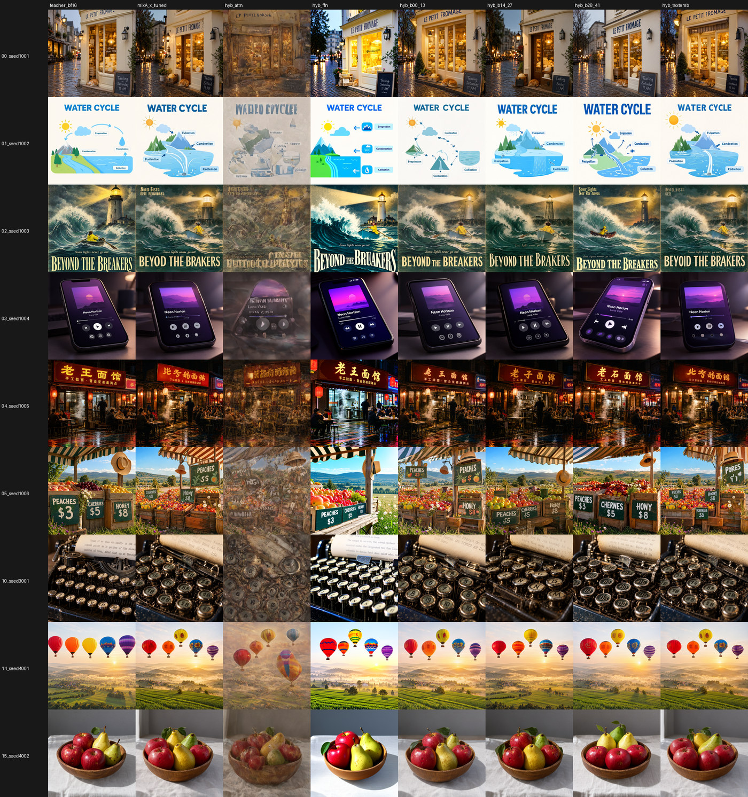
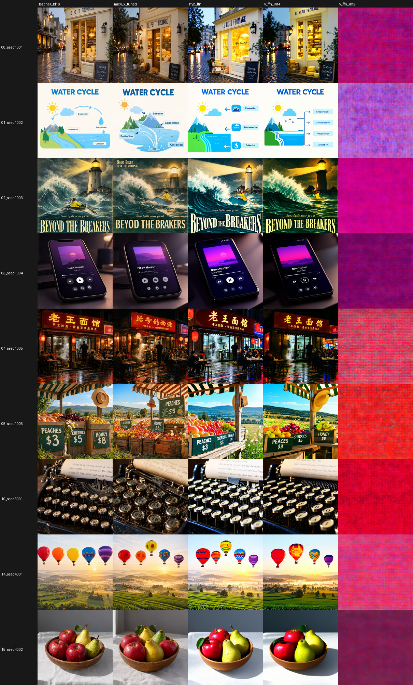
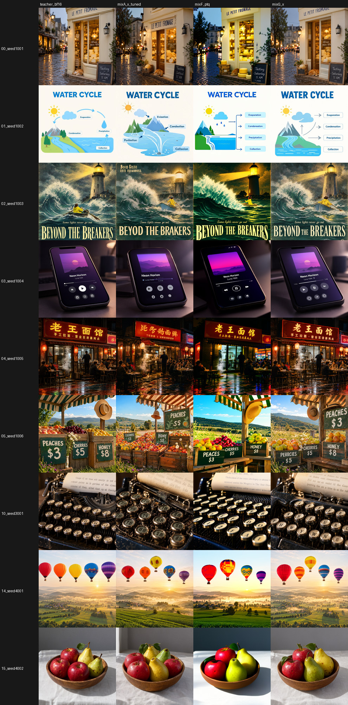
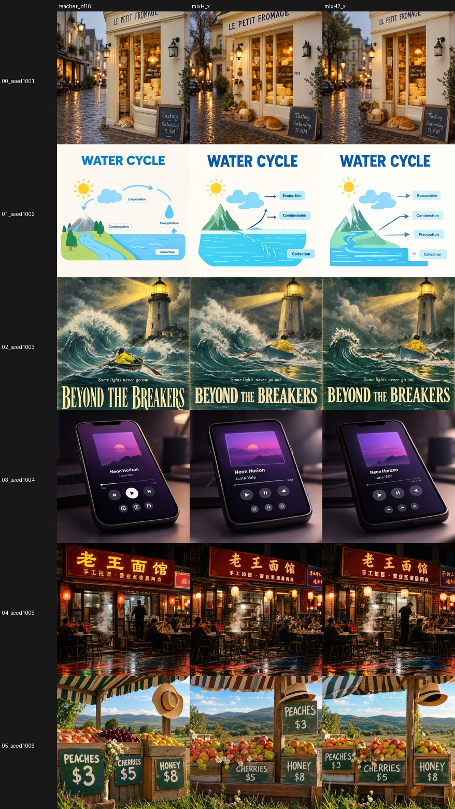

# LowBitMoss

Low-bit (binary / 2 / 3 / 4-bit mixed) quantization of the **MOSS-Image SFT** diffusion transformer with **block-wise distillation QAT**:
training and evaluation code, the file format, and a ComfyUI loader node.

**Status: research in progress.** The code works end to end. The smallest models whose images a Claude judge instance still rates close to the bf16 teacher
(10.2 GB) are a 1.95 GB model (`mixH2_x`, 1.85 GB with fp8 LoRA factors) and a 1.72 GB variant (`mixH2_xm_f8`, with a small colour drift); a 1.74 GB model with
1-bit attention in the middle blocks is not acceptable. This is not a finished or released quantization, no model files are included, and the numbers below come
from one machine, 24 evaluation prompts and one seed per prompt.

All sizes are decimal GB (10^9 bytes). Windows Explorer shows binary GiB (2^30 bytes), which look about 7% smaller (the 1.85 GB model appears as 1.72 in Explorer, the 1.72 GB model as 1.61, the 10.16 GB bf16 teacher as 9.47).

## Results so far

Evaluation: 24 held-out prompts (`prompts/eval_prompts.json`), 768 px, 25 steps, cfg 2.5, `er_sde`, one seed per prompt; teacher CLIP score 36.17. "Judge" is a Claude
model instance that opened every image and scored 0-5 (F faithfulness, T text, C counts/spatial, Q quality, A would-accept); one instance per model, so treat +-0.2
on an average as noise. The per-image side-by-side verdicts and the specific text findings are firmer than the averages. "Text ok / exact" is, of the 6 quoted-text prompts, how many the judge
accepted (A >= 4) and how many came out letter-for-letter exact. Name suffixes: `_x` text embedder quantized, `_tuned` plus one end-to-end tuning round, `xm` modulation layers
rounded to int4, `f8` LoRA factors stored as fp8.

| model | size | CLIP | DINOv2 cos | SSIM | judge F / T / C / Q / A | text ok / exact |
|---|---|---|---|---|---|---|
| bf16 teacher | 10.2 GB | 36.17 | 1 | 1 | | |
| naive int4 rounding | 3.1 GB | | | | good images, no judge run | |
| uniform ternary / binary (block-wise QAT, no LoRA) | 1.9 / 1.3 GB | 22.5 (ternary) | 0.12 | 0.435 | unusable, no structure | |
| mixA: bin/int2/int4 by sensitivity + rank-32 LoRA | 2.07 GB | 35.66 | 0.81 | 0.583 | 3.50 / 1.40 / 2.14 / 3.81 / 2.90 | 0/6, - |
| mixF_ptq: mixA attention + FFN int4 by plain rounding | 2.42 GB | 36.07 | 0.80 | 0.438 | 4.29 / 4.36 / 2.71 / 4.29 / 4.02 | 5/6, 3/6 |
| mixG_x: low-bit attention + QAT int3 FFN | 2.14 GB | 36.31 | 0.884 | 0.656 | 4.50 / 4.43 / 3.36 / 4.44 / 4.29 | 5/6, 4/6 |
| **mixG_tuned**: mixG_x + end-to-end tuning | **2.14 GB** | 36.35 | 0.901 | 0.666 | 4.48 / **4.79** / 3.64 / 4.23 / 4.21 | 5/6, **6/6** |
| mixH_tuned: QAT int2 FFN in blocks 6-35, rank-64 LoRA, + tuning | 1.95 GB | 36.11 | 0.860 | 0.615 | 4.31 / 4.00 / 3.29 / 4.29 / 4.10 | 4/6, 3/6 |
| **mixH2_x**: the mixH allocation with ~2x calibration data, no tuning | **1.95 GB** | 36.33 | 0.877 | 0.640 | 4.33 / 4.00 / 3.43 / 4.27 / 4.21 | 4/6, 3/6 |
| mixH2_tuned: mixH2_x + end-to-end tuning | 1.95 GB | 36.26 | 0.864 | 0.622 | 4.29 / 3.93 / 3.36 / 4.29 / 4.17 | 4/6, 2/6 |
| mixH2_x_f8: mixH2_x with fp8 LoRA | 1.85 GB | 36.39 | 0.877 | 0.641 | pending (not judged yet) | pending |
| **mixH2_xm_f8**: mixH2_x + int4 modulation layers + fp8 LoRA | **1.72 GB** | 36.61 | 0.851 | 0.594 | 4.25 / 4.00 / 3.79 / 4.21 / 4.15 | 5/6, 4/6 |
| mixI_tuned: mixH + 1-bit qkv/o in blocks 6-35, 1-bit ffn_down in blocks 12-29 | 1.74 GB | 35.93 | 0.788 | 0.554 | 3.54 / 1.14 / 2.07 / 3.54 / 3.15 | 0/6, 0/6 |

Numbers come from the project's `NOTES.md`, the judge reports `eval/judge_*.md` and the per-model `eval/<model>/metrics.json` (work-directory files, not part of this repository).
Not in the table: `mixH_x` (1.95 GB, before tuning; CLIP 36.64, DINOv2 0.867, SSIM 0.627; not judged), `mixH2_xm` (int4 modulation without fp8 LoRA; CLIP 36.68, DINOv2 0.856, SSIM 0.594; not judged),
`mixI_x` (CLIP 35.60, DINOv2 0.745, SSIM 0.541).

Per-image verdicts of the judge: mixG_x vs mixF_ptq 15 better / 9 same / 0 worse; mixH2_x vs mixH_tuned 9 / 13 / 2 and vs mixG_tuned 4 / 17 / 3; mixH2_tuned vs mixH2_x 8 / 12 / 4;
mixH2_xm_f8 vs mixH2_x 4 / 15 / 5; mixI_tuned vs mixH_tuned 0 / 4 / 20.

What to pick, by criterion: exact text and counts: `mixG_tuned` (2.14 GB). General-purpose images at the smallest size that is clearly acceptable: `mixH2_x` (1.95 GB; 1.85 GB with fp8 LoRA).
Smallest: `mixH2_xm_f8` (1.72 GB), at the price of a slight cool, lower-contrast drift (below). Remaining weakness of all the 1.95 GB and 1.72 GB models: small text on busy graphics
(infographic labels, a price digit, secondary signs); large and medium text is intact.

### What the results say

* **Text and counting live in the FFN, and the output-MSE sensitivity map did not see it.** The first coherent model (mixA) matched the teacher on CLIP score (98.6%) and had a good output-error
  proxy, yet all 6 text prompts and both counting prompts failed. Restoring the FFN to bf16 fixed them; restoring the attention made the images *worse* because the FFN, LoRA and scales had co-adapted to the
  quantized attention. The text-held-out MSE proxy (`e2e_tune.py --holdout_text`) did not track text quality either. Judge by images, not by output MSE or CLIP score.
* **Training lets the FFN go below 4 bits; plain rounding does not.** Plain rounding: FFN int4 is clean (mixF_ptq), uniform int3 degrades (colour cast, "WAER CYCLE"), int2 collapses to noise. Block-wise QAT at 3 bits beats
  plain 4-bit rounding (mixG_x: smaller, 15 better / 9 same / 0 worse than mixF_ptq), and QAT at 2 bits with a rank-64 LoRA keeps the text (mixH, 1.95 GB).
* **More calibration data, not more bits, closed the gap at 1.95 GB.** The mixH allocation with ~2x the block-wise training samples (3000 instead of 1536; mixH2_x) reaches would-accept 4.21 = mixG_tuned's 4.21
  at 0.19 GB less (mixH_tuned: 4.10). An extra end-to-end tuning round on top (mixH2_tuned) did not help (4.17; letter-exact text 3/6 -> 2/6).
* **1-bit attention in the middle blocks is past the cliff.** mixI (1.74 GB: qkv/o at 1 bit in blocks 6-35 plus ffn_down at 1 bit in blocks 12-29) is not acceptable even with rank-64 LoRA and end-to-end tuning:
  0/6 text prompts, counts 2.07, 20 of 24 images worse than mixH_tuned. Natural scenes and watercolour stay fine; structured objects, text, counts and anatomy drift.
* **Why CFG may matter (hypothesis).** The Bonsai-Image base (FLUX.2 Klein 4B) is step-distilled (4 steps, cfg 1), MOSS-Image SFT needs 25 steps at cfg 2.5. We measured an error amplification of about 2.4x in the CFG-combined
  velocity. That is a measurement, not a tested explanation of why the same bit-widths do not transfer.
* **Where the bytes of mixH2_x go** (`scripts/size_report.py`): block codes 1420 MB (72.8%), LoRA 204 MB (10.4%), `shared_block_modulation` + `video_head_modulation` + `time_embedding.2` in bf16 170 MB (about 8.7%),
  text-embedder codes 75 MB (3.9%), group scales 74 MB (3.8%).
* **Cheap savings.** fp8 LoRA factors (`compact_lora.py`) save 102 MB with a negligible measured effect: the weight error against the teacher changes by <= 2e-5, and mixH2_x -> mixH2_x_f8 moves CLIP 36.33 -> 36.39,
  DINOv2 0.877 -> 0.877, latent cosine 0.720 -> 0.720. Rounding the modulation layers to int4 saved ~125 MB but cost more fidelity than predicted: DINOv2 0.877 -> 0.856, SSIM 0.640 -> 0.594, latent cosine 0.720 -> 0.659
  (mixH2_xm). The judge still accepts mixH2_xm_f8 (21 of 24 images A >= 4, 5/6 text prompts; within noise of mixH2_x) but measured a small consistent drift: about 0.025 cooler (R-B) and about 8% less luminance
  contrast than the teacher, twice the loss of mixH2_x.

Details and the ablations: [docs/METHOD.md](docs/METHOD.md).

| ablation (restore groups to bf16) | FFN precision study | mixG vs predecessors | text rows: mixH_x vs mixH2_x |
|---|---|---|---|
| [](docs/images/sheet_ablation.jpg) | [](docs/images/sheet_ffn_study.jpg) | [](docs/images/sheet_mixG.jpg) | [](docs/images/sheet_mixH2.jpg) |

Columns of the sheets: ablation and FFN study, see METHOD.md; mixG: teacher, tuned mixA, mixF_ptq, mixG_x (9 critical prompts: 6 with text, typewriter keys, 2 with counts); mixH2: teacher, mixH_x (1536 samples), mixH2_x
(3000 samples), the six text prompts.

### Aesthetic score (HPSv3)

[HPSv3](https://huggingface.co/MizzenAI/HPSv3) (MizzenAI, MIT) is a human-preference reward model built on Qwen2-VL-7B-Instruct. `scripts/hps3_score.py` scores the 24 evaluation images of a model against their
prompts (mu = raw score, higher is preferred; images are resized to HPSv3's fixed pixel budget) with a small re-implementation of the model's inference in `transformers`, and writes `eval/hps3_summary.json` and `.md`.
"diff to teacher" is the mean of the per-prompt differences (model minus bf16 teacher), with the paired SE and the number of prompts on which the model beats the teacher.

| model | size | mean mu [bootstrap 95%] | diff to teacher +- SE (wins/24) |
|---|---|---|---|
| bf16 teacher | 10.16 GB | 12.38 [11.76, 13.01] | |
| mixG_tuned | 2.14 GB | 12.14 [11.36, 12.87] | -0.24 +- 0.29 (9/24) |
| mixG_x | 2.14 GB | 12.09 [11.39, 12.74] | -0.30 +- 0.19 (7/24) |
| mixH2_x_f8 | 1.85 GB | 11.99 [11.36, 12.59] | -0.40 +- 0.18 (5/24) |
| mixH2_x | 1.95 GB | 11.92 [11.32, 12.49] | -0.47 +- 0.19 (5/24) |
| mixH2_tuned | 1.95 GB | 11.90 [11.21, 12.53] | -0.49 +- 0.23 (8/24) |
| mixH_x | 1.95 GB | 11.88 [11.19, 12.53] | -0.50 +- 0.22 (8/24) |
| mixH_tuned | 1.95 GB | 11.70 [10.87, 12.45] | -0.69 +- 0.30 (7/24) |
| mixA_x_tuned (mixA, text embedder quantized, + tuning) | 1.67 GB | 11.61 [10.91, 12.31] | -0.77 +- 0.28 (7/24) |
| mixH2_xm | 1.83 GB | 11.49 [10.83, 12.11] | -0.90 +- 0.22 (5/24) |
| mixH2_xm_f8 | 1.72 GB | 11.44 [10.76, 12.09] | -0.94 +- 0.20 (5/24) |
| mixF_ptq | 2.42 GB | 10.86 [10.16, 11.59] | -1.53 +- 0.23 (4/24) |
| mixI_tuned | 1.74 GB | 10.65 [9.94, 11.33] | -1.73 +- 0.31 (1/24) |
| mixI_x | 1.74 GB | 9.66 [8.97, 10.27] | -2.73 +- 0.29 (1/24) |
| tern_v1 (uniform ternary, no LoRA) | 1.92 GB | -8.96 [-9.44, -8.39] | -21.35 +- 0.47 (0/24) |

* **What it shows.** mixG_tuned, mixG_x, mixH2_x_f8, mixH2_x, mixH2_tuned, mixH_x and mixH_tuned (mu 11.70 to 12.14) cannot be separated from each other; the 1.85 GB mixH2_x_f8 is 0.40 mu below the teacher.
  The plain-rounding mixF_ptq (2.42 GB) is below all the mixG, mixH and mixH2 models, including the smaller ones, and mixI and tern_v1 confirm that 1-bit attention and uniform ternary are not acceptable.
* **The int4 modulation layers cost fidelity.** mixH2_x_f8 -> mixH2_xm_f8 (and mixH2_x -> mixH2_xm) lowers the difference to the teacher from -0.40 to -0.94 (-0.47 to -0.90). A step of about 0.5 mu is at the edge of
  the noise level (below), but it points the same way as DINOv2/SSIM/latent cosine and the judge's report of a small cool, low-contrast drift.
* **Noise.** 24 prompts and ONE seed per prompt: seed-to-seed variation of a model is not measured at all, and the intervals only reflect which 24 prompts were drawn. The paired SE against the teacher is 0.2-0.3, so
  differences below about 0.5 mu cannot be told apart from prompt-sampling noise (the summary file computes 0.46 mu as twice the median paired SE, 0.23, between candidate models).
* **The scorer is validated only by plausibility checks.** The upstream repository ships no reference score values to compare with, and the upstream requirements pin `transformers` 4.45.2 while this re-implementation ran on
  5.14.1, so its absolute mu values were never checked against the reference implementation; only the ranking inside one table is meaningful. `scripts/hps3_checks.py` runs the plausibility checks (the same image twice,
  wrong prompt, blurred / grey / noise images, plain sequential position ids against transformers' 3D mrope ids).
  In the original run the repeated score was identical, wrong prompts and degraded images scored lower, and the 3D-mrope variant gave different (not identical) scores, so the position ids matter; the sequential ids of the reference code are used.

Setup. The scripts download nothing: put the 16.6 GB checkpoint, the small Qwen2-VL-7B-Instruct config/tokenizer files (no weights) and a clone of the upstream source (its prompt text and two example images are read from it)
under `$LOWBITMOSS_AUX` (default `$LOWBITMOSS_HOME/models_aux`; set the variable to keep the 16.6 GB on another disk):

```python
from huggingface_hub import hf_hub_download
AUX = "models_aux"  # your $LOWBITMOSS_AUX
hf_hub_download("MizzenAI/HPSv3", "HPSv3.safetensors", local_dir=f"{AUX}/HPSv3")
for name in ["chat_template.json", "config.json", "generation_config.json", "merges.txt",
             "preprocessor_config.json", "tokenizer.json", "tokenizer_config.json", "vocab.json"]:
    hf_hub_download("Qwen/Qwen2-VL-7B-Instruct", name, local_dir=f"{AUX}/qwen2vl_proc")
```

and `git clone https://github.com/MizzenAI/HPSv3.git "$LOWBITMOSS_AUX/hpsv3_src"`. Then `$PY -I hps3_score.py --tags teacher_bf16,mixG_x,mixG_tuned` (GPU; scores every tag whose 24 images are in `eval/<tag>/`,
caches per image in `eval/<tag>/hps3.json`; `--examples` also scores the two upstream example images; `COMFYUI_DIR` is read for the size of the teacher file).
The 16.6 GB checkpoint (15.45 GiB) leaves no headroom for activations on a 16 GB card, so the model runs with `--gpu_gib 11` (default): about 11 GiB on the GPU, the remaining decoder layers in pinned CPU RAM, streamed in by accelerate.

### Category winners

`scripts/category_winners.py` merges `eval/<model>/metrics.json` (CLIP, DINOv2, SSIM, latent cosine against the teacher), `eval/hps3_summary.json` and the judge scores into `eval/category_winners.md`
(CPU only, standard library). The judge scores are a table typed into the script from the judge reports (a Claude model instance per model, +-0.2 noise per average); the reports themselves are not part of this repository.
It covers the 12 models of the reported runs; edit `TAGS` and the judge table for your own. `mixH2_x_f8` was not judged separately: its row shows the scores of `mixH2_x`, whose metrics it matches within fp8 rounding of the LoRA factors.

| category | winner | tied with |
|---|---|---|
| best overall (judge would-accept) | mixG_x (A 4.29) | mixG_tuned, mixH_tuned, mixH2_x(_f8), mixH2_tuned, mixH2_xm_f8 (A 4.10-4.21) |
| best text rendering | mixG_tuned (T 4.79, 6/6 letter-exact) | none (next best T 4.43) |
| best aesthetics (HPSv3) | mixG_tuned (mu 12.14, teacher 12.38) | mixG_x, mixH_x, mixH_tuned, mixH2_x, mixH2_x_f8, mixH2_tuned |
| closest to the teacher | mixG_tuned (DINOv2 0.901, SSIM 0.666, latent cos 0.750) | none by DINOv2 (next 0.884) |
| smallest acceptable (A >= 4.0) | mixH2_xm_f8 (1.72 GB, A 4.15, HPSv3 -0.94 vs teacher) | |
| best size/quality value (A >= 4.0 and HPSv3 within 0.5 of the teacher) | mixH2_x_f8 (1.85 GB, HPSv3 -0.40) | |

Read the table with the caveats above: 24 prompts, one seed each, one judge instance per model, HPSv3 paired SE 0.2-0.3. "Best overall" and "best aesthetics" are ties inside the noise, so their nominal winners are not a ranking.
The categories where the models really differ are exact text and closeness to the teacher (`mixG_tuned`) and size (`mixH2_x_f8` at 1.85 GB, `mixH2_xm_f8` at 1.72 GB, which pays for it with the int4 modulation layers that HPSv3 also marks down).

## Pipeline

Run from `scripts/` with the ComfyUI venv Python (`$PY`, always `-I`). `scripts/example_pipeline.sh` runs all of this for the mixG recipe and lists the mixH2 commands as an optional last step.
Work files go to `$LOWBITMOSS_HOME/{data,out,eval,logs}` (default: the repository root, git-ignored); the HPSv3 files to `$LOWBITMOSS_AUX` (default `$LOWBITMOSS_HOME/models_aux`).

1. Capture teacher trajectories as calibration data (160 prompts + 80 text-rich prompts, 512 px):
   `$PY -I capture.py --res 512 --n 160 --keep 8` and
   `$PY -I capture.py --res 512 --n 80 --keep 8 --prompts ../prompts/calib_text_prompts.json --prefix p-t`
2. Teacher outputs for every captured sample (the reference of the error proxy): `$PY -I teacher_targets.py`
3. Per-layer sensitivity: `$PY -I sensitivity.py --kind tern` (and `$PY -I sensitivity_extra.py --kinds int4,int2` for the non-block linears)
4. Bit allocation (the shipped `scripts/alloc_mix*.json` are the ones used for the results; this re-derives them from your sensitivity map): `$PY -I make_alloc.py`
5. Block-wise distillation QAT with LoRA:
   `$PY -I train_blocks.py --kind @alloc_mixG.json --loss std --lora_rank 32 --n_samples 1536 --holdout 48 --epochs 2 --lr_w 1e-4 --lr_s 2e-3 --out ../out/mixG_lora32.safetensors --log ../logs/mixG_lora32.json`
   (the 1.95 GB recipe: `--kind @alloc_mixH.json --lora_rank 32 --lora_rank_low 64 --n_samples 3000`)
6. Quantize the text embedder (no training): `$PY -I quantize_extras.py --inp ../out/mixG_lora32.safetensors --out ../out/mixG_x.safetensors`
   (`--mod --time` also rounds the modulation layers and `time_embedding.2` to int4)
7. Generate evaluation images (teacher once, then the student) and compare:
   `$PY -I gen_inproc.py --bf16 --unet <ComfyUI>/models/diffusion_models/moss_image_sft_bf16.safetensors --tag teacher_bf16`,
   `$PY -I gen_inproc.py --unet ../out/mixG_x.safetensors --tag mixG_x`,
   `$PY -I metrics.py --teacher ../eval/teacher_bf16 --student ../eval/mixG_x --prompts eval`
8. End-to-end tuning of group scales and LoRA against the teacher outputs:
   `$PY -I e2e_tune.py --inp ../out/mixG_x.safetensors --out ../out/mixG_tuned.safetensors --epochs 0.7 --mb 2 --lr 2e-4 --lora_lr 4e-5 --tw 2 --cfg_w 1`
9. Contact sheet: `$PY -I sheet.py --dirs ../eval/teacher_bf16 ../eval/mixG_x --thumb 256 --rows 6 --out ../eval/sheet.png`
10. Check the ComfyUI loader path against the training-side proxy: `$PY -I test_loader_proxy.py ../out/mixG_tuned.safetensors 24`
11. Optional: store the LoRA factors as fp8 (-102 MB on mixH2_x) and see where the bytes go:
    `$PY -I compact_lora.py --inp ../out/mixH2_x.safetensors --out ../out/mixH2_x_fp8lora.safetensors`, `$PY -I size_report.py ../out/mixH2_x_fp8lora.safetensors`
    (`e2e_tune.py` reads compact files but writes plain bf16 LoRA again, so run `compact_lora.py` last; compact files need the current loader node and a ComfyUI restart)
12. Optional: HPSv3 aesthetic score and the category table (setup under "Aesthetic score (HPSv3)"): `$PY -I hps3_score.py --tags teacher_bf16,mixG_x,mixG_tuned` (GPU, 16.6 GB checkpoint),
    `$PY -I category_winners.py` (CPU; reads the 12 models of the reported runs)

Ablation helper (`make_hybrid.py`): restore selected linears of a file to bf16 (`--restore ffn`, `attn`, `ffn:LO-HI`, `attn:LO-HI`, `blocks:LO-HI`) or requantize them by plain rounding (`--ptq int4`), to find which layers carry which quality.
Server-based generation (`gen_eval.py`, same workflow through a running ComfyUI) and a header dump (`inventory.py <file>`) are also included.

`gen_inproc.py` is a supervisor around a worker process. On Windows, when VRAM runs short (desktop, another job, a long-running process) the driver pages VRAM to system RAM and sampling becomes 15-40x slower and does not recover.
The worker therefore keeps 2.5 GB of VRAM free, gives up on any image that takes longer than `--watchdog` (150 s; a normal image takes about 30 s), and is restarted on purpose every `--recycle` (5) images; finished images are skipped.

## Hardware used

NVIDIA RTX 4080 (16 GB), 128 GB system RAM, Windows 11. Block-wise QAT of all 42 blocks took about 72 minutes, end-to-end tuning about an hour (700 steps),
a 24-image evaluation (about 30 s per image) roughly 12 minutes. Data and checkpoints need about 15 GB of disk.

## Requirements

* A ComfyUI checkout at v0.42.5 (developed against it; the CPU tests also pass on v0.43.0) with its venv: torch 2.12.1+cu130 and the packages ComfyUI needs
  (including `comfy-kitchen`, `safetensors`, `numpy`, `pillow`). Nothing is pip-installed by this repository.
* `transformers` and `scipy` for `metrics.py` (CLIP and DINOv2 are downloaded from the Hugging Face hub on first use).
* Only for `hps3_score.py`: `accelerate` and the HPSv3 files described under "Aesthetic score (HPSv3)" (16.6 GB checkpoint). `category_winners.py` needs only the Python standard library.
* The MOSS-Image files in that ComfyUI: `models/diffusion_models/moss_image_sft_bf16.safetensors` (teacher), `models/text_encoders/qwen3.5_9b_bf16.safetensors`, `models/vae/flux2-vae.safetensors`.
* Environment: `COMFYUI_DIR` (required; the folder containing `main.py`) and optionally `LOWBITMOSS_HOME` (work directory, default the repository root).
  Under Git Bash on Windows give paths in the `C:/...` form.

Scripts never modify ComfyUI; `-I` (isolated mode) is used everywhere, so each script adds its own directory to `sys.path`.

## Using a quantized model in ComfyUI

The stock `UNETLoader` cannot read these files. Copy (or symlink) `custom_nodes/ComfyUI-MOSS-LowBit` into `ComfyUI/custom_nodes/`, put the `.safetensors` file in
`ComfyUI/models/diffusion_models/`, restart ComfyUI and use the node **MOSS LowBit UNET Loader** (category `model/loaders`) in place of the `UNETLoader` of the official
MOSS-Image template (25 steps, cfg 2.5, `er_sde`, `simple`, text encoder type `moss_image`, `flux2-vae`). The loader keeps the packed codes resident and dequantizes each
linear to bf16 inside the call. The node uses ComfyUI's `QuantizedTensor` layout API and may need updating when that API changes.

## File format (moss_lowbit_v1)

One `.safetensors` file with the original tensor names. Every quantized linear `X` has `X.weight` (uint8, packed codes), `X.weight_scale` (fp16, one scale per 128 inputs),
`X.weight_kind` (1 bin, 2 tern, 3 int2, 4 int4, 5 tern5, 6 int3) and optionally a low-rank correction `X.lora_a` / `X.lora_b` (`W = Q + B A`), stored as bf16 or compactly as float8_e4m3fn with a scalar fp16
`X.lora_a_scale` / `X.lora_b_scale`. Everything else stays bf16. Kinds can be mixed per layer; mixG_x is 2.14 GB, mixH2_x 1.95 GB. Full specification: [SPEC.md](SPEC.md).

## Repository layout

```
scripts/            training, evaluation and test code (_paths.py reads LOWBITMOSS_HOME / COMFYUI_DIR), alloc_mix*.json, example_pipeline.sh
scripts/orig/       the loader and format helpers from before the fp8 LoRA, kept only as the bit-exactness reference of test_lora_fp8.py
custom_nodes/       ComfyUI-MOSS-LowBit loader node
prompts/            calibration prompts (192 + 80 text-rich) and the 24 evaluation prompts
docs/               METHOD.md (method and findings), TESTING.md, images/ (contact sheets)
SPEC.md             file format and loader requirements
```

Tests: see [docs/TESTING.md](docs/TESTING.md) (four CPU-only scripts pass; the rest need a GPU or the teacher).

## Known limitations

* Not a finished quantization: counts of larger numbers of objects, infographic logic and small text on busy graphics still fail in the 1.95 GB and 1.72 GB models; the evaluation is small (24 prompts, one seed each, one Claude judge instance per model).
* The 1.72 GB variant (int4 modulation layers) shows a small colour and contrast drift; `mixH2_x_f8` (fp8 LoRA only) has not been judged yet.
* No fused low-bit kernels: the loader dequantizes per linear call, so the gain is memory, not speed (speed was not benchmarked here).
* The attention allocations from the sensitivity map (mostly 1-2 bits) and a 2-bit FFN trained with QAT and a rank-64 LoRA hold up; forcing 1-bit qkv/o into every middle block (mixI) does not, and neither does plain-rounding below 4 bits in the FFN.
* Calibration at 512 px, evaluation at 768 px; other resolutions are not evaluated.
* The HPSv3 numbers come from a re-implementation validated only by plausibility checks (see "Aesthetic score (HPSv3)"). In this repository form `hps3_score.py` was syntax-checked and its summary code re-run on the saved per-image scores; loading the model and scoring images were not re-run.
* Developed and run on Windows; shell and path handling use `os.path.join` and should work on Linux, but that has not been tried. `example_pipeline.sh` was assembled from the run scripts and only syntax-checked.
* Depends on ComfyUI internals (`comfy.quant_ops`, `comfy.ldm.moss_image`), developed against v0.42.5.

## Credits

* The **file format** follows the PrismML Bonsai-Image whitepaper (group-wise low-bit weights with fp16 group scales, small sensitive layers in 16 bit). It is cited as a format
  reference only: the whitepaper does not disclose its training recipe, so this project's block-wise distillation QAT is not a reproduction of Bonsai.
* [ComfyUI](https://github.com/Comfy-Org/ComfyUI) (model code, loaders, quantized-tensor layout API) and **MOSS-Image** by OpenMOSS-Team (the model being quantized; Qwen3.5 text encoder and FLUX.2 VAE are used as shipped for it).
* Metrics use OpenAI CLIP ViT-B/16 and Meta DINOv2-small through `transformers`. The aesthetic score uses the [HPSv3](https://github.com/MizzenAI/HPSv3) reward model (MizzenAI, MIT) on Qwen2-VL-7B-Instruct; the checkpoint and the Qwen files are downloaded by the user and not included here.
* This work was done with assistance from Claude Code (Anthropic).

## License

**NO LICENSE CHOSEN YET.** The loader node builds on ComfyUI internals (GPL-3.0), so pick a compatible license before making the repository public.
