# Low-bit MOSS-Image: block-wise QAT for a 5B transformer and its 4-step distilled variant

**Author:** Ray Mutantsparrow
**Date / version:** 2026-10-30, version 4. It extends version 3 of 2026-10-29 (kept unchanged as `whitepaper_v3.md` / `whitepaper_v3.html` / `whitepaper_v3.pdf`) with a new chapter, Section 9, on shrinking the Qwen3.5-9B text encoder and the VAE, and an appendix on the release candidates; version 3 extended version 2 of 2026-10-28 (kept unchanged as `whitepaper.md` / `whitepaper.html` / `whitepaper.pdf`) with Section 8 on quantizing a step-distilled (4-step, CFG 1) teacher, and version 2 itself superseded the draft of 2026-10-27, which is kept unchanged as `whitepaper_v1.md` / `whitepaper_v1.html`.
**Code and data:** Code: https://github.com/MutantSparrow/LowBitMoss; models and research data: https://huggingface.co/MutantSparrow/LowBitMoss. This paper and the released project artifacts are licensed under Apache 2.0, with upstream attribution notices preserved.
**Units:** all sizes in this report are decimal GB (10^9 bytes). Windows Explorer shows binary GiB (2^30 bytes), which look about 7% smaller (the 1.85 GB model appears as 1.72 in Explorer, the 1.72 GB model as 1.61, the 10.16 GB bf16 teacher as 9.47).

**A note from the author.** I'm neither an engineer nor a researcher, but a self-taught dilettante. I work as a Creative Director in the games industry, where my day job sometimes overlaps with my interest in machine learning. I set out to do some informal, hands-on research into running diffusion transformer (DiT) models on consumer hardware, and to share what I learn with the open-source community in ways I hope are useful.

A big thank-you to the OpenMOSS team (https://huggingface.co/OpenMOSS-Team) and the ComfyUI team (https://huggingface.co/Comfy-Org) for the open-weight models and open-source tools that made these experiments possible. Thanks, guys. You rock!

*AI tools assisted the experiments, code and drafting of this report. The visual judge used in the evaluation is a Claude model instance (Section 5.3).*

> **Status as of 2026-10-30, review revision.** The working low-bit DiTs occupy 1.72-2.93 GB of model files. The small distilled package occupies 7.18 GB of model files versus 29.81 GB originally; it has automatic scores and an informal web-interface test, but no complete-package judge pass. The proposed 7.97 GB quality package has not been evaluated as that exact combination: A 4.27 and 23/24 accepted images belong to mixG_tuned_t with the bf16 encoder and full VAE (22.58 GB of model files). Table I7 identifies every tested configuration. Local HPSv3-based scores have not been validated for numerical parity with official HPSv3; intervals are exploratory, and no equivalence claims are made. The distilled teacher is harder to quantize than the 25-step teacher in our setting. No peak-memory or wall-clock speed result is claimed.

**Changes since version 1.** Added: the models after mixG_x (mixG_tuned, mixH, mixI, mixH2, mixH2_tuned, the fp8-LoRA and int4-modulation savings) with six new judge reports; the compact int3, base-3 ternary and fp8-LoRA formats with their measurements; the findings of Section 7 (data against bits, the failure of the combined 1-bit attention-and-FFN allocation, tuning rounds as trade-offs); the HPSv3 aesthetic score and a table of category winners with their ties (Sections 6.17, 6.18); operational lessons; updated limitations, reproducibility, pending work and traceability notes. Corrected: the CFG error amplification is 2.2-2.4 (version 1 said 2.3-2.4), the LoRA size range, and the account of why the mixC evaluation covers 16 images.

**Changes since version 2.** Added: Section 8 (the step-distilled teacher): the probe of the distilled bf16 model with its judge report, two findings about the 4-step LoRA itself (what the bf16 merge keeps, and a merged teacher checkpoint that reproduces the LoRA-patched images), the loader bug that made the first quantization attempt a false negative, the mixG recipe re-run against the merged teacher (tmixG_x), the negative results (a teacher-forced tuning round, the more aggressive H allocations, a trajectory-level latent-MSE loss), a table of the distilled ladder against the 25-step ladder with the evaluation-count arithmetic of the speed argument, and the open items; five figures (20-24) and Tables 19-27; four new judge reports and the HPSv3 and metrics files of the new evaluation runs; new rows in Appendices C, F, G and H. Changed: the loader now refuses ComfyUI LoRA patches on quantized weights (Section 3.3); Section 7.6 now reports the test of its step-distillation hypothesis; Section 7.9 has three new lessons; Sections 8-10 of version 2 (limitations, reproducibility, pending work) became Sections 9-11 in version 3 (they are Sections 10-12 in version 4) and their text was updated for the distilled results. Nothing in the 25-step results of Sections 1-7 was re-measured or changed.

**Changes since version 3.** Added: Section 9 (the text encoder and the VAE): the anatomy of the bf16 encoder, the baselines with the quantized encoders of the ComfyUI ecosystem (one of which cannot be loaded, and a GGUF route that was not pursued), a pruned post-training-quantized encoder of our own with a sweep of six files and the finding that the linear-attention layers are the sensitive part, a method lesson on reference-distance metrics, the ghost artifact and its blind count (two reports; our first reading withdrawn), a judge report for our encoder, the conditioning error of every encoder and the layout of ComfyUI's GPTQ file that explain the order, the recommended pruned GPTQ encoder with its check on the 25-step DiTs, the FLUX.2 small decoder, the package arithmetic and how to run it, and the open items; five figures (25-29) and Tables 28-42; a judge report and two blind-count reports as new evaluation files; Appendix I (release candidates); new rows in Appendices A, C, F and H; three new lessons in Section 7.9; an operational note on an unexpected reboot (Section 11). Changed: the statements that the encoder is untouched or in progress (Sections 3.2, 8.7, 10 and 12); Sections 9-11 of version 3 are now Sections 10-12. Nothing in the results of Sections 1-8 was re-measured or changed.

**Added to version 4 after its first rebuild (2026-10-30).** Section 9.12 (three judge reports: the folded model mixG_tuned_t against the distilled teacher, and the two 25-step models with the pruned GPTQ encoder; and the owner's web-interface test of the small pick), Tables 43 and 44, Figure 29 (encoder likeness), Figure 31 (VAE likeness) and, in Appendix I, Figures 32 and 33 (DiT likeness and quality) with Tables I4 to I6 (the values of the four charts of the release folder; the VAE crops are now Figure 30). The statements that mixG_tuned_t was not judged and that nothing had been run from the web interface were replaced (abstract, status box, Sections 5.3, 8.3, 8.7, 9, 10 and 12, Table 27, Appendix I); the encoder recommendation now carries the judge result for the smaller non-distilled models; the best-combination table distinguishes a quality pick and a small pick of the distilled family; Appendix F records what was added and the discrepancies found. The open items of Section 9 are now Section 9.13.

## Abstract

LowBitMoss explores how mixed-precision quantization can bring MOSS-Image SFT diffusion transformers to consumer hardware. We apply block-wise quantization-aware distillation on a single 16 GB GPU to the 5.08B-parameter DiT, combining learnable group scales, student-stream inputs, and low-rank corrections. Released DiT files occupy 1.72-2.93 GB, compared with 10.16 GB for the bf16 teacher. On 24 prompts at 768 px, the 2.14 GB mixG_tuned model achieves model-judge acceptance of 4.21/5 and letter-exact rendering of all six text prompts. The 1.85 GB and 1.72 GB variants broaden the available storage options.

For four-step distilled generation, the 2.93 GB folded-LoRA model reaches model-judge acceptance of 4.27/5, with 23 of 24 images accepted at 1024 px using the bf16 text encoder and full VAE. A 4.93 GB pruned GPTQ text encoder and a 0.11 GB VAE decoder bring the two recommended distilled component sets to 7.18 GB and 7.97 GB of model-file storage, compared with 29.81 GB originally. We document the training, packing, and loader choices and release code, model components, calibration captures, and evaluation artifacts under Apache 2.0, giving the community a practical starting point for further experiments with low-bit DiT models.

**Table 1. The size and quality ladder (judged models; 24 prompts, 768 px, one seed each).**

| model | file (GB) | smaller than teacher | judged A (would accept, 0-5) | judged T (text) | text prompts accepted / letter-exact (of 6) | HPSv3 minus teacher (+- paired SE) | verdict |
|---|---|---|---|---|---|---|---|
| bf16 teacher | 10.16 | 1.0x | | | 6 / 6 (as stated in the reports) | (12.38) | reference |
| mixF_ptq (mixA attention, FFN int4 by plain rounding) | 2.42 | 4.2x | 4.02 | 4.36 | 5 / 3 | -1.53 +- 0.23 | acceptable, largest |
| mixG_x (FFN int3 by QAT) | 2.14 | 4.7x | 4.29 | 4.43 | 5 / 4 | -0.30 +- 0.19 | acceptable |
| **mixG_tuned** (mixG_x + end-to-end round) | **2.14** | 4.7x | 4.21 | **4.79** | 5 / **6** | -0.24 +- 0.29 | six text prompts exact; balloons correct; fruit count incorrect |
| mixH_tuned (FFN int2 in blocks 6-35, 1,536 samples) | 1.95 | 5.2x | 4.10 | 4.00 | 4 / 3 | -0.69 +- 0.30 | borderline (18 of 24 images at A of 4 or more), weaker text and counts |
| **mixH2_x** (same, 3,000 samples, no tuning) | **1.95** | 5.2x | 4.21 | 4.00 | 4 / 3 | -0.47 +- 0.19 | smallest judged without the colour drift |
| mixH2_tuned (mixH2_x + end-to-end round) | 1.95 | 5.2x | 4.17 | 3.93 | 4 / 2 | -0.49 +- 0.23 | neither clearly helped nor hurt |
| mixH2_x with fp8 LoRA (mixH2_x_f8) | 1.85 | 5.5x | not judged | not judged | not judged | -0.40 +- 0.18 | metrics equal to mixH2_x |
| **mixH2_xm_f8** (+ int4 modulation layers) | **1.72** | 5.9x | 4.15 | 4.00 | 5 / 4 | -0.94 +- 0.20 | judged acceptable, small colour drift and a measurable fidelity cost |
| mixI_tuned (mixH + 1-bit attention in blocks 6-35 and ffn_down in blocks 12-29) | 1.74 | 5.8x | 3.15 | 1.14 | 0 / 0 | -1.73 +- 0.31 | not acceptable |
| mixA (first mixed model, 1-bit FFN in the middle blocks) | 2.07 | 4.9x | 2.90 | 1.4 | 0 / 0 | -0.77 +- 0.28 (mixA_x_tuned) | fails text and counts |

*Source:* file sizes from the safetensors headers (`paper/_build/size_breakdown.json`); A, T and the text counts from `eval/judge_<model>.md` (means recomputed by `paper/_build/judge_table.py`, which matches the report's own averages); HPSv3 from `eval/hps3_summary.json` (Table 15); the mixH2_x_f8 row also from `eval/mixH2_x_f8/metrics.json` (Table 6). Differences of 0.1-0.2 in A or T, and of about 0.5 in HPSv3, are not clearly resolved by these measurements (Sections 5.3 and 6.17); the reports are separate judge sessions. The ladder of the step-distilled models (4 steps, CFG 1) is Table 27 in Section 8.6; the package with a shrunken text encoder and VAE is Table 42 in Section 9.11.

## 1 Introduction and goal

MOSS-Image SFT is a 5.08B-parameter rectified-flow-style diffusion transformer that reads long scene captions. In bf16 its diffusion transformer alone is 10.16 GB, which is already most of a 16 GB card before the 19.3 GB (bf16) Qwen3.5-9B text encoder and the VAE are counted. The goal set in `SPEC.md` is the smallest quantized version (4-bit, 2-bit, ternary or 1-bit) that still gives images "satisfactorily close" to the teacher. The project was inspired by the PrismML Bonsai-Image 4B whitepaper [1], which publishes a deployment format (group-128 binary or ternary weights with fp16 scales, a few sensitive tensors kept in 16-bit) and benchmark results, but, as far as we could find in the extracted text and in the earlier Bonsai-8B papers (research notes, part 0), no training recipe.

"Satisfactory" turned out to need a definition. We started with the CLIP score and a held-out output-MSE proxy, found that both can look fine on models that cannot spell or count (Section 7), and moved to a rubric that explicitly scores text correctness and counts (Section 5.3). For the size ladder of Table 1 we call a model *generally acceptable* when its judged A is 4.0 or more (within the judge's noise), at least 20 of 24 images have A of 4 or more, and at least 4 of the 6 quoted-text prompts are accepted; *exact* means that all six quoted-text prompts are letter-for-letter correct (and, separately, that the exact-five-balloons prompt is right). These thresholds were set by us after seeing the scores, so they describe the ladder rather than test a prior hypothesis.

**Contributions, stated modestly.**

1. A working block-wise distillation recipe and code for a 5B DiT on one 16 GB GPU (Section 4), including a closed-form data-aware low-rank branch, a sensitivity-driven greedy bit allocator and a short end-to-end tuning stage.
2. An extension of the Bonsai-style on-disk format to six code kinds (binary, ternary, int2, int3, int4, base-3-packed ternary) with optional LoRA factors that the loader folds into the weight, stored in bf16 or compactly as fp8 with a per-tensor scale (Section 3).
3. A set of negative results that we think are useful: uniform ternary/binary fail, plain 2-bit rounding collapses, the combined 1-bit attention-and-ffn_down allocation fails at this training budget, the output-MSE sensitivity map and a text-held-out MSE proxy mislead, CLIP score and DINOv2 similarity are blind to text and count errors, and a second end-to-end tuning round is a trade rather than a gain (Section 7).
4. Three models on the ladder with judged scores: 2.14 GB (mixG_tuned, exact text), 1.95 GB (mixH2_x) and 1.72 GB (mixH2_xm_f8), against the 10.16 GB teacher.
5. (Version 3.) The same recipes run against a 4-step distilled teacher (Section 8): a probe of that teacher, a loader bug that produced a false negative and the method lesson it carries, a 2.14 GB distilled model with a judged acceptance of 4.06, and three negative results (the more aggressive 2-bit-FFN allocation, a teacher-forced tuning round, a trajectory-level latent-MSE loss).
6. (Version 4.) The text encoder and the VAE (Section 9): baselines with the quantized encoders that already exist, a pruned post-training-quantized encoder of our own (4.60 GB, with a similar observed local HPS mean) that turned out to be a negative result, a direct conditioning-error measure and the layout of ComfyUI's GPTQ file that explain why, blind artifact counts that withdrew our first reading of a ghost artifact, and a recommended package of 7.18 GB made of ComfyUI's own GPTQ encoder pruned of its unused tensors (4.93 GB) and the FLUX.2 small decoder (0.11 GB), with a release folder (Appendix I).

**What this is not.** It is not a reproduction of Bonsai (the recipe there is undisclosed). It is not sub-2-bit at acceptable quality: the average over the quantized linears of mixH2_x is 2.52 bits per weight including scales (2.85 with the LoRA branches) and the whole file is 3.07 bits per model parameter. It reports no speed results (the loader dequantizes on the fly in PyTorch and has no fused kernels; Section 8.6 gives only the count of model evaluations per image), no 1024 px results for the 25-step ladder (the distilled models of Section 8 are evaluated at 1024 px and 768 px), and no standard benchmark run (GenEval, DPG-Bench; HPSv3 is used here only as a scorer of our 24 images per model, which is not comparable to the benchmark numbers of [1]). The text-encoder results of Section 9 are at CFG 1 with one distilled DiT and one check with two non-distilled DiTs; the recommended encoder is ComfyUI's own file, pruned, and not a result of our training, and it has judge reports only with the two 25-step DiTs (none with the distilled DiT), and the small decoder has none.

## 2 Background

### 2.1 The Bonsai-Image format

The Bonsai-Image 4B whitepaper [1] (May 2026) releases 1-bit and ternary deployments of FLUX.2 Klein 4B. As stated there:

- Weights of the matmul-heavy linears (Q/K/V, output projections, MLP) are binary {-1,+1} or ternary {-1,0,+1}, with one fp16 scale per group of 128 weights. The matmul-only cost is 1.125 bits/weight (binary) and about 1.71 bits/weight (ternary); averaged over the whole transformer they report about 1.925 and 2.51 bits/weight, i.e. 7.75 GB (fp16) to 0.93 GB and 1.21 GB.
- Fewer than 5% of the transformer parameters stay in 16-bit: the input/output projections, the context and time/guidance embedders, the final norm and the modulation projections. The Qwen3-4B text encoder is HQQ int4 and the VAE stays fp16.
- Inference uses fused low-bit kernels (Gemlite on CUDA, MLX on Apple Silicon) and does not expand the weights back to dense fp16. The reported experiments use four denoising steps at guidance 1.0.
- Across GenEval, HPSv3 and DPG-Bench the source reports average score ratios of 94.4% and 88.4% relative to FLUX.2 Klein 4B for its ternary and 1-bit models. These are reported score ratios, not calibrated percentages of image quality.
- The paper says the approach avoids "a high-precision auxiliary branch" and lists small text, fine detail, high-frequency texture and object counts as the main quality risks. Our own pipeline *does* use a bf16 (or fp8) low-rank branch (Section 3.3), which is a design difference from Bonsai.

### 2.2 Why diffusion is hard to quantize

The Bonsai paper (Section 2.3) argues that diffusion failures are trajectory-dependent and perceptual: errors and activation statistics change along the noise schedule, and a model can stay close on aggregate metrics while desaturating colors, flattening texture, losing detail or degrading typography. Q-Diffusion (arXiv:2302.04304) and SVDQuant (arXiv:2411.05007), both named in [1], are the 4-bit references. The research notes add that text rendering is reported to be the first casualty and to separate variants that look identical on aggregate scores (Ideogram 4.0 PTQ, arXiv:2606.12280, abstract only), that late (low-noise) steps hold the detail error and classifier-free guidance amplifies the cond/uncond mismatch there (DSAQuant, arXiv:2609.04031), and that MSE-based sensitivity can miss semantic-drift layers (MixDQ arXiv:2405.17873, BitsFusion arXiv:2406.04333). Our measurements in Section 7 agree with all three points.

### 2.3 Related work we drew on

All numbers in this subsection are "as reported" by the research notes (`research/low_bit_dit_research.md`), which were produced from summaries of arXiv pages and not from a manual read of every PDF; none was re-verified here.

- *Low-bit diffusion QAT.* TerDiT (2405.14854) trains ternary DiTs from scratch; BitsFusion (2406.04333) reaches 1.99 bits on SD-1.5 with mixed precision and two QAT stages; 1.58-bit FLUX (2412.18653) ternarizes FLUX.1-dev with self-supervision from the model itself; RobuQ (2509.23582) and QVGen (2505.11497) use SVD-initialised low-rank branches trained jointly with the quantized weights; EfficientDM (2310.03270) and QuEST (2402.03666) distill on the full-precision model's own trajectories; BiDM (2412.05926) and BinaryDM (2404.05662) binarize UNets; TreeQ (2512.06353) and DSAQuant (2609.04031) cover DiT/video QAT; PTQ4DiT (2405.16005), Q-DiT (2406.17343), ViDiT-Q (2406.02540) and MixDQ (2405.17873) are weight-activation PTQ methods.
- *Recipes borrowed from the LLM side.* EfficientQAT (2407.11062): block-wise training of all weights and step sizes, then end-to-end training of the quantization parameters only; BRECQ (2102.05426): block-wise reconstruction; BitDistiller (2402.10631) and ParetoQ (2502.02631): FP-initialised QAT with teacher-generated data; LoftQ (2310.08659), CLoQ (2501.18475), ApiQ (2402.05147) and LQ-LoRA (2311.12023): quantization-aware low-rank initialisation, of which CLoQ's closed-form data-aware version is closest to ours.
- *Mixed precision.* HAWQ-V3 (2011.10680), BitsFusion's size-normalised MSE plus CLIP-drop bonus bits, and MixDQ's metric-decoupled allocation. We use a plain greedy allocator on a single-layer sensitivity map for the first models (Section 4.5) and hand-written allocations afterwards.

Of the ten candidate techniques ranked in the research notes, this work implements: noise-level weighting and a CFG-combined loss (only in the end-to-end stage, not in the block-wise loss), an end-to-end stage that also trains the LoRA, many more distinct calibration samples (1,536 and 3,000 instead of 512; technique 3), fp8 LoRA factors and the intermediate int3 and base-3 ternary kinds (technique 10), and a crude two-level LoRA rank (32, and 64 on the 1- and 2-bit linears; a stand-in for the non-uniform rank of technique 5, not a byte-budget optimisation). It does not implement OCR/Laplacian metrics, post-QAT sensitivity re-measurement, CFG gating at inference, activation-aware scale init, attention distillation or Fisher-weighted losses.

## 3 Model and format

### 3.1 MOSS-Image SFT

The facts below are read from `comfy/ldm/moss_image/model.py` in the ComfyUI install (read-only) and from `SPEC.md`.

- 42 identical transformer blocks, model width 3072, 24 heads (head dimension 128), FFN width 8192, in a single token sequence: image tokens (a linear embedding of each 128-channel latent position, so 1,024 tokens at 512 px and 2,304 at 768 px with the FLUX.2 VAE) followed by text tokens.
- The text conditioning (4096-dim, from Qwen3.5-9B) first passes through the model's own "text embedder": a projection and two small transformer blocks (239M parameters). Note that this is part of the DiT, not the Qwen text encoder.
- A block applies a modulated RMSNorm, a fused `qkv` linear, per-head q/k RMSNorm with rotary embedding (four axes), attention, an `o` linear, a gated residual, a second modulated norm, `ffn_up_gate` (3072 to 16384, split into hidden and gate halves), the soft-capped gated activation `4*tanh(g/4)*sigmoid(g) * 25*tanh(h/25)`, and `ffn_down` (8192 to 3072). All four block linears are bias-free. One timestep-conditioned 6x3072 modulation (`shared_block_modulation`) is shared by all blocks.
- The sampling reference (official template) is 25 steps, CFG 2.5, `er_sde`, `simple` scheduler, with the negative prompt "nsfw, worst quality, bad anatomy, watermark, jpeg artifact"; its default image size is 1024 px (`SPEC.md`), which is not what this report evaluates.

**Table 2. Parameter budget of the teacher (bf16, 10,164,655,808 bytes).**

| group | tensors | parameters (M) | share |
|---|---|---|---|
| qkv | 42 x [9216, 3072] | 1,189.1 | 23.4% |
| o | 42 x [3072, 3072] | 396.4 | 7.8% |
| ffn_up_gate | 42 x [16384, 3072] | 2,113.9 | 41.6% |
| ffn_down | 42 x [3072, 8192] | 1,057.0 | 20.8% |
| **block linears (quantization targets)** | 168 | **4,756.3** | **93.6%** |
| text embedder (proj + 2 text blocks) | 11 linears | 239.2 | 4.7% |
| shared_block_modulation + video_head_modulation | 2 linears | 75.5 | 1.5% |
| time embedding, latent in/out, norms | | 11.3 | 0.2% |
| **total** | | **5,082.3** | 100% |

*Source:* `paper/_build/size_breakdown.py` (reads the safetensors header of the teacher file `moss_image_sft_bf16.safetensors`); output in `paper/_build/size_breakdown.json` and `paper/_build/teacher_tensors.py`. Attention (qkv + o) is 1,585.4M parameters and the FFN 3,170.9M.

### 3.2 What is quantized and what is not

All 168 block linears are quantization targets. The text embedder is quantized afterwards by plain rounding in the "x" models (Section 4.7). The modulation linears (`shared_block_modulation`, `video_head_modulation`), `time_embedding.2`, the time embedding's first linear, the latent in/out projections and all norms stay in bf16 in every model except the "xm" variants, where the first three of those are rounded to int4 (Section 6.15). Single-layer int2 damage to the modulation and head layers was 0.07-0.17 relative MSE against at most 0.0009 for any text-embedder layer (`logs/sens_extra.json`, Appendix D). The Qwen3.5-9B text encoder (19.3 GB bf16) and the VAE (336 MB) are not touched in Sections 1-8, so the file sizes there are sizes of the diffusion transformer only; Section 9 shrinks the encoder and the VAE.

### 3.3 The `moss_lowbit_v1` format and the loader

A quantized linear `X` is stored as `X.weight` (uint8, packed codes, same key as the original so ComfyUI's model detection still works), `X.weight_scale` (fp16, `[out, in/128]`, group size 128 along `in`), `X.weight_kind` (uint8 scalar, its presence marks the linear as quantized) and, optionally, a low-rank correction `X.lora_a` / `X.lora_b` (bf16, or fp8 with scales, Section 3.5). The dequantized weight is `w = (code - offset) * scale (+ B A)`, computed in fp32 with a single rounding to bf16. Source of truth: `scripts/lowbit_pack.py`, `SPEC.md`.

**Table 3. Code kinds.**

| kind | name | bits/code | weight levels (x group scale) | bits/weight with fp16 scale | packing | used in an evaluated model |
|---|---|---|---|---|---|---|
| 1 | bin | 1 | -0.5, +0.5 | 1.125 | 8 codes per byte | mixA, mixC, mixF, mixG, mixH, mixI (and descendants) |
| 2 | tern | 2 | -1, 0, +1 | 2.125 | 4 codes per byte (2-bit slots, code 3 unused) | uniform ternary v1/v2 |
| 3 | int2 | 2 | -1.5, -0.5, +0.5, +1.5 | 2.125 | 4 codes per byte | mixA, mixC, mixF, mixG, mixH, mixI (and descendants) |
| 4 | int4 | 4 | -7.5 ... +7.5 | 4.125 | 2 codes per byte | all mixed models, naive int4 |
| 5 | tern5 | 1.6 | -1, 0, +1 | 1.725 | 5 trits per byte (base 3), rows padded to a multiple of 5 | no (unit tests only, `scripts/test_tern5.py`) |
| 6 | int3 | 3 | -3.5 ... +3.5 | 3.125 | 8 codes in 3 bytes (24-bit word) | mixG, mixH, mixI (and descendants) |

*Source:* `scripts/lowbit_pack.py` (`KINDS`), `SPEC.md`, `paper/_build/size_breakdown.json` (kinds present in each evaluated file).

The loader is the ComfyUI node "MOSS LowBit UNET Loader" (`custom_nodes_dev/ComfyUI-MOSS-LowBit/lowbit.py`, two files). It subclasses ComfyUI's mixed-precision ops, wraps each quantized linear in a `QuantizedTensor` with a custom layout and keeps the packed codes and scales resident; the bf16 weight exists only inside the linear call, dequantized in chunks of 2^24 elements. There are no fused kernels and we did not benchmark speed (informally, the in-process generation logs show a median of about 29-32 s per 768 px image for the quantized models, against 22.9 s per image (21.7 s including one cached image) for the teacher on the ComfyUI server harness, `eval/teacher_bf16/gen_meta.json`, with unknown GPU contention, so the current loader should be assumed *not* faster than bf16).

*LoRA folding.* The low-rank branch is folded into the layout's `dequantize()` (`W = Q + B A`, `addmm_` in fp32). This is the result of the loader bug described in Section 6.5: hooking the branch into an `aten.linear` handler silently did nothing.

*Runtime LoRA patches are refused (new in version 3).* ComfyUI's own LoRA patching re-encodes every patched weight with the layout's `quantize()` (plain absmean rounding, no trained scales, no low-rank branch), which destroys a QAT result (Section 8.3). `MossLowBitLayout.requantize_kwargs` therefore raises a `NotImplementedError` ("LoRA patches do not work on moss_lowbit weights; fold the LoRA into the file with scripts/add_turbo_factors.py"). A LoRA is folded into a file as extra low-rank factors instead. Version 2 listed compatibility with ComfyUI's patcher as untested; it is now tested, and it fails.

*Loader checks.* `scripts/test_loader_proxy.py` evaluates the held-out output rel-MSE through the real loader path; `scripts/test_lowbit_loader.py`, `test_lora_layout.py`, `test_int3.py`, `test_tern5.py`, `test_lora_fp8.py` and `test_qlayer.py` are numerical unit tests (the last four print `ALL OK` in `logs/test_*after_fp8lora.log` and `logs/test_lora_fp8.log`).

### 3.4 Compact packings and the weight error of each kind

Two kinds were added to the original four to fill the gaps between 2 and 4 bits and below 2 bits. **Kind 6 (int3)** stores eight 3-bit codes in a little-endian 24-bit word, three bytes per eight weights, so `X.weight` is `[out, in*3/8]` bytes (1,152 for 3,072 inputs, 3,072 for 8,192); `in` is a multiple of 128, so no padding is needed. **Kind 5 (tern5)** stores the same ternary codes as kind 2 but five per byte in base 3 (byte = sum over j of code_j times 3 to the power j, value 0..242), rows padded with the zero level to a multiple of 5, so `X.weight` is `[out, ceil(in/5)]` bytes. On the 42 blocks, tern5 takes 952.1 MB of packed codes against 1,189.1 MB for kind 2 (-237.0 MB, 19.9% of the codes, 18.8% of codes plus scales) and 1.726 bits per weight including scales; all-int3 takes 1,857.9 MB with scales (`logs/test_tern5_after_fp8lora.log`, `logs/test_int3_after_fp8lora.log`). Kind 6 is used by mixG, mixH and mixI; kind 5 was exported and loaded in unit tests (dequantization is bit-identical to kind 2) but no evaluated model uses it, because no ternary or 1-bit tier reached acceptable quality (Section 6.12). For orientation only, the unit tests time the PyTorch unpack of a 16384 x 3072 weight on CPU at 5.4 ms (kind 5) against 33.6 ms (kind 2), and 37.0 ms (kind 6) against 57.2 ms (kind 4); these are not inference speeds.

**Table 4. Relative weight error of the optimal group-128 quantizer of each kind (||Wq - W||^2 / ||W||^2).**

| kind | bits/weight with scale | constant used by the allocator (`alloc.py`) | real weight, layers.20.proj.ffn_up_gate of the teacher | Gaussian test weight (`qlayer.py`) |
|---|---|---|---|---|
| int4 | 4.125 | 0.011 | 0.0107 | 0.0098 |
| int3 | 3.125 | 0.0377 | 0.0377 | 0.0349 |
| int2 | 2.125 | 0.125 | 0.122 | 0.1152 |
| tern | 2.125 (1.725 as tern5) | 0.194 | not measured | 0.1866 |
| bin | 1.125 | 0.372 | not measured | 0.3594 |

*Source:* `scripts/alloc.py` (`MSE`, with the comment that the constants were measured), `logs/test_int3_after_fp8lora.log` (real-weight and Gaussian rows), `SPEC.md`. The error grows by roughly 3.5x from 4 to 3 bits and 3.2x from 3 to 2 bits on the real weight; a 1-bit weight is about 3x worse than ternary.

### 3.5 Compact LoRA: fp8 factors with a per-tensor scale

The low-rank correction `W = Q + B A` may be stored with both factors as float8_e4m3fn, each with a scalar fp16 scale (`X.lora_a_scale`, `X.lora_b_scale`) equal to amax/448 rounded *up* to fp16 so that nothing overflows (e4m3fn has no infinity and turns 464 and above into NaN); the effective factor is `fp8.float() * scale`. `scripts/compact_lora.py` rewrites a whole file and checks that it reads back identically. On mixH2_x (135 linears, 270 factors, rank 32 or 64):

**Table 5. fp8 LoRA factors on mixH2_x.**

| quantity | value |
|---|---|
| LoRA bytes | 203.7 MB to 101.8 MB (-50.0%) |
| file size | 1.951 GB to 1.850 GB (-5.2%) |
| relative error of a factor, mean (range) | lora_a 0.0265 (0.0258-0.0267); lora_b 0.0263 (0.0173-0.0267) |
| relative error of the folded correction B A (5 sampled linears) | 0.037-0.0375 |
| relative error of the whole weight Q + B A (5 sampled linears) | 0.0010-0.0053 |
| weight error against the teacher, bf16 LoRA to fp8 LoRA (5 sampled linears) | changes by at most 2e-5 (e.g. 0.36171 to 0.36172 on layers.33.proj.ffn_up_gate) |

*Source:* `logs/compact_lora_mixH2_x.log`, `logs/test_lora_fp8.log`, `SPEC.md`.

The loader keeps the fp8 factors and their scales in the layout (the factors take half the VRAM as well) and applies the scales inside `dequantize`. A sharp edge, in the same family as the dispatch bug of Section 6.5: an *older* loader would cast the fp8 factors to bf16 *without* the scales and produce wrong weights with only an "unexpected keys" warning, so compact files need the current node and a ComfyUI restart; anything that reads `lora_a` / `lora_b` must go through `lowbit_pack.lora_from_stored`, and `e2e_tune.py` reads compact files but writes bf16 LoRA again, so compaction is the last step of a pipeline (`SPEC.md`).

## 4 Method

### 4.1 Calibration data from real teacher trajectories

`scripts/capture.py` runs the bf16 teacher's actual sampling (25 steps, CFG 2.5, `er_sde`, `simple`, seed 1000+i, 512 px, i.e. 32x32 latent) through ComfyUI's KSampler with the diffusion model's `forward` hooked, and records `(x_t, t, context)` for both the conditional and the unconditional call of a stratified subset of sampler steps (8 strata, always including the first and the last step). The result is 160 general prompts giving 2,966 samples (18.5 per prompt), plus 80 later-added text-rich prompts giving 1,476 samples, 4,442 in total. `scripts/teacher_targets.py` stores the teacher's final output (velocity) for each sample. The last 5% of the prompt files (8 of 160, later 12 of 240) are never trained on and serve as the held-out set. No calibration prompt appears in the evaluation prompts (exact-string check, 0 overlaps with both calibration files). The block-wise runs draw 512 (mixA, mixC), 1,536 (mixG, mixH, mixI) or 3,000 (mixH2) samples from this pool (Appendix C).

### 4.2 Block-wise distillation QAT

For each block `i` in order (`scripts/train_blocks.py`, `scripts/qlayer.py`):

```
T_i  : bf16 teacher block (frozen)           X_t : teacher stream entering block i
S_i  : copy of T_i whose four linears are QLinear (fp32 latent w, learnable log group scale, STE fake-quant, optional LoRA)
X_s  : student stream = output of the already-quantized student blocks 0..i-1
target Y = T_i(X_t)                           # the teacher block applied to the TEACHER stream
loss  = L( S_i(X_s), Y )                      # student block, student input, teacher target
AdamW (betas 0.9/0.99, wd 0), 8 samples per step, cosine lr with a 1% floor
export packed codes + fp16 scales (+ bf16 LoRA);  X_s <- S_i(X_s)
```

Feeding the student its own (perturbed) stream while keeping the clean teacher output as target makes each block partly correct the error it receives: in Figure 8 the stream error of mixG *falls* from 0.0025 to 0.0008 along blocks 2-16 even though every block is quantized. The fake quantizer (`fake_quant`) divides by the learnable group scale, adds the code offset, clamps to the code range, and rounds with a straight-through gradient (sign for binary). Scales are initialised to the MSE-optimal per-group value (`init_scale`): twice the mean absolute value for binary (levels at plus and minus the mean), an exact search over the support size for ternary, and a 66-point grid search over 0.4-1.05 of the absmax step for the multi-bit kinds. The prefix of the network (embedders, time embedding, modulation) is the unquantized teacher's during this stage; the text embedder is quantized afterwards (Section 4.7). Learning rates were chosen from a small sweep on ternary block 20 (Appendix C): 1e-4 for the latent weights and 2e-3 for the log scales. The number of optimizer steps per block is samples divided by 8 times the epoch count (2 epochs in every mixed model), so a run with more samples also takes proportionally more steps (Appendix C).

### 4.3 Closed-form data-aware low-rank branch

For every quantized linear that is not int4 (`train_blocks.py` skips int4), a bf16 branch `B A` of rank `r` is added: 32 in mixA, mixC and mixG, and in mixH, mixH2 and mixI 32 on the int3 linears and 64 on the 1- and 2-bit linears (`--lora_rank_low 64`). With `E = W - Q(W)` and `S = E[x x^T]` estimated from the inputs of that linear when the teacher block runs on the student stream (96 samples), `init_lora` minimises `||(E - B A) S^(1/2)||_F` in closed form: eigendecompose `S + lambda I` (`lambda = 1e-3 * mean diag S`), take a randomised rank-`r` SVD (`torch.svd_lowrank`, `q = r+8`, 3 iterations) of `E S^(1/2)`, and set `B = U sqrt(Sigma)`, `A = sqrt(Sigma) V^T S^(-1/2)`. This is in the spirit of CLoQ (2501.18475) with student-stream data as in ApiQ. `A` and `B` are then trained jointly with the latent weights and scales (lr 1e-4). On ternary block 34 the initialisation lowered the pre-training error from 0.5165 to 0.0893 (rank 32), and the post-training stream error from 0.0113 (rank 0) to 0.0050 (rank 32) and 0.0048 (rank 64) (`logs/sweep_lora.log`; single-block runs with the token loss). That sweep is the only rank evidence we have: rank 64 was chosen for the 2-bit linears of mixH without a dedicated ablation, and the gain of 64 over 32 in the sweep is small. A rank-32 branch costs 35-113 MB in bf16 on the evaluated models that use it, and the rank-32/64 branches of mixH2 cost 203.7 MB, or 101.8 MB as fp8 (Appendix A).

### 4.4 Losses

Three block-output losses are implemented (`sample_loss`): `global` (sum of squared error over all tokens divided by the target energy), `token` (mean over tokens of the per-token relative squared error, denominator floored at 1e-3 of its mean) and `std` (squared error divided by each channel's standard deviation over tokens, floored at 0.1 times the median, then averaged). The motivation recorded in the code for `std` is that the residual stream carries large constant per-channel offsets that dominate norm-relative losses. Runs used `token` (uniform ternary v2) and `std` (every mixed model); the uniform v1 runs predate the loss option and did not record it. **No controlled comparison of the three losses exists in the logs**, so we make no claim about which is better; `std` was adopted for the mixed models by design, not by ablation.

### 4.5 Sensitivity analysis and allocation

`scripts/sensitivity.py` quantizes one block linear at a time (ternary, MSE-optimal scales, plain rounding) in the otherwise bf16 teacher and measures the relative MSE of the full model output (sum of squared error over sum of squared target) on 24 held-out captured samples. Summing the 168 single-layer damages gives 0.719; blocks 34-41 carry 77.8% of it, block 0 another 1.8%, and blocks 1-22 only 7.6% (Figure 1). (`NOTES.md` now says "~80%" for blocks 34-41 plus block 0, with the recomputed 79.6%; an earlier note said 76%.) By linear type the shares are qkv 23.3%, o 12.4%, ffn_up_gate 35.7%, ffn_down 28.7%.

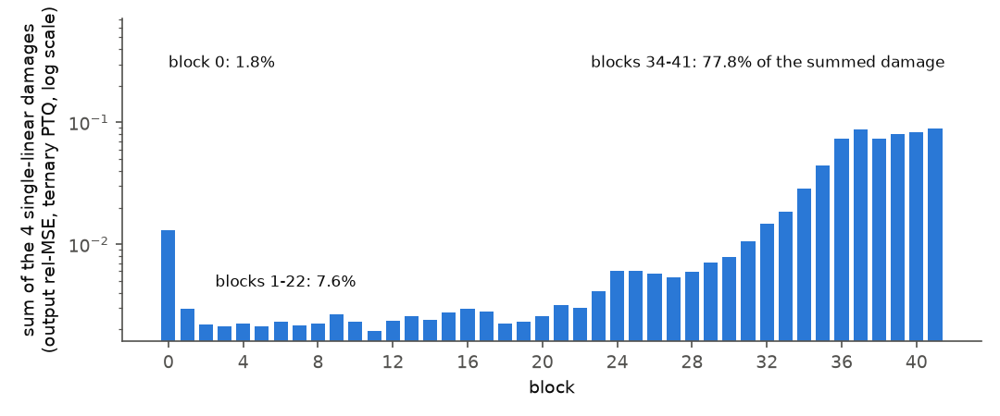

**Figure 1.** Output-MSE sensitivity of the blocks. *Source:* `logs/sens_tern.json`, plotted by `paper/_build/build_figures_v2.py`.

`scripts/alloc.py` turns this into a per-linear choice. Predicted damage for kind `k` is the ternary damage scaled by the ratio of relative weight MSE of the optimal group-128 quantizers (Table 4). Starting with everything at the highest-bit kind, the greedy loop repeatedly takes the downgrade with the smallest ratio of added damage to saved bytes until a target predicted error is reached. The additive model is reasonable at 4 bits: the sum predicts 0.0407 for all-layer int4 against 0.04206 measured on the naive int4 file (absmax scales; `logs/e2e_eval_baselines.log`). At 1 bit it under-predicts: 1.378 predicted against 2.046 measured for a naive all-binary file, so interactions grow as precision falls. mixA's allocation corresponds to a predicted PTQ-level error of about 0.15 (recomputed). mixG, mixH and mixI were *not* produced by the greedy allocator: after the ablation (Section 6.7) the allocations were written by hand and the attention allocation was copied from mixA. mixG has an int3 FFN with int4 at blocks 0, 1, 40, 41; mixH has an int2 FFN in blocks 6-35, int3 in blocks 2-5 and 36-39, int4 in blocks 0, 1, 40, 41; mixI is mixH with qkv and o at 1 bit in blocks 6-35 and ffn_down at 1 bit in blocks 12-29 (Figure 2, Appendix B).

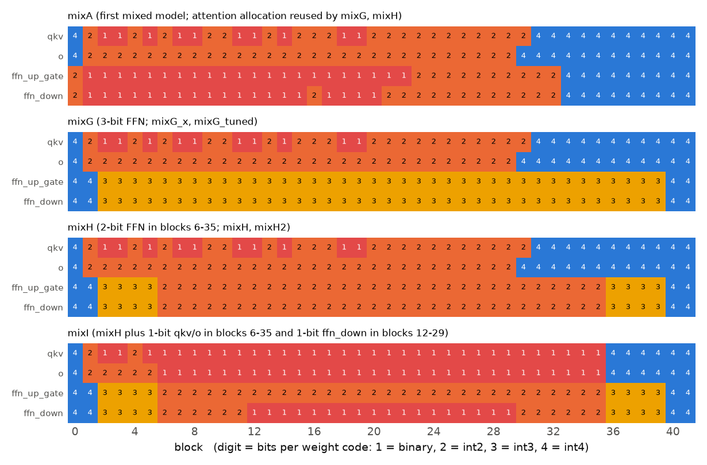

**Figure 2.** Bits per linear for mixA, mixG, mixH (also used by mixH2) and mixI. *Source:* `scripts/alloc_mixA.json`, `alloc_mixG.json`, `alloc_mixH.json`, `alloc_mixI.json`.

### 4.6 End-to-end tuning

`scripts/e2e_tune.py` freezes the packed codes and trains only the fp16 group scales (39.0M scale values) and the bf16 LoRA factors (49.9M parameters in mixA, 54.9M in mixG, 101.8M in mixH and mixH2, 108.1M in mixI), against the teacher's output on the captured trajectories. For a conditional/unconditional pair of the same sampler step with outputs `v_c`, `v_u` and teacher outputs `y_c`, `y_u`, the loss is `rel(v_c, y_c) + rel(v_u, y_u) + cfg_w * rel(v_u + 2.5 (v_c - v_u), y_u + 2.5 (y_c - y_u))` with `rel(o, y) = ||o - y||^2 / ||y||^2`, multiplied by a noise-level weight `w(t) = 1 + tw (1 - t)` (`tw = 2`, so low-noise steps weigh up to three times more than the noisiest; `t = 1` is pure noise) and normalised by `1 + tw/2`. AdamW with 20-step warm-up and cosine decay, gradient clipping at 1.0, activation checkpointing per block, 2 pairs per step. The mixA run used the 160-prompt trajectories (1,406 training pairs); every later run used the combined set with the 80 text-rich prompts (2,108 training pairs, 38 held-out pairs). Hyper-parameters are in Appendix C.

### 4.7 The text embedder, and optional modulation layers

The sensitivity of the text embedder is tiny (every one of its block linears has single-layer int2 damage of at most 0.00087; `logs/sens_extra.json`). `scripts/quantize_extras.py` therefore applies plain MSE-optimal rounding without training: int4 for `text_embedder.proj`, int2 for the qkv, proj, ffn_gate and ffn_up linears of its two blocks, int4 for their ffn_down. This shrinks mixA from 2.07 to 1.67 GB. The end-to-end proxy moved from 0.03216 (text embedder bf16, `logs/proxy_mixA_lora32_std.log`) to 0.03253 (quantized, `logs/mixA_x_tuned.log`, "before"). With `--mod --time` the same script also rounds `shared_block_modulation`, `video_head_modulation` and `time_embedding.2` to int4; that costs more than the text embedder and is evaluated in Section 6.15.

## 5 Evaluation protocol


**Interpretation for all result tables.** For inference throughout this report, absence of a clear difference is not equivalence. Use the SE or interval of the specific comparison, not a global 0.3-0.5 threshold. The often-quoted judge ±0.2 is an informal spread estimate, not a significance test. All HPS values for our images are from a local HPSv3-based implementation whose numerical parity with official HPSv3 remains unvalidated; model selection on this small set and multiple comparisons further limit interpretation. “Exact text” counts prompts separately from their individual quoted strings. Correctness is assessed against the prompt; matching a teacher counting error is still a prompt failure. Judged scores apply only to the tested encoder/VAE configuration, not automatically to a proposed compact package (Table I7).

### 5.1 Prompts and sampling

`eval/eval_prompts.json`: 24 long scene captions (80-101 words, mean 89), one seed per prompt: 6 text (quoted strings, a Chinese sign, prices, an infographic, a UI mock-up), 4 portraits, 4 fine-detail, 2 counting ("exactly five balloons", "exactly three apples, two yellow pears and one green pear") and 8 varied. All images: 768x768, 25 steps, CFG 2.5, `er_sde`, `simple`, the negative prompt above. `scripts/gen_inproc.py` reproduces the ComfyUI server workflow in-process with the same nodes and seeds. The teacher images are in `eval/teacher_bf16`. Note that the teacher itself renders three apples, one yellow and one green pear (five fruits) for the fruit-bowl prompt, so five of six fruits is the teacher's own result. The distilled models of Section 8 use the same prompts and seeds with the settings of their own template: 4 steps, CFG 1.0, `euler`, `simple`, no negative prompt, at 1024 x 1024 (primary; the distilled LoRA was trained at 1024 only) and at 768 x 768 (secondary). Their reference images are `eval/turbo4_1024` and `eval/turbo4_768`.

### 5.2 Automatic metrics

*Held-out output proxy.* Relative MSE of the full model's output (velocity) against the teacher's on held-out captured samples (`e2e_scales.py --epochs 0` and `e2e_tune.py --epochs 0`; the latter also reports error by noise level and for the CFG-combined velocity). Different scripts and different holdout subsets were used over time, so proxy values are only comparable within a section where we say so. The four end-to-end runs after mixA share one held-out set (38 pairs, same targets file), so Table 7 compares them directly.

*Image metrics* (`scripts/metrics.py`, student against the same-seed teacher image): CLIP ViT-B/16 text-image score (100 x cosine, the prompt truncated to CLIP's 77 tokens, so for 80-100-word prompts the late part of a caption is not seen), DINOv2-small CLS cosine to the teacher image, PSNR, SSIM (Gaussian 11x11, sigma 1.5), and latent relative MSE and cosine. Because quantization changes the composition, the last four measure similarity to the teacher's image, not quality.

*Preference score.* The local HPSv3-based implementation described in Section 6.17 scores images against their prompts. Official numerical parity has not been established. For inference throughout this report, absence of a clear difference is not equivalence. Use the SE or interval of the specific comparison, not a global 0.3-0.5 threshold. The often-quoted judge ±0.2 is an informal spread estimate, not a significance test. All HPS values for our images are from a local HPSv3-based implementation whose numerical parity with official HPSv3 remains unvalidated; model selection on this small set and multiple comparisons further limit interpretation.

*Latent drift between two models* (`paper/_build/latent_drift.py`): the mean over the 24 prompts of `||a - b||^2 / ||b||^2` between the final latents of two models with the same seeds. For a student against the teacher this reproduces the `latent_rel_mse` of `metrics.json` (0.5554 for mixH2_x). It is used in Section 6.15 to compare how far a modification moves the sample.

### 5.3 The independent visual judge

Nine reports (`eval/judge_mixA_lora32.md`, `judge_mixF_ptq.md`, `judge_mixG_x.md`, `judge_mixG_tuned.md`, `judge_mixH_tuned.md`, `judge_mixI_tuned.md`, `judge_mixH2_x.md`, `judge_mixH2_tuned.md`, `judge_mixH2_xm_f8.md`) score every one of the 24 student images from 0 to 5 on F (subject/scene faithfulness), T (text correctness, on the 6 quoted-text prompts plus the typewriter key legends, 7 images), C (counts and spatial relations, 7 images), Q (image quality) and A (would a user accept it instead of the teacher), with half points, and list the worst images and systematic patterns. The judge is a **Claude model instance reading the PNGs**, not a human rater, and each report is a separate session, so a different instance. The reports informally describe +0.1 to +0.2 differences as judge noise; this is not a measured uncertainty interval or significance test; the project owner puts the instance-to-instance spread at about 0.2. The method varies between reports: the first three opened all student images and only some teacher images; from the mixG_tuned report on, every report opened all 24 images of the student and of the reference model(s) as side-by-side composites at native resolution; from the mixH_tuned report on the judges also used 1.2-3x crops of the text areas (the mixI report mentions none and saw the reference halves at 0.87x); the later reports state that no image gets a 5 on Q or A. The judges also calibrated differently: the mixG_tuned judge docked Q by 0.5 where mixG_x was visibly crisper, so part of that model's Q drop is calibration; the mixH2_x judge scored the fruit bowl A 4 instead of 3.5 because the teacher has the same five fruits (worth +0.02 on the mean); the mixH2_xm_f8 judge computed colour statistics on all 72 PNGs of the comparison. Single readings also disagree: the mixI report counts three cups in the mixH_tuned kitchen image where the mixH_tuned report counted two, and the mixG_tuned report read "3:48" in a time stamp that the mixG_x report read as "3 48". Side-by-side verdicts (better/same/worse than a reference model per image) are firmer evidence than absolute scores, and the specific text and count findings are firmer than the averages. AI assistance in implementation and evaluation may create shared blind spots.

Version 3 adds four reports (`eval/judge_turbo4.md`, `judge_tmixG_x.md`, `judge_tmixG_tuned.md`, `judge_tmixH_x_f8.md`) with the same rubric and scoring subsets (C on 7 images, T on the six quoted-text prompts plus the typewriter keys), the method of the later reports above (all 24 student images opened at native size, every pair also opened side by side with its reference, 2-3x crops of the text areas) and a secondary look at 768 px for 9 prompts that is observed and not scored. The reference of the A score is different: in the turbo4 report it is the 25-step teacher's image of the same prompt; in the three student reports it is the turbo4 image, i.e. the distilled teacher. A different composition from the same seed was not penalised in itself, so A keeps its meaning (would a user accept this image instead of the reference) but not strictly its scale. The noise is again about +-0.2 per average, and the reports are separate instances; the tmixH_x_f8 judge scored every image before reading the tmixG_x report.

Version 4 adds four judge reports (`eval/judge_enc_i4e8.md`, Section 9.7; `judge_mixG_tuned_t.md`, `judge_nd_mixG_tuned_gptq.md` and `judge_nd_mixH2_x_f8_gptq.md`, Section 9.12) with the same rubric and scoring subsets. Its A asks whether a user would accept the enc_i4e8 image instead of the image made with the bf16 encoder (the same DiT); the bf16-encoder images were scored in the same session, which gives a firm comparison inside one instance, and a different layout was not penalised by itself. It also adds two blind artifact-count reports (`eval/ghost_rate_part1.md`, `ghost_rate_part2.md`, Section 9.6): a model instance classifying 144 and 108 images with shuffled labels, a count and not a rubric score. The stock encoders, the pruned encoder with the distilled DiT and the small decoder have no judge report. The three reports of Section 9.12 are separate instances; the two on the pruned encoder scored the new images before reading the earlier bf16-encoder reports, and the mixG_tuned one discloses that it had seen the per-image scores of ids 00-22 of the earlier report before scoring (partial anchoring).

### 5.4 Ablation by restoring layer groups

`scripts/make_hybrid.py` takes a trained file and puts selected linears back to the bf16 teacher weights (dropping their quantization keys and LoRA), or requantizes them from the teacher by plain optimal-scale rounding at a chosen kind (`--ptq`). Hybrids are generated on a 9-prompt critical subset (ids 0-5, 10, 14, 15: six text prompts, the typewriter, two counting prompts). These ablations have contact sheets but no judge report and no `metrics.json`; they are visual observations.

## 6 Results

**Model names.** `tern_v1/v2`, `bin_v1`: uniform ternary/binary, block-wise QAT, no LoRA. `mixA`, `mixC`, `mixG`, `mixH`, `mixI`: per-linear mixed allocations with LoRA (mixA from the greedy allocator at predicted error about 0.15, mixC at 0.30 with mostly binary, mixG hand-made with a 3-bit FFN, mixH with a 2-bit FFN in the middle blocks, mixI mixH plus 1-bit attention and 1-bit ffn_down). `mixH2` is mixH trained with about twice the calibration samples. Suffix `_x`: text embedder quantized after training. `_tuned`: after an end-to-end tuning round. `m`: modulation layers and `time_embedding.2` rounded to int4. `f8` (or `fp8lora`): LoRA factors stored as fp8. `mixF_ptq`: the e2e-tuned mixA with its FFN requantized to int4 by plain rounding. `naive int4`: round-to-nearest with absmax/7.5 scales, no training.

### 6.1 Overview

**Table 6. All models with a `metrics.json` (24 prompts, 768 px, one seed each; teacher CLIP 36.17).**

| model | file (GB) | smaller than teacher | file bits per parameter | CLIP | DINOv2 cos | SSIM | judge A (0-5) |
|---|---|---|---|---|---|---|---|
| bf16 teacher | 10.16 | 1.0x | 16 | 36.17 | | | |
| uniform ternary v1 | 1.92 | 5.3x | 3.02 | 22.52 | 0.124 | 0.435 | not judged (mush) |
| mixC (mostly 1-bit), **16 images only** | 1.77 | 5.7x | 2.78 | 33.18 (teacher 36.16 on the same 16) | 0.599 | 0.505 | not judged |
| mixA | 2.07 | 4.9x | 3.25 | 35.66 | 0.812 | 0.583 | 2.90 |
| mixA_lora32_std_x, **LoRA silently dropped by the loader bug** | 1.67 | 6.1x | 2.63 | 21.52 | 0.070 | 0.376 | invalid run |
| mixA_x_tuned | 1.67 | 6.1x | 2.63 | 35.76 | 0.816 | 0.590 | not fully judged (9-prompt side-by-side only) |
| mixF_ptq | 2.42 | 4.2x | 3.82 | 36.07 | 0.802 | 0.438 | 4.02 |
| mixG_x | 2.14 | 4.7x | 3.37 | 36.31 | 0.884 | 0.656 | 4.29 |
| **mixG_tuned** | **2.14** | 4.7x | 3.37 | 36.35 | 0.901 | 0.666 | 4.21 |
| mixH_x | 1.95 | 5.2x | 3.07 | 36.64 | 0.867 | 0.627 | not judged |
| mixH_tuned | 1.95 | 5.2x | 3.07 | 36.11 | 0.860 | 0.615 | 4.10 |
| mixI_x | 1.74 | 5.8x | 2.74 | 35.60 | 0.745 | 0.541 | not judged |
| mixI_tuned | 1.74 | 5.8x | 2.74 | 35.93 | 0.788 | 0.554 | 3.15 |
| **mixH2_x** | **1.95** | 5.2x | 3.07 | 36.33 | 0.877 | 0.640 | 4.21 |
| mixH2_tuned | 1.95 | 5.2x | 3.07 | 36.26 | 0.864 | 0.622 | 4.17 |
| mixH2_x_f8 (mixH2_x + fp8 LoRA) | 1.85 | 5.5x | 2.91 | 36.39 | 0.877 | 0.641 | not judged |
| mixH2_xm (+ int4 modulation) | 1.83 | 5.6x | 2.87 | 36.68 | 0.856 | 0.594 | not judged |
| **mixH2_xm_f8** (+ both) | **1.72** | 5.9x | 2.71 | 36.61 | 0.851 | 0.594 | 4.15 |

*Source:* `eval/<model>/metrics.json`, `eval/teacher_bf16/metrics.json` (rows computed by `paper/_build/tables_v2.py`); sizes from `out/*.safetensors` via `paper/_build/size_breakdown.json` (file bits per parameter = file bytes x 8 / 5.0823e9); judge A from `eval/judge_*.md`. The mixC row covers only the first 16 prompts.

Not in the table because they have no `metrics.json`: naive int4 (3.10 GB, proxy 0.04206, one loader-test image looks plausible, not scored), uniform binary v1 (1.32 GB, proxy 0.536, the first four images are featureless fields, Figure 7) and uniform ternary v2 (1.92 GB, proxy 0.136, no images generated). The CLIP score of several models exceeds the teacher's (mixG_x, mixG_tuned, mixH_x, mixH2_x, mixH2_tuned, mixH2_x_f8, mixH2_xm, mixH2_xm_f8), which says more about the metric than about the models (Section 7.5). The mixC evaluation covers 16 of 24 images: it ended after image 15, and images 10-15 had taken 1,243-1,484 s each against about 28 s (Section 7.9).

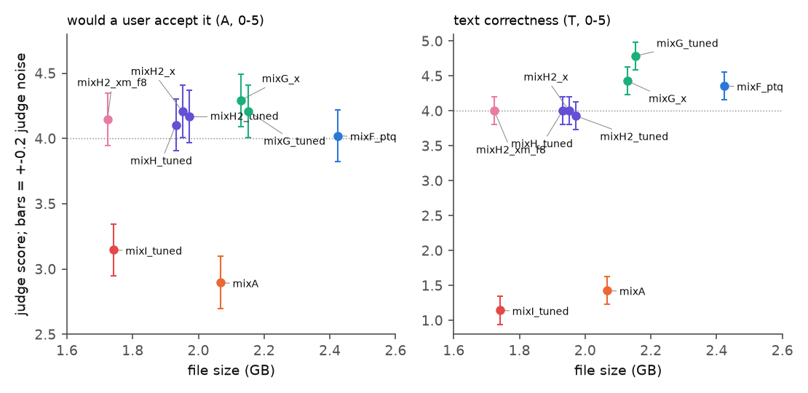

**Figure 3.** Judged acceptance (A) and text correctness (T) of the nine judged models against file size; vertical bars are +-0.2, the owner's estimate of judge noise; the dotted line is A or T = 4. Models of identical file size (mixH_tuned, mixH2_x, mixH2_tuned at 1.95 GB; mixG_x and mixG_tuned at 2.14 GB) are offset horizontally by up to 0.02 GB for legibility. *Source:* `eval/judge_*.md` via `paper/_build/judge_table.py`; sizes from `paper/_build/size_breakdown.json`.

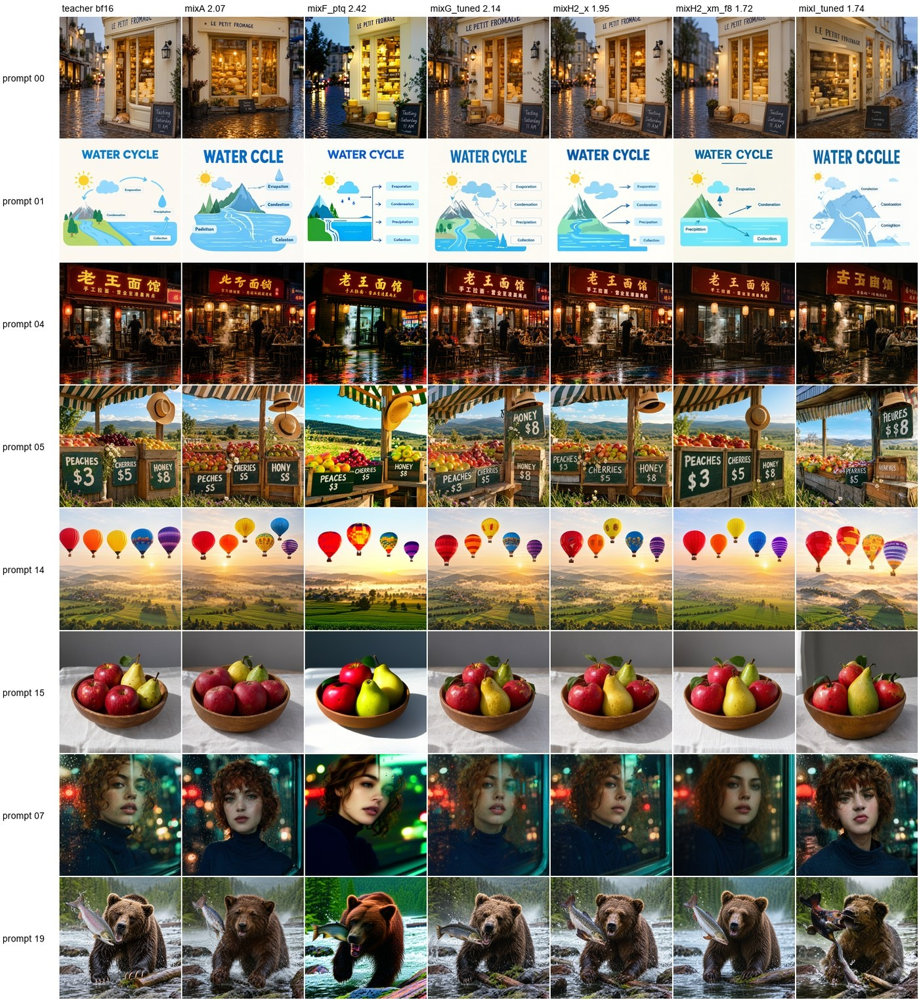

**Figure 4.** Columns: teacher bf16, mixA, mixF_ptq, mixG_tuned, mixH2_x, mixH2_xm_f8, mixI_tuned (file sizes in GB). Rows: prompts 00 (cheese shop with three text strings), 01 (water-cycle infographic), 04 (Chinese noodle-shop sign), 05 (fruit stand with prices), 14 (exactly five balloons), 15 (fruit bowl), 07 (portrait), 19 (bear and salmon). Thumbnails are resized to 190 px; the judges read the 768 px originals. *Source:* `eval/<model>/NN_seed*.png`, composed by `paper/_build/build_figures_v2.py`.

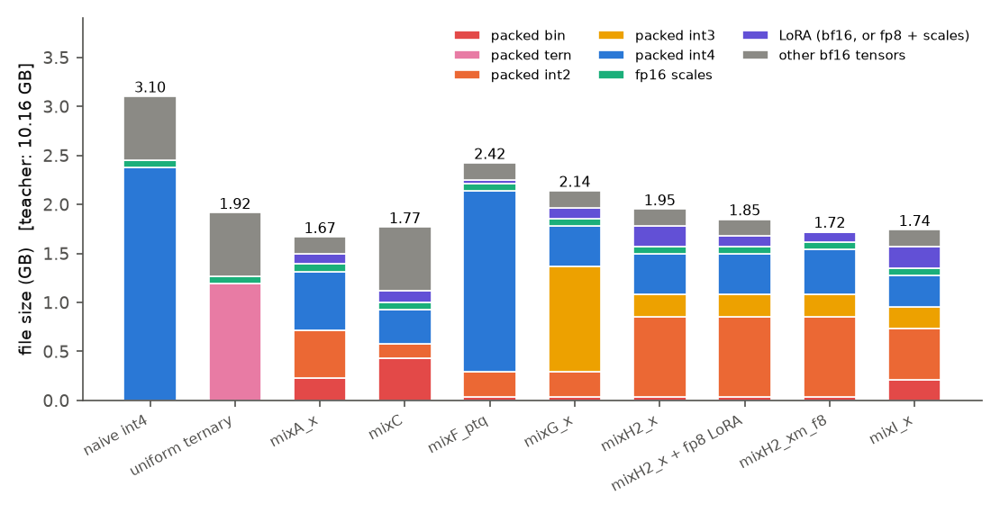

**Figure 5.** File size by component. mixA_x stands for mixA with the quantized text embedder (identical sizes for mixA_x_tuned); mixH2_x also stands for mixH_x, mixH_tuned and mixH2_tuned. *Source:* `paper/_build/size_breakdown.json` (headers and `weight_kind` tensors of `out/*.safetensors`).

### 6.2 Uniform ternary and binary fail

Uniform ternary (all 168 linears) trained block by block (v1: 384 samples, 2 epochs; v2: 768 samples, 4 epochs, student-stream inputs, `token` loss) leaves a held-out output error of 0.286 (v1) and 0.136 (v2), against 0.042 for plain int4 rounding and 0.536 / 2.046 for uniform binary after training / by naive rounding (`logs/e2e_eval_baselines.log`, `logs/e2e_eval_tern_v2.log`). The v1 images are structureless (Figure 6): CLIP 22.5, DINOv2 0.124. Uniform binary v1 gives featureless brown and grey fields (Figure 7). We did not generate images for ternary v2; its error is half of v1's but still more than three times that of plain int4 rounding. Per-block errors accumulate along depth (Figure 8, red) and reach a student-stream error of 0.247 at block 41; the last eight blocks carry most of the damage, as the sensitivity map predicted. (v1's log shows identical per-block and stream errors, so we infer it ran without the student-stream propagation that v2 and later runs use; the v1/v2 comparison therefore mixes more samples, more epochs and student-stream inputs, and does not isolate any one of them.)


**Figure 6.** Teacher (left) and uniform ternary v1 (right) on prompts 00-05. *Source:* `eval/sheet_tern_v1_1.png`.

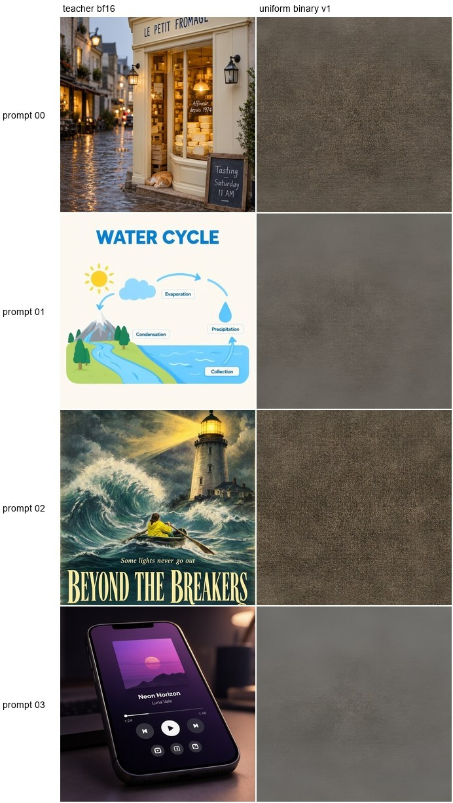

**Figure 7.** Teacher and uniform binary v1 on prompts 00-03. *Source:* `eval/bin_v1/`, `eval/teacher_bf16/` (no `metrics.json` exists for bin_v1).

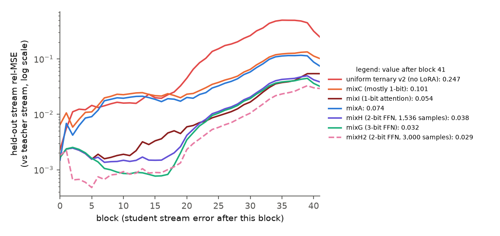

**Figure 8.** Student-stream relative MSE on the held-out samples after each block, for the uniform ternary v2 run and six mixed runs; the legend gives the value after block 41. mixH2 differs from mixH by training samples and optimizer steps together (3,000 against 1,536 samples, 750 against 384 steps per block). *Source:* `logs/full_tern_v2.json`, `mixC_lora32_std.json`, `mixI_lora.json`, `mixA_lora32_std.json`, `mixH_lora.json`, `mixG_lora32.json`, `mixH2_lora.json` (field `stream_rel_mse`).

### 6.3 Plain rounding: 4 bits survives, 2 bits collapses

Round-to-nearest int4 (absmax scales) gives a held-out error of 0.042 and, per the notes, good images. The same plain-rounding recipe at 2 bits is a collapse: requantizing the FFN of the tuned mixA by optimal-scale rounding to int2 gives a text-set proxy of 0.524 and pure noise images (Figure 13, last column), and uniform 3-bit FFN rounding is clearly degraded (green cast, noise; Figure 14). This is why every sub-4-bit result below relies on training.

### 6.4 Mixed precision with a LoRA branch, and the 1-bit FFN problem

mixA (greedy bin/int2/int4 allocation, rank-32 LoRA, `std` loss, 512 samples, 3 epochs, 74 minutes) reaches a held-out error of 0.032 and a CLIP score of 35.66 (98.6% of the teacher). The judge (`eval/judge_mixA_lora32.md`) finds near-teacher photographic texture, fur, moss, water, painterly and anime styles, and large clean backgrounds, but **0 of 6 text prompts correct** (dropped and swapped letters, "$3" collapsing to "SS", Chinese worst: the sign reads 北子面鍋 instead of 老王面馆), **both counting prompts wrong** (six balloons; four apples where three were asked) and object drift (a gauntlet that becomes a dome, a six-legged table). Overall acceptance 2.90/5. The teacher renders all six quoted-text prompts correctly and gets five balloons.

mixC pushes the allocation further (3.49B of the 4.76B block parameters are binary, including most FFNs) and shrinks the file to 1.77 GB: text turns into bar-like glyphs and the CLIP score falls to 33.18 over the first 16 prompts (mixA on the same 16: 35.35) (Figure 9).


**Figure 9.** Teacher, mixA and mixC on prompts 00-05. *Source:* `eval/sheet_mixC_lora32_std_1.png`.

### 6.5 A loader bug that looked like a bad model

The first evaluation of the text-embedder-quantized mixA gave noise (CLIP 21.52, DINOv2 0.070; Figure 10, `eval/mixA_lora32_std_x/metrics.json`) while the training-side proxy was fine. Cause (`NOTES.md`): `F.linear(x, QuantizedTensor)` decomposes into transpose and matmul and never reaches a registered `aten.linear` handler, so a LoRA term implemented in that handler was silently skipped; the generic fallback dequantized the base weight alone (`NOTES.md` quotes a loader proxy of 0.173 before the fix against 0.0435 after, on the same 8 held-out samples, measured interactively and not logged; we did not find a log). The fix was to fold `B A` into `dequantize()`. After the fix the loader path gives 0.02485 on `mixA_x_tuned` (`logs/loaderproxy_mixA_x_tuned.log`) against 0.02485 in the tuning log (`logs/mixA_x_tuned.log`, a different subset of the same held-out region), and the unfixed-vs-fixed images look as in Figure 10 (the right column is the same recipe with the text embedder in bf16, i.e. a nearly identical model). The file itself had been fine all along.

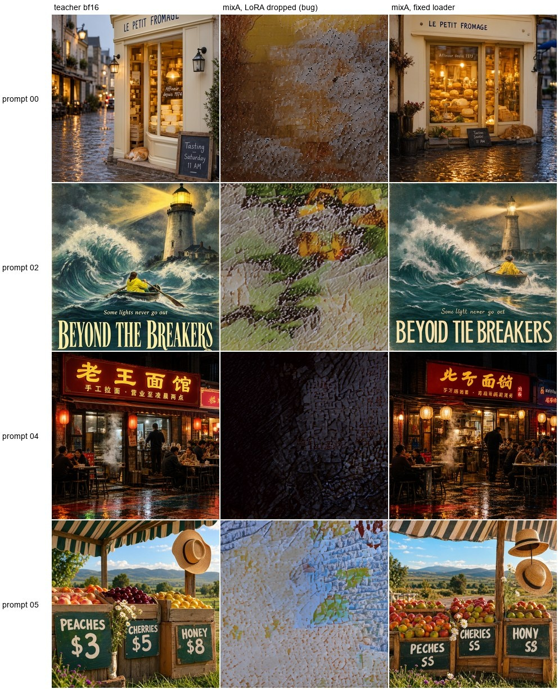

**Figure 10.** Teacher, mixA through the buggy loader (LoRA branch dropped, text embedder quantized) and mixA through the fixed loader (text embedder bf16). The two right-hand models differ only by the text-embedder quantization, which costs about 1% in the proxy (Section 4.7). *Source:* `eval/mixA_lora32_std_x/`, `eval/mixA_lora32/`.

### 6.6 End-to-end tuning

Tuning scales and LoRA end to end on mixA_x (703 steps, 62 minutes) cut the held-out error by 23.6% and the CFG-combined error by 21.8%. The same stage was then applied to mixG_x, mixH_x, mixI_x and mixH2_x.

**Table 7. End-to-end tuning, held-out pairs.**

| run | pairs (train / holdout) | rel-MSE before | after | change | CFG-combined before | after | CFG / single, before / after | by noise level (t<1/3, 1/3-2/3, >2/3) before | after | steps (minutes at step 700) |
|---|---|---|---|---|---|---|---|---|---|---|
| mixA_x to mixA_x_tuned | 1406 / 39 | 0.03253 | 0.02485 | -23.6% | 0.07745 | 0.06057 | 2.38 / 2.44 | 0.060, 0.031, 0.029 | 0.052, 0.024, 0.021 | 703 (62.0) |
| mixG_x to mixG_tuned | 2108 / 38 | 0.01403 | 0.01200 | -14.5% | 0.03230 | 0.02769 | 2.30 / 2.31 | 0.048, 0.017, 0.009 | 0.040, 0.015, 0.008 | 737 (72.2) |
| mixH_x to mixH_tuned | 2108 / 38 | 0.02099 | 0.01754 | -16.4% | 0.04791 | 0.03971 | 2.28 / 2.26 | 0.060, 0.025, 0.015 | 0.052, 0.021, 0.012 | 737 (64.4) |
| mixI_x to mixI_tuned | 2108 / 38 | 0.04375 | 0.03285 | -24.9% | 0.09879 | 0.07295 | 2.26 / 2.22 | 0.080, 0.049, 0.042 | 0.067, 0.038, 0.029 | 737 (64.7) |
| mixH2_x to mixH2_tuned | 2108 / 38 | 0.01805 | 0.01542 | -14.6% | 0.04088 | 0.03543 | 2.26 / 2.30 | 0.054, 0.022, 0.013 | 0.046, 0.020, 0.011 | 737 (64.9) |

*Source:* `logs/mixA_x_tuned.log`, `logs/mixG_tuned.log`, `logs/mixH_tuned.log`, `logs/mixI_tuned.log`, `logs/mixH2_tuned.log` (rows computed by `paper/_build/tables_v2.py`). The mixA row used the 160-prompt trajectories, the others the combined set with the text-rich prompts; the four later runs share one holdout set.

Observations. (i) The relative gain was largest in the noisiest bucket in all five runs (-16% to -30%) and smallest in the low-noise or the middle bucket (-11% to -17%), although the loss weights low-noise steps more. (ii) The relative error is highest at low noise before and after tuning, for every model measured: for naive int4 0.146 / 0.056 / 0.020, for uniform ternary v1 0.579 / 0.370 / 0.211 (`logs/e2e_eval_baselines.log`). (iii) The proxy gain is largest for the weakest models (mixI -24.9%, mixA -23.6%) and about -15% for the three best, while the images improve by no such margin (Sections 6.10, 6.12, 6.14). (iv) Visually, the first run fixed large lettering ("WATER CYCLE", "FROMAGE", Figure 11) but not small print, Chinese or prices. (v) When the mixF_ptq judge opened mixA_x_tuned for its 9-prompt side-by-side it found exactly five balloons and the 3/2/1 fruit mix, whereas the earlier report on the untuned mixA had six balloons and a wrong fruit mix (the mixF report calls x_tuned "a slightly better student than the one scored", especially on counting); text was still garbled. (vi) The error ratio of the CFG-combined velocity to the single predictions is 2.2-2.4 for every run (Section 7.6).


**Figure 11.** Teacher, mixA (before) and mixA_x_tuned on prompts 00-05. *Source:* `eval/sheet_mixA_x_tuned_1.png`.

Two further queued tuning runs (`mixA_x_tuned2` with the text-rich prompts oversampled, and `mixF_tuned`) were cancelled through the skip flag and produced no model.

### 6.7 Which layers carry text and counts? The ablation

On the 9 critical prompts, restoring layer groups of the tuned mixA (`mixA_x_tuned`) to bf16 gave (Figure 12): restoring **all FFN linears** (84 of 179 quantized linears, a 7.13 GB diagnostic file) makes text, the Chinese sign, prices, typewriter keys and counts essentially correct; restoring **all attention linears** (84 linears, 4.30 GB) makes the images *muddy*, which we read, as a hypothesis, as a mismatch between the bf16 attention and the FFN, LoRA and scales that were co-adapted to the quantized attention; restoring any **single third of the blocks** (0-13, 14-27, 28-41; every linear of those blocks) improves some strings but none reliably; restoring the **text embedder** changes nothing visible. The text and count failures therefore came from the low-bit FFN, which mixA had at 1 bit in most middle blocks and which the output-MSE sensitivity map had rated harmless (Section 7.3). This evidence is 9 prompts, read by eye, with no judge report.

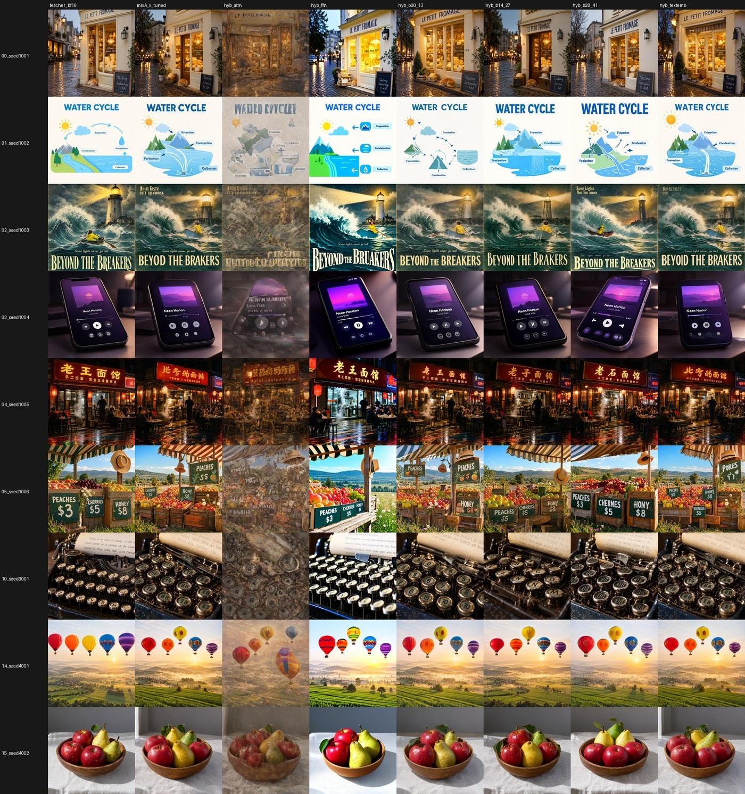

**Figure 12.** Columns: teacher, mixA_x_tuned, then the tuned mixA with one group restored to bf16: all attention, all FFN, blocks 0-13, 14-27, 28-41, the text embedder. Rows: prompts 00, 01, 02, 03, 04, 05, 10, 14, 15. *Source:* `eval/sheet_ablation.png`, `scripts/queue10.sh`, `logs/ablation.log`.

### 6.8 How many bits does the FFN need? Plain rounding

On the tuned mixA the FFN was requantized from the teacher by plain optimal-scale rounding (`make_hybrid.py --restore ffn --ptq`). At **int4** text, the Chinese sign, prices, labels and counts were essentially as good as with a bf16 FFN (Figure 13), giving the 2.42 GB model **mixF_ptq**; at **int2** the output collapses to noise. A held-out proxy computed on the 80 text-rich prompts, which the tuned mixA never trained on, ranks the variants as follows.

**Table 8. Text-held-out proxy against what the images show.**

| variant (tuned mixA with ...) | holdout rel-MSE | CFG-combined | text and counts in the 9 images |
|---|---|---|---|
| nothing changed (mixA_x_tuned) | 0.02457 | 0.05944 | text garbled, Chinese wrong |
| FFN restored to bf16 | 0.04497 | 0.09132 | essentially correct |
| attention restored to bf16 | 0.05890 | 0.09422 | muddy images |
| FFN requantized to int4 by rounding | 0.07270 | 0.11157 | essentially correct |
| FFN requantized to int2 by rounding | 0.52398 | 0.64393 | noise |

*Source:* `logs/proxy_text.log` (proxy), `eval/sheet_ffn_study.png`, `eval/sheet_ablation.png` (images). 50 held-out pairs.

The proxy ranks the model with the *worst* text first and the int4 variant with the *good* text below the garbled one: **a text-set MSE proxy does not track text quality** (Section 7.4).

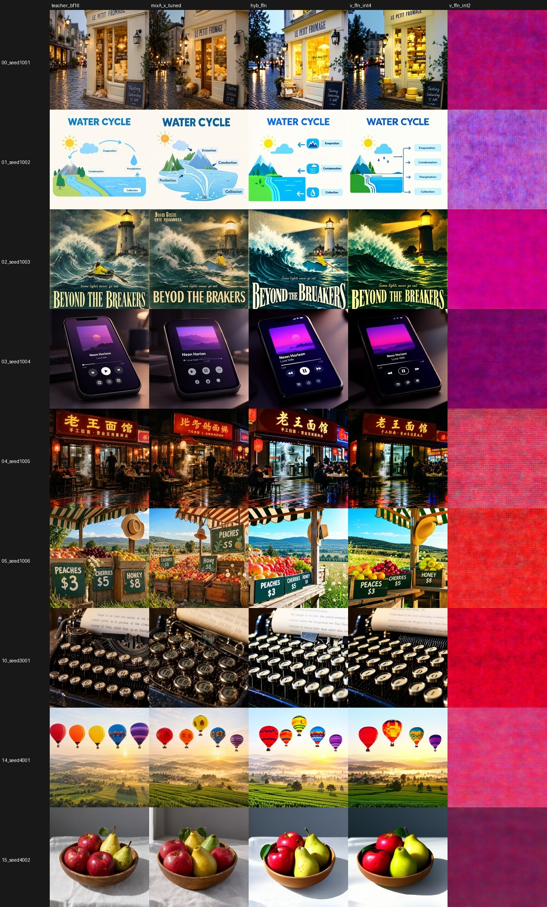

**Figure 13.** Columns: teacher, mixA_x_tuned, FFN restored to bf16, FFN int4 by rounding, FFN int2 by rounding; 9 prompts. *Source:* `eval/sheet_ffn_study.png`.

### 6.9 Three-bit FFN: rounding and the trained mixed recipe (mixG_x)

At 3 bits, plain rounding of the FFN was not enough (Figure 14): uniform int3 gave a green cast, noise and "WAER CYCLE"; int4 in blocks 0-7 and 34-41 with int3 in between was better but still over-saturated with some text damage; int4 stayed the clean choice. The next model, mixG, trained the FFN at int3 (int4 in blocks 0, 1, 40, 41) with block-wise QAT, rank-32 LoRA, `std` loss, the full 4,442-sample calibration set including the 80 text prompts (1,536 randomly drawn training samples, 2 epochs, 72 minutes), kept the mixA attention allocation, and quantized the text embedder afterwards: **mixG_x, 2.14 GB, 12% smaller than mixF_ptq (2.42 GB) and judged better**. Note that this is a comparison of two *systems*, not a controlled ablation: besides QAT against rounding, mixG has LoRA on its FFN, retrained attention, text prompts in the calibration set and a different sample count, while mixF's attention went through an extra e2e-tuning stage. The 3-bit rounding and trained-system observations are also not a controlled QAT-only ablation: low-rank correction, calibration, and other trained components differ. They demonstrate the behavior of the tested recipes, not the isolated effect of QAT.

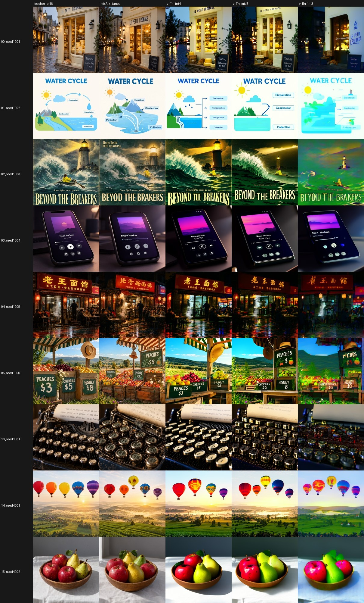

**Figure 14.** Columns: teacher, mixA_x_tuned, FFN int4 by rounding, FFN int4 at blocks 0-7 and 34-41 with int3 between, uniform int3 by rounding; 9 prompts. *Source:* `eval/sheet_ffn_int3.png`, `scripts/queue14.sh`.

The judge (`eval/judge_mixG_x.md`) gives mixG_x F 4.50, T 4.43, C 3.36, Q 4.44, A 4.29 against 4.29, 4.36, 2.71, 4.29, 4.02 for mixF_ptq (Table 11), and against mixF_ptq per image **15 better, 9 same, 0 worse** (for 11 of the 24 images the mixF side was taken from the earlier report's description rather than re-opened). The exact-count prompts improved: five balloons are correct; the fruit bowl still has four fruits instead of six (the teacher has five). The quoted strings of four of six text prompts are letter-for-letter exact including the 12-character Chinese sub-line, and the over-saturation seen in mixF is much reduced. Remaining defects reported by the judge: the infographic is a list of boxes rather than a cycle (all text correct), a dropped colon ("3 48") and a stray glyph in the music-player UI, an extra garbled sign and two straw hats in the fruit stand, the gauntlet reads as a bracer, beads at the neck instead of the wrist. The judge's own caution: the 0.27 A-score gap between mixG_x and mixF_ptq is at the edge of judge noise.

### 6.10 mixG_tuned: an end-to-end round on the 3-bit model

One end-to-end tuning round on mixG_x (Table 7: held-out error -14.5%, CFG-combined 0.0323 to 0.0277) changed the images less than the proxy suggests. Metrics: CLIP 36.35, DINOv2 0.901, SSIM 0.666 (mixG_x 36.31, 0.884, 0.656). The judge (`eval/judge_mixG_tuned.md`): F 4.48, T 4.79, C 3.64, Q 4.23, A 4.21 against 4.50, 4.43, 3.36, 4.44, 4.29 for mixG_x; per image against mixG_x **7 better, 14 same, 3 worse** (worse: the infographic, whose arrows became a tangle; a portrait that turned soft with a visible seam through the forehead; a street scene in which the woman now faces away). All six quoted-text prompts are letter-for-letter exact including the Chinese sign and its 12-character sub-line (the only report with 6 of 6), the balloons are exactly five and the fruit bowl has five of six fruits (the teacher also has five). The judge's own reading of the deltas: F and A have similar point estimates; no calibrated judge significance test exists; about 0.2 of the T gain is a reading difference for one time stamp between judge instances, part of the C gain is one image, and part of the Q drop is calibration, but the portrait softness in image 07 is a real regression. Net: **no clear overall win; the round traded close-up portrait sharpness and diagram cleanliness for fewer text and count errors**. mixG_tuned is the only model in this report with all six quoted-text prompts exact.

### 6.11 mixH: a trained 2-bit FFN in the middle blocks

mixH keeps the mixA attention allocation and moves the FFN from int3 to int2 in blocks 6-35 (int3 in blocks 2-5 and 36-39, int4 in 0, 1, 40, 41), with rank-64 LoRA on the 1- and 2-bit linears (Figure 2). The predicted block-linear size falls from 1,778 MB to 1,495 MB and the file from 2.14 to 1.95 GB (-8.8%). Block-wise QAT with 1,536 samples took 73 minutes and ended with a stream error of 0.0384 after block 41 (mixG: 0.0319). Before tuning (mixH_x; not judged) the metrics are CLIP 36.64, DINOv2 0.867, SSIM 0.627, latent cosine 0.700 (mixG_x: 36.31, 0.884, 0.656, 0.733), and the text rows of Figure 15 read as follows (by eye, no judge report): shop sign, poster title, Chinese sign with its sub-line and the prices are correct; diagram labels and one word on the phone are slightly garbled. So a *trained* 2-bit FFN with a rank-64 LoRA keeps the text where plain 2-bit rounding collapsed to noise (Section 6.8).

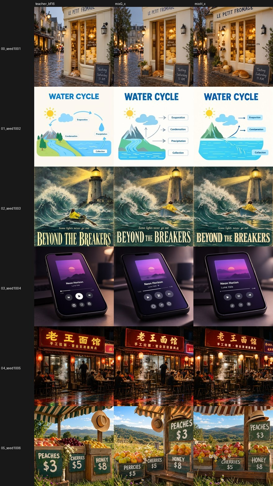

**Figure 15.** Teacher, mixG_x and mixH_x on prompts 00-05. *Source:* `eval/sheet_mixH_vs_mixG_1.png`.

After the end-to-end round (mixH_tuned; proxy -16.4%, CLIP 36.11, DINOv2 0.860, SSIM 0.615) the judge (`eval/judge_mixH_tuned.md`) gives F 4.31, T 4.00, C 3.29, Q 4.29, A 4.10 against 4.48, 4.79, 3.64, 4.23, 4.21 for mixG_tuned. A, F and Q are not clearly resolved by these measurements; **T (-0.79) and C (-0.35) have lower point estimates; separate judge sessions prevent a calibrated significance claim**. Text: 4 of 6 prompts acceptable (mixG_tuned 5 of 6), 3 of 6 letter-exact (6 of 6); the misses are small text on busy graphics (the infographic labels "Evapioration" and "Condenation", a malformed price digit on the largest sign) and six balloons instead of five. Per image against mixG_tuned: 5 better (portraits, music player), 12 same, 7 worse; 18 of 24 images have A of 4 or more. The judge's verdict: mixG_tuned stays the safer candidate for text and count prompts, while mixH_tuned is competitive on portraits and general scenes. At this point the smallest file that was acceptable or borderline by the general criterion was 1.95 GB (mixH_tuned: 18 of 24 images at A of 4 or more, against the 20 we ask for), and six text prompts exact; balloons correct; fruit count incorrect needed 2.14 GB.

### 6.12 mixI: the combined 1-bit attention and FFN-down allocation fails

mixI is mixH with qkv and o at 1 bit in blocks 6-35 and ffn_down at 1 bit in blocks 12-29 (81 binary linears, 1.67B parameters; block-linear size 1,272 MB; file 1.74 GB, 0.21 GB below mixH), the same rank-64 LoRA and the same training budget. Block-wise training ended at a stream error of 0.0542 (mixH 0.0384); end-to-end tuning reduced the proxy from 0.04375 to 0.03285, which is still 1.9 times the 0.01754 of mixH_tuned. Metrics: CLIP 35.60 (mixI_x) and 35.93 (mixI_tuned), DINOv2 0.745 and 0.788, SSIM 0.541 and 0.554. The judge (`eval/judge_mixI_tuned.md`) gives F 3.54, T 1.14, C 2.07, Q 3.54, A 3.15, much lower observed scores and widespread visible failures: **0 of 6 text prompts acceptable and 0 of 6 exact** (the sign reads "FPRONAGE", the poster title "BYOD TEN REAKERS", the infographic "WATER CCCLLE", the Chinese board 吉五面馆 with an unreadable sub-line, the typewriter keys unreadable), four balloons instead of five, and against mixH_tuned **0 better, 4 same, 20 worse** (Figure 16). Natural scenes, watercolour and still life stay good (A of 4 in six images); structured objects fail (a phone UI without buttons, chainmail turned into a coarse mesh, a bakery base that is no longer a cube, a knight sitting in front of a collapsed crystal) and anatomy drifts (a teddy-like bear, a double umbrella with translucent legs). 1-bit attention and a 1-bit ffn_down were changed together, so this experiment cannot say which of the two broke the model. The conclusion we draw is limited: **at this training budget, with rank-64 LoRA and one tuning round, the combined mixI allocation fails. Attention-only and FFN-down-only downgrades were not tested; neither an attention precision floor nor its causal contribution is established.**


**Figure 16.** Teacher, mixH_tuned, mixI_x and mixI_tuned on prompts 00-05. *Source:* `eval/sheet_mixI_1.png`.

### 6.13 mixH2: twice the calibration data

mixH2 is exactly the mixH configuration (same allocation, ranks and hyper-parameters) trained on 3,000 instead of 1,536 samples, which at 2 epochs and 8 samples per step is 750 instead of 384 steps per block and 138 instead of 73 minutes. The final stream error is 0.0292 (mixH 0.0384, mixG 0.0319) and the early blocks are much better (Figure 8; 0.0007 against 0.0025 after block 2). Without any end-to-end round, mixH2_x has CLIP 36.33, DINOv2 0.877, SSIM 0.640, latent cosine 0.720 (mixH_x: 36.64, 0.867, 0.627, 0.700; mixG_x: 36.31, 0.884, 0.656, 0.733). The judge (`eval/judge_mixH2_x.md`): F 4.33, T 4.00, C 3.43, Q 4.27, A 4.21, with 20 of 24 images at A of 4 or more, **equal to mixG_tuned's 4.21 at 1.95 against 2.14 GB** (mixH_tuned: 4.10). Per image: against mixH_tuned 9 better, 13 same, 2 worse; against mixG_tuned 4 better, 17 same, 3 worse (worse: the infographic, the music-player time stamps, the gauntlet). Text: 4 of 6 prompts acceptable, 3 of 6 letter-exact, with the failures in small text of busy graphics (labels "Condenstion" and "Precipatton", tiny numerals); balloons exactly five. The gap that remains to mixG_tuned is T (4.00 against 4.79), i.e. exact spelling of small text. **The larger-data, longer-training recipe reached the same observed mean acceptance as the 2.14 GB recipe; the separate effects of distinct data, optimization steps, and end-to-end tuning are not identified.** Three caveats: the A difference to mixH_tuned (+0.11) is inside the noise, and the firmer evidence is the per-image verdict (9 better, 2 worse) and the metrics against the teacher (DINOv2 0.877 against 0.867 for the untuned mixH_x, SSIM 0.640 against 0.627); sample count and steps per block doubled together (epochs were fixed), so we cannot say which one mattered; and mixH2_x differs from mixH_tuned also by not having had the end-to-end round.

### 6.14 mixH2_tuned: the extra tuning round at 1.95 GB

An end-to-end round on mixH2_x (Table 7: proxy -14.6%) gave CLIP 36.26, DINOv2 0.864, SSIM 0.622. The judge (`eval/judge_mixH2_tuned.md`): F 4.29, T 3.93, C 3.36, Q 4.29, A 4.17 against 4.33, 4.00, 3.43, 4.27, 4.21 for mixH2_x, all differences small relative to the informal judge-spread estimate, which is not a significance test, and 20 of 24 images at A of 4 or more in both. Per image against mixH2_x: 8 better, 12 same, 4 worse. It helped portraits (+0.25 on Q and A as a category) and some scene attributes (a bicycle, a single sword, more customers, a denser tree crown) and fixed the time stamps of the music player; it broke other small text (the window line of the shop, an extra misspelled "PANCHES $3" sign, four of the five infographic labels, which are now misspelled or duplicated) and inverted the colours of the typewriter keys. Letter-exact text went from 3 of 6 to 2 of 6 (3 of 6 if one slightly malformed Chinese glyph is tolerated). The judge's conclusion: the round "neither clearly helped nor hurt on the average" and the text-heavy tuning data did not buy better small-text spelling; with one seed per prompt, single-image text swings are weak evidence of a systematic effect. We therefore treat mixH2_x, not mixH2_tuned, as the 1.95 GB model.

### 6.15 Size savings and measured tradeoffs: fp8 factors and int4 modulation

**Table 9. Where the bytes of mixH2_x go (MB, decimal), and what the two savings change.**

| component | mixH2_x | + fp8 LoRA (mixH2_x_fp8lora) | + int4 modulation (mixH2_xm_f8) |
|---|---|---|---|
| block linears: packed codes (168 tensors) | 1,420.3 | 1,420.3 | 1,420.3 |
| LoRA branches (135 linears, bf16 or fp8 + scales) | 203.7 | 101.8 | 101.8 |
| text embedder: packed codes | 75.5 | 75.5 | 75.5 |
| group scales of the block linears (fp16) | 74.3 | 74.3 | 74.3 |
| shared_block_modulation (bf16, or int4) | 113.3 | 113.3 | 28.3 |
| video_head_modulation (bf16, or int4) | 37.8 | 37.8 | 9.4 |
| time_embedding.2 (bf16, or int4) | 18.9 | 18.9 | 4.7 |
| non-block scales (fp16) | 3.7 | 3.7 | 5.1 |
| all other small bf16 tensors (time_embedding.0, video_embedder, final linear, norms, ...) | 3.9 | 3.9 | 3.9 |
| **total file** | **1,951.4** | **1,849.6** | **1,723.5** |

*Source:* `scripts/size_report.py` run on `out/mixH2_x.safetensors`, `mixH2_x_fp8lora.safetensors` and `mixH2_xm_f8.safetensors` (`logs/size_mixH2_xm_f8.log` for the last); the last row is the remainder to the total. The block-linear codes, LoRA and text-embedder codes are 72.8%, 10.4% and 3.9% of mixH2_x.

**fp8 LoRA factors** (Section 3.5) save 101.8 MB (5.2% of the file) at a per-factor error of 2.6%, a weight error that moves by at most 2e-5, and no measurable change in the metrics: mixH2_x to mixH2_x_f8 moves CLIP 36.33 to 36.39, DINOv2 0.877 to 0.877, SSIM 0.640 to 0.641, latent cosine 0.720 to 0.720, and the 24 final latents differ by a relative distance of only 0.0185 (image PSNR between the two sets 33 dB). No clear degradation was detected by these metrics; this is not an equivalence result. We have **not judged** mixH2_x_f8 (no judge report exists); the evidence is metrics and the latent distance.

**int4 modulation layers** (`quantize_extras.py --mod --time`) save 126 MB (6.5%), but the cost was larger than the project notes assumed when they listed the change among the cheap savings (it is the change with a measurable local-score decrease). The three layers had single-layer int4 output errors of 0.0082, 0.0062 and 0.0139 (Appendix D), against 0.0002 for a text-embedder layer, and their sum, 0.028, is two thirds of the output error of rounding all 168 block linears to int4 (0.042). Table 10 shows the effect.

**Table 10. Effect of the two savings against mixH2_x.**

| model | file (GB) | CLIP | DINOv2 | SSIM | latent cosine | latent distance to mixH2_x (mean) | judge A |
|---|---|---|---|---|---|---|---|
| mixH2_x | 1.951 | 36.33 | 0.877 | 0.640 | 0.720 | | 4.21 |
| mixH2_x_f8 | 1.850 | 36.39 | 0.877 | 0.641 | 0.720 | 0.0185 | not judged |
| mixH2_xm | 1.825 | 36.68 | 0.856 | 0.594 | 0.659 | 0.4333 | not judged |
| mixH2_xm_f8 | 1.724 | 36.61 | 0.851 | 0.594 | 0.656 | 0.4325 | 4.15 |
| for scale: mixH2_tuned | 1.951 | 36.26 | 0.864 | 0.622 | 0.691 | 0.3540 | 4.17 |
| for scale: mixH_x (half the data) | 1.951 | 36.64 | 0.867 | 0.627 | 0.700 | 0.2931 | not judged |

*Source:* `eval/<model>/metrics.json`; latent distance from `paper/_build/latent_drift.py` (output saved in `paper/_build/latent_drift_output.txt`); judge A from `eval/judge_mixH2_x.md`, `judge_mixH2_xm_f8.md`, `judge_mixH2_tuned.md`.

Rounding the modulation layers moves the final latents by as much as retraining on different data (0.43 against 0.29) or an end-to-end round (0.35), so the sample is a different draw and the structure metrics fall (DINOv2 -0.021, SSIM -0.046, latent cosine -0.061). The judge (`eval/judge_mixH2_xm_f8.md`) nevertheless finds the model acceptable: F 4.25, T 4.00, C 3.79, Q 4.21, A 4.15 against 4.33, 4.00, 3.43, 4.27, 4.21 for mixH2_x (all differences small relative to the informal judge-spread estimate, which is not a significance test except C, whose +0.36 comes from three image-specific changes), 21 of 24 images at A of 4 or more, 5 of 6 text prompts accepted and 4 of 6 letter-exact (mixH2_x: 4 and 3). Per image against mixH2_x: 4 better (music player, fruit stand, portrait, kitchen with exactly two cups), 15 same, 5 worse (the infographic, the noodle shop, the anime boy, the typewriter, the mossy oak). The judge also reports a **small consistent colour drift**: over the 24 images the model is cooler by 0.025 in R minus B (79% of the images), has 0.009 less luminance contrast and a 0.042 narrower 1st-99th percentile luminance range than mixH2_x, which the judge summarises as slightly cooler white balance and about 8% less luminance contrast than the teacher, twice the loss of mixH2_x; it shows in warm dark scenes (grey-green keys, pale lanterns) and in very bright scenes, not in portraits. No banding, blocking or noise from the modulation layers was seen. HPSv3 agrees that the rounding costs fidelity (Section 6.17: -0.55 +- 0.17 on top of fp8 LoRA). So the 1.72 GB model passes our acceptance criterion on the judge's reading, with caveats that the structural metrics, the colour statistics and the aesthetic score make visible.

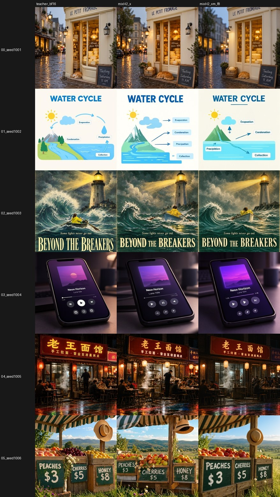

**Figure 17.** Teacher, mixH2_x and mixH2_xm_f8 on prompts 00-05. *Source:* `eval/sheet_mixH2_xm_f8_1.png`.

### 6.16 Judged comparison of all nine reports

**Table 11. Visual judge, 24 images each (mean scores, 0-5).**

| model (file) | F | T | C | Q | A | images with A of 4 or more |
|---|---|---|---|---|---|---|
| mixA (2.07 GB) | 3.50 | 1.4 | 2.14 | 3.81 | 2.90 | 7 / 24 |
| mixF_ptq (2.42 GB) | 4.29 | 4.36 | 2.71 | 4.29 | 4.02 | 20 / 24 |
| mixG_x (2.14 GB) | 4.50 | 4.43 | 3.36 | 4.44 | 4.29 | 22 / 24 |
| mixG_tuned (2.14 GB) | 4.48 | 4.79 | 3.64 | 4.23 | 4.21 | 21 / 24 |
| mixH_tuned (1.95 GB) | 4.31 | 4.00 | 3.29 | 4.29 | 4.10 | 18 / 24 |
| mixI_tuned (1.74 GB) | 3.54 | 1.14 | 2.07 | 3.54 | 3.15 | 6 / 24 |
| mixH2_x (1.95 GB) | 4.33 | 4.00 | 3.43 | 4.27 | 4.21 | 20 / 24 |
| mixH2_tuned (1.95 GB) | 4.29 | 3.93 | 3.36 | 4.29 | 4.17 | 20 / 24 |
| mixH2_xm_f8 (1.72 GB) | 4.25 | 4.00 | 3.79 | 4.21 | 4.15 | 21 / 24 |

*Source:* summary tables of `eval/judge_*.md`, recomputed from the per-image tables by `paper/_build/judge_table.py`; every mean matches the report's own `Overall` line. The nine reports are separate judge sessions with +-0.2 noise; the mixA row scores `mixA_lora32` (before tuning), not `mixA_x_tuned`, which was never fully judged.

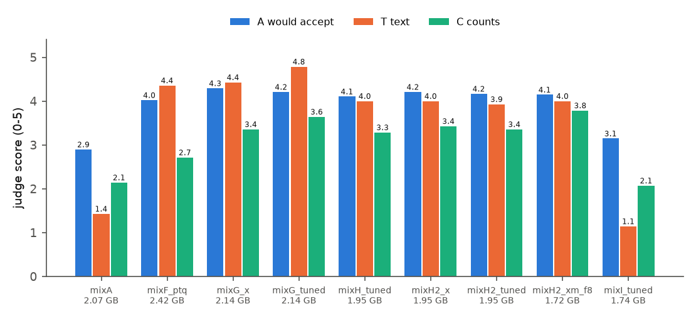

**Figure 18.** A, T and C of the nine judged models (labels rounded to 0.1; exact values in Table 11). *Source:* as Table 11.

**Table 12. Judge acceptance A by prompt category.**

| model | text (6) | portrait (4) | detail (4) | counting (2) | varied (8) |
|---|---|---|---|---|---|
| mixA | 1.67 | 3.75 | 3.00 | 2.00 | 3.56 |
| mixF_ptq | 4.08 | 4.25 | 4.00 | 2.25 | 4.31 |
| mixG_x | 4.17 | 4.38 | 4.38 | 3.50 | 4.50 |
| mixG_tuned | 4.08 | 3.88 | 4.50 | 4.00 | 4.38 |
| mixH_tuned | 3.83 | 4.25 | 4.13 | 3.50 | 4.38 |
| mixI_tuned | 2.25 | 3.50 | 3.50 | 2.75 | 3.56 |
| mixH2_x | 4.00 | 4.13 | 4.25 | 4.25 | 4.38 |
| mixH2_tuned | 3.83 | 4.38 | 4.00 | 4.25 | 4.38 |
| mixH2_xm_f8 | 4.00 | 4.13 | 3.88 | 4.25 | 4.38 |

*Source:* per-image tables of the judge reports, category means by `paper/_build/judge_table.py`; the per-image values are in Appendix G. Categories hold 2-8 images, so single images move the means by 0.1-0.5.

**Table 13. Side-by-side verdicts (per image, 24 images unless noted).**

| comparison | better | same | worse |
|---|---|---|---|
| mixF_ptq against the tuned mixA (9 prompts) | 7 | 0 | 2 |
| mixG_x against mixF_ptq | 15 | 9 | 0 |
| mixG_tuned against mixG_x | 7 | 14 | 3 |
| mixH_tuned against mixG_tuned | 5 | 12 | 7 |
| mixI_tuned against mixH_tuned | 0 | 4 | 20 |
| mixH2_x against mixH_tuned | 9 | 13 | 2 |
| mixH2_x against mixG_tuned | 4 | 17 | 3 |
| mixH2_tuned against mixH2_x | 8 | 12 | 4 |
| mixH2_tuned against mixG_tuned (secondary, lower confidence) | 3 | 16 | 5 |
| mixH2_xm_f8 against mixH2_x | 4 | 15 | 5 |

*Source:* the verdict sections of `eval/judge_mixF_ptq.md`, `judge_mixG_x.md`, `judge_mixG_tuned.md`, `judge_mixH_tuned.md`, `judge_mixI_tuned.md`, `judge_mixH2_x.md`, `judge_mixH2_tuned.md`, `judge_mixH2_xm_f8.md`. Verdicts compare different compositions (Section 10); for 11 of the mixG_x against mixF_ptq images the mixF side came from the earlier report's description.

**Table 14. Text and count outcomes as read by the judges.**

| model | text prompts accepted (A of 4 or more, of 6) | letter-exact (of 6) | balloons (prompt: exactly 5) | fruit bowl (prompt: 6 fruits; the teacher shows 5) |
|---|---|---|---|---|
| teacher | 6 (stated) | 6 (stated) | 5 | 5 |
| mixA | 0 | 0 | 6 | 6, with four apples |
| mixF_ptq | 5 | 3 | 4 | 4 |
| mixG_x | 5 | 4 | 5 | 4 |
| mixG_tuned | 5 | 6 | 5 | 5 |
| mixH_tuned | 4 | 3 | 6 | 5 |
| mixI_tuned | 0 | 0 | 4 | 4 to 5, mixed up |
| mixH2_x | 4 | 3 | 5 | 5 |
| mixH2_tuned | 4 | 2 (3 if one Chinese glyph variant is tolerated) | 5 | 5 |
| mixH2_xm_f8 | 5 | 4 | 5 | 5 |

*Source:* the text-prompt and counting sections of `eval/judge_*.md` (the mixA and mixF_ptq reports for the teacher's counts). One seed per prompt: a single image can change from run to run for reasons that are not systematic (the mixH2_tuned judge says so explicitly).

### 6.17 Local HPSv3-based preference scoring

HPSv3 [33] is a preference-score model built on the Qwen2-VL architecture. Its README describes it as trained on the HPDv3 dataset (1.08M text-image pairs and 1.17M annotated pairwise comparisons) and reports 76.9% preference accuracy on the HPDv3 benchmark; the Bonsai paper [1] uses it among its benchmarks. We use it as one more scorer of our 24 images per model, differently biased from CLIP, DINOv2 and the judge: the score `mu` of an image given its prompt, higher is preferred. The code is **our own minimal re-implementation** with the `transformers` library, not the reference package (`scripts/hps3_score.py`): the released checkpoint (MizzenAI/HPSv3, MIT licence) is loaded into `Qwen2VLModel`, the reward head is applied at the `<|Reward|>` token, the prompt template is read from the reference source, the 768 px images are resized to about 448 px (the HPSv3 input size) and, like the reference code, the language model gets plain sequential position ids. Validation is by plausibility only (`scripts/hps3_checks.py`, `logs/hps3_checks.log`): the score is deterministic (10.797 twice for the same example), a wrong prompt lowers the same images from 10.80 to -5.28 and from 7.04 to -7.77, a 96 px blur lowers 10.80 to 9.29, a gray image scores -9.15 and noise -10.21. The repository has no reference values, the reference environment used transformers 4.45.2 against our 5.14.1, and switching to transformers' 3D rotary position ids instead of sequential ids moves the two examples by -0.03 and +0.60, so absolute scores and small differences remain provisional until official numerical parity is established.

**Table 15. HPSv3 score of the evaluated models (24 prompts, 768 px images scored at about 448 px, one seed each).**

| model | file (GB) | mean mu [bootstrap 95% interval] | difference to the teacher +- paired SE (prompts where the model is higher) | judge A |
|---|---|---|---|---|
| bf16 teacher | 10.16 | 12.38 [11.76, 13.01] | - | |
| mixF_ptq | 2.42 | 10.86 [10.16, 11.59] | -1.53 +- 0.23 (4 / 24) | 4.02 |
| mixG_x | 2.14 | 12.09 [11.39, 12.74] | -0.30 +- 0.19 (7 / 24) | 4.29 |
| **mixG_tuned** | 2.14 | **12.14** [11.36, 12.87] | -0.24 +- 0.29 (9 / 24) | 4.21 |
| mixH_x | 1.95 | 11.88 [11.19, 12.53] | -0.50 +- 0.22 (8 / 24) | not judged |
| mixH_tuned | 1.95 | 11.70 [10.87, 12.45] | -0.69 +- 0.30 (7 / 24) | 4.10 |
| mixH2_x | 1.95 | 11.92 [11.32, 12.49] | -0.47 +- 0.19 (5 / 24) | 4.21 |
| mixH2_tuned | 1.95 | 11.90 [11.21, 12.53] | -0.49 +- 0.23 (8 / 24) | 4.17 |
| mixH2_x_f8 | 1.85 | 11.99 [11.36, 12.59] | -0.40 +- 0.18 (5 / 24) | not judged (metrics equal to mixH2_x) |
| mixH2_xm | 1.83 | 11.49 [10.83, 12.11] | -0.90 +- 0.22 (5 / 24) | not judged |
| mixH2_xm_f8 | 1.72 | 11.44 [10.76, 12.09] | -0.94 +- 0.20 (5 / 24) | 4.15 |
| mixI_x | 1.74 | 9.66 [8.97, 10.27] | -2.73 +- 0.29 (1 / 24) | not judged |
| mixI_tuned | 1.74 | 10.65 [9.94, 11.33] | -1.73 +- 0.31 (1 / 24) | 3.15 |
| mixA_x_tuned | 1.67 | 11.61 [10.91, 12.31] | -0.77 +- 0.28 (7 / 24) | not fully judged |
| uniform ternary v1 | 1.92 | -8.96 [-9.44, -8.39] | -21.35 +- 0.47 (0 / 24) | not judged (no structure) |

*Source:* `eval/hps3_summary.md` and `eval/hps3_summary.json` (made by `scripts/hps3_score.py`; rows reordered and wins recomputed by `paper/_build/hps_pairs.py`, output in `paper/_build/hps_pairs_output.txt`); judge A from Table 11. The paired SE is the standard deviation of the 24 per-prompt differences over the square root of 24. Per-category means are in Appendix H.

**Uncertainty is comparison-specific.** There are 24 fixed prompt-seed pairs and one training run per configuration. Paired SEs vary from 0.06 to 0.34 in these comparisons, so a global 0.46-point cutoff is not valid. Report each paired contrast and its interval; Table I8 provides selected exploratory 95% paired t intervals, with df = 23, and no adjustment for multiple comparisons. These intervals omit training, judge, and scorer-implementation uncertainty and do not establish equivalence. Judge ±0.2 is an informal spread estimate, not a measured standard error or confidence interval.

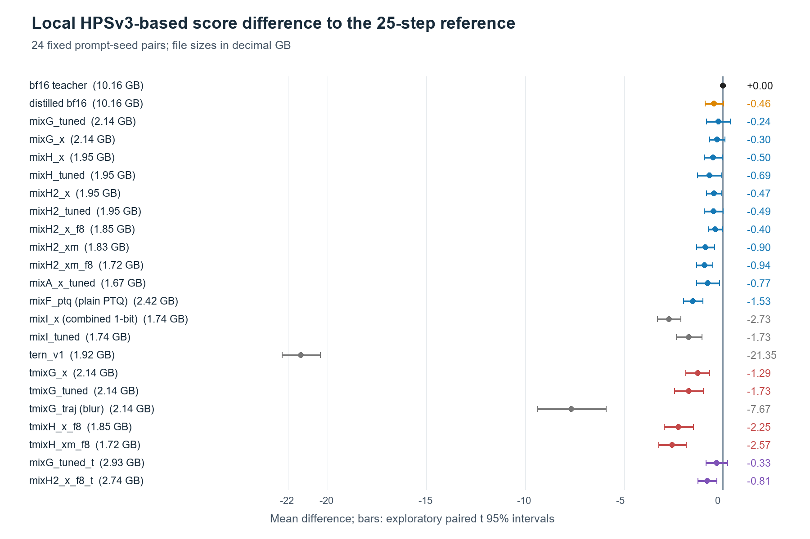

**Figure 19.** Local HPSv3-based mean differences from the 25-step teacher, including the later distilled runs for context. Bars are exploratory 95% paired t intervals, not a global noise band or equivalence test; all scored failures are shown. File sizes and comparison values are in Table I4. *Source:* `eval/hps3_*.json`, recomputed by `scripts/review_reporting.py`.

**Table 16. Selected paired HPSv3 differences (mean over the 24 prompts of a minus b).**

| comparison | a | b | difference +- paired SE | prompts where a is higher |
|---|---|---|---|---|
| fp8 LoRA factors only | mixH2_x_f8 | mixH2_x | +0.07 +- 0.06 | 13 / 24 |
| int4 modulation layers (without fp8 LoRA) | mixH2_xm | mixH2_x | -0.43 +- 0.18 | 8 / 24 |
| int4 modulation layers, on top of fp8 LoRA | mixH2_xm_f8 | mixH2_x_f8 | -0.55 +- 0.17 | 7 / 24 |
| both savings | mixH2_xm_f8 | mixH2_x | -0.47 +- 0.17 | 6 / 24 |
| end-to-end round on the 3-bit model | mixG_tuned | mixG_x | +0.05 +- 0.21 | 13 / 24 |
| end-to-end round on the 2-bit model | mixH2_tuned | mixH2_x | -0.02 +- 0.12 | 12 / 24 |
| twice the calibration data | mixH2_x | mixH_x | +0.04 +- 0.15 | 12 / 24 |
| 2-bit FFN against 3-bit FFN | mixH2_x | mixG_tuned | -0.22 +- 0.21 | 11 / 24 |
| 1-bit attention | mixI_tuned | mixH_tuned | -1.05 +- 0.21 | 3 / 24 |
| FFN int4 by rounding against FFN int3 by QAT | mixF_ptq | mixG_x | -1.23 +- 0.23 | 5 / 24 |
| the 3-bit model against the teacher | mixG_tuned | bf16 teacher | -0.24 +- 0.29 | 9 / 24 |
| the 1.85 GB model against the teacher | mixH2_x_f8 | bf16 teacher | -0.40 +- 0.18 | 5 / 24 |
| the 1.72 GB model against the teacher | mixH2_xm_f8 | bf16 teacher | -0.94 +- 0.20 | 5 / 24 |

*Source:* `eval/hps3_summary.json` (`mu_by_prompt`), computed by `paper/_build/hps_pairs.py` (`paper/_build/hps_pairs_output.txt`). One seed per prompt; comparison-specific intervals are required; no equivalence conclusion follows.

What the exploratory local scores show. No equivalence margin was prespecified, and the similar top-group point estimates do not establish equal quality. The fp8-factor contrast is +0.072 with 95% paired t interval [-0.042, +0.186]; the modulation contrast on top of fp8 is -0.546 [-0.902, -0.191]. Doubling calibration samples and nearly doubling optimizer steps changes HPS by +0.037 [-0.270, +0.343], not an identified data-only gain. Large failures remain evident: uniform ternary has no useful image structure and mixI loses text and scene fidelity. HPS is a preference signal, not a spelling or counting test, and these local inference scores remain provisional pending official numerical parity (Table I8).

### 6.18 Category winners

`scripts/category_winners.py` collects, per criterion, the best model from the `metrics.json` files, the HPSv3 summary and the judge scores (`eval/category_winners.md`). Table 17 gives the winners with the models that are not clearly separated by the available comparisons.

**Table 17. Highest observed scores and the limits of their comparisons.**

| category | winner | evidence | comparison limitations |
|---|---|---|---|
| best overall (judge A) | mixG_x (A 4.29) | judge reports | separate judge sessions; no formal equivalence or ranking test (A 4.10-4.21) |
| best text rendering | mixG_tuned (T 4.79; 6 of 6 letter-exact) | judge reports | highest observed T; separate judge sessions and only six exact-text prompts |
| best aesthetics (HPSv3) | mixG_tuned (mu 12.14; teacher 12.38) | HPSv3 | provisional local-score ranking; no equivalence test or universal significance cutoff |
| closest to the teacher | mixG_tuned (DINOv2 0.901, SSIM 0.666, latent cosine 0.750) | `metrics.json` | clear against the 1.95 and 1.72 GB models (paired DINOv2 +0.024 +- 0.005, higher in 20 of 24 images, against mixH2_x); only about 2 SE ahead of mixG_x (+0.017 +- 0.008, 14 of 24) |
| smallest acceptable (judge A of 4.0 or more) | mixH2_xm_f8 (1.72 GB; A 4.15) | judge and size | clear on size (0.13 GB below the next); costs HPSv3 -0.94 +- 0.20 against the teacher and a small colour drift |
| best size and quality value (A of 4.0 or more and HPSv3 within 0.5 of the teacher) | mixH2_x_f8 (1.85 GB; HPSv3 -0.40 +- 0.18; A 4.21 on the bf16-factor source model mixH2_x, not a judge result for this file) | judge, HPSv3 and size | not judged separately; metrics equal to mixH2_x within fp8 rounding of the LoRA factors |

*Source:* `eval/category_winners.md` (generated by `scripts/category_winners.py`), with the paired DINOv2 differences from `paper/_build/dino_pairs.py` (`paper/_build/dino_pairs_output.txt`) and the ties from Tables 11, 15 and 16. The "value" row uses the script's own thresholds. mixH_x, mixI_x and mixH2_xm are not judged; the uniform ternary and binary models and mixI are not acceptable on any measure.

**The available comparisons do not establish a reliable ranking of the top group.** Similar observed means do not demonstrate equivalent quality. mixG_tuned has the highest observed text score and six exact text prompts in this sample; fp8 factors reduce size with no clear loss detected, whereas modulation quantization lowers the local preference score. Generalization beyond these prompt-seed pairs and judge sessions remains unmeasured.

## 7 Findings and lessons

### 7.1 FFN precision carries text; the attention can go lower

The ablation (Section 6.7) and the plain-rounding study (Section 6.8) agree: with the FFN in bf16 or in int4 by rounding, text, prices, the Chinese sign and the observed balloon count is correct; the six-fruit prompt is not reliably correct even though the attention stays at 1-2 bits; with a 1-bit FFN in the middle blocks (mixA) they fail. Restoring the *attention* to bf16 made the images muddier, not better, which we read as co-adaptation: the FFN, LoRA and scales of the tuned model had been fitted to the quantized attention, so exchanging one half breaks the pairing (a hypothesis; we did not retrain the FFN against a bf16 attention to test it). The later models show how far each half can go. The attention allocation of mixA, mixG and mixH (int2 in most middle blocks, 1-bit qkv in 10 of 42 blocks, int4 at the ends) was acceptable in every one of them; moving qkv and o to 1 bit in 30 blocks (and ffn_down to 1 bit in 18) in mixI was not (Section 6.12). The working mixed recipe uses 2-bit middle-block components and rank-64 corrections; the failed combined mixI allocation does not identify a universal floor for either attention or FFN.

### 7.2 Measured rounding and trained recipes

By plain optimal-scale rounding of the FFN: int4 keeps text and counts, uniform int3 gives a green cast, noise and "WAER CYCLE", int2 gives noise (Sections 6.3, 6.8, 6.9). The weight error of the three kinds on a real FFN weight is 0.0107, 0.0377 and 0.122 (Table 4), a steady factor of 3 to 4 per bit, while the images change qualitatively between them. Training moves the working point by about a bit each time: a block-wise QAT int3 FFN with LoRA was judged better than int4 by rounding (15 better, 9 same, 0 worse; mixG_x against mixF_ptq, with the confounds listed in Section 6.9), and a trained int2 FFN with a rank-64 LoRA gave acceptable images (mixH, mixH2) where rounding to int2 gave noise. Weight error alone does not predict where a model breaks; the output behaviour does.

### 7.3 MSE sensitivity is not text sensitivity

The single-layer output-MSE map put blocks 1-22 at only 0.002-0.003 summed damage per block (all four linears together), and the allocator gave their FFNs one bit. The images then lost all text and counts. Restoring the FFN to bf16 fixed those failures (Section 6.7), and 4-bit rounding of the FFN did too (Section 6.8). The same map rated the middle-block attention and ffn_down as cheap, and mixI spent that budget (Section 6.12); the additive model already under-predicts at 1 bit (1.378 predicted against 2.046 measured for a naive all-binary file). Lesson: a sensitivity map must be computed with a metric that sees what you care about; the research notes list OCR- or CLIP-decoupled sensitivity for the critical linears as an open item, not done here.

### 7.4 Output-MSE proxies mislead

The text-held-out MSE proxy was lowest for the model with the worst text (0.0246) and higher for a model with good text (0.0727, FFN int4) (Table 8; the FFN-int4 variant is the pre-tuning state of mixF_ptq). It fails when the compared models differ in kind: a coarse FFN co-adapted with the rest of the network against an accurately rounded FFN (our hypothesis for the cause, not tested). The end-to-end proxy of Table 7 is more useful but only at coarse resolution. On its common holdout set the four models mixG_tuned, mixH2_tuned, mixH_tuned and mixI_tuned have errors of 0.0120, 0.0154, 0.0175 and 0.0329 and judged A of 4.21, 4.17, 4.10 and 3.15, the same order, and mixI is separated by a large margin in both. But the tuning rounds, which optimise this very quantity, lowered it by 14-25% in every run (mixH2: -14.6%) without a matching gain in A or T (Sections 6.10, 6.12, 6.14), and mixG_tuned and mixH2_x differ by a factor 1.5 in the proxy with identical A (4.21) and a 0.79 gap in T. Use images, and a judge that scores text and counts.

### 7.5 CLIP score and DINOv2 similarity are blind to text and count errors

mixA scores CLIP 35.66 (98.6% of the teacher) and 0 of 6 on text. By category, CLIP over the six text prompts is 34.53 for mixA (teacher 36.14, judged T 1.4), 36.92 for mixF_ptq and 36.77 for mixG_x (judged T 4.4 and 4.4), i.e. a 2.4-point CLIP move for a three-point judged move. The later models show the failure in both directions (Table 18): mixI_tuned has text-prompt CLIP 35.80, only 0.34 below the teacher, with 0 of 6 text prompts accepted and judged T 1.14; mixH_x has the highest text-prompt CLIP of all (37.58, 1.4 above the teacher) with garbled diagram labels; on the two counting prompts mixI_tuned has the highest CLIP (35.93) and a judged C of 2.07, while mixG_tuned (34.92, below the teacher's 35.15) has the best judged C (3.64, exactly five balloons). Overall CLIP is lower for the failed models (mixA 35.66, mixI_x 35.60, mixI_tuned 35.93) than for the acceptable ones (36.07-36.68), but by only 0.1-1.0 points (mixI_tuned is 0.18 below mixH_tuned), and it cannot order the acceptable models: mixH2_xm has the highest of all (36.68) and mixH2_xm_f8 (36.61) a judged T of 4.00 against 4.79 for mixG_tuned (36.35). The prompt truncation to 77 tokens (late parts of an 89-word caption, where the quoted strings often sit, are not seen) is a contributing factor we did not quantify. The HPSv3 score (Section 6.17) is less blind at the coarse level: its text-prompt gap to the teacher is +0.06 for mixG_tuned, -0.54 for mixH2_x, -1.57 for mixA_x_tuned and -2.24 for mixI_tuned, against CLIP gaps of -0.34 for mixI_tuned and +0.5 to +1.0 for the acceptable models. It is a preference score, though, and not a spelling check: it ranks mixF_ptq (judged acceptable) below mixA_x_tuned, and six prompts are a thin base. DINOv2, SSIM and PSNR against the same-seed teacher image mostly track how closely the composition was kept (a quantized model draws a different composition, Section 10): they are low for mixI (DINOv2 0.745-0.788), but they also fall to 0.851 for the int4-modulation model that the judge accepts, and mixF_ptq (DINOv2 0.802, SSIM 0.438) is lower than mixA (0.812, 0.583) although the judge scores them 4.02 and 2.90.

**Table 18. Mean CLIP score by prompt category, with the judged text and count scores.**

| model | text (6) | portrait (4) | detail (4) | counting (2) | varied (8) | all (24) | judged T | judged C |
|---|---|---|---|---|---|---|---|---|
| teacher | 36.14 | 38.06 | 34.80 | 35.15 | 36.19 | 36.17 | | |
| mixA | 34.53 | 38.09 | 33.60 | 35.80 | 36.29 | 35.66 | 1.4 | 2.14 |
| mixA_x_tuned | 35.75 | 36.82 | 33.53 | 35.76 | 36.36 | 35.76 | not judged | not judged |
| mixF_ptq | 36.92 | 37.44 | 32.75 | 35.11 | 36.67 | 36.07 | 4.36 | 2.71 |
| mixG_x | 36.77 | 37.70 | 34.20 | 35.66 | 36.48 | 36.31 | 4.43 | 3.36 |
| mixG_tuned | 36.65 | 37.72 | 35.05 | 34.92 | 36.46 | 36.35 | 4.79 | 3.64 |
| mixH_x | 37.58 | 37.96 | 34.14 | 35.55 | 36.79 | 36.64 | not judged | not judged |
| mixH_tuned | 36.82 | 36.52 | 34.16 | 35.20 | 36.59 | 36.11 | 4.00 | 3.29 |
| mixI_x | 35.79 | 38.25 | 31.37 | 34.25 | 36.58 | 35.60 | not judged | not judged |
| mixI_tuned | 35.80 | 37.77 | 33.50 | 35.93 | 36.33 | 35.93 | 1.14 | 2.07 |
| mixH2_x | 36.98 | 39.02 | 33.96 | 35.37 | 35.91 | 36.33 | 4.00 | 3.43 |
| mixH2_tuned | 37.13 | 37.66 | 33.38 | 35.20 | 36.63 | 36.26 | 3.93 | 3.36 |
| mixH2_x_f8 | 37.28 | 38.84 | 34.09 | 35.18 | 35.96 | 36.39 | not judged | not judged |
| mixH2_xm | 37.07 | 39.52 | 32.94 | 35.22 | 37.21 | 36.68 | not judged | not judged |
| mixH2_xm_f8 | 36.94 | 39.52 | 33.06 | 35.18 | 37.05 | 36.61 | 4.00 | 3.79 |

*Source:* `eval/<model>/metrics.json` (`per_image.clip_student`, `clip_teacher`) grouped with the categories of `eval/eval_prompts.json` by `paper/_build/tables_v2.py`; judged T and C from Table 11. The counting column rests on two prompts.

### 7.6 Classifier-free guidance amplifies the error

In the end-to-end tuning logs the relative error of the CFG-combined velocity (`v_u + 2.5 (v_c - v_u)`) is 2.2-2.4 times the error of the single predictions for all five LoRA-based runs, before and after tuning (Table 7: 2.38 and 2.44 for mixA_x, 2.30 and 2.31 for mixG, 2.28 and 2.26 for mixH, 2.26 and 2.22 for mixI, 2.26 and 2.30 for mixH2; 2.42 on the text set of the tuned mixA, `logs/proxy_text.log`). Variants with a restored, rounded or collapsed block group show lower ratios (1.2-2.0, Table 8). The ratio is nearly the same for models whose single-prediction error differs threefold (mixG_x 0.014, mixI_x 0.044), which fits an amplification set by the guidance formula and the size of the cond-uncond difference rather than by the quality of the quantization; that reading is ours and was not tested (we did not sample our models without CFG or with fewer steps). Bonsai samples with four steps at guidance 1.0 (Section 2.1): a model used without CFG and with far fewer steps would not see this amplification or this accumulation. `NOTES.md` attributes the base model's behaviour to step distillation; the Bonsai text itself only states the four-step, guidance-1.0 regime, so that attribution is our hypothesis. It is the reason we think a 2-bit target is harder for a 25-step, CFG-2.5 model, and a possible reason for the gap to Bonsai; the explanation of our failures remains a hypothesis.

**Update in version 3: the hypothesis is not supported.** Section 8 runs the test that this subsection could not: the same recipes against a 4-step, CFG-1 distilled teacher. If CFG amplification and step accumulation were what made low-bit targets hard, that teacher should have been easier to quantize. It was harder on every measure that can be compared. With the same allocation, rank, sample count (1,536) and loss, the student-stream error after block 41 is 0.105 against 0.032 for the mixG recipe and 0.121 against 0.038 for the mixH recipe, with the gap opening in blocks 36-41 (Figure 22); the HPSv3 gap to the model's own teacher is -0.83 +- 0.16 against -0.30 +- 0.19 (mixG recipe) and -1.79 +- 0.22 against -0.50 +- 0.22 (mixH recipe); the judged acceptance falls from 4.29 (mixG_x) to 4.06 (tmixG_x), and from 4.10 (mixH_tuned, which had a tuning round) to 3.58 (tmixH_x_f8). These comparisons confound the teacher with the calibration resolution (768 px against 512 px) and with the judge baseline (Section 5.3), and each rests on one training run, but they all point the same way. In our setting the guidance and the number of steps are therefore not what makes a 2-bit target hard for this model, and the gap to Bonsai remains unexplained.

### 7.7 Larger-data and longer-training recipes, and the combined 1-bit allocation

The 1.95 GB mixH2 recipe uses 3,000 samples and 750 optimizer steps per block versus 1,536 and 384 for mixH. Its observed A is 4.21 versus 4.10 for mixH_tuned and 4.21 for mixG_tuned, but these are different judge sessions and the first comparison also changes end-to-end tuning. These results do not isolate a distinct-data effect or establish equal quality. Small-text spelling remains weaker than mixG_tuned on this set. The combined mixI attention-and-FFN-down downgrade fails despite rank-64 corrections and tuning; the attention-only contribution remains unidentified.

### 7.8 Extra tuning rounds are trades, not gains

The first round on mixA fixed large lettering and, by the mixF_ptq judge's side-by-side, the balloon and fruit counts (Section 6.6). On the better models, a round did not raise overall acceptance: mixG_tuned against mixG_x A 4.21 against 4.29, with T +0.36 (of which about 0.2 is a reading difference), C +0.28, Q -0.21 and verdicts 7/14/3; mixH2_tuned against mixH2_x A 4.17 against 4.21, T 3.93 against 4.00, letter-exact 2 of 6 against 3 of 6, verdicts 8/12/4. Each round moved the 24 final latents by 0.28-0.35 in relative distance (Table 10 and `paper/_build/latent_drift_output.txt`), so the verdicts compare re-drawn compositions. Where text exactness matters, mixG_tuned is the only model with six exact strings; at 1.95 GB we ship the untuned model. The distilled teacher shows the same pattern (Section 8.5): a teacher-forced round lowered the one-step holdout error by 13% and left the judged averages inside the noise (A 3.98 against 4.06), with new local artifacts in three images.

### 7.9 Operational lessons

- **Never trust a loader or inference path before it reproduces the training-side proxy on the same file.** One missing branch in a dispatch handler turned a good model into noise (Section 6.5). `test_loader_proxy.py` ran after training in queue7, queue8 and queue11 (mixA_x_tuned: 0.02485, equal to the tuning log), but **not for the later files** (int3, fp8 LoRA, mixG onward): for those the loader is covered by CPU unit tests (`test_int3.py`, `test_lora_fp8.py`: the loader layout equals a dense reference to one bf16 ulp) and by the generated images, not by a loader-proxy log. Compact fp8-LoRA files are decoded wrongly, with only a warning, by a loader that predates them (Section 3.5).
- **Windows VRAM paging stalls (inference).** In the generation runs from mixF_ptq to mixI_tuned, the *sixth* image of every worker process stalled: the sampler went from about 1.0-1.1 s per step to 29-35 s per step (roughly 30 times slower), for example 33 s per step at step 12 of an image, with no error and no recovery. The watchdog of that time (420 s per image) killed the worker, the supervisor restarted it and skipped finished images, four times per 24-image run (`logs/gen_mixG_x.log` shows images 0-4, a stall, images 5-9, a stall, and so on). The earlier mixC run, without any of this, slowed gradually (1.0 to 1.65 s per step over ten images) and then took 1,243-1,484 s per image (49-59 s per step, 44-52 times longer) for images 10-15, and the evaluation ended after 16 images. In training, one uniform-binary block took 1,514 s against 23 s (66 times) while another process shared the GPU (`logs/full_bin_v1.log`, block 5). The cause was diagnosed in the project (comment in `gen_inproc.py`) as Windows paging VRAM to system RAM when the card runs short; we did not verify that with driver counters, and "no error, abrupt, non-recovering slowdown" is all the logs show. The fix in `gen_inproc.py` has three parts: `reserve_vram = 2.5` GB of headroom for the desktop, a per-image watchdog (150 s; a normal image takes about 30 s) that exits the worker, and a supervisor that restarts the worker, planned after every 5 images (`--recycle`) so that a worker never reaches the state in which it stalled. The runs from mixH2_tuned onward had four planned restarts and no stall (`mixH2_x` shows one stall and three planned restarts, the transition).
- **One big GPU job at a time on a 16 GB card.** Two big jobs thrash. One 42-block QAT run took 72-74 minutes for mixA, mixG, mixH and mixI (`logs/mixA_lora32_std.log`, `logs/mixG_lora32.log`, `logs/mixH_lora.log`, `logs/mixI_lora.log`), 138 minutes for mixH2 (3,000 samples), and an end-to-end tuning run about an hour (62-72 minutes to step 700).
- **Queue and skip.** Training, evaluation and tuning were chained through small shell queues (`scripts/queue*.sh`, each waiting for the previous one's `.done` file); a skip flag in `e2e_tune.py` allows cancelling a queued stage without editing a running script.
- **Keep an ablation harness.** `make_hybrid.py` (restore or requantize chosen layer groups) located the real cause of the text failures with about an hour of image generation (eval image timestamps 16:18-17:20 on 2026-10-27).
- **A judge is an instance.** Keep the reports, state the rubric, ask for per-image verdicts against a named reference and read averages inside +-0.2 as ties; differences in strictness between sessions are visible in the reports themselves (Section 5.3).
- **Report only what is traceable.** Several numbers in `NOTES.md` could not be tied to a log file (Appendix F).
- **A bimodal failure that differs between runs points at execution state, not at the model (new in version 3).** The runtime-LoRA runs on quantized files produced intact images (HPSv3 +6 to +14) and collapsed ones (about -10) from the same file, and a different set of prompts at 4 and at 6 steps; every collapsed image was the first or the second image of a generation worker (Section 8.3). We had read it as a quantization result and the cause was the loader. Before attributing a bimodal failure to a model, list the outcomes by position in the process (first image after a start, memory state) and repeat the same file.
- **A loader that cannot do something should refuse (new in version 3).** The layout accepted a LoRA patch without complaint and re-encoded the weights. The fix is an error whose message names the way out (Section 3.3).
- **Count the copies, not only the samples (new in version 3).** The first block-wise QAT run at 768 px kept five copies of the token streams, 21.7 GB each for 1,536 samples, and filled the machine (box in Section 8.4).
- **A distance to a reference measures movement, not harm (new in version 4).** The int4 encoders are far from the bf16 encoder on DINOv2, SSIM and latent cosine (0.93, 0.80, 0.83) and equal to it on HPSv3 and on the judge's comparison; ComfyUI's GPTQ encoder is closer (DINOv2 0.981) and no better (Section 9.5). The conditioning error against the bf16 encoder, measured without the DiT, ordered all the encoders correctly (Section 9.8). Use a quality score, a judge or a direct measure, and keep the image distance for what it is.
- **Count before you explain (new in version 4).** One ghosted face in one image became a hypothesis about our encoder; a blind count of 36 images per variant showed the same artifact in the unquantized distilled teacher (3 of 6 seeds) and a different, clearer defect (translucent kitchen furniture) that the single image did not show (Section 9.6). The aggregate that tied (HPSv3 mean) and the single image that did not were both incomplete.
- **Look inside the file you download, and ask who already solved it (new in version 4).** The stock int8 and GPTQ encoders keep the lm_head, the MTP head and the vision tower, 1.80 and 2.42 GB that the text conditioning does not use (Table 29); pruning ComfyUI's GPTQ file beat our own quantizer at the same nominal 4 bits (conditioning error 0.011 against 0.119, Table 37).

## 8 A step-distilled teacher: quantizing the 4-step model

The model of Sections 1-7 is sampled with 25 steps and CFG 2.5. It has a step-distilled companion: the same bf16 checkpoint plus a LoRA (`akhaliq/MOSS-Image-SFT-4-steps`, file `lora.safetensors`, rank 128, alpha 128, fp32, trained at 1024 px only, Apache-2.0; [34]) that is sampled with 4 steps, CFG 1.0 and `euler` / `simple`. Section 7.6 guessed that this regime is part of why Bonsai-style models can go lower: there is no guidance to amplify the error and there are far fewer steps to accumulate it. This chapter applies the LoRA, re-runs the recipes of Section 4 against the result, and reports what worked and what did not, including a false negative that came from our own loader. Every number is from a file on disk (sources under each table); the text encoder is not touched here (Section 8.7).

**Protocol and names.** Unless stated otherwise: the 24 prompts and seeds of Section 5.1; 4 steps, CFG 1.0, `euler`, `simple`, no negative prompt; images at 1024 x 1024 (primary) and 768 x 768; image metrics (Section 5.2) against the distilled bf16 model's image of the same seed and resolution, so they measure how closely a student follows its teacher and not how good its images are; HPSv3 as in Section 6.17; the judge as in Section 5.3, with the reference of A being the distilled teacher's image for the student reports. *turbo4* is the bf16 model with the LoRA as ComfyUI deploys it (`eval/turbo4_1024`, `eval/turbo4_768`). The merged teacher is the same model written to one file (Section 8.2). The prefix "t" marks a student trained against that merged teacher: **tmixG_x** (mixG recipe: `alloc_mixG.json`, int3 FFN with int4 at the ends, rank-32 LoRA, 1,536 samples, text embedder quantized), **tmixG_tuned** and **tmixG_traj** (tmixG_x plus an end-to-end round, teacher-forced or trajectory-level), **tmixH_x_f8** and **tmixH_xm_f8** (mixH recipe: `alloc_mixH.json`, int2 FFN in blocks 6-35, rank 32 and 64, 1,536 samples, fp8 LoRA factors; "xm" adds the int4 modulation layers). `turbo_on_*` and `turbo6_on_*` are quantized 25-step models with the LoRA applied by ComfyUI at run time (4 and 6 steps); `turboF_*` the same models with the LoRA folded into the file. A file's size depends only on its allocation: tmixG_x, tmixH_x_f8 and tmixH_xm_f8 have exactly the byte sizes of mixG_x, mixH2_x_f8 and mixH2_xm_f8 (2.14, 1.85 and 1.72 GB; Table A1).

### 8.1 Motivation, and the distilled model as a teacher

Before quantizing anything, the distilled model had to be shown to be a worthy teacher, because a student inherits its teacher's flaws. The judge report `eval/judge_turbo4.md` scored turbo4 at 1024 px against the 25-step teacher's image of the same prompt (Table 19).

**Table 19. The distilled bf16 model (turbo4) against the 25-step teacher, 24 prompts.**

| model | steps / CFG | HPSv3 mean mu [bootstrap 95%] | judge F | judge T | judge C | judge Q | judge A | A of 4 or more | against the 25-step teacher's image (better / same / worse) | quoted strings letter-exact (of 6) |
|---|---|---|---|---|---|---|---|---|---|---|
| bf16 teacher (768 px) | 25 / 2.5 | 12.38 [11.76, 13.01] | | | | | | | | 6 (as stated in the reports) |
| **turbo4**, 1024 px | 4 / 1.0 | 11.93 [11.24, 12.58] | 4.23 | 4.71 | 4.14 | 4.31 | 4.21 | 18 / 24 | 8 / 11 / 5 | 6 |
| turbo4, 768 px | 4 / 1.0 | 11.93 [11.24, 12.61] | not scored (9 prompts looked at) | | | | | | | exact on ids 0, 2, 3, 4, 5 |
| for scale: mixG_tuned (768 px) | 25 / 2.5 | 12.14 [11.36, 12.87] | 4.48 | 4.79 | 3.64 | 4.23 | 4.21 | 21 / 24 | | 6 |

*Source:* `eval/judge_turbo4.md` (means recomputed by `paper/_build/tables_v3.py`, which matches the report's own Overall line), `eval/hps3_turbo.json`, `eval/hps3_summary.json`, `eval/judge_mixG_tuned.md` (Table 11). The paired HPSv3 difference turbo4 (1024 px) minus the teacher is -0.46 +- 0.23, higher in 7 of 24 prompts. The A of turbo4 is against a different composition drawn from the same seed (defects are differences); the A of mixG_tuned is against a near-identical composition (defects are degradations), so the two A values are comparable in meaning, not strictly in scale. The 768 px row is a secondary look at ids 0-5, 10, 14 and 15 (observed, not scored; the judge states the text exact for ids 0, 2, 3, 4 and 5).

Reading. A 4.21 and T 4.71 (4.92 on the six quoted-text prompts alone); all six quoted-text prompts are letter-exact, including the Chinese sign and its 11-character sub-line; against the 25-step teacher's image 8 are better, 11 the same and 5 worse. The worse ones are the infographic (01: pale, low contrast, a ghost panel), three close-up portraits (06, 07, 09: younger, prettier, details such as age, a plain backdrop, a train window or clay crust dropped) and the typewriter macro (10: garbled paper text). The style differs from the teacher's in a consistent way: no burnt or over-sharpened look and no global colour shift, but contrast about 7% lower (luminance standard deviation 0.191 against 0.205), Laplacian edge energy about 60% of the teacher's (0.031 against 0.051), wider and calmer compositions, and small second-level details dropped silently rather than distorted. At 768 px there is no haze or wash-out (the judge looked for the warning of the model card and did not see it), the text is as exact, and the 768 px image is better for two prompts (01, 10) and worse for one (05), so a student can be trained and evaluated at 768 px. The judge's verdict: the distilled model is essentially as good as the 25-step teacher on average, at the level of mixG_tuned (A 4.21 for both) and not above it, and its flaws (portrait grit, exact multi-type counts, macro text) would be inherited by a student. HPSv3 agrees at the coarse level (11.93 against 12.38) and separates the two by about two standard errors.

### 8.2 Two findings about the LoRA itself

**The deployed bf16 merge keeps only part of the intended delta.** ComfyUI applies a LoRA to a bf16 weight as bf16(W + alpha/rank x up @ down). Its "stochastic rounding" helper (`comfy/float.py`) is a plain `value.to(bfloat16)` for bf16, so the baked merge and the cast-time patch are both round-to-nearest. The delta is small against a bf16 step. Per linear, |dW|/|W| is between 2e-4 and 1.1e-3, 4% to 27% of the weights change by one bf16 step, and the applied delta keeps 12% to 80% of the intended one (projection of the applied on the intended delta; cosine 0.30 to 0.84) (Table 20). The model card, as recorded in the project notes, says the LoRA must stay unmerged in fp32 for this reason. The deployed model nevertheless scores as in Table 19, so the distilled model is robust to the loss, and an fp32-exact merge, which a bf16 ComfyUI cannot deploy, might be better; we did not test that on the bf16 model. The folded quantized files of Section 8.3 accumulate the correction from bf16-stored factors in fp32 and round the reconstructed weight to the compute dtype and score 12.05 in HPSv3 against 11.93 for turbo4 (+0.13 +- 0.15), which is compatible with that guess and not a test of it.

**Table 20. How much of the LoRA delta the bf16 merge keeps (12 of the 168 block linears).**

| layer | linear | norm ratio dW / W | kept (projection of the applied on the intended delta) | cosine | weights changed |
|---|---|---|---|---|---|
| 0 | qkv | 0.0006 | 0.48 | 0.62 | 16.2% |
| 0 | o | 0.0007 | 0.50 | 0.63 | 15.2% |
| 0 | ffn_up_gate | 0.0003 | 0.16 | 0.35 | 6.0% |
| 0 | ffn_down | 0.0002 | 0.12 | 0.30 | 4.4% |
| 20 | qkv | 0.0003 | 0.22 | 0.41 | 7.8% |
| 20 | o | 0.0004 | 0.35 | 0.54 | 10.2% |
| 20 | ffn_up_gate | 0.0003 | 0.19 | 0.38 | 6.3% |
| 20 | ffn_down | 0.0002 | 0.20 | 0.39 | 5.4% |
| 41 | qkv | 0.0005 | 0.45 | 0.59 | 19.3% |
| 41 | o | 0.0004 | 0.34 | 0.51 | 11.5% |
| 41 | ffn_up_gate | 0.0011 | 0.80 | 0.84 | 26.6% |
| 41 | ffn_down | 0.0007 | 0.44 | 0.58 | 16.0% |

*Source:* `paper/_build/test_distill_lib_output.txt`, the output of `scripts/test_distill_lib.py` run on the CPU for this report on layers 0, 20 and 41 (the script reads the LoRA and the teacher weights and writes nothing); the ranges quoted in the text are the same as in `NOTES.md`, which recorded them from an earlier run of the same script (no log of that run exists). The qkv delta is the fused [q | k | v] delta of the three separate LoRA factors.

For quantization the consequence is that the delta (a norm ratio of at most 1.1e-3) is about two orders of magnitude below the rounding error of even int4 (a norm ratio of about 0.10, the square root of the 0.0107 of Table 4). A quantized copy of the SFT model cannot contain it; it has to be added on top of the quantized weights (Section 8.3) or the quantization has to be trained against the merged weights (Section 8.4).

**A merged teacher checkpoint approximates the LoRA-patched images.** `scripts/make_turbo_teacher.py` merges the LoRA (round-to-nearest in bf16, i.e. what ComfyUI deploys) into the 168 block linears of the bf16 checkpoint, copies every other tensor, and writes one file of the original size, 10,164,655,808 bytes. The pipeline of Section 4 reads its teacher from that file (`MOSS_TEACHER`), so the sensitivity, capture, target and training scripts needed no change. Table 21 compares the images of the merged checkpoint with those of the LoRA-patched model for the same prompts and seeds.

**Table 21. Merged teacher checkpoint against the LoRA-patched images (1024 px, 4 steps, CFG 1, 24 prompts), and two comparisons for scale.**

| comparison (candidate against the LoRA-patched turbo4 image) | PSNR (dB) | SSIM | DINOv2 cosine | relative latent MSE | latent cosine | CLIP (reference CLIP) |
|---|---|---|---|---|---|---|
| **merged teacher checkpoint** | 27.26 | 0.903 | 0.984 | 0.0994 | 0.950 | 35.80 (35.89) |
| for scale: tmixG_x (2.14 GB student) | 16.56 | 0.647 | 0.897 | 0.6905 | 0.650 | 35.75 (35.89) |
| for scale: turboF_mixG_tuned (2.93 GB, folded LoRA) | 14.48 | 0.558 | 0.869 | 0.9697 | 0.537 | 35.76 (35.89) |

*Source:* `eval/turbo4_merged_1024/metrics.json`, `eval/tmixG_x_1024/metrics.json`, `eval/turboF_mixG_tuned/metrics.json` (reference images `eval/turbo4_1024`); `paper/_build/tables_v3.py`.

The merged checkpoint gives the same model family and look and is not bit-identical. The notes attribute the difference to the rounding of the patch path and to GPU non-determinism, both amplified over four steps; we have no separate measurement of the second. It is far closer to its reference than any quantized student, which is the property the teacher needs.

### 8.3 A loader bug that produced a false negative

**The first attempt.** The cheapest test of whether the 4-step map survives our quantization needs no retraining: load the LoRA through ComfyUI's patcher at strength 1.0 on top of two category winners of the 25-step ladder, mixG_tuned (2.14 GB, exact text) and mixH2_x_f8 (1.85 GB, best size and quality value; Table 17), and sample 4 steps at CFG 1 and 1024 px (`scripts/queue24.sh`). A second queue repeated it at 6 and 8 steps in case more steps would rescue the combination (`scripts/queue25.sh`).

**The result looked like a verdict.** The HPSv3 scores are bimodal (Table 22, Figure 20). Of the 24 images of mixG_tuned, 12 score about -10 and the other 12 score +9 to +14; for mixH2_x_f8 it is 13 collapsed images and 11 intact ones (+6 to +14); at 6 steps 14 of 24 mixG_tuned images are collapsed. The collapsed images are flat or textured colour fields (Figure 21, left). The means of the two 4-step runs, 0.68 and -0.63, sit far below the 11.93 of the distilled bf16 model, so, taken at face value, half the images of a quantized model break under the 4-step map: quantization and step distillation do not mix. That reading is wrong; the next observations show why.

**Table 22. The LoRA applied by ComfyUI at run time to quantized models, and the folded redo (1024 px, CFG 1; collapsed = HPSv3 mu below 0).**

| run | file (GB) | steps | collapsed images | HPSv3 mean (all 24) | mean of the intact images | mean of the collapsed images | lowest intact image | position in the worker's life: collapsed / intact |
|---|---|---|---|---|---|---|---|---|
| turbo_on_mixG_tuned (LoRA at run time) | 2.14 | 4 | 12 / 24 | 0.68 | 11.45 | -10.09 | 9.14 | 1-2 / 3-5 |
| turbo_on_mixH2_x_f8 (LoRA at run time) | 1.85 | 4 | 13 / 24 | -0.63 | 10.67 | -10.19 | 5.82 | 1-2 / 3-5 |
| turbo6_on_mixG_tuned (LoRA at run time) | 2.14 | 6 | 14 / 24 | -0.69 | 11.61 | -9.48 | 6.76 | 1-2 / 3-5 |
| turbo6_on_mixH2_x_f8 (LoRA at run time) | 1.85 | 6 | 14 / 23 flat-colour images, read from the contact grid | not scored | | | | 1-2 / 3-5 |
| **turboF_mixG_tuned (LoRA folded into the file)** | 2.93 | 4 | **0 / 24** | **12.05** | 12.05 | | 7.09 | / 1-7 |
| **turboF_mixH2_x_f8 (LoRA folded into the file)** | 2.74 | 4 | **0 / 24** | **11.57** | 11.57 | | 5.91 | / 1-7 |
| for scale: turbo4, the distilled bf16 model | 10.16 | 4 | 0 / 24 | 11.93 | 11.93 | | 7.32 | |

*Source:* `eval/hps3_turbo_quant.json`, `eval/hps3_turbo_quant_steps.json`, `eval/hps3_turbo_fold.json`, `eval/hps3_turbo.json` (means over the 24 prompts; the lowest intact image is the minimum of the per-prompt mu); positions in the worker's life and times from `logs/gen_turbo_on_*.log`, `gen_turbo6_on_*.log`, `gen_turboF_*.log` by `paper/_build/collapse_v3.py` (output in `paper/_build/collapse_v3_output.txt`). The 6-step run of mixH2_x_f8 was cut off after 23 images and not scored (`logs/hps3_turbo_quant_steps.log`); its 14 flat-colour images were counted by eye on `eval/grid_turbo6_on_mixH2_x_f8.png`. The 8-step runs produced no images. File sizes from `out/*.safetensors`.

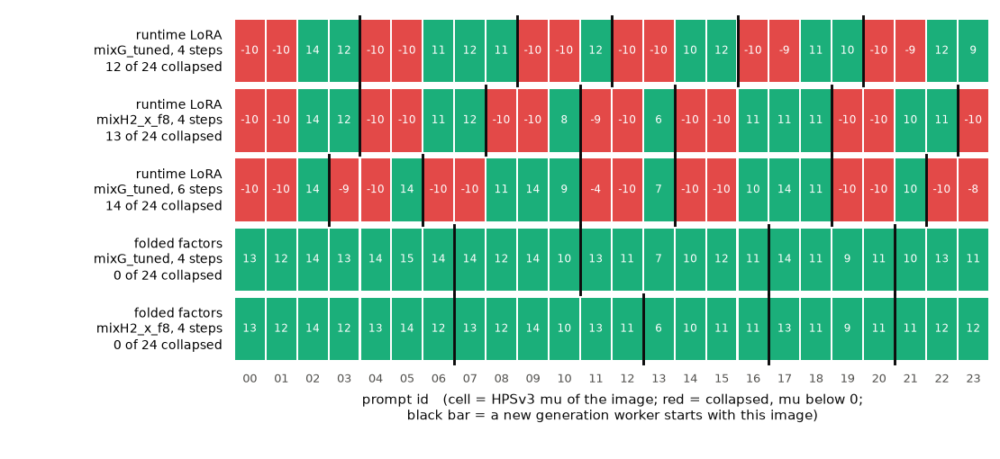

**Figure 20.** HPSv3 mu of each of the 24 images in five runs; red cells are collapsed images (mu below 0), green cells are intact ones, and a black bar marks the image with which a new generation worker started (a worker is the process of `gen_inproc.py`; the supervisor restarts it after a stall or a planned recycling, Section 7.9). In the three runtime-LoRA rows every collapsed image is the first or the second of its worker and every image from the third on is intact; the two folded rows have no collapsed image at any position. *Source:* `eval/hps3_turbo_quant.json`, `hps3_turbo_quant_steps.json`, `hps3_turbo_fold.json`, restart positions from the generation logs, `paper/_build/build_figures_v3.py`.


**Figure 21.** The 24 images (ids 00-23) of mixG_tuned with the 4-step LoRA applied by ComfyUI at run time (left; 12 collapsed) and with the LoRA folded into the file (right; none collapsed), same seeds. *Source:* `eval/grid_turbo_on_mixG_tuned.png`, `eval/grid_turboF_mixG_tuned.png`, composed by `paper/_build/build_figures_v3.py`.

**Why it was not the model.** Four observations, three of them from the logs.

- The same file, prompts and seeds collapse or survive depending on the run: at 4 steps the collapsed images of mixG_tuned are ids 0, 1, 4, 5, 9, 10, 12, 13, 16, 17, 20 and 21; at 6 steps they are 0, 1, 3, 4, 6, 7, 11, 12, 14, 15, 19, 20, 22 and 23 (id 11 at -3.81 is the one partial case). The notes called this out first: a different set collapses at 4 and at 6 steps.
- The failure follows the position in the life of a generation worker, not the prompt. In the three scored runs all 39 collapsed images are the first or the second image after a worker (re)start, and none of the 33 images from the third on is collapsed; in the 6-step run of mixH2_x_f8 the 14 flat-colour images are again all at positions 1-2 and the 9 other images at positions 3-5. Because the restarts fall at different images in different runs, a different set of prompts is hit each time.
- The loader counted its requantize calls in one run. The log of the 6-step mixH2_x_f8 run prints a cumulative counter after each image: 168 after image 20, 336 after image 21 and 336 after image 22. Image 20 is the first image of its worker and the counter is read at the end of each image, so this is one full pass over the 168 block linears (168 is their number) by the end of the first image, a second pass during the second image, and none during the third. Images 20 and 21 are flat colour fields; image 22 is a clean kitchen.
- The timing shows the same worker life in every run, with and without the LoRA: two fast images, a third that is about 1-2 s slower, then a stall that ends the worker (the Windows VRAM behaviour of Section 7.9). At 4 steps the collapsed images took 7.4-8.2 s (the very first image of a run is slower), the intact third images 8.9-9.8 s and the stalled fourth images 97-141 s; the folded files, which never collapse, show 6.9-7.8 s, 7.9-9.1 s and 65-126 s at the same positions. The collapse is tied to the first two phases of that cycle, not to extra sampling work.

**Cause (a loader bug).** When ComfyUI loads a LoRA-patched weight, or faults it back into the GPU buffer under dynamic VRAM (`post_cast` in `comfy/ops.py`), it re-encodes the patched weight with `QuantizedTensor.requantize_from_float`, which calls the layout's `quantize()`. For `MossLowBitLayout` that was plain absmean rounding: no trained group scales and no low-rank branch, i.e. post-training quantization of weights that had been QAT-trained, and with `update_weight` the result is copied into the resident buffer. Which images are hit depends on what is resident when the sampler runs, which is why the damage follows the worker and not the prompt. Section 6.3 shows what plain rounding does at 2-3 bits (noise, flat colour). This diagnosis is the project's, from ComfyUI's code, the counter and the pattern above; the file itself was never at fault, as in Section 6.5.

> **Lesson.** A bimodal failure whose pattern differs between runs of the same file is a statement about execution state, not about the model. The same weights, prompts and seeds gave intact and collapsed images depending only on where the image fell in the life of a worker, and a different set of prompts at 4 and at 6 steps was the hint. Reading the table by prompt gives a half-broken model; reading it by position gives a loader bug.

**The fix and the redo.** `MossLowBitLayout.requantize_kwargs` now refuses with an error that names the way out (Section 3.3). The LoRA is folded into the quantized file instead (`scripts/add_turbo_factors.py`): the turbo factors are concatenated to the existing low-rank factors, so the loader's dequantization computes W = Q + B A + dW in fp32 (qkv with a block-diagonal B of rank 3 x 128; linears kept in bf16 get the delta merged with round-to-nearest as ComfyUI deploys it). The script checks a random sample of folded linears against Q + B A + dW; the notes record agreement to 1e-6 and 1e-4 of |W|. The cost is the rank-128 factors in bf16: mixG_tuned grows from 2.14 to 2.93 GB (+0.79 GB) and mixH2_x_f8 from 1.85 to 2.74 GB (+0.89 GB). The redo (`scripts/queue27.sh`, tags `turboF_*`) has no collapsed image at any position (Table 22, Figure 20): HPSv3 12.05 [11.29, 12.77] for mixG_tuned and 11.57 [10.83, 12.23] for mixH2_x_f8, against 11.93 for turbo4 and 12.38 for the 25-step teacher; paired against turbo4 +0.13 +- 0.15 (higher in 15 of 24 prompts) and -0.35 +- 0.13 (7 of 24), and the lowest prompt scores 7.09 and 5.91. DINOv2 against the turbo4 images is 0.869 and 0.847 and SSIM 0.558 and 0.566: the images follow other trajectories than turbo4's and score as well. Quantization and the 4-step map are therefore compatible, and the roughly 50% collapse was the loader's requantize path. The folded files cost 0.8-0.9 GB more than their sources; the merged-teacher route of Section 8.4 avoids that cost, and the project owner decided on it; the folded files stayed as a diagnostic baseline (in version 4 the folded mixG_tuned was judged and is released as mixG_tuned_t, Section 9.12).

### 8.4 Quantizing the merged distilled teacher: tmixG_x

**Set-up.** The decision was to re-run the winning recipes against the merged teacher and not to carry the LoRA in the quantized files. The calibration pool of Section 4.1 cannot be reused, because the distilled model's sampler inputs come from its own 4-step trajectory. `scripts/capture_turbo.py` therefore runs the merged checkpoint at 768 px with 4 steps, CFG 1, `euler` / `simple`, and records (x_t, t, context) at each step; there is one conditional call per step and no negative branch at CFG 1. The pool is 456 prompt files (the 80 text-rich prompts with two seeds, and general prompts with 160 and 136 prompts for the two seeds), 1,824 samples in all (`logs/targets_turbo768.log`), at 2,304 image tokens each; the 48 held-out samples come from the last 22 of the 456 files. The training is the mixG recipe unchanged: `alloc_mixG.json` (int3 FFN, int4 in blocks 0, 1, 40, 41, the mixA attention allocation), `std` loss, rank-32 LoRA, 1,536 training samples, 2 epochs, 8 samples per step (384 steps per block), learning rates 1e-4 and 2e-3, the teacher blocks read from the merged checkpoint (`MOSS_TEACHER`), then the plain-rounding quantization of the text embedder (`quantize_extras.py`). The result, tmixG_x, has the byte size of mixG_x (2.14 GB). The block-wise run took 123 minutes (elapsed time in `logs/tmixG_lora32.log`).

> **Lesson (memory).** The first attempt at this run stopped at block 0 (161 s) because the machine ran out of RAM. `train_blocks.py` held about five copies of the token streams on the CPU; one copy is [1,536 samples x 2,304 tokens x 3,072] in bf16, 21.7 GB at 768 px, so about 120 of the 128 GB were resident. The harness killed the queue shell and the owner stopped the Python child. The script now pops the initial tokens out of the sample dictionaries and advances the student stream in place (three copies instead of five, about 80 GB expected); the run that produced tmixG_x needed about 104 GB. The memory of block-wise QAT grows with samples x tokens x width x copies, and the move from 512 to 768 px multiplied the tokens by 2.25, so the number of stream copies, not the number of samples, decided whether the run fitted. Check the resident size before launching a long queue.

**The distilled map was harder to fit.** The student-stream error after block 41 is 0.105 for tmixG, against 0.032 for mixG, with the same allocation, rank and sample count; for the mixH recipe it is 0.121 against 0.038 (Figure 22). At block 41 the plain-rounding error of the block is 0.292 and the trained one 0.251, against 0.125 and 0.087 for mixG (`logs/tmixG_lora32.json`, `mixG_lora32.json`). The distilled students are not worse early: at block 33 the stream errors are 0.032 and 0.033 (tmixG, mixG) and 0.021 and 0.036 (tmixH, mixH). The gap opens in the last blocks, where tmixG goes from 0.044 at block 35 to 0.092 at block 39, while mixG goes from 0.038 to 0.045 and then falls to 0.032 at block 41. That is consistent with the sensitivity map of Section 4.5, in which blocks 34-41 carry most of the damage; a four-step trajectory visits few, widely spaced noise levels and has no later step to correct what the last blocks get wrong, but we did not test that. The two teachers also differ in the states they are calibrated on (768 px, 4 steps, against 512 px, 25 steps) and in the held-out set, so the absolute levels are only indicative; the 3-fold gap appears in both recipes.

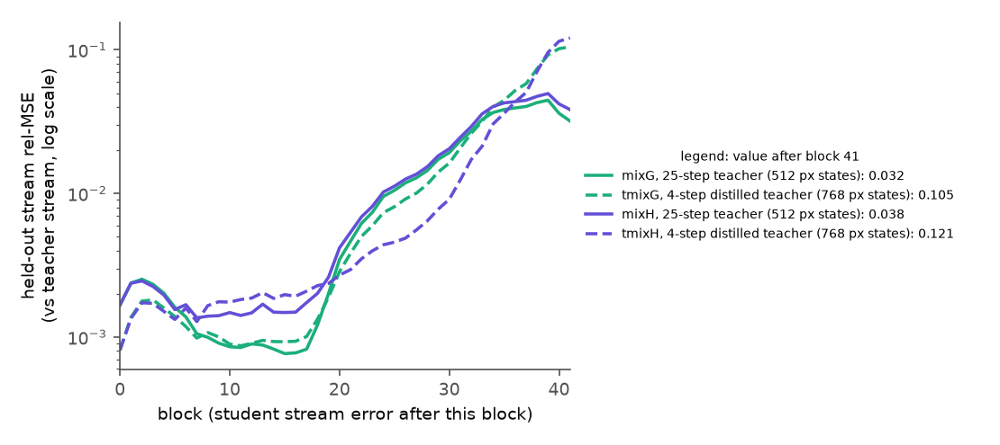

**Figure 22.** Student-stream relative MSE on the held-out samples after each block for the mixG and mixH recipes against the 25-step teacher (solid; 512 px states) and against the merged distilled teacher (dashed; 768 px states); the legend gives the value after block 41. Same allocation, rank, loss and number of training samples (1,536) in each pair. *Source:* `logs/mixG_lora32.json`, `tmixG_lora32.json`, `mixH_lora.json`, `tmixH_lora.json` (field `stream_rel_mse`), `paper/_build/build_figures_v3.py`.

**Results.** Table 23 gives the image metrics against the turbo4 images and the HPSv3 scores of every student of this chapter; Table 24 gives the four judge reports.

**Table 23. The distilled students: metrics against the turbo4 image of the same seed and resolution, and HPSv3 (24 prompts; 4 steps, CFG 1, euler).**

| model | file (GB) | px | DINOv2 cosine | SSIM | latent cosine | CLIP (turbo4's CLIP) | HPSv3 mean mu | lowest prompt | HPSv3 minus turbo4 +- paired SE (prompts where higher) |
|---|---|---|---|---|---|---|---|---|---|
| turbo4 (the reference) | 10.16 | 1024 | | | | (35.89) | 11.93 | 7.32 | |
| turbo4 (the reference) | 10.16 | 768 | | | | (35.84) | 11.93 | 7.09 | |
| turboF_mixG_tuned (25-step student + folded LoRA) | 2.93 | 1024 | 0.869 | 0.558 | 0.537 | 35.76 (35.89) | 12.05 | 7.09 | +0.13 +- 0.15 (15 / 24) |
| turboF_mixH2_x_f8 (25-step student + folded LoRA) | 2.74 | 1024 | 0.847 | 0.566 | 0.529 | 36.06 (35.89) | 11.57 | 5.91 | -0.35 +- 0.13 (7 / 24) |
| **tmixG_x** | 2.14 | 1024 | 0.897 | 0.647 | 0.650 | 35.75 (35.89) | 11.09 | 6.80 | -0.83 +- 0.16 (4 / 24) |
| tmixG_x | 2.14 | 768 | 0.896 | 0.612 | 0.644 | 35.86 (35.84) | 11.06 | 5.16 | -0.87 +- 0.19 (3 / 24) |
| tmixG_tuned (teacher-forced round) | 2.14 | 1024 | 0.894 | 0.651 | 0.668 | 35.74 (35.89) | 10.65 | 4.95 | -1.27 +- 0.22 (1 / 24) |
| tmixG_tuned | 2.14 | 768 | 0.890 | 0.610 | 0.646 | 36.08 (35.84) | 11.23 | 6.90 | -0.71 +- 0.18 (4 / 24) |
| tmixH_x_f8 | 1.85 | 1024 | 0.868 | 0.631 | 0.630 | 36.14 (35.89) | 10.13 | 5.00 | -1.79 +- 0.22 (1 / 24) |
| tmixH_x_f8 | 1.85 | 768 | 0.873 | 0.600 | 0.628 | 35.56 (35.84) | 10.14 | 4.23 | -1.80 +- 0.20 (1 / 24) |
| tmixH_xm_f8 (+ int4 modulation) | 1.72 | 1024 | 0.845 | 0.619 | 0.576 | 36.13 (35.89) | 9.81 | 5.59 | -2.11 +- 0.17 (0 / 24) |
| tmixH_xm_f8 | 1.72 | 768 | 0.857 | 0.576 | 0.575 | 35.57 (35.84) | 9.75 | 4.23 | -2.19 +- 0.28 (1 / 24) |
| tmixG_traj (trajectory-level round) | 2.14 | 1024 | 0.771 | 0.650 | 0.691 | 35.13 (35.89) | 4.71 | -5.72 | -7.22 +- 0.75 (0 / 24) |
| tmixG_traj | 2.14 | 768 | 0.759 | 0.609 | 0.687 | 35.55 (35.84) | 4.85 | -1.68 | -7.08 +- 0.67 (0 / 24) |

*Source:* `eval/<model>/metrics.json`, `eval/hps3_turbo.json`, `hps3_turbo_fold.json`, `hps3_tmixG.json`, `hps3_tmixG_tuned.json`, `hps3_tmixH.json`, `hps3_tmixG_traj.json` (rows and paired differences by `paper/_build/tables_v3.py`, output in `paper/_build/v3_tables_output.txt`; the paired SE is the standard deviation of the 24 per-prompt differences over the square root of 24). The metrics compare each student with the turbo4 image of the same prompt, seed and resolution, so they measure how closely it follows its teacher; the folded 25-step students follow other trajectories. HPSv3 images are scored at about 448 px whatever their size. Interpret each contrast using its own interval (Section 6.17); small observed differences do not establish equivalence.

At 1024 px tmixG_x reaches DINOv2 0.897, SSIM 0.647, latent cosine 0.650 and CLIP 35.75 against turbo4's 35.89; at 768 px 0.896, 0.612 and 0.644. The route that keeps the 25-step student and folds the LoRA into it follows its teacher less closely on all three (0.869, 0.558, 0.537) and scores higher in HPSv3: 12.05 against 11.09, a paired difference of +0.96 +- 0.17 with tmixG_x higher in only 4 of 24 prompts. The two kinds of measure disagree about which student is better. HPSv3 puts tmixG_x at 11.09 [10.38, 11.77] at 1024 px and 11.06 at 768 px, 0.83 +- 0.16 and 0.87 +- 0.19 below turbo4 (the lowest prompt scores 6.80 and 5.16); against the 25-step teacher's 12.38 it is 1.29 +- 0.29 below. Its 25-step counterpart mixG_x was 0.30 +- 0.19 below its own teacher, and mixG_tuned 0.24 +- 0.29 below.

**Table 24. The four judge reports of the distillation chapter (24 images each, 1024 px).**

| report | reference of A | F | T | C | Q | A | images with A of 4 or more | quoted-text prompts accepted / letter-exact (of 6) | against the reference image (better / same / worse) | luminance contrast, Laplacian edge energy: lower than the reference by |
|---|---|---|---|---|---|---|---|---|---|---|
| turbo4 | the 25-step teacher | 4.23 | 4.71 | 4.14 | 4.31 | 4.21 | 18 / 24 | 5 / 6 | 8 / 11 / 5 | contrast -6.9%, edge energy -40.0% |
| **tmixG_x** | turbo4 | 4.08 | 3.79 | 3.86 | 4.23 | 4.06 | 18 / 24 | 4 / 4 | 1 / 14 / 9 | contrast -7.9%, edge energy -21.3% |
| tmixG_tuned | turbo4 | 4.23 | 3.93 | 3.79 | 4.08 | 3.98 | 17 / 24 | 5 / 4 | 1 / 15 / 8 | contrast -9.2%, edge energy -9.9% |
| tmixH_x_f8 | turbo4 | 3.88 | 2.93 | 3.43 | 3.88 | 3.58 | 9 / 24 | 0 / 1 | 0 / 7 / 17 | contrast -8.8%, edge energy -29.9% |

*Source:* Judge scores and acceptance counts: the original `eval/judge_*.md` reports, recomputed by `paper/_build/tables_v3.py`. The last column is revised common-preprocessing edge energy and contrast, from `paper/_build/review_detail_stats.json` and `scripts/review_reporting.py`, not the heterogeneous original judge pixel statistics. The 25-step teacher images are native 768 px; the distilled images are native 1024 px resized to 768. Table I9 defines the metric. Judge uncertainty remains uncalibrated.

The judge report of tmixG_x gives F 4.08, T 3.79, C 3.86, Q 4.23 and A 4.06, with 18/24 images at A >= 4 and 4/6 text prompts letter-exact. The storefront and water-cycle labels fail; the remaining four text prompts are exact in this sample. A different judge evaluated the teacher, so score differences do not provide calibrated significance tests. Scene and design prompts generally survive, while dark or fine-texture scenes lose detail. Common-preprocessing measurements on the saved primary-resolution images give mean Laplacian RMS 0.04864 for tmixG_x versus 0.06183 for turbo4 (-21.3%), -9.9% for tmixG_tuned, and -0.3% for mixG_tuned_t. These are changes in an edge-energy statistic, not percentages of meaningful detail retained. All 1024 px images were resized to 768 px with the same Pillow LANCZOS filter, then measured with Rec.709 luma and a four-neighbour Laplacian; Table I9 gives the measurements and source code.

By the thresholds of Section 1, which are ours and post hoc, tmixG_x meets A of 4.0 or more (4.06) and 4 accepted text prompts, and with 18 of 24 images at A of 4 or more it is borderline on the third (20 of 24), like mixH_tuned of Section 6.11. The project notes call it the smallest satisfactory distilled model so far; we keep that, with the qualifiers that its small text is clearly weaker than its teacher's and that its A is measured against a teacher that has only 18 of 24 images at A of 4 or more itself.

### 8.5 What did not help

**A teacher-forced end-to-end round (tmixG_tuned).** Section 6.6 gave an end-to-end round on scales and LoRA that lowered the proxy by 14-25% on the 25-step models. The same stage was run on tmixG_x (`scripts/queue29.sh`): targets are the merged teacher's outputs on the captured states (`teacher_targets.py`), 0.7 epochs, 607 steps of 2 samples (about 49 minutes), learning rates 2e-4 for the scales and 4e-5 for the LoRA, noise weight 2; the CFG-combined loss is off (`cfg_w` 0), because the captures hold conditional calls only (CFG 1) and there are no conditional / unconditional pairs. The one-step holdout error fell from 0.04868 to 0.04219 (-13%). The image measures did not move (Table 23: DINOv2 0.894 against 0.897, SSIM 0.651 against 0.647, latent cosine 0.668 against 0.650 at 1024 px; 0.890, 0.610 and 0.646 against 0.896, 0.612 and 0.644 at 768 px). HPSv3 is 10.65 at 1024 px (lowest prompt 4.95) and 11.23 at 768 px against 11.09 and 11.06 for tmixG_x, i.e. -0.44 +- 0.18 and +0.17 +- 0.16: a difference whose sign changes with the resolution. The judge (Table 24) finds all five averages within +-0.2 of tmixG_x's (F +0.15, T +0.14, C -0.07, Q -0.15, A -0.08), 17 of 24 images at A of 4 or more, 1 better, 15 same and 8 worse than turbo4, and, counted by string, 14 of 19 requested strings exact, three minor typos and two wrong (four of six prompts letter-exact, as for tmixG_x). The storefront improved (sign and window line exact, the slate still has the garbled word); three images got new local artifacts, a smeared face (07), nothing in focus (10) and see-through chairs (22); at 768 px the tuned model is weaker on text (2 of 6 prompts exact against 4 of 6). Contrast is 9% lower and Laplacian edge energy 9.9% lower than turbo4's (tmixG_x: 21.3% lower). tmixG_x stays the reference model. The pattern is that of Section 7.8: the round lowered the one-step holdout error and not the image metrics, which fits the reading that the error accumulating along the four steps is not what a teacher-forced loss optimises.

**The more aggressive allocation (tmixH_x_f8, tmixH_xm_f8).** The mixH recipe (FFN at int2 in blocks 6-35, int3 in blocks 2-5 and 36-39, int4 in 0, 1, 40, 41; rank 64 on the 1- and 2-bit linears; 1,536 samples, as for the original mixH) was run against the merged teacher (`scripts/queue30.sh`). It took 123 minutes and ended at a stream error of 0.121 (Figure 22). fp8 LoRA factors (-101.8 MB) give tmixH_x_f8 at 1.85 GB, and the int4 modulation layers tmixH_xm_f8 at 1.72 GB; both are coherent at both resolutions (24 of 24 images). They are clearly worse than tmixG_x on every measure (Tables 23 and 24). HPSv3 is 10.13 at 1024 px (lowest prompt 5.00) and 10.14 at 768 px, 1.79 +- 0.22 and 1.80 +- 0.20 below turbo4 and 0.96 +- 0.15 below tmixG_x at 1024 px; tmixH_xm_f8 scores 9.81 and 9.75, so the int4 modulation layers cost a further 0.32 +- 0.18 and 0.39 +- 0.22, as in Section 6.17. DINOv2 is 0.868 and 0.845 at 1024 px (tmixG_x: 0.897). The judge scores tmixH_x_f8 F 3.88, T 2.93, C 3.43, Q 3.88, A 3.58, with only 9 of 24 images at A of 4 or more (tmixG_x: 18), 0 better, 7 same and 17 worse than turbo4, and one of six quoted-text prompts letter-exact (the price boards): the poster title reads BEYOND THE BIEAKERS, the music player's title "Neonn Horizon", the Chinese sub-line has two garbled characters and an extra one, and the storefront and infographic fail. No image is broken; two have heavy local artifacts (infographic labels dissolving into overlapping glyphs, and a see-through chair with a floating cloth in the kitchen). Fine-detail energy is half of turbo4's (0.017 against 0.034) and contrast 11% lower. T, C, Q and A have lower point estimates; their significance is not calibrated against tmixG_x, and no image has a higher A than in tmixG_x. The model is not satisfactory; tmixH_xm_f8 has no judge report, and its metrics and HPSv3 are lower still.

The distilled 4-step map tolerates the int2-FFN allocation worse than the 25-step map did. The comparators of the 25-step ladder (Table 15) are mixH_x, the same allocation with the same 1,536 samples and no tuning round, 0.50 +- 0.22 below the 25-step teacher, and mixH2_x_f8 (3,000 samples), 0.40 +- 0.18 below; tmixH_x_f8 is 1.79 +- 0.22 below its teacher, about 1.3 HPSv3 points more at equal training data. One caveat runs the other way: the data increase that closed the gap in Section 6.13 was not available, because the 4-step pool holds 1,824 samples, so the H result here is the half-data recipe, which was borderline in the 25-step ladder as well (mixH_tuned: A 4.10, 18 of 24 images at A of 4 or more).

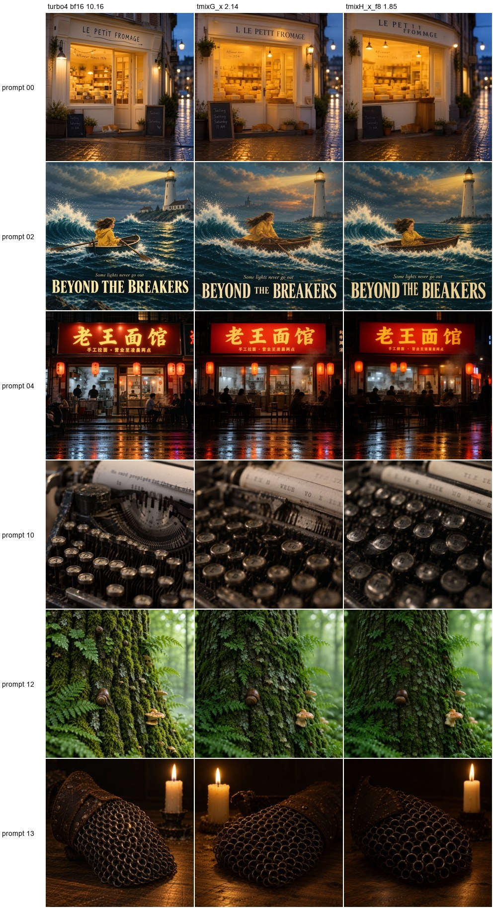

**Figure 23.** Prompts 00 (storefront), 02 (lighthouse poster), 04 (Chinese noodle-shop sign), 10 (typewriter), 12 (mossy oak) and 13 (chainmail gauntlet) for turbo4 (bf16, 10.16 GB), tmixG_x (2.14 GB) and tmixH_x_f8 (1.85 GB); 1024 px images resized to 300 px, the judges read the originals. As the judges read them: row 00, the sign is LE PETIT FROMAGE in turbo4, "L LE PETTT FROMAGE" in tmixG_x and a broken two-line "LE PET I T / FFOMMAGE" in tmixH_x_f8; row 02, BEYOND THE BREAKERS in the first two and BEYOND THE BIEAKERS in tmixH_x_f8; row 04, the title is exact in all three and the sub-line of tmixH_x_f8 has two garbled characters and an extra one; row 10, about 15 readable key legends in turbo4, about 8 in tmixG_x, and almost all the same E or B in tmixH_x_f8; rows 12 and 13, the moss and the mail lose texture, and tmixH_x_f8 shows a repeated tile pattern on the oak. *Source:* `eval/turbo4_1024`, `eval/tmixG_x_1024`, `eval/tmixH_x_f8_1024`, readings from `eval/judge_turbo4.md`, `judge_tmixG_x.md`, `judge_tmixH_x_f8.md`; composed by `paper/_build/build_figures_v3.py`.

**A trajectory-level latent-MSE loss (tmixG_traj).** A teacher-forced round fixes the one-step error but not the exposure bias of a four-step sampler: at inference the student sees its own, perturbed states. `e2e_tune.py --traj` (new for this run) therefore lets the student run the four euler steps from the captured noise and matches its states to the teacher's captured ones: the final latent with weight 1 and the intermediate states with weight 0.25, the teacher's final latent being the last captured state advanced by its stored output. The sampler convention was checked first (`scripts/check_euler.py`): x_(k+1) = x_k + (t_(k+1) - t_k) y_k with t = 1, 0.9375, 0.8333, 0.625, 0 and y the raw network output; with the opposite sign the error is 2.0, and with this sign the captured states are reproduced within a relative error of 4-7%. The run (`scripts/queue31.sh`) took 651 steps of one trajectory each (1.5 epochs, learning rates 2e-4 and 4e-5, about 110 minutes). The target quantity improved: the final-latent relative MSE of the student's own rollout on held-out prompts fell from 0.684 to 0.548, and on the 24 evaluation prompts the relative latent MSE against the turbo4 images fell from 0.69 to 0.52 and the latent cosine rose from 0.650 to 0.691. Everything that looks at the image got worse (Table 23): DINOv2 0.897 to 0.771, CLIP 35.75 to 35.13, HPSv3 11.09 to 4.71 at 1024 px and 4.85 at 768 px (-6.38 +- 0.66 against tmixG_x, lower in 24 of 24 prompts), and even the one-step teacher-forced holdout error rose from 0.049 to 0.069 (Table 25). The images are blurred (Figure 24): portraits, text and fine detail lose their edges while the layouts and large shapes stay. This model has no judge report; the evidence is the metrics, HPSv3 and the contact grid.

**Table 25. The two end-to-end rounds on tmixG_x.**

| run | steps | minutes | one-step holdout rel-MSE, before to after | final-latent rel-MSE of the 4-step rollout, before to after | DINOv2 / SSIM / latent cosine at 1024 px | HPSv3 at 1024 / 768 px | judged A |
|---|---|---|---|---|---|---|---|
| tmixG_x (no round) | | | 0.04868 | 0.68436 | 0.897 / 0.647 / 0.650 | 11.09 / 11.06 | 4.06 |
| tmixG_tuned (teacher-forced) | 607 | 48.5 (at step 600) | 0.04868 to 0.04219 | not measured | 0.894 / 0.651 / 0.668 | 10.65 / 11.23 | 3.98 |
| tmixG_traj (trajectory-level) | 651 | 109.7 (at step 650) | 0.04868 to 0.06938 | 0.68436 to 0.54812 | 0.771 / 0.650 / 0.691 | 4.71 / 4.85 | not judged |

*Source:* `logs/tmixG_tuned.log`, `logs/tmixG_traj.log` (the "before" values are those printed at the start of each run, on the same 44 held-out samples), `eval/tmixG_*/metrics.json`, `eval/hps3_tmixG*.json`, Table 24. Both runs: 179 scale tensors (39.0M) and 270 LoRA tensors (54.9M) trained, packed codes frozen (Appendix C).


**Figure 24.** Contact grid (ids 00-23) of tmixG_traj at 1024 px, the model trained with the trajectory-level latent-MSE loss. The layouts and the large shapes survive (the infographic and poster titles are still readable, the poster's already misspelled), but faces, fur, macro textures and small text are blurred, and several images (the storefront, the typewriter, the street stall) have lost their detail. *Source:* `eval/grid_tmixG_traj_1024.png` (made by `scripts/contact_grid.py`).

**Why a pure latent-MSE trajectory loss blurs.** The student's states leave the teacher's after the first step, so it cannot reproduce the teacher's final latent exactly. Under a squared error on the final latent the best answer when the target cannot be told apart is the average of the plausible targets, the conditional mean, and an average of sharp images is a blurred image. The pattern we measure fits that: the latent MSE and cosine, which reward the mean, improve while DINOv2, CLIP and HPSv3 collapse. This is our explanation; we did not test a perceptual loss or on-policy targets. Pure latent-MSE trajectory losses should not be used for a 4-step student. If this is revisited, the options are on-policy states with teacher targets (DAgger-style rounds, in which the teacher is run from the student's states) or a perceptual loss. `e2e_tune.py --traj` stays in the code as the documented negative result; the checkpoint `out/tmixG_traj.safetensors` can be deleted.

**Table 26. Selected paired HPSv3 differences among the distilled models (mean over the 24 prompts of a minus b).**

| comparison | a | b | difference +- paired SE | prompts where a is higher |
|---|---|---|---|---|
| the distilled model against the 25-step teacher | turbo4 (1024 px) | bf16 teacher | -0.46 +- 0.23 | 7 / 24 |
| tmixG_x against the 25-step teacher | tmixG_x (1024 px) | bf16 teacher | -1.29 +- 0.29 | 5 / 24 |
| tmixG_x against its own teacher, 1024 px | tmixG_x | turbo4 | -0.83 +- 0.16 | 4 / 24 |
| tmixG_x against its own teacher, 768 px | tmixG_x | turbo4 | -0.87 +- 0.19 | 3 / 24 |
| retrained against the merged teacher, against the folded-LoRA route | tmixG_x | turboF_mixG_tuned | -0.96 +- 0.17 | 4 / 24 |
| folded-LoRA route (2.93 GB) against the distilled model | turboF_mixG_tuned | turbo4 | +0.13 +- 0.15 | 15 / 24 |
| folded-LoRA route (2.74 GB) against the distilled model | turboF_mixH2_x_f8 | turbo4 | -0.35 +- 0.13 | 7 / 24 |
| teacher-forced round, 1024 px | tmixG_tuned | tmixG_x | -0.44 +- 0.18 | 9 / 24 |
| teacher-forced round, 768 px | tmixG_tuned | tmixG_x | +0.17 +- 0.16 | 15 / 24 |
| H allocation against G allocation, 1024 px | tmixH_x_f8 | tmixG_x | -0.96 +- 0.15 | 3 / 24 |
| H allocation against G allocation, 768 px | tmixH_x_f8 | tmixG_x | -0.92 +- 0.15 | 2 / 24 |
| int4 modulation layers on the H allocation, 1024 px | tmixH_xm_f8 | tmixH_x_f8 | -0.32 +- 0.18 | 8 / 24 |
| int4 modulation layers on the H allocation, 768 px | tmixH_xm_f8 | tmixH_x_f8 | -0.39 +- 0.22 | 10 / 24 |
| trajectory-level round, 1024 px | tmixG_traj | tmixG_x | -6.38 +- 0.66 | 0 / 24 |
| trajectory-level round, 768 px | tmixG_traj | tmixG_x | -6.21 +- 0.64 | 0 / 24 |

*Source:* `eval/hps3_turbo.json`, `hps3_turbo_fold.json`, `hps3_tmixG.json`, `hps3_tmixG_tuned.json`, `hps3_tmixH.json`, `hps3_tmixG_traj.json` and `hps3_summary.json` (teacher), computed by `paper/_build/tables_v3.py` (`paper/_build/v3_tables_output.txt`). One seed per prompt; each difference requires a comparison-specific interval, not a global cutoff.

### 8.6 The distilled ladder against the 25-step ladder, and the speed argument

Table 27 puts the two ladders side by side at the sizes they share. HPSv3 differences are against each ladder's own bf16 reference, and the judge's A is against each ladder's own reference image, so the A values are comparable in meaning and not strictly in scale (Section 5.3); the absolute HPSv3 scores come from the same scorer and prompts, with 768 px images for the 25-step ladder and 1024 px images for the distilled one (the scorer resizes both to about 448 px).

**Table 27. The distilled ladder against the 25-step ladder (24 prompts, one seed each).**

| model | file (GB) | steps / CFG | model forward passes per image | px | HPSv3 mean mu | HPSv3 minus the 25-step teacher +- paired SE | HPSv3 minus its own bf16 reference +- paired SE | judged A | judged T | quoted strings letter-exact (of 6) | verdict |
|---|---|---|---|---|---|---|---|---|---|---|---|
| **25-step ladder (Table 1)** | | | | | | | | | | | |
| bf16 teacher | 10.16 | 25 / 2.5 | 50 | 768 | 12.38 | - | - | | | 6 (as stated) | reference |
| mixG_tuned | 2.14 | 25 / 2.5 | 50 | 768 | 12.14 | -0.24 +- 0.29 | -0.24 +- 0.29 | 4.21 | 4.79 | 6 | six text prompts exact; balloons correct; fruit count incorrect |
| mixH2_x_f8 | 1.85 | 25 / 2.5 | 50 | 768 | 11.99 | -0.40 +- 0.18 | -0.40 +- 0.18 | not judged (mixH2_x: 4.21) | (mixH2_x: 4.00) | (mixH2_x: 3) | metrics equal to mixH2_x |
| mixH2_xm_f8 | 1.72 | 25 / 2.5 | 50 | 768 | 11.44 | -0.94 +- 0.20 | -0.94 +- 0.20 | 4.15 | 4.00 | 4 | smallest acceptable, small colour drift |
| **distilled ladder (this chapter)** | | | | | | | | | | | |
| turbo4 (bf16 + 4-step LoRA) | 10.16 | 4 / 1.0 | 4 | 1024 | 11.93 | -0.46 +- 0.23 | - | 4.21 (against the 25-step teacher) | 4.71 | 6 | reference of this ladder |
| turboF_mixG_tuned (25-step student + folded LoRA) | 2.93 | 4 / 1.0 | 4 | 1024 | 12.05 | -0.33 +- 0.26 | +0.13 +- 0.15 | 4.27 (added in version 4, Section 9.12) | 4.50 | 5 | source DiT for proposed quality package; original-component evaluation only; 0.8 GB larger than its source |
| turboF_mixH2_x_f8 (25-step student + folded LoRA) | 2.74 | 4 / 1.0 | 4 | 1024 | 11.57 | -0.81 +- 0.23 | -0.35 +- 0.13 | not judged | | | diagnostic; 0.9 GB larger than its source |
| **tmixG_x** | 2.14 | 4 / 1.0 | 4 | 1024 | 11.09 | -1.29 +- 0.29 | -0.83 +- 0.16 | 4.06 | 3.79 | 4 | smallest satisfactory distilled model |
| tmixG_tuned | 2.14 | 4 / 1.0 | 4 | 1024 | 10.65 | -1.73 +- 0.35 | -1.27 +- 0.22 | 3.98 | 3.93 | 4 | no better than tmixG_x |
| tmixH_x_f8 | 1.85 | 4 / 1.0 | 4 | 1024 | 10.13 | -2.25 +- 0.36 | -1.79 +- 0.22 | 3.58 | 2.93 | 1 | not satisfactory |
| tmixH_xm_f8 | 1.72 | 4 / 1.0 | 4 | 1024 | 9.81 | -2.57 +- 0.33 | -2.11 +- 0.17 | not judged | | | lower still on every measure |
| tmixG_traj | 2.14 | 4 / 1.0 | 4 | 1024 | 4.71 | -7.67 +- 0.84 | -7.22 +- 0.75 | not judged | | | blurred; negative result |

*Source:* Tables 1, 15, 19, 23 and 24 (`eval/hps3_summary.json`, `eval/hps3_turbo*.json`, `eval/hps3_tmix*.json`, the judge reports of Tables 11 and 24); forward passes per image from the arithmetic below. A of the distilled rows is against turbo4's image (against the 25-step teacher's for turbo4 itself). The T and letter-exact entries of mixH2_x_f8 are those of mixH2_x, which has the same metrics.

**The count of forward passes.** A 25-step sample at CFG 2.5 with `er_sde` calls the denoiser once per step (ComfyUI's `sample_er_sde`), and each call evaluates the conditional and the unconditional branch, as the calibration capture of Section 4.1 records: 25 x 2 = 50 forward passes of the DiT. A 4-step sample at CFG 1.0 with `euler` makes 4 calls with a single branch each, because ComfyUI skips the unconditional branch at CFG 1; the capture of Section 8.4 confirms it (456 prompts x 4 steps = 1,824 conditional calls and no negative branch). The ratio is 50 / 4 = 12.5. The count does not depend on the quantization or on the file size; it multiplies whatever one forward pass costs, and it leaves the text encoder (one run per prompt in either setting) outside. Three caveats keep it from being a speed result. At 1024 px a forward pass handles (1024 / 16)^2 = 4,096 image tokens against 2,304 at the 768 px of the 25-step evaluation, so a pass is more expensive. The loader dequantizes in PyTorch and has no fused kernels (Section 3.3), so a quantized file is not faster than bf16 per pass. And the logged times are not comparable: the log of the turbo4 run has a median of 9.7 s per 1024 px image, with 9 of 24 images disturbed by the stalls of Section 7.9 (up to 99.9 s; about 9-10 s when uncontended, as the notes say), against 22.9 s per 768 px image for the 25-step teacher in the server harness of Section 3.3. We claim the count, 12.5 times fewer forward passes, and no wall-clock ratio.

**What the distilled line buys and costs.** The files are the same size. In absolute HPSv3 terms the best 25-step student, mixG_tuned (12.14), is above every distilled student: tmixG_x scores 11.09 (about 1.0 point lower, the images also differing in resolution), turbo4 itself 11.93, and only the folded-LoRA file, 0.8 GB larger, reaches 12.05. At 2.14 GB the trade is therefore 12.5 times fewer forward passes against about one HPSv3 point and two of the six exactly spelled strings. The step-distilled line also stops at 2.14 GB as the satisfactory model, whereas the 25-step line reached 1.72 GB (Table 27).

### 8.7 Open items

- **The text encoder is the subject of Section 9 (version 4).** The Qwen3.5-9B encoder is 19.3 GB in bf16, about 90% of the package once the DiT is small (19.3 of 21.4 GB with the 1.72 GB DiT and the VAE). CFG multiplies encoder error, which is why the distilled DiT, which runs at CFG 1, had to come first.
- **Per-layer sensitivity has not been re-derived on the distilled teacher.** Both allocations used here (`alloc_mixG.json`, `alloc_mixH.json`) were written for the 25-step model from a sensitivity map measured on its 512 px trajectories (Section 4.5). The 3-fold higher stream error of the last blocks (Figure 22) suggests that the distilled map would want a different allocation; this is untested.
- **One training run per configuration, 24 prompts, one seed, three judge instances for the students** (about +-0.2 noise): differences in Tables 23-26 below about 0.4-0.5 in HPSv3, or below 0.2 in a judge average (for example the teacher-forced round), do not establish effects without a calibrated comparison.
- **No 3,000-sample variant of the H allocation** (the 4-step pool holds 1,824 samples; Section 8.5), no judge report for tmixH_xm_f8, tmixG_traj and the folded mixH2_x_f8_t (the folded mixG_tuned was judged in version 4, Section 9.12), and no 8-step runtime-LoRA runs (they were cut by the loader fix).
- **An fp32-exact merge** of the LoRA into the bf16 model, which ComfyUI cannot deploy, was not tested as a better teacher (Section 8.2).
- **No speed measurement** and no fused kernels (Section 8.6); a trajectory-level loss with on-policy states or a perceptual term was not attempted (Section 8.5).

### 8.8 What the chapter changes

The step-distilled bf16 model is a good teacher (judged A 4.21, all six quoted-text prompts exact). Applying its LoRA at run time to a quantized file is unsafe, and our own loader made a roughly 50% collapse look like a quantization result; with the LoRA folded into the file the quantized 25-step students keep the distilled quality (HPSv3 +0.13 +- 0.15 and -0.35 +- 0.13 against turbo4) at 0.8-0.9 GB more. Re-running the mixG recipe against the merged teacher gives tmixG_x, 2.14 GB, judged A 4.06 with four of six strings exact and an HPSv3 0.83 +- 0.16 below its teacher, which needs 4 forward passes per image instead of 50. A teacher-forced tuning round did not help, the 2-bit-FFN allocation (1.85 GB) is not satisfactory on the distilled teacher, and a trajectory-level latent-MSE loss blurs the images. The distilled teacher is harder to quantize than the 25-step one, so the step-distillation hypothesis of Section 7.6 is not supported, and the smallest satisfactory distilled model (2.14 GB) is larger than the smallest acceptable 25-step model (1.72 GB).

## 9 Shrinking the text encoder and the VAE

After Sections 1-8 the diffusion transformer is 2.14 GB (tmixG_x) and the text encoder, the 19.31 GB bf16 Qwen3.5-9B, is 88.6% of the 21.78 GB package that results. This chapter reports what we did about it, dead ends included: baselines with the quantized encoders that already exist; a pruned post-training-quantized (PTQ) encoder of our own, which turned out to be worse than ComfyUI's own GPTQ file; a ghost artifact in portrait images that we first tied to that encoder and then counted blind; a direct measure of the conditioning error that orders the encoders; and the recommended package, ComfyUI's own W4A8 GPTQ encoder with the tensors that MOSS never reads removed (4.93 GB) together with the FLUX.2 small decoder as VAE (0.11 GB). Every number is from a file on disk (sources under each table). Judge evidence: one judge report for our encoder enc_i4e8 (Section 9.7), two blind artifact-count reports (Section 9.6), and three judge reports added after the first rebuild (Section 9.12): the folded model mixG_tuned_t, and the two 25-step models with the pruned GPTQ encoder. The stock encoders, the pruned encoder with the distilled DiT and the small decoder have no judge report, so for them the evidence is image metrics, HPSv3 and, for the unpruned GPTQ file, the blind counts.

**Protocol and names.** Unless stated otherwise the DiT is tmixG_x (Section 8.4, 2.14 GB), sampled with 4 steps, CFG 1.0, `euler` / `simple`, no negative prompt, at 1024 x 1024, with the 24 prompts and seeds of Section 5.1; only the text encoder (or, in Section 9.10, the VAE) changes. The reference is the same DiT with the bf16 encoder (`eval/tmixG_x_1024`, the images of Section 8.4). Image metrics (Section 5.2) compare each run with that reference, so they measure how far an encoder moves the image and not how good the image is. HPSv3 is as in Section 6.17 (24 images, one seed each); the reference scores 11.09, and 12.28 on the six text prompts. Encoders are loaded through the stock CLIPLoader path (`comfy.sd.load_clip`, clip type MOSS_IMAGE) by `scripts/gen_inproc.py --clip`; our own low-bit files add `--clip-lowbit`, which passes the low-bit ops of Section 3.3 as `custom_operations`. Paired differences follow the convention of Section 6.17: the mean over the 24 prompts of a minus b, with the standard deviation of the 24 differences over the square root of 24 as the paired SE; each contrast requires its own paired interval; no global significance cutoff is used. Names: `enc_int8_convrot` and `enc_w4a8_gptq` are the two stock files; `enc_gptq_pruned` is the pruned GPTQ file; our own low-bit files are `enc_` plus the layer kinds, where `i4` is every layer linear at int4, `m3` the mlp at int3, `i3` everything at int3, `l3` the linear-attention layers at int3, `a3` the full-attention layers at int3 (the rest int4), and the suffix `e8` marks ComfyUI's int8 embedding table instead of bf16 (Table C7); `gh_*` are the generation folders of the ghost-rate test (Section 9.6). **Run-to-run noise** of the pipeline was measured once the ghost-rate folders existed: the 30 images of five configurations (prompts 6, 7, 8, 9, 17 and 22 at their base seeds) were generated twice, in `eval/<tag>` and in `eval/gh_*`, with the same configuration and seed; 9 are bit-identical and the other 21 differ by 33.7-37.6 dB PSNR (mean 36.0). Likewise the pruned and the unpruned GPTQ encoder give identical latents but only 13 of 24 bit-identical images, the other 11 at 30.6-37.2 dB (mean 33.9). So a PSNR of 34-37 dB between two images is what the pipeline does to itself, and the int8 encoder's 33.4 dB (Table 30) is at that level.

### 9.1 Why the encoder matters: anatomy

MOSS-Image conditions the DiT on the hidden states of the last layer of Qwen3.5-9B. Per the project notes, the conditioning needs all 32 layers, reads the last layer with the MTP head off, and ComfyUI builds its MTP module only if the file contains `mtp.fc.weight`. The bf16 file is 19.31 GB (9.653 B parameters, 775 tensors): 64.8% of the original 29.8 GB package (Table 42) and 88.6% of the package once the DiT is tmixG_x. Table 28 splits it.

**Table 28. Anatomy of the bf16 Qwen3.5-9B encoder file (19,306,312,328 bytes).**

| component | tensors | parameters (B) | bf16 (GB) | share of the file | used for the text conditioning |
|---|---|---|---|---|---|
| mlp (gate, up, down; 32 layers) | 96 | 4.832 | 9.66 | 50.1% | yes |
| linear attention (gated delta net; 24 layers) | 216 | 1.618 | 3.24 | 16.8% | yes |
| full attention (q, k, v, o; 8 layers) | 48 | 0.470 | 0.94 | 4.9% | yes |
| layer norms | 64 | 0.000 | 0.00 | 0.0% | yes |
| final norm | 1 | 0.000 | 0.00 | 0.0% | yes |
| embedding table (248,320 x 4,096) | 1 | 1.017 | 2.03 | 10.5% | yes (a row lookup) |
| lm_head | 1 | 1.017 | 2.03 | 10.5% | no |
| vision tower | 333 | 0.456 | 0.91 | 4.7% | no |
| MTP head | 15 | 0.243 | 0.49 | 2.5% | no |
| total | 775 | 9.653 | 19.31 | 100% | |

*Source:* header of `qwen3.5_9b_bf16.safetensors`, read by `paper/_build/enc_anatomy_v4.py` (output in `paper/_build/enc_anatomy_v4_output.txt`); the parameters agree with the "ENCODER ANATOMY" note of `NOTES.md`. The full-attention layers are layers 3, 7, 11, ..., 31; the other 24 are linear-attention layers. The small tensors of the linear-attention layers (A_log, conv1d, dt_bias, two 32 x 4,096 gate projections, a norm) are counted in its row. Whether a component is used for the conditioning is the project notes' statement, not something we tested by ablation.

Three consequences. (i) The `lm_head`, the vision tower and the MTP head, 1.716 B parameters or 3.43 GB (17.8% of the file), do not enter the conditioning and can be dropped at no quality cost. The stock quantized files keep them (Table 29): the int8 file carries 1.80 GB of them (1.018 + 0.277 + 0.502) and the GPTQ file 2.42 GB (1.018 + 0.487 + 0.912). (ii) The embedding table (2.03 GB) is a lookup, so it can be stored per row. (iii) The 6.92 B parameters of the 32 layers are where both the size and the quality risk are.

**Table 29. Bytes by component (GB) in the bf16 file, in the two stock quantized encoders, in the pruned GPTQ file and in two of our files.**

| component | bf16 | ComfyUI int8 convrot | Comfy-Org W4A8 GPTQ | pruned GPTQ | enc_i4 | enc_i4e8 |
|---|---|---|---|---|---|---|
| embedding table | 2.034 | 1.018 | 1.018 | 1.018 | 2.034 | 1.018 |
| mlp | 9.664 | 4.836 | 2.722 | 2.722 | 2.491 | 2.491 |
| linear attention | 3.235 | 1.626 | 0.922 | 0.922 | 0.845 | 0.845 |
| full attention | 0.940 | 0.470 | 0.265 | 0.265 | 0.242 | 0.242 |
| layer norms | 0.001 | 0.001 | 0.001 | 0.001 | 0.001 | 0.001 |
| lm_head | 2.034 | 1.018 | 1.018 | 0.000 | 0.000 | 0.000 |
| MTP head | 0.487 | 0.277 | 0.487 | 0.000 | 0.000 | 0.000 |
| vision tower | 0.912 | 0.502 | 0.912 | 0.000 | 0.000 | 0.000 |
| total | 19.306 | 9.748 | 7.343 | 4.927 | 5.613 | 4.597 |
| of which not used for the conditioning (lm_head, MTP, vision tower) | 3.433 | 1.797 | 2.417 | 0.000 | 0.000 | 0.000 |

*Source:* headers of the six files, `paper/_build/enc_anatomy_v4.py` (`enc_anatomy_v4_output.txt`); the files are `qwen3.5_9b_bf16`, `qwen3.5_9b_int8_convrot`, `qwen3.5_9b_w4a8_gptq` and `qwen3.5_9b_w4a8_gptq_pruned` in `models/text_encoders`, and `out/enc_i4` and `out/enc_i4e8`. The headers show how the stock files store a layer linear (read from the shapes and dtypes, not from the format code): the int8 file has int8 weights of the full width with one fp32 scale per row and a `comfy_quant` marker; the GPTQ file is described in Section 9.8; our files have uint8 packed codes of half the input width, fp16 scales of group 128 (32 per row for a 4,096-wide input) and a `weight_kind` marker. The pruned GPTQ file has 1,228 tensors against 1,579 in the full file; each of its tensors has the same name, dtype, shape and byte length as in the full file.

### 9.2 Baselines through the stock loader

Three quantized encoders for MOSS-Image existed before this work [35, 36]. Two of them load in the stock CLIPLoader; they were run with tmixG_x as the DiT (`scripts/queue32.sh`, `queue33.sh`; Table 30).

**Table 30. The stock quantized encoders through the stock CLIPLoader, with tmixG_x (4 steps, CFG 1, 1024 px; reference = bf16 encoder).**

| encoder | file (GB) | PSNR (dB) | SSIM | DINOv2 cosine | latent cosine | CLIP (reference 35.75) | HPSv3 mean [95%] | HPSv3 text prompts | lowest prompt | HPSv3 minus bf16 encoder +- paired SE (prompts where higher) |
|---|---|---|---|---|---|---|---|---|---|---|
| bf16 encoder (the reference) | 19.31 | | | | | 35.75 | 11.09 [10.38, 11.77] | 12.28 | 6.80 | |
| ComfyUI int8 convrot | 9.75 | 33.4 | 0.949 | 0.992 | 0.990 | 35.70 | 10.95 [10.26, 11.60] | 12.10 | 6.81 | -0.15 +- 0.06 (8 / 24) |
| Comfy-Org W4A8 GPTQ | 7.34 | 28.7 | 0.941 | 0.981 | 0.956 | 35.76 | 10.99 [10.24, 11.70] | 12.02 | 6.54 | -0.10 +- 0.10 (11 / 24) |
| OrbitQuant W4A8 (size from the project notes) | 5.51 | not run | | | | | not runnable with the stock loader | | | |

*Source:* `eval/enc_int8_convrot/metrics.json`, `eval/enc_w4a8_gptq/metrics.json` (reference images `eval/tmixG_x_1024`), `eval/hps3_enc_baseline.json`, `eval/hps3_enc_w4a8_gptq.json`, `eval/hps3_tmixG.json` (reference), rows and paired differences by `paper/_build/tables_v4.py` (`v4_tables_output.txt`); sizes from the files in `models/text_encoders`. The OrbitQuant row is from `NOTES.md` and `logs/gen_enc_orbitquant_w4a8_gptq.log`; its file is no longer in the folder and `eval/enc_orbitquant_w4a8_gptq` holds no images.

- **ComfyUI int8 convrot, 9.75 GB.** ComfyUI's own format. It is the closest to the reference on every distance measure (PSNR 33.4 dB, DINOv2 0.992, latent cosine 0.990) and 2.0 times smaller than bf16 (19.31 / 9.75). HPSv3 is 0.15 +- 0.06 below the reference: small, a third of the 0.4-0.5 band, and measurable (about 2.5 paired SE, lower in 16 of 24 prompts).
- **Comfy-Org W4A8 GPTQ, 7.34 GB.** A data-aware 4-bit weight format in the stock layout, 2.6 times smaller than bf16 (19.31 / 7.34). Its images follow the reference less closely (DINOv2 0.981, latent cosine 0.956) and score 0.10 +- 0.10 below it on HPSv3. Its contact grid (`eval/grid_enc_w4a8_gptq.png`) keeps the text prompts intact; there is no judge report for it.
- **WaveCut/MOSS-Image-SFT-OrbitQuant-W4A8, 5.51 GB, could not be run.** Per the notes the file stores `packed_weight_indices` and `row_norms` (200 projections, no `model.language_model.` prefix), so the stock CLIPLoader builds a wrong-shaped encoder from it. The generation log ends in `RuntimeError: mat1 and mat2 shapes cannot be multiplied (154x768 and 4096x3072)`, raised in the DiT's text-embedder projection (`comfy/ldm/moss_image/model.py`), i.e. the conditioning that came out had width 768 and not 4,096. The model card says the file loads through its own `moss_orbitquant.py` or the third-party ComfyUI-OrbitQuant 0.8.0 nodes [36]; installing third-party nodes runs third-party code and needs the project owner's approval, which we did not seek. The only figure from the card, LPIPS 0.190 against bf16 over 33 images, is for the whole pipeline and not comparable with ours.

Both runnable files are inside the noise band of the reference on HPSv3, so for a user they are the practical baselines, and they set the bar for an encoder of our own: about 5 GB or less at the same HPSv3.

**The GGUF suggestion, and why it was not pursued.** The project owner suggested the GGUF quantizations of `pottokao/MOSS-Image-Text-Encoder-Heretic` made by `mradermacher` [37] (architecture qwen35, Apache-2.0; sizes in GB: Q2_K 3.65, Q3_K_S 4.06, Q3_K_M 4.41, Q3_K_L 4.70, IQ4_XS 4.99, Q4_K_S 5.11, Q4_K_M 5.38, Q5_K_S 6.02, Q5_K_M 6.18, Q6_K 7.04, Q8_0 9.11, f16 17.14, plus a vision projector of 0.58 or 0.85). Three reasons stopped us. (1) "Heretic" is an abliterated variant: abliteration edits the weights, so its conditioning differs from the original encoder by an unknown amount, and every measure of this chapter would be confounded. (2) ComfyUI core cannot read GGUF text encoders, and the third-party ComfyUI-GGUF node [38] does not help: per the notes, its clip loader only remaps the tensor names of t5, llama, qwen2vl, qwen3, qwen3vl and gemma3 and passes unknown architectures through unchanged, so a qwen35 (hybrid gated-delta-net) GGUF would not match ComfyUI's Qwen3.5 module. (3) The project owner allowed installing the node, but the `git clone` into `custom_nodes` was blocked by the permission system of the coding assistant and the registry install failed with an error; neither was worked around. The one test that needs no new code, dequantizing a GGUF to bf16 and running that, was not done.

### 9.3 A pruned post-training-quantized encoder of our own

**Method.** `scripts/quantize_encoder.py` reads the bf16 file and writes a `moss_lowbit_v1` file (Section 3.3). It (i) drops `lm_head.*`, `mtp.*` and `model.visual.*` (Table 28); (ii) keeps in bf16 the norms, the `conv1d`, `A_log` and `dt_bias` tensors of the linear-attention layers and their two tiny `in_proj_a` / `in_proj_b` projections; (iii) quantizes the other linears of the 32 layers (6.912 B parameters: gate, up and down of the mlp, q, k, v and o of the 8 full-attention layers, `in_proj_qkv`, `in_proj_z` and `out_proj` of the 24 linear-attention layers) with group-128 codes and fp16 scales from the same MSE-optimal grid search that initialises the DiT scales (`init_scale`, Section 4.2); and (iv) leaves the embedding table in bf16 or, with `--embed int8`, replaces it with ComfyUI's own int8 table copied from the int8 file. There is no training, no calibration data and no activation statistics: it is rounding to nearest with optimal scales, which Section 6.3 found to be enough at 4 bits for the DiT. The kinds are int4 and int3 of Table 3 (4.125 and 3.125 bits per weight with the scale), so the 6.912 B layer weights take 3.564 GB at int4 and 2.700 GB at int3; the layers of the int4 files are 3.579 GB (Table 29) because they also hold the bf16 tensors of (ii).

**Loading.** `comfy.sd.load_clip` honours `model_options['custom_operations']`, so the low-bit ops that carry the DiT carry the encoder as well and the stock CLIPLoader path needed no change (the node for it is in Section 9.11). Per the project notes, ComfyUI's model detection needs `model.language_model.layers.0.linear_attn.A_log` and the `input_layernorm` weight, both kept in bf16; the compute dtype comes from the norm weight and, with no `comfy_quant` keys, the layers become bf16 modules with our ops. The MTP module is built only if `mtp.fc.weight` exists: the three stock files contain it and ours do not (checked in the headers). ComfyUI's Embedding reads the `comfy_quant` marker of the int8 table per row, so the int8 embedding needed no new op. Two things do not shrink at run time. The 9B configuration forces an `lm_head` and the Qwen3.5 class always builds the vision tower, so the weights we dropped stay uninitialised in memory: each load logs 111 "Missing weight" warnings (1 for `lm_head`, 108 for the linears of the vision blocks, 2 for the merger), 777 in `logs/gen_enc_i4e8.log`, which holds 7 loads. The file shrinks and the allocation does not; the notes add that under dynamic VRAM the `lm_head` units are faulted in first. This is a core limitation that we left alone (Section 9.13).

**The sweep.** `scripts/queue34.sh` ran i4, m3 and i3 (embedding in bf16), `scripts/queue35.sh` i4e8, l3 and a3 (int8 embedding); each file was generated, scored and put on a contact grid with tmixG_x.

**Table 31. Our pruned PTQ encoders (tmixG_x, 4 steps, CFG 1, 1024 px; reference = bf16 encoder).**

| encoder | what is quantized | file (GB) | HPSv3 mean [95%] | HPSv3 text prompts | lowest prompt | DINOv2 cosine | SSIM | latent cosine | CLIP | HPSv3 minus bf16 encoder +- paired SE (prompts where higher) |
|---|---|---|---|---|---|---|---|---|---|---|
| enc_i4 | all layer linears int4; embedding bf16 | 5.61 | 11.03 [10.31, 11.74] | 12.53 | 6.61 | 0.932 | 0.799 | 0.836 | 35.76 | -0.06 +- 0.12 (13 / 24) |
| enc_m3 | mlp int3, the rest int4; embedding bf16 | 5.01 | 10.64 [9.92, 11.34] | 11.88 | 6.60 | 0.888 | 0.703 | 0.706 | 35.84 | -0.46 +- 0.17 (8 / 24) |
| enc_i3 | all layer linears int3; embedding bf16 | 4.75 | 4.86 [3.50, 6.15] | 5.54 | -3.54 | 0.445 | 0.435 | 0.324 | 28.65 | -6.24 +- 0.64 (0 / 24) |
| enc_i4e8 | all layer linears int4; int8 embedding | 4.60 | 11.09 [10.39, 11.77] | 12.60 | 6.76 | 0.928 | 0.799 | 0.834 | 35.77 | 0.00 +- 0.12 (12 / 24) |
| enc_a3 | full attention int3, the rest int4; int8 embedding | 4.54 | 11.02 [10.28, 11.75] | 12.49 | 6.39 | 0.924 | 0.768 | 0.798 | 35.93 | -0.07 +- 0.09 (9 / 24) |
| enc_l3 | linear attention int3, the rest int4; int8 embedding | 4.40 | 9.77 [9.24, 10.28] | 10.22 | 6.98 | 0.808 | 0.641 | 0.576 | 35.49 | -1.32 +- 0.19 (2 / 24) |

*Source:* `eval/enc_<tag>/metrics.json` (reference images `eval/tmixG_x_1024`, CLIP of the reference 35.75), `eval/hps3_enc_ptq.json` (i4, m3, i3), `eval/hps3_enc_ptq2.json` (i4e8, l3, a3), `eval/hps3_tmixG.json` (reference), `logs/quantize_enc_<tag>.log` and the file sizes in `out/`; rows and paired differences by `paper/_build/tables_v4.py`. Settings of each run are in Table C7. The `.md` companions of the two HPSv3 files print a "diff to teacher" column of dashes, because those runs had no reference tag, and a line "768px images"; the images are 1024 px (Appendix F).

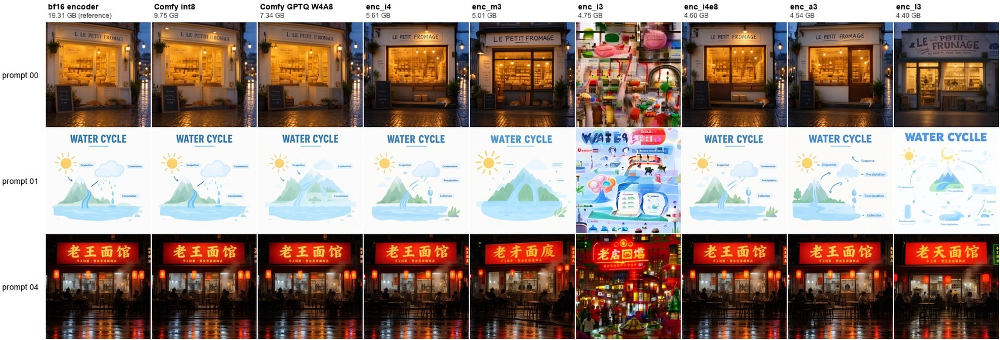

**Figure 25.** Prompts 00 (storefront with a sign), 01 (water-cycle infographic) and 04 (Chinese noodle-shop sign) for the bf16 encoder (the reference) and eight quantized encoders in order of file size (GB); tmixG_x, 4 steps, CFG 1, 1024 px images resized to 190 px; one seed each. Read off the thumbnails, without a judge report: the images of the bf16, int8 and GPTQ encoders share their composition and the extra "L" in the sign that the tmixG_x judge reported as "L LE PETTT FROMAGE" (Section 8.4), while the sign reads LE PETIT FROMAGE in enc_i4, enc_i4e8 and enc_a3; the Chinese title of prompt 04 looks intact in all of those and has altered glyphs in enc_m3 and enc_l3; enc_i3 is incoherent. The small labels of the infographic cannot be read at this size. *Source:* `eval/<tag>/00_seed1001.png`, `01_seed1002.png`, `04_seed1005.png`, composed by `paper/_build/build_figures_v4.py`.

Reading of Table 31.

- **enc_i4**: every layer linear at int4, embedding bf16, 5.61 GB. HPSv3 11.03, 0.06 +- 0.12 below the reference, and 12.53 on the text prompts against 12.28. The contact grid (notes, no judge) shows the storefront sign, the four water-cycle labels, the price board and the titles correct.
- **enc_i4e8**: the same layers with the int8 embedding table, 4.60 GB. HPSv3 11.09, equal to the reference (0.00 +- 0.12); 12.60 on the six text prompts (+0.32 +- 0.17, under two SE). Against enc_i4 the int8 table changes HPSv3 by +0.06 +- 0.06 (higher in 16 of 24 prompts) and saves 1.016 GB (5.613 - 4.597): no clear loss was detected in these measurements; equivalence was not tested.
- **enc_m3**: mlp at int3, 5.01 GB, 0.46 +- 0.17 below the reference and 0.40 +- 0.14 below enc_i4 (Table 32); the text prompts fall to 11.88.
- **enc_i3**: everything at int3, 4.75 GB, is broken: HPSv3 4.86 with a lowest prompt of -3.54, CLIP 28.65 against 35.75, DINOv2 0.445.

The sweep is consistent with the DiT result of Section 6.3: plain rounding is fine at 4 bits and fails below. What is new is which part gives way first, and that is the next section. On the means, enc_i4e8 looked like a success; Sections 9.6 and 9.8 show why it is not the file we recommend.

### 9.4 What is sensitive: the linear-attention layers

Table 32 lists the paired HPSv3 differences that matter for the sweep. The int3 probes separate the groups that enc_i3 changed together (`scripts/queue35.sh` ran the attention probes with int4 elsewhere and the int8 embedding).

**Table 32. Selected paired HPSv3 differences among the encoder variants (mean over the 24 prompts of a minus b).**

| comparison | a | b | difference +- paired SE | prompts where a is higher |
|---|---|---|---|---|
| ComfyUI int8 against the bf16 encoder | enc_int8_convrot | bf16 encoder | -0.15 +- 0.06 | 8 / 24 |
| Comfy-Org GPTQ against the bf16 encoder | enc_w4a8_gptq | bf16 encoder | -0.10 +- 0.10 | 11 / 24 |
| int4 layers, bf16 embedding, against the bf16 encoder | enc_i4 | bf16 encoder | -0.06 +- 0.12 | 13 / 24 |
| int4 layers, int8 embedding, against the bf16 encoder | enc_i4e8 | bf16 encoder | 0.00 +- 0.12 | 12 / 24 |
| int8 embedding table against bf16 embedding (both int4 layers) | enc_i4e8 | enc_i4 | +0.06 +- 0.06 | 16 / 24 |
| our encoder against the ComfyUI int8 encoder | enc_i4e8 | enc_int8_convrot | +0.15 +- 0.12 | 14 / 24 |
| our encoder against the Comfy-Org GPTQ encoder | enc_i4e8 | enc_w4a8_gptq | +0.10 +- 0.15 | 15 / 24 |
| mlp at int3 against the bf16 encoder | enc_m3 | bf16 encoder | -0.46 +- 0.17 | 8 / 24 |
| mlp at int3 | enc_m3 | enc_i4 | -0.40 +- 0.14 | 5 / 24 |
| full-attention layers at int3 | enc_a3 | enc_i4e8 | -0.07 +- 0.10 | 10 / 24 |
| linear-attention layers at int3 | enc_l3 | enc_i4e8 | -1.32 +- 0.22 | 2 / 24 |
| everything at int3 | enc_i3 | enc_i4 | -6.18 +- 0.65 | 1 / 24 |

*Source:* `eval/hps3_enc_baseline.json`, `hps3_enc_w4a8_gptq.json`, `hps3_enc_ptq.json`, `hps3_enc_ptq2.json`, `hps3_tmixG.json` (`mu_by_prompt`), computed by `paper/_build/tables_v4.py` (`v4_tables_output.txt`). One seed per prompt; the SE reflects the choice of 24 prompts only. The enc_i3 and enc_m3 comparisons use enc_i4 (bf16 embedding) as b, the attention probes use enc_i4e8 (int8 embedding).

The three groups, with what int3 saves against int4 (the parameter counts are from Table 28; the saving is 1 bit in 8 per weight, and the file differences agree with it):

- **mlp** (4.832 B parameters): saves 0.604 GB (5.613 - 5.009; 4.832 / 8 = 0.604), costs 0.40 +- 0.14 against enc_i4 (higher in 5 of 24 prompts).
- **linear attention** (1.618 B): saves 0.201 GB (4.597 - 4.396; 1.618 / 8 = 0.202), costs 1.32 +- 0.22 against enc_i4e8 (higher in 2 of 24), DINOv2 0.808, text prompts 10.22.
- **full attention** (0.470 B): saves 0.059 GB (4.597 - 4.538; 0.470 / 8 = 0.059), costs 0.07 +- 0.10 against enc_i4e8, which is nothing measurable.
- **everything** (enc_i3 against enc_i4): costs 6.18 +- 0.65.

The parts do not add up: 0.40 + 0.07 + 1.32 = 1.79, against 6.18 for all at once, so interactions at 3 bits are large (the same pattern as the additive sensitivity model of the DiT at 1 bit, Section 4.5; the probes also differ in the embedding, for which Table 32 detects no clear local-score loss). The 24 gated-delta-net layers are the sensitive part: a quarter of the layer parameters (1.618 of 6.920 B) and the cause of most of the loss, for 0.20 GB. The full-attention layers tolerate int3, but there are 8 of them, so the free option saves 0.06 GB; the mlp saves 0.60 GB and costs 0.40-0.46, which sits at the edge of the noise band. A possible reason, which we did not test, is that a linear-attention layer carries a recurrent state along the sequence, so a weight error is accumulated across tokens and not averaged out. Only these group-level probes were run; no per-layer sensitivity map of the encoder exists.

### 9.5 A method lesson: distance to a reference is not quality

On the distance measures the int4 encoders look much worse than Comfy's: DINOv2 0.932 and 0.928 against 0.992 and 0.981, SSIM 0.799 against 0.949 and 0.941, latent cosine 0.836 and 0.834 against 0.990 and 0.956. On HPSv3 they are not worse: enc_i4e8 equals the reference, enc_i4 is 0.06 below, and the two stock encoders are 0.15 and 0.10 below. A different encoder changes the conditioning and with it the sample drawn from the same seed, so the images differ from the reference in details and sometimes in layout without being worse; the judge report of enc_i4e8 (Section 9.7) finds the layout of the reference in 20 of 24 pairs and the differences in the details, which a distance to the reference still counts. For scale, tmixG_x against its own distilled teacher has DINOv2 0.897, SSIM 0.647 and latent cosine 0.650 (Table 23), a larger move than any working encoder makes.

**Table 33. The same eight encoders ordered by reference distance and by HPSv3.**

| encoder | DINOv2 cosine | rank by DINOv2 | SSIM | rank by SSIM | HPSv3 mean | rank by HPSv3 | per-prompt r (DINOv2, HPSv3 change) |
|---|---|---|---|---|---|---|---|
| enc_int8_convrot | 0.992 | 1 | 0.949 | 1 | 10.95 | 5 | -0.33 |
| enc_w4a8_gptq | 0.981 | 2 | 0.941 | 2 | 10.99 | 4 | 0.40 |
| enc_i4 | 0.932 | 3 | 0.799 | 4 | 11.03 | 2 | -0.12 |
| enc_m3 | 0.888 | 6 | 0.703 | 6 | 10.64 | 6 | -0.12 |
| enc_i3 | 0.445 | 8 | 0.435 | 8 | 4.86 | 8 | 0.60 |
| enc_i4e8 | 0.928 | 4 | 0.799 | 3 | 11.09 | 1 | 0.04 |
| enc_a3 | 0.924 | 5 | 0.768 | 5 | 11.02 | 3 | -0.50 |
| enc_l3 | 0.808 | 7 | 0.641 | 7 | 9.77 | 7 | 0.20 |

*Source:* `eval/enc_<tag>/metrics.json` and the HPSv3 files of Tables 30 and 31, by `paper/_build/tables_v4.py`. The last column is the Pearson correlation over the 24 prompts between the DINOv2 similarity of the image to the reference and the HPSv3 change (encoder minus reference) of the same prompt; with 24 points a correlation needs about 0.4 to be distinguishable from zero.

The two orderings agree on the bottom three (enc_m3, enc_l3, enc_i3) and reverse at the top, where the five best HPSv3 means span only 10.95-11.09, inside the noise. Per prompt, the correlation between similarity to the reference and the HPSv3 change has no consistent sign for the six working encoders (from -0.50 to +0.40). A distance to a reference image measures how far the conditioning moved the sample; the harm shows in a quality score, a judge, an artifact count, or in a direct measure of the conditioning itself (Section 9.8). This is the family of warnings of Sections 7.4 and 7.5, for an encoder change this time. It also cuts the other way: the same insensitivity is why the HPSv3 mean did not see the artifact of the next section.

### 9.6 The ghost artifact, counted blind

**What was seen.** The project owner, looking at the enc_i4e8 image of prompt 07 (a portrait of a woman behind a rain-covered window), noticed a second faint mouth and cheek ghosted beside the face, like a double exposure. The judge report of enc_i4e8 (Section 9.7) also reports it, as the one heavy local artifact among the 24 images. Figure 26 puts the same prompt and seed side by side across DiTs and encoders. **Who read the strip:** the frames of Figure 26 are the visual reading of `eval/strip_07_all.png` by the assistant that drafted this report, written into the project notes before any count existed; they are not the project owner's reading (the owner only pointed out the enc_i4e8 image). The blind counts below confirm the configurations they cover: tmixG_x with the bf16, int8, GPTQ and enc_i4e8 encoders, the distilled bf16 teacher and tmixG_tuned. For enc_i4, enc_m3, tmixH_x_f8, the 25-step models and the folded-LoRA model the frames rest on the visual reading alone.

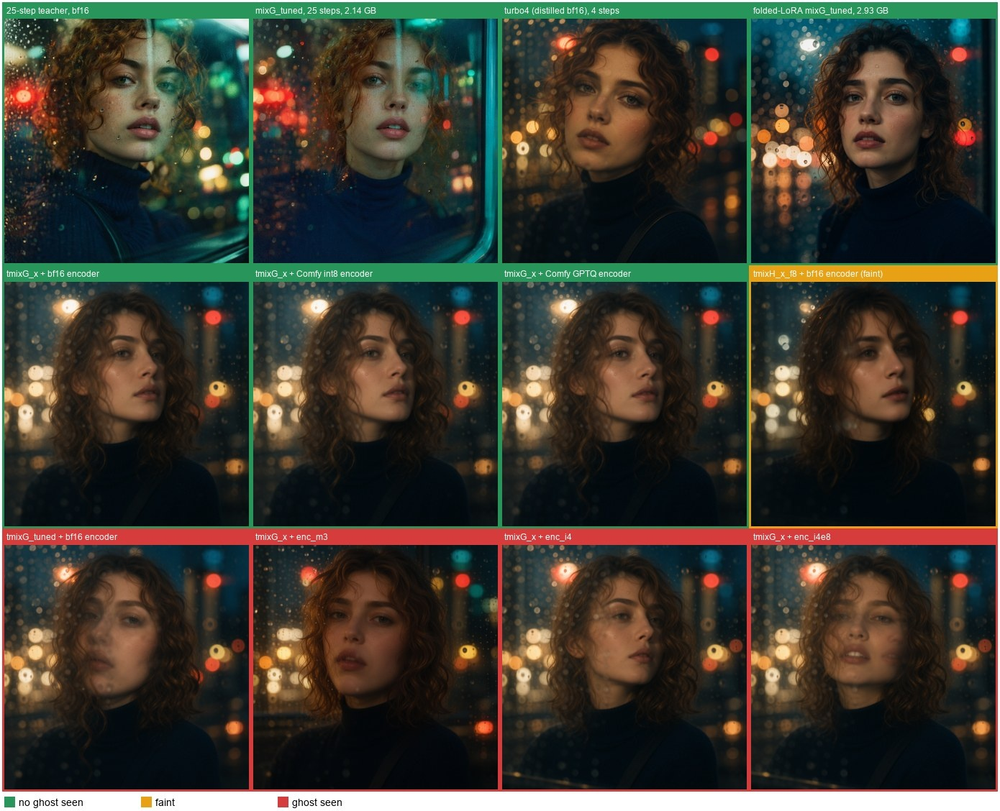

**Figure 26.** Prompt 07 (seed 2002) in twelve configurations. Frame: green = no ghost seen, amber = faint, red = ghost seen (a second faint mouth and cheek beside the face). Top row: other DiTs (the 25-step teacher and mixG_tuned at 768 px, the distilled bf16 teacher turbo4, the folded-LoRA mixG_tuned). Middle row: tmixG_x with the bf16, ComfyUI int8 and Comfy-Org GPTQ encoders, and tmixH_x_f8 with the bf16 encoder (faint). Bottom row: tmixG_tuned with the bf16 encoder, and tmixG_x with our enc_m3, enc_i4 and enc_i4e8. One seed per panel; the frames are a visual reading, not a measurement. 1024 px images resized to 340 px. *Source:* `eval/<tag>/07_seed2002.png`, frames from the notes (strip made by `scripts/strip_id.py`), composed by `paper/_build/build_figures_v4.py`.

**The first hypothesis, and why the count was needed.** We first read the strip as an effect of our encoder: a 4-step quantized student does not commit to one layout in the first step when the conditioning is perturbed, so two nearby layouts are blended (the same mechanism as the blur of the trajectory-level loss, Section 8.5), and our int4 encoders, which move the result more than ComfyUI's, would trigger it more. One image per configuration cannot show that. `scripts/queue36.sh` (resumed as `queue39.sh` after the reboot of Section 11) generated the person prompts (ids 6, 7, 8, 9, 17 and 22) with 6 seeds each (the base seed and 5 more, seed + 100 j), 36 images per variant, for six variants (tags `gh_turbo_bf16`, `gh_x_bf16`, `gh_x_int8`, `gh_x_gptq`, `gh_x_i4e8`, `gh_tuned_bf16`).

**The blind count.** Two reports (`eval/ghost_rate_part1.md`, `ghost_rate_part2.md`) were written by a Claude visual judge that classified every image as clean, ghost (a double or double-exposed face), mushy (a smeared face without a clear double) or other (a heavy non-face artifact such as translucent or duplicated furniture). In part 1 (144 images: four encoders with tmixG_x) the four folders were shuffled with a fixed seed and labelled A to D, the mapping was not opened until all images were classified, each (prompt, seed) was viewed as a 1280 x 1280 composite and suspicious faces were re-checked at 1:1 and zoomed. Part 2 (108 images: three generators with the bf16 encoder) did the same with labels A to C and 3-up composites.

**Limits of the count**, which the reports state themselves: the judge is a model instance, not a human and not a trained detector; each variant has 36 images, so differences of 1-3 images are not meaningful; borderline calls differ between the passes (the same folder `gh_x_bf16` is 35/0/0/1 in part 1 and 34/0/0/2 in part 2, the difference being the borderline `22_seed5507`); and the blinding was imperfect for enc_i4e8, whose images often differed visibly in rendering style or composition from the other three, so the judge may have recognised them as one variant across composites. The `gh_*` images are reruns of the configurations of the evaluation, not bit-identical copies (run-to-run noise above), and no human checked them.

**Table 34. Blind artifact counts, 36 images per variant (prompts 6, 7, 8, 9, 17, 22 x 6 seeds; 4 steps, CFG 1, 1024 px).**

| variant | clean | face ghost | mushy | other | total |
|---|---|---|---|---|---|
| tmixG_x, bf16 encoder (part 1) | 35 | 0 | 0 | 1 | 36 |
| tmixG_x, ComfyUI int8 encoder | 35 | 0 | 0 | 1 | 36 |
| tmixG_x, Comfy-Org GPTQ encoder | 35 | 0 | 0 | 1 | 36 |
| tmixG_x, enc_i4e8 | 29 | 2 | 0 | 5 | 36 |
| distilled bf16 teacher | 31 | 3 | 0 | 2 | 36 |
| tmixG_x, bf16 encoder (part 2) | 34 | 0 | 0 | 2 | 36 |
| tmixG_tuned, bf16 encoder | 28 | 1 | 0 | 7 | 36 |

*Source:* "Total counts per variant" of `eval/ghost_rate_part1.md` (rows 1-4) and `eval/ghost_rate_part2.md` (rows 5-7), by `paper/_build/tables_v4.py`. Part 2 also gives the counts with its mild "other" cases counted clean: 33/3/0/0 (distilled teacher), 35/0/0/1 (tmixG_x) and 29/1/0/6 (tmixG_tuned). Mapping revealed after judging: part 1 A = bf16, B = enc_i4e8, C = GPTQ, D = int8; part 2 A = distilled teacher, B = tmixG_x, C = tmixG_tuned.

**Table 35. The same counts per prompt (clean / face ghost / mushy / other; 6 images per cell).**

| prompt | tmixG_x, bf16 (part 1) | int8 | GPTQ | enc_i4e8 | distilled teacher | tmixG_x, bf16 (part 2) | tmixG_tuned |
|---|---|---|---|---|---|---|---|
| 06 monk | 6/0/0/0 | 6/0/0/0 | 6/0/0/0 | 6/0/0/0 | 6/0/0/0 | 6/0/0/0 | 6/0/0/0 |
| 07 curly hair, rainy window | 6/0/0/0 | 6/0/0/0 | 6/0/0/0 | 4/2/0/0 | 2/3/0/1 | 6/0/0/0 | 4/1/0/1 |
| 08 anime boy | 6/0/0/0 | 6/0/0/0 | 6/0/0/0 | 5/0/0/1 | 6/0/0/0 | 6/0/0/0 | 6/0/0/0 |
| 09 pottery studio | 6/0/0/0 | 6/0/0/0 | 6/0/0/0 | 6/0/0/0 | 6/0/0/0 | 6/0/0/0 | 6/0/0/0 |
| 17 umbrella street | 6/0/0/0 | 6/0/0/0 | 6/0/0/0 | 6/0/0/0 | 5/0/0/1 | 6/0/0/0 | 6/0/0/0 |
| 22 white kitchen | 5/0/0/1 | 5/0/0/1 | 5/0/0/1 | 2/0/0/4 | 6/0/0/0 | 4/0/0/2 | 0/0/0/6 |
| total | 35/0/0/1 | 35/0/0/1 | 35/0/0/1 | 29/2/0/5 | 31/3/0/2 | 34/0/0/2 | 28/1/0/7 |

*Source:* "Per prompt id" tables of `eval/ghost_rate_part1.md` and `ghost_rate_part2.md`, by `paper/_build/tables_v4.py`. The "other" of enc_i4e8 on prompt 08 is mild (a semi-transparent scarf end; the face is clean).

What the counts say.

- **Face ghosts sit on prompt 07 only, and the unquantized distilled teacher has them too.** No other prompt has a face ghost in any of the 252 images, and none is mushy. On prompt 07 the distilled bf16 teacher is ghosted on 3 of 6 seeds (2102, 2202, 2402), tmixG_tuned on 1 (2002), tmixG_x with the bf16, int8 and GPTQ encoders on none, and tmixG_x with enc_i4e8 on 2 (2002 and 2202, clean in the other three encoders with the same noise). Seed 2202 is ghosted for the teacher and for enc_i4e8, seed 2002 for tmixG_tuned and for enc_i4e8. So the face ghost on prompt 07 is a trait of the 4-step distilled map on that prompt and certain seeds; the two enc_i4e8 cases are within what the unquantized teacher does (3). Our first reading, that the ghost is tied to our encoder, is not supported for faces. With 36 images and one judge, 0-3 face ghosts per variant is a rough signal at best.
- **More kitchen artifacts were observed in this sample.** In the kitchen prompt 22 (translucent chairs and table legs): the distilled teacher 0 of 6 seeds, tmixG_x with the bf16 encoder 1-2 of 6 (seed 5207 in both passes; 5507, mild, in part 2 only), tmixG_x with the int8 or GPTQ encoder 1 of 6 (5207, shared by every quantized variant), tmixG_x with enc_i4e8 4 of 6 (seeds 5007, 5107, 5207 and 5407), tmixG_tuned 6 of 6. That is a possible encoder-linked defect in this small sample (4 of 6 against 1 of 6 for the same DiT), requiring confirmation, and the end-to-end tuning of tmixG_tuned adds the same artifact (Figure 27). Flagged images in total: enc_i4e8 7 against 1 for each of the other three encoders (6 against 0 without the shared seed), tmixG_tuned 8, the distilled teacher 5, tmixG_x 2 (part 2).
- **Revised reading.** The initial attribution of face ghosts to our encoder is not supported. More kitchen artifacts were observed with enc_i4e8 on these six seeds (4/6 versus 1/6). One failure is shared, leaving three discordant paired failures in one direction and none in the other; the exact two-sided paired sign/McNemar p-value is 0.25 for this kitchen comparison. This is suggestive and does not establish a reliable kitchen-specific difference. The wider artifact totals answer a different question. Prefer the stronger encoder based on the combined evidence, including its much lower conditioning error, and confirm artifact rates on new prompts and seeds.
- **The folded model mixG_tuned_t was not in the blind test** (it is the panel "folded-LoRA mixG_tuned" of Figure 26), but its judge report (Section 9.12) looked for both artifacts in its own 24 images: no ghost or double face on prompt 07, no ghost or translucent furniture on prompt 22, and no semi-transparent duplicate of any object anywhere. That is one seed per prompt and a judge's reading, not a count over seeds.

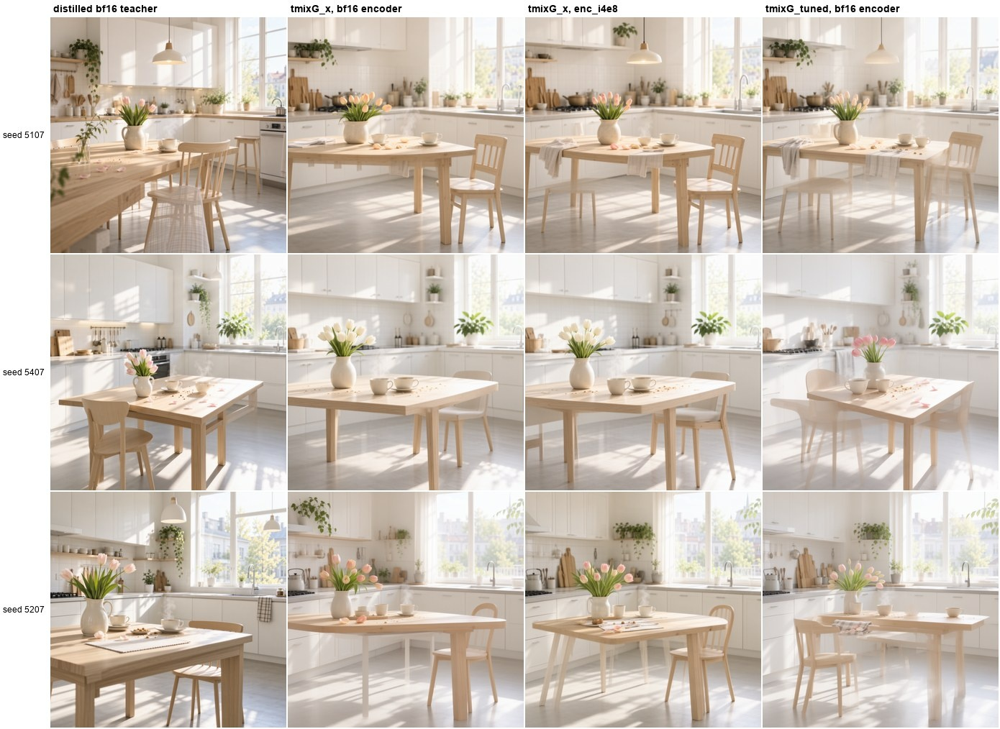

**Figure 27.** Prompt 22 (white kitchen, two cups, tulips) for the distilled bf16 teacher, tmixG_x with the bf16 encoder, tmixG_x with enc_i4e8 and tmixG_tuned with the bf16 encoder, at seeds 5107, 5407 and 5207 (1024 px resized to 330 px). Read against the blind reports: seeds 5107 and 5407 are flagged for enc_i4e8 and tmixG_tuned and not for tmixG_x or the teacher (a translucent chair or ghost legs next to the table); seed 5207 shows see-through table legs in every quantized variant and not in the teacher. At this size the effect is clearest in the tmixG_tuned column. *Source:* `eval/gh_turbo_bf16`, `gh_x_bf16`, `gh_x_i4e8`, `gh_tuned_bf16` (`22_seed5107.png`, `22_seed5407.png`, `22_seed5207.png`), flags from `eval/ghost_rate_part1.md` and `ghost_rate_part2.md`, composed by `paper/_build/build_figures_v4.py`.

**HPSv3 and the ghost.** The mean does not see the face ghost: enc_i4e8 scores 11.09 against the reference's 11.09. At the level of one image it partly does. On the evaluation seed of prompt 07 (2002) the enc_i4e8 image scores 10.56 against 11.76 for the reference (-1.20, the second lowest of the 24 per-prompt differences of that encoder; the lowest, -1.53, is the other portrait, prompt 06), tmixG_tuned scores 9.35, and the three encoders the blind count found clean score 11.76 (bf16), 11.91 (int8) and 12.19 (GPTQ). The images of the evaluation and of the blind count are different runs of the same configuration (run-to-run noise above), and a per-image score has no standard error, so this is an observation and not a detector. The tie of the means also hides a portrait-specific cost: on the four portraits (prompts 6-9) HPSv3 falls by 0.65 for enc_i4e8, 0.51 for enc_i4 and 0.63 for enc_m3, against 0.17 for the int8 encoder and 0.05 for GPTQ, while the six text prompts gain 0.32 +- 0.17 with enc_i4e8 (Table H3; four prompts is thin evidence).

### 9.7 The judge pass on enc_i4e8

`eval/judge_enc_i4e8.md` is a visual judge report with the rubric of Section 5.3 (F, T, C, Q and A with half points, no 5 on Q or A, C on 7 images, T on the six quoted-text prompts plus the typewriter keys). Its model instance opened all 24 enc_i4e8 images at native 1024 x 1024, every pair side by side with the bf16-encoder image, and read every quoted string from native views and 2-4x crops. It also scored the bf16-encoder (reference) images on the same scale. A asks whether a user would accept the enc_i4e8 image instead of the bf16-encoder image; a different layout was not penalised by itself.

**Table 36. The judge report of enc_i4e8 (24 images, 1024 px).**

| report | F | T (7 images) | C (7 images) | Q | A | images with A of 4 or more | against the bf16-encoder image (better / same / worse) | quoted-text prompts accepted / letter-exact (of 6) | quoted strings exact (of 19) |
|---|---|---|---|---|---|---|---|---|---|
| **enc_i4e8** | 4.17 | 3.86 | 4.29 | 4.25 | 4.10 | 21 / 24 | 2 / 19 / 3 | 5 / 3 | 15 |
| bf16-encoder images, scored in the same session | 4.21 | 3.93 | 4.00 | 4.42 | | | | not stated / 4 | 12 |
| for scale: tmixG_x against turbo4 (Table 24) | 4.08 | 3.79 | 3.86 | 4.23 | 4.06 | 18 / 24 | 1 / 14 / 9 | 4 / 4 | not counted |

*Source:* `eval/judge_enc_i4e8.md` (means, counts of A of 4 or more and verdicts recomputed from its per-image table by `paper/_build/tables_v4.py`, which matches the report's own averages; the accepted, letter-exact and string counts are the report's statements); `eval/judge_tmixG_x.md` via Table 24. The A of the last row is against turbo4's image and from another instance, so it is not on one scale with the first row. The report was written once and had not changed for 13 minutes when we first read it.

Reading.

- **Averages.** Against the reference scored in the same session every difference is inside or at the edge of the +-0.2 noise band: F -0.04, T -0.07, Q -0.17, and C +0.29 on seven images, which the report traces to image 15 (the bf16 encoder shows four apples) and image 01. On the six quoted-text prompts T is 4.00 for both.
- **Verdicts.** 2 better (00, whose sign is exact where the reference reads "L LE PETTT FROMAGE"; 15, the fruit mix), 19 same, 3 worse (02, a one-letter typo in the tagline; 07; 10, the typewriter, whose mechanics and legible legends fall from about 10 to 6-8). In 20 of 24 pairs the layout is that of the reference; it differs clearly in 00, 01, 07 (head pose) and 10.
- **Text.** 15 of the 19 requested strings are exact against 12 for the reference, but 3 of 6 prompts are letter-exact against 4 of 6, because of the window line and slate of 00, the "Evaportion" of 01 and the tagline typo of 02 (the reference fails 00 and 01); 5 of 6 prompts are accepted (01 is 3.5). Two images carry an unrequested wrong text (a "CHEFRRIES $3" board in 05, garbled chalk on a wall in 00).
- **One heavy artifact, prompt 07.** "The face is smeared as a double exposure - a ghost second jaw / mouth on the right cheek, mushy eyes, lashes lost" (F 3, Q 2.5, A 2.5; "a user would reject it"). Without it the averages are F 4.22, Q 4.33, A 4.17. No image is broken, and there is no colour shift, banding, blocking or over-sharpening. On the kitchen image (prompt 22) the report notes a pale translucent table leg, which it also sees in the reference, and gives A 4.5; the kitchen finding of Section 9.6 is a count over six seeds and not a single-image defect.
- **Thresholds.** A of 4.10 with 21 of 24 images at A of 4 or more (below 4: 01, 07, 10) and 5 of 6 text prompts accepted meet the three post hoc thresholds of Section 1, with the exception of image 07.

Caveats. The A of 4.10 and the 4.06 of tmixG_x come from different instances and different baselines; the firm comparison is the one with the reference scored in the same session. That instance scored the reference 0.13-0.19 higher on F, T, C and Q than the tmixG_x report did, which is the instance-to-instance spread of Section 5.3 again, while the readings that matter agree ("L LE PETTT FROMAGE", "Evapoation", "Condenation", "Conipitation", no "Collection"). The stock encoders were not judged.

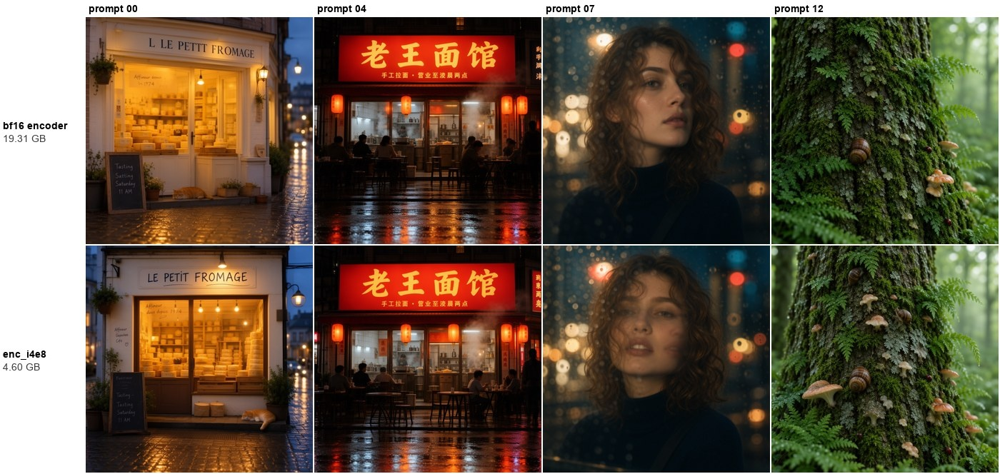

**Figure 28.** The bf16 encoder (top) and enc_i4e8 (bottom) with tmixG_x, same seeds, prompts 00 (storefront), 04 (Chinese sign), 07 (portrait; the ghost of Section 9.6 is visible in the enc_i4e8 image, judged A 2.5) and 12 (mossy oak). The four ids were chosen by us to span text, a fine texture and the ghost prompt, not drawn at random. The compositions differ in detail because the conditioning differs (Section 9.5). 1024 px images resized to 320 px. *Source:* `eval/tmixG_x_1024/`, `eval/enc_i4e8/`, composed by `paper/_build/build_figures_v4.py`.

### 9.8 The conditioning error, and why ComfyUI's GPTQ file is closer

A direct measure that does not need the DiT: `scripts/encode_prompts.py` runs each encoder over 296 prompts (the 24 evaluation prompts, 192 calibration prompts and 80 text-rich prompts) the way the sampler sees them, as the conditioning that `CLIPTextEncode` returns, and `scripts/cond_error.py` computes the distance to the bf16 encoder's conditioning: the relative MSE and the mean token cosine, per prompt and averaged (`queue40.sh`).

**Table 37. Conditioning error of every encoder against the bf16 encoder (296 prompts).**

| encoder | relative MSE, mean | median | 95th percentile | maximum | token cosine, mean | token cosine, worst prompt | prompts |
|---|---|---|---|---|---|---|---|
| ComfyUI int8 convrot | 0.00079 | 0.00053 | 0.00150 | 0.02881 | 0.99959 | 0.98455 | 296 |
| Comfy-Org W4A8 GPTQ | 0.01099 | 0.01004 | 0.01765 | 0.03740 | 0.99440 | 0.98013 | 296 |
| pruned GPTQ | 0.01099 | 0.01004 | 0.01765 | 0.03740 | 0.99440 | 0.98013 | 296 |
| pruned GPTQ against the unpruned GPTQ file | 0.00000 | 0.00000 | 0.00000 | 0.00000 | 1.00000 | 1.00000 | 296 |
| enc_i4e8 | 0.11881 | 0.11644 | 0.14569 | 0.19241 | 0.93937 | 0.90475 | 296 |
| enc_i4 | 0.11881 | 0.11634 | 0.14571 | 0.19248 | 0.93937 | 0.90471 | 296 |
| enc_a3 | 0.19172 | 0.18963 | 0.22539 | 0.28758 | 0.90181 | 0.84941 | 296 |
| enc_m3 | 0.31058 | 0.30910 | 0.34530 | 0.39863 | 0.84322 | 0.79753 | 296 |
| enc_l3 | 0.70095 | 0.70290 | 0.85420 | 0.97429 | 0.62854 | 0.47949 | 296 |
| enc_i3 | 1.14210 | 1.13978 | 1.24940 | 1.35385 | 0.42457 | 0.32503 | 296 |

*Source:* `logs/cond_error.log`, `cond_error_pruned_vs_bf16.log`, `cond_error_pruned_vs_gptq.log` (tensors in `data/enc_cond/`), by `paper/_build/tables_v4.py`. enc_i4 and enc_i4e8 differ only in the embedding table, bf16 or int8.

The order of Table 37 matches the image-level findings. With the conditioning error growing from 0.119 (enc_i4e8) to 0.192 (enc_a3), 0.311 (enc_m3), 0.701 (enc_l3) and 1.142 (enc_i3), HPSv3 falls from 11.09 through 11.02, 10.64 and 9.77 to 4.86 (Table 31), strictly in that order; the two stock encoders, at 0.0008 and 0.011, are inside the noise on HPSv3 and have the same count of artifacts as the bf16 encoder (Table 34), while enc_i4e8, at 0.119, has the kitchen-furniture artifacts. No clear conditioning-error increase was detected for the int8 embedding table (enc_i4 and enc_i4e8 have the same error). Our round-to-nearest int4 is 10.8 times farther from bf16 than ComfyUI's GPTQ file at the same nominal 4 bits (0.1188 / 0.0110).

**Why.** The header of the Comfy-Org GPTQ file shows how it spends its bits (Table 38; read from shapes and dtypes, not from the format code).

**Table 38. Layout of `qwen3.5_9b_w4a8_gptq.safetensors` (layer linears: 200 tensors in 32 layers).**

| part | dtype and shape (layer 0, gate_proj) | tensors | GB |
|---|---|---|---|
| 4-bit codes, two per byte | I8 [12288, 2048] | 200 | 3.456 |
| relative scales, one per 16 weights | F8_E4M3 [12288, 256] | 200 | 0.432 |
| per-channel scale | F32 [12288] | 200 | 0.006 |
| codebook of 16 entries | F32 [16] | 200 | 0.000 |
| small bf16 tensors of the layers (in_proj_a, in_proj_b) | BF16 | 48 | 0.013 |
| embedding table, per-row int8 | I8 [248320, 4096] | | 1.018 |
| lm_head, int8 | | | 1.018 |
| vision tower, bf16 | | | 0.912 |
| MTP head, bf16 | | | 0.487 |

*Source:* header of the file, `paper/_build/enc_anatomy_v4.py` (`enc_anatomy_v4_output.txt`). The 200 layer linears are 96 (mlp) + 32 (full attention) + 72 (linear attention); each also has a `comfy_quant` marker. The sum of all parts is 7.343 GB.

The layer weights take (3.456 + 0.432 + 0.006) x 8 / 6.912 = 4.51 bits each, against 4.125 for ours. They differ from ours in three ways at once: a relative scale for every 16 weights plus a per-channel scale instead of one fp16 scale for every 128; a 16-entry codebook (non-uniform, per the notes) instead of a uniform grid; and GPTQ rounding, which is data-aware, instead of round-to-nearest. We did not ablate which of the three matters. The notes' decision followed from this table and from Table 37: stop developing a post-training quantizer of our own and use ComfyUI's file.

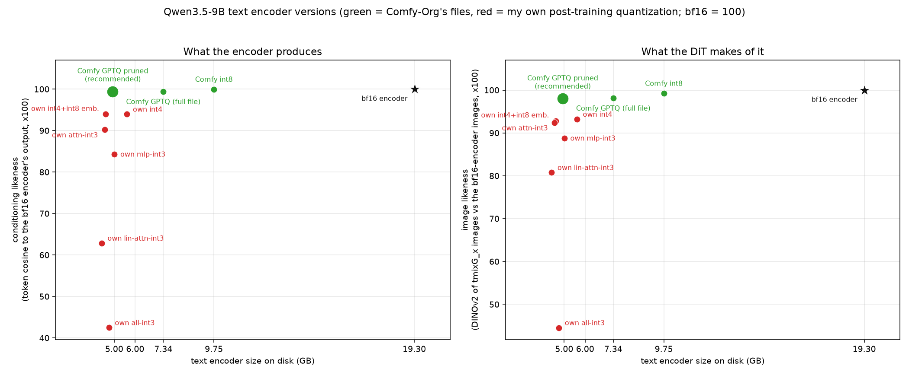

**Figure 29.** The Qwen3.5-9B encoder versions against the bf16 encoder (= 100); green: Comfy-Org's files (the recommended pruned GPTQ file is the large dot), red: our own post-training quantization. Left: what the encoder produces, the token cosine between its conditioning and the bf16 encoder's, times 100 (Table 37). Right: what the DiT makes of it, the DINOv2-small cosine, times 100, between the tmixG_x images made with the encoder and those made with the bf16 encoder. **Likeness here is a cosine to a reference: it measures how close the conditioning or the picture stays to the reference, not whether the picture is good** (Section 9.5). It shows that the pruned GPTQ file (99.4 and 98.0) stays at the level of the stock files and our int4 files do not (93.9 and 92.8), while HPSv3 (Table 31) cannot separate the five best. The values are in Table I5. *Source:* `RELEASE_CANDIDATES/charts/encoder_likeness_vs_size.png` and `encoder_likeness.csv` (computed by `scripts/likeness_plot.py`, drawn by `scripts/likeness_charts.py`), copied by `paper/_build/build_figures_v4.py`.

### 9.9 The recommended encoder: ComfyUI's W4A8 GPTQ file, pruned

`scripts/prune_encoder.py` drops `lm_head.*`, `mtp.*` and `model.visual.*` from a ComfyUI-format Qwen3.5-9B encoder file and copies everything else byte for byte. Applied to `qwen3.5_9b_w4a8_gptq.safetensors` it writes `qwen3.5_9b_w4a8_gptq_pruned.safetensors`: 4,926,837,368 bytes (4.93 GB) and 1,228 tensors against 1,579, 2.42 GB less than the full file (Table 29). It needs no custom node: the stock Load CLIP node with type `moss_image` reads it (the dropped weights stay uninitialised at run time, as in Section 9.3).

**Verification** (`queue41.sh`, `queue43.sh`).

- **Conditioning.** On the 296 prompts the pruned file's conditioning equals the full file's (relative MSE 0.00000, cosine 1.0000) and is 0.0110 / 0.9944 from bf16 (Table 37).
- **Images.** The 24 evaluation images through tmixG_x give latents identical to those of the unpruned run (latent relative MSE 0.0000, cosine 1.0000); the decoded images are bit-identical for 13 of the 24 and differ by 30.6-37.2 dB PSNR (mean 33.9) for the other 11, which is the decode variation of Section 9 (the explanation in the notes is decode nondeterminism; a controlled test of it was not run). HPSv3 is 11.02 for the pruned run against 10.99 for the unpruned run (+0.03 +- 0.04, 8 of 24 higher) and 11.09 for the bf16 encoder (-0.07 +- 0.11, 12 of 24 higher). Against the bf16-encoder images the pruned run has PSNR 28.2 dB, SSIM 0.919, DINOv2 0.980 and latent cosine 0.956 (the unpruned run: 28.7, 0.941, 0.981, 0.956, Table 30), i.e. the same latents and a different decode.
- **Artifacts.** The blind count of Table 34 was run on the unpruned file (35/0/0/1, the same as bf16 and int8); the pruned file has the same conditioning, so the count is supporting evidence for the unchanged conditioning, not a direct measurement of the pruned run or final package. It was not run on the pruned file's own images.
- **Non-distilled DiTs.** CFG amplifies conditioning error, so the encoder was also run with the 25-step DiTs at their original settings (25 steps, CFG 2.5, `er_sde`, 768 px; `queue43.sh`) against their bf16-encoder runs (Table 39). The difference is not distinguishable from zero, no prompt collapsed (lowest prompt 7.61 and 7.98), and CFG did not amplify the encoder difference on HPSv3. The judge reports added later (Section 9.12) find a small cost in spelling, larger for the smaller model: mixG_tuned A 4.12 against 4.21 with the bf16 encoder (20 of 24 images accepted; one regression, the big sign of prompt 05) and mixH2_x_f8 A 4.06 with 19 of 24 accepted and T about 0.3 lower, from separate judge instances.

**Table 39. The pruned GPTQ encoder against the bf16 encoder with the distilled and the non-distilled DiTs.**

| DiT and settings | HPSv3, bf16 encoder [95%] | HPSv3, pruned GPTQ encoder [95%] | difference +- paired SE (prompts where higher) | lowest prompt, bf16 / pruned | DINOv2 vs the bf16-encoder images | SSIM | latent cosine | CLIP, bf16 / pruned |
|---|---|---|---|---|---|---|---|---|
| tmixG_x (4 steps, CFG 1, 1024 px) | 11.09 [10.38, 11.77] | 11.02 [10.30, 11.71] | -0.07 +- 0.11 (12 / 24) | 6.80 / 6.68 | 0.980 | 0.919 | 0.956 | 35.75 / 35.72 |
| mixG_tuned (25 steps, CFG 2.5, 768 px) | 12.14 [11.36, 12.87] | 12.16 [11.44, 12.85] | +0.02 +- 0.09 (13 / 24) | 7.56 / 7.61 | 0.981 | 0.926 | 0.962 | 36.35 / 36.27 |
| mixH2_x_f8 (25 steps, CFG 2.5, 768 px) | 11.99 [11.36, 12.59] | 12.04 [11.42, 12.63] | +0.05 +- 0.10 (16 / 24) | 7.52 / 7.98 | 0.979 | 0.945 | 0.969 | 36.39 / 36.37 |

*Source:* `eval/hps3_vae_full_ref.json` (`enc_gptq_pruned`), `hps3_tmixG.json` (reference), `hps3_nd_gptq.json` (`mixG_tuned`, `nd_mixG_tuned_gptq`, `mixH2_x_f8`, `nd_mixH2_x_f8_gptq`), `eval/nd_mixG_tuned_gptq/metrics.json`, `nd_mixH2_x_f8_gptq/metrics.json` (reference images `eval/mixG_tuned`, `eval/mixH2_x_f8`), by `paper/_build/tables_v4.py`. The image metrics of the tmixG_x row are against the bf16-encoder images (`eval/tmixG_x_1024`) and come from `logs/metrics_enc_gptq_pruned.log`, because `eval/enc_gptq_pruned/metrics.json` was overwritten by the later comparison with the unpruned run (Appendix F). The 4-step run uses the full VAE.

The pruned file is the encoder we recommend. Against our own enc_i4e8 it is 0.33 GB larger (4.927 - 4.597), has 11 times less conditioning error (0.0110 against 0.1188), needs no custom node, and shows no more kitchen-furniture artifacts than the bf16 encoder (1 of 6 seeds, the one every quantized variant shares; counted on the unpruned file) where enc_i4e8 shows 4 of 6. enc_i4e8 stays in the tables as a documented negative result. For the smaller non-distilled models, where exact small text matters, the Comfy int8 encoder (9.75 GB, conditioning error 0.0008) or the bf16 encoder is the safer choice (Section 9.12).

### 9.10 The VAE: the FLUX.2 small decoder

After the encoder the VAE (0.34 GB) is the next largest file. `black-forest-labs/FLUX.2-small-decoder` (Apache-2.0, ungated) is a distilled drop-in decoder for the FLUX.2 latent space, per the notes with about 28 M decoder parameters against about 50 M and the encoder unchanged. ComfyUI's VAE loader already accepts a decoder narrower than the encoder (the `decoder_ddconfig` branch of `comfy/sd.py`), and text-to-image needs only the decoder.

**Table 40. The VAE files.**

| file | bytes | GB | what it is |
|---|---|---|---|
| `flux2-vae.safetensors` | 336,211,292 | 0.336 | the standard FLUX.2 VAE: fp32 encoder, decoder and the `bn.*` latent statistics (84.05 M parameters, per the notes) |
| `flux2-vae-small-decoder.safetensors` | 249,519,092 | 0.250 | the official file: original encoder plus small decoder (62.37 M parameters, per the notes); loads as is; keeps VAE Encode |
| `flux2-small-decoder-only.safetensors` | 111,801,980 | 0.112 | the raw decoder-only file (27.95 M parameters): not loadable, its keys lack the `decoder.` prefix and the `bn.*` tensors ("does not contain a valid VAE") |
| `flux2-small-decoder-vae.safetensors` | 111,804,380 | 0.112 | built by `scripts/make_small_vae.py`: the raw file with the prefix added and the three `bn.*` tensors copied from the full VAE (143 tensors); text-to-image only; decodes identically to the 250 MB file |

*Source:* file sizes from the file system (`paper/_build/tables_v4.py`); parameter counts and the description of the files from `NOTES.md`; "decodes identically" from `logs/vae_gpu_psnr.log` (the two small files give the same PSNR, 35.21 dB, against the full VAE on the 22 images the full VAE produced).

**Robustness.** The full VAE crashed the 16 GB GPU after 22 of 24 consecutive 1024 px decodes (`CUBLAS_STATUS_ALLOC_FAILED`), both on the enc_i4e8 latents and again on the latents of the recommended package (22 PNGs each); the small decoder decoded all 24 each time, in 127.5 s (5.31 s per image including first-call setup) for the built file on the recommended latents, and 129.1 s and 134.7 s on the enc_i4e8 latents for the 250 MB and the built file. The 'peak VRAM' that `vae_compare.py` prints is not a real figure (ComfyUI's virtual allocator confuses `torch.cuda.max_memory_allocated`), so no memory number is given for the decoders. As a platform note, the CPU decode path segfaulted (exit 139) after about 9-12 images in every process that loaded more than one VAE, so all VAE numbers are GPU runs, one process per VAE file.

**Fidelity** on the 24 latents of the recommended package (tmixG_x with the pruned GPTQ encoder), against the images the full VAE decoded in the original generation:

**Table 41. Small decoder against the full VAE on the recommended package (24 latents).**

| decoder | HPSv3 mean [95%] | lowest prompt | HPSv3 text prompts | HPSv3 portraits | HPSv3 detail | CLIP |
|---|---|---|---|---|---|---|
| full VAE (original generation) | 11.02 [10.30, 11.71] | 6.68 | 12.02 | 11.92 | 9.53 | 35.72 |
| small decoder | 11.06 [10.29, 11.80] | 6.79 | 12.21 | 12.44 | 9.34 | 35.87 |

*Source:* `eval/hps3_vae_full_ref.json` (`enc_gptq_pruned`), `eval/hps3_vae_final.json` (`enc_gptq_pruned_flux2-small-decoder-vae`), `eval/enc_gptq_pruned_flux2-small-decoder-vae/metrics.json` (reference images `eval/enc_gptq_pruned`), by `paper/_build/tables_v4.py`. The paired HPSv3 difference is +0.03 +- 0.10 (small decoder higher in 10 of 24 prompts).

The images agree at PSNR 35.66 dB (minimum 28.31), SSIM 0.9479 and DINOv2 0.9958, and HPSv3 is equal not clearly resolved by these measurements (+0.03 +- 0.10). Against the 22 images that the full-VAE rerun produced before it crashed the numbers are 35.30 dB, SSIM 0.9559 and DINOv2 0.9970 (`logs/vae_final_psnr.log`, `vae_final_metrics.log`), and 35.21 dB, 0.9585 and 0.9973 on the enc_i4e8 latents. The comparison of the full VAE with itself on identical latents (the pruned against the unpruned GPTQ run: 13 of 24 images bit-identical, 33.9 dB for the other 11) is of the same order, but the small decoder is slightly farther from the full VAE than two runs of the same pipeline are from each other (DINOv2 99.6 against 99.8 and SSIM 94.8 against 97.4, Figure 31). At 100% the crops are near-identical (Figure 30); the small decoder may show a marginally crisper, finer-grained texture on the moss (the notes' reading and ours).

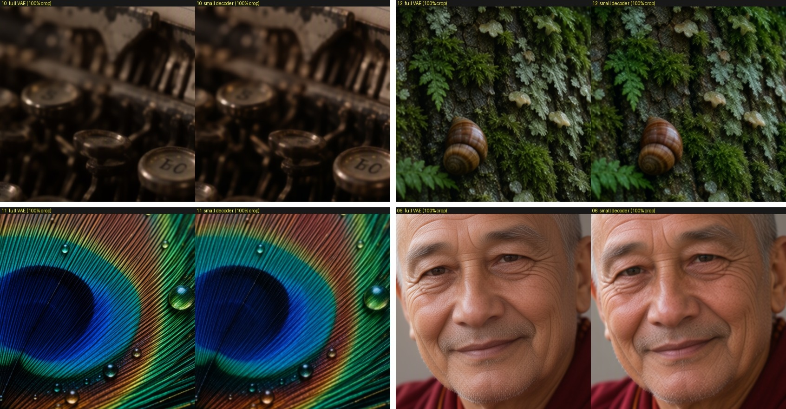

**Figure 30.** 100% crops of 420 x 420 px, full VAE (left of each pair) against the small decoder (right), from the 24 latents of the recommended package: 10 (typewriter), 12 (moss and snail), 11 (peacock feather) and 06 (monk's face). The left crops are cut from the images of the original generation (`eval/enc_gptq_pruned`; the typewriter crop matches that file pixel for pixel). *Source:* `eval/crops_vae_full_vs_small.png`, rearranged as 2 x 2 by `paper/_build/build_figures_v4.py`.

Recommendation, from the notes: the official 250 MB file as the default (it keeps the encoder, so VAE Encode and image-to-image still work), the 112 MB built file for text-to-image only.

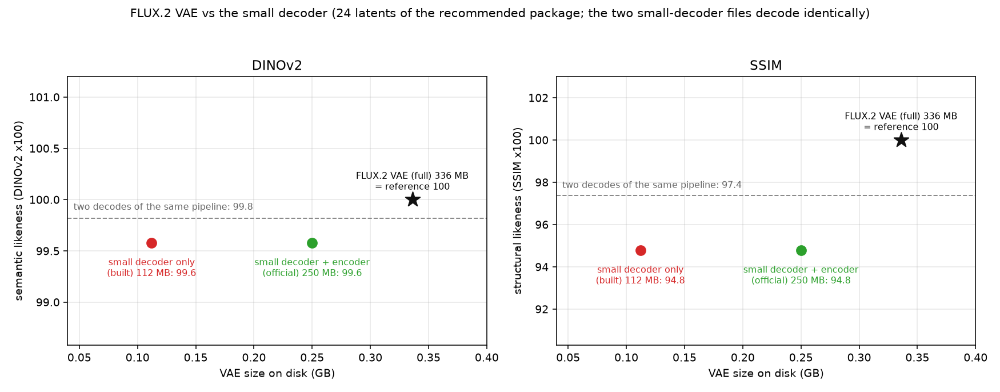

**Figure 31.** The two small-decoder files against the full FLUX.2 VAE (= 100) on the 24 latents of the recommended package; the two files decode identically. Left: DINOv2 (semantic likeness), 99.6 for both; right: SSIM (structural likeness), 94.8 for both. The dashed lines are the pipeline's own floor, two decodes of the same pipeline (the unpruned and the pruned GPTQ runs, identical latents, full VAE): DINOv2 99.8, SSIM 97.4. Likeness is a similarity to a reference, not quality; HPSv3 of the small decoder is 11.06 against 11.02 (Table 41). The values are in Table I6. *Source:* `RELEASE_CANDIDATES/charts/vae_likeness_vs_size.png` and `vae_likeness.csv`, copied by `paper/_build/build_figures_v4.py`.

### 9.11 The package, how to run it, and where it stands

**Table 42. The package (decimal GB).**

| configuration | DiT | text encoder | VAE | total | smaller than the original |
|---|---|---|---|---|---|
| original: bf16 DiT, bf16 encoder, full VAE | 10.16 | 19.31 | 0.34 | 29.81 | 1.0x |
| tmixG_x, bf16 encoder, full VAE | 2.14 | 19.31 | 0.34 | 21.78 | 1.4x |
| tmixG_x, ComfyUI int8 encoder, full VAE | 2.14 | 9.75 | 0.34 | 12.22 | 2.4x |
| tmixG_x, Comfy-Org GPTQ encoder, full VAE | 2.14 | 7.34 | 0.34 | 9.82 | 3.0x |
| tmixG_x, enc_i4e8, full VAE | 2.14 | 4.60 | 0.34 | 7.07 | 4.2x |
| tmixG_x, pruned GPTQ encoder, full VAE | 2.14 | 4.93 | 0.34 | 7.40 | 4.0x |
| tmixG_x, pruned GPTQ encoder, official small decoder | 2.14 | 4.93 | 0.25 | 7.32 | 4.1x |
| **recommended: tmixG_x, pruned GPTQ encoder, small decoder (built)** | 2.14 | 4.93 | 0.11 | **7.18** | **4.2x** |
| mixG_tuned_t, pruned GPTQ encoder, small decoder (built) | 2.93 | 4.93 | 0.11 | 7.97 | 3.7x |

*Source:* byte sizes of `diffusion_models/moss_image_sft_bf16.safetensors` (10,164,655,808), `tmixG_x.safetensors` (2,140,557,083), `out/mixG_tuned_t.safetensors` (2,933,288,947), `vae/flux2-vae.safetensors` (336,211,292), the small decoders (Table 40) and the encoder files (`paper/_build/tables_v4.py`, `v4_tables_output.txt`; Table A2). Ratios are original total / total. Arithmetic: 10.16 + 19.31 + 0.34 = 29.81 for the original (29,807,179,428 bytes); 2.14 + 4.93 + 0.11 = 7.18 for the recommended package (7,179,198,831 bytes), 7.32 with the official 250 MB decoder, 7.41 on the rounded figures and 7.40 from the bytes with the full VAE. The project notes' earlier package figures used a VAE of 0.25 GB (about 7.0 GB against 30.0 GB for the enc_i4e8 package); the standard VAE file is 0.336 GB (Section 3.2 says 336 MB), so this table uses it (Appendix F).

The encoder alone shrinks 3.9 times (19.31 / 4.93), the whole package 4.2 times. The pruned GPTQ file is 1.5 times smaller than the full GPTQ file (7.34 / 4.93) and 2.0 times smaller than the int8 file (9.75 / 4.93).

**How to run it in ComfyUI.** The node pack `ComfyUI-MOSS-LowBit` (two files; master copy `custom_nodes_dev/ComfyUI-MOSS-LowBit`) provides "MOSS LowBit UNET Loader", needed for every low-bit DiT of this report (Section 3.3), and "MOSS LowBit CLIP Loader", which calls `comfy.sd.load_clip` with `clip_type=MOSS_IMAGE` and `model_options={"custom_operations": lowbit_ops(torch.bfloat16)}`; the second node is only for encoders in our own low-bit format (the negative result of Section 9.3) and the recommended encoder does not need it. The graph is: MOSS LowBit UNET Loader (`tmixG_x`), the stock Load CLIP node with type `moss_image` (`qwen3.5_9b_w4a8_gptq_pruned`), the stock Load VAE (`flux2-small-decoder-vae`, or `flux2-vae-small-decoder` if VAE Encode is needed) and the empty-latent node of the stock MOSS-Image workflow, into a KSampler with 4 steps, CFG 1.0, `euler`, `simple`, an empty negative prompt, at 1024 x 1024 (768 x 768 also works). For the non-distilled DiTs the settings are 25 steps, CFG 2.5, `er_sde`, `simple`, the negative prompt of Section 5.1, 768 x 768. Files go to `models/diffusion_models`, `models/text_encoders` and `models/vae`; ComfyUI has to be restarted to show the nodes. The release folder and its use are in Appendix I. All numbers of this chapter come from the in-process runs of `gen_inproc.py`, which use the same nodes and seeds (Section 5.1). The project owner then ran the recommended distilled package in the ComfyUI web interface (2026-10-30) and reported: "works just fine. Results are soft, but good enough"; there is no log or measurement of that run (Section 9.12).

**Where it stands.** The 7.18 GB small package has automatic scores (local HPS 11.06), a VAE comparison, and an informal user test, but no complete-package judge report. Its DiT-only A 4.06 and 18/24 acceptance were measured with the bf16 encoder and full VAE (21.78 GB of model files). The proposed 7.97 GB quality package has not been run as that exact combination. Its source DiT mixG_tuned_t achieved A 4.27 and 23/24 with the bf16 encoder and full VAE (22.58 GB of model files), not the package components. Treat the compact quality package as a candidate pending complete-package evaluation. Table I7 identifies the exact configurations; Table I9 reports standardized edge energy. File size is not peak VRAM or RAM, and no wall-clock speedup is measured.

### 9.12 Judge passes and a web-interface test added after the first rebuild

Three judge reports and one informal test were added on 2026-10-30, after the first rebuild of this version. The reports use the rubric of Section 5.3 (F, T, C, Q and A with half points, no 5 on Q or A, C on 7 images, T on the six quoted-text prompts plus the typewriter keys), were written by separate model instances, and read every candidate image at native size, side by side with its reference, with crops of the text and of the suspected artifacts. The averages, the counts of A of 4 or more and the verdicts below are recomputed from their per-image tables by `paper/_build/tables_v4.py` and match the reports' own averages.

**The folded model mixG_tuned_t.** `eval/judge_mixG_tuned_t.md` judges `turboF_mixG_tuned` (released as mixG_tuned_t: the 25-step mixG_tuned with the turbo LoRA folded in as extra low-rank factors, 2.93 GB, Section 8.3) against its unquantized distilled teacher turbo4, at 1024 px, 4 steps and CFG 1; all 24 images were scored before the tmixG_x report was read. The images were made with the bf16 encoder and the full VAE.

**Table 43. The judge report of mixG_tuned_t against the distilled teacher (24 images, 1024 px).**

| report | F | T (7 images) | C (7 images) | Q | A | images with A of 4 or more | against the reference image (better / same / worse) | quoted-text prompts accepted / letter-exact (of 6) | quoted strings exact (of 19) |
|---|---|---|---|---|---|---|---|---|---|
| **mixG_tuned_t (2.93 GB)** | 4.29 | 4.50 | 4.07 | 4.35 | 4.27 | 23 / 24 | 2 / 18 / 4 | 5 / 5 | 18 |
| tmixG_x (2.14 GB; Table 24) | 4.08 | 3.79 | 3.86 | 4.23 | 4.06 | 18 / 24 | 1 / 14 / 9 | 4 / 4 | not counted |
| the distilled teacher against the 25-step teacher's image (Table 24) | 4.23 | 4.71 | 4.14 | 4.31 | 4.21 | 18 / 24 | 8 / 11 / 5 | 5 / 6 | not counted |

*Source:* `eval/judge_mixG_tuned_t.md` (means, counts and verdicts recomputed by `paper/_build/tables_v4.py`; the accepted, letter-exact and string counts are the report's statements, and the accepted count agrees with the per-image table: A of 4 or more on prompts 00, 02, 03, 04 and 05); `eval/judge_tmixG_x.md` and `eval/judge_turbo4.md` via Table 24. The three rows are separate judge sessions, and the A of the last row is against the 25-step teacher's image.

- **Result.** A 4.27, 23 of 24 images accepted (only 01, the water-cycle diagram, is below, at A 3), 5 of 6 text prompts and 18 of 19 strings exact, including the Chinese sign and its sub-line; the miss is 01 ("Condenssion" and a duplicated "Evaporation" box). Against the teacher's image: 2 better (06, 07), 18 same, 4 worse (01, 05, 09, 21). Against tmixG_x the differences are +0.21 in A and +0.71 in T; T has the largest observed increase; the informal judge-spread estimate is not a significance test, because of the storefront (exact here, wrong in tmixG_x) and the diagram.
- **No ghosts.** No ghost or double face on prompt 07 (one face, no second contour, no doubled eyes or mouth, checked on a 1.8x crop), no ghost or translucent furniture on prompt 22 (checked on a 1.5x crop), no semi-transparent duplicate of any object anywhere, no broken image and no heavy local artifact; the moderate defects are 01, 21 and 10.
- **Edge-energy measurement.** Common-preprocessing measurements on the saved primary-resolution images give mean Laplacian RMS 0.04864 for tmixG_x versus 0.06183 for turbo4 (-21.3%), -9.9% for tmixG_tuned, and -0.3% for mixG_tuned_t. These are changes in an edge-energy statistic, not percentages of meaningful detail retained. All 1024 px images were resized to 768 px with the same Pillow LANCZOS filter, then measured with Rec.709 luma and a four-neighbour Laplacian; Table I9 gives the measurements and source code. Similar mean edge energy does not establish preserved meaningful detail, and the exact 7.97 GB package remains unmeasured.
- **Caveats.** A separate judge instance from the tmixG_x report, so a leniency offset between the two rows is possible (the report says so); one seed per prompt; +-0.2 noise on averages. The judged images used the bf16 encoder and the full VAE, not the pruned encoder and the small decoder of the package, and mixG_tuned_t was not part of the blind ghost count.

So mixG_tuned_t is the **proposed quality package (exact combination unmeasured)** of the distilled family (package 2.93 + 4.93 + 0.11 = 7.97 GB, Table 42), 0.79 GB larger than tmixG_x, and tmixG_x remains the **small pick** (7.18 GB). The first rebuild of this version called mixG_tuned_t "not judged"; that statement is replaced everywhere.

**The 25-step models with the pruned GPTQ encoder.** `eval/judge_nd_mixG_tuned_gptq.md` and `eval/judge_nd_mixH2_x_f8_gptq.md` judge the two non-distilled models with the pruned encoder (25 steps, CFG 2.5, 768 px, full VAE) against the bf16 teacher, then pair every image with the earlier image of the same weights and seed made with the bf16 encoder. The mixG_tuned report discloses that its judge had seen the per-image scores of ids 00-22 of the earlier report before scoring (partial anchoring cannot be excluded); the mixH2_x_f8 report scored blind first and read the earlier report afterwards. The earlier reports (`judge_mixG_tuned.md`, `judge_mixH2_x.md`; Table 11) are from different instances, and the mixH2_x one judged mixH2_x (before the fp8 factors), while the paired images are mixH2_x_f8 (the same weights up to the fp8 rounding of the factors).

**Table 44. The pruned GPTQ encoder with the two 25-step DiTs: judge reports against the bf16 teacher (24 images, 768 px).**

| model and encoder | F | T (7 images) | C (7 images) | Q | A | images with A of 4 or more | quoted strings exact (of 18) | text prompts accepted / letter-exact (of 6) | against the bf16-encoder image (better / same / worse) |
|---|---|---|---|---|---|---|---|---|---|
| mixG_tuned, pruned GPTQ encoder | 4.33 | 4.57 | 3.57 | 4.21 | 4.12 | 20 / 24 | 17 | 3 / 5 | 1 / 22 / 1 |
| mixG_tuned, bf16 encoder (earlier report, Table 11) | 4.48 | 4.79 | 3.64 | 4.23 | 4.21 | 21 / 24 | 18 | 5 / 6 | |
| mixH2_x_f8, pruned GPTQ encoder | 4.19 | 3.79 | 3.93 | 3.98 | 4.06 | 19 / 24 | 13 | 3 / 2 | 1 / 18 / 5 |
| mixH2_x (earlier report, bf16 encoder, Table 11) | 4.33 | 4.00 | 3.43 | 4.27 | 4.21 | 20 / 24 | 14 | 4 / 3 | |

*Source:* `eval/judge_nd_mixG_tuned_gptq.md`, `eval/judge_nd_mixH2_x_f8_gptq.md` (means, counts and verdicts recomputed by `paper/_build/tables_v4.py`; the letter-exact counts are the reports' statements), `eval/judge_mixG_tuned.md` and `eval/judge_mixH2_x.md` via Tables 11 and 14. The string counts of the earlier reports are those the new reports quote. The earlier rows are other judge sessions.

- **mixG_tuned.** A 4.12 against 4.21 with the bf16 encoder; the differences across the two instances are F -0.15, T -0.22, C -0.07, Q -0.02, A -0.09, inside the +-0.2 band except T (just outside). Paired by image, 22 are the same (many near pixel-identical), 1 is better (01, a cleaner diagram) and 1 is worse (05: the big sign "PEACHES $3" becomes "PEACHE$" over "$5", the only new text failure; 5 of 6 prompts exact against 6 of 6). 20 of 24 images are accepted (below 4: 01, 03, 05, 07); no broken image, no heavy artifact.
- **mixH2_x_f8.** A 4.06 with 19 of 24 images accepted, one short of the 20 of 24 bar (below 4: 01, 02, 03, 13, 23); 13 of 18 strings exact (2 of 6 prompts) against 14 of 18 (3 of 6). The judge's own paired estimate of the encoder swap (GPTQ minus bf16-encoder image) is F -0.06, T -0.29, C 0.00, Q -0.02, A -0.10; T has the largest estimated decline; no formal judge significance test was performed. Against the bf16-encoder images 18 are near-identical, 1 is better (01) and 5 are worse (02, 03, 04, 16, 23): a tagline typo (02), "Neon Hoiizon" and a missing "1:24" (03), one wrong character in the Chinese sub-line (04), and two scenes recomposed (16, a cropped tree with two travellers; 23, the coin hand lost and an arm stump). No broken image; heavy local artifacts in 23, 03 and 13.
- **Reading.** The pruned encoder costs some spelling of small text: one large sign in mixG_tuned, the tagline, the small title, the time stamps and the sub-line in mixH2_x_f8, i.e. more on the smaller model; large clean text and the portraits, details and landscapes are unchanged. It remains the default encoder (similar local HPS point estimates without an equivalence result, Table 39, and 7 GB package). For the smaller non-distilled models where exact small text matters, the Comfy int8 encoder (9.75 GB, conditioning error 0.0008) or the bf16 encoder is the better choice: the bf16 encoder is the one of the earlier reports (T 4.00, 14 of 18 strings for mixH2_x); the int8 encoder is closer to bf16 than the GPTQ file but was not run with these DiTs.
- **Caveats.** Separate judge instances: the mixH2_x_f8 report lists scale offsets against the earlier report of 0.5 to 2 points on single images (for example C of image 01: 2 earlier, 4 now, for an image with fewer errors; its raw C difference of +0.50 it attributes to scale), so its paired estimate is the firmer number; partial anchoring in the mixG_tuned report; one seed per prompt; +-0.2 noise. The mixG_tuned report counts the 手工拉面 sub-line as 12 characters where the other reports count 11 plus the middle dot (Appendix F); the verdict is exact in both.

**The web-interface test.** On 2026-10-30 the owner ran tmixG_x with the pruned GPTQ encoder and small decoder and reported that it worked and looked soft but good enough. This was an informal test without a measurement log. The exact proposed quality package and compact non-distilled combinations have not received package judge passes. The saved original-component images already show reduced edge energy; additional softness from the encoder/VAE substitutions was not isolated. The common-procedure primary-resolution statistics are in Table I9, and must not be interpreted as percentages of meaningful detail retained.

**A six-step option.** Although trained at 4 steps, the very small distilled models also perform well at 6 steps in my informal use, producing pictures with more contrast and a more polished look. This is a personal observation rather than a scored 4-versus-6-step comparison; the evaluation results reported here remain the 4-step results.

### 9.13 Open items

- **Data-aware quantization of our own encoder.** The negative result of Section 9.3 is for data-free rounding. A GPTQ-style layerwise solve, and a block-wise QAT of the encoder with the bf16 encoder as the teacher, captions as the calibration data (the notes call for thousands of bilingual captions) and the error of the last hidden state as the loss, would be the way to make int3 usable, in particular for the 24 linear-attention layers; the conditioning error of Section 9.8 is the development signal. Neither was started, and the recommended file already costs 4.93 GB.
- **A quantized-row embedding at int4.** The int8 table is 1.018 GB; at group 128 with fp16 scales (4.125 bits) the same 1.017 B parameters take 0.524 GB, which would save about 0.49 GB in the recommended encoder too. It needs a new Embedding op, since ComfyUI's reads its int8 format.
- **The runtime allocation of `lm_head` and the vision tower.** ComfyUI's Qwen35 class always builds them (Section 9.3). If they are allocated in bf16 that is up to 2.03 + 0.91 GB (Table 28; the allocation dtype was not measured) that a pruned file does not save. A change would be in ComfyUI core, which we did not touch.
- **Per-layer sensitivity.** Only group-level probes exist for the encoder. The DiT allocations (`alloc_mixG.json`, `alloc_mixH.json`) also still come from the 25-step sensitivity map and have not been re-derived on the distilled DiT (Section 8.7).
- **Judging and repeating.** A judge pass for the pruned GPTQ encoder with the distilled DiT and for the small decoder (none exists); a judge pass and a blind artifact count for mixG_tuned_t with the pruned encoder and the small decoder (it was judged with the bf16 encoder and the full VAE, and was not in the blind count); the same rubric for the int8 and GPTQ encoders, and the int8 encoder with the smaller 25-step DiTs; a blind artifact count on the pruned file's own images; more seeds than one per prompt; and a controlled test of the decode variation (the same latents decoded repeatedly).
- **A measured web-interface run.** The owner's run of the small pick is a verbal report; a logged run, with the proposed quality package and the 25-step models, is still to do.
- **Other settings.** Every encoder result is at CFG 1 with one DiT except the two 25-step checks of Section 9.9 and 9.12. CFG multiplies the encoder's error (the reason the distilled DiT came first), so the encoders other than the pruned GPTQ file are untested with the 25-step, CFG 2.5 models of Sections 1-7.

## 10 Limitations and threats to validity

- **Small evaluation.** 24 prompts, one seed per prompt, 768 px (1024 px and 768 px in Section 8, 1024 px in Section 9). Per-category means rest on 2-8 images. No formal judge-score uncertainty intervals; differences of a few tenths in a judge score are not significant. Single seeds make single-image text swings weak evidence (the mixH2_tuned judge says so explicitly).
- **The judge is a Claude instance, not human raters.** Scores differ by about 0.2 between instances; the seventeen reports (nine for the 25-step ladder, four in Section 8, four in Section 9) are separate sessions, each model was scored by a different instance, and their strictness and method differ (Section 5.3: only the later reports read crops, the mixG_tuned judge docked Q for a side-by-side reason, the mixI report saw the reference at 0.87x); T scores in particular are not strictly comparable across reports. Single readings disagree between reports (two or three cups in one image; a colon in a time stamp). Some side-by-side comparisons of the earlier reports rely on a previous report's text. The A of the four reports of Section 8 is against a different reference image from the A of the earlier nine (the distilled teacher's image, or the 25-step teacher's image for turbo4), so those A values are not on one scale with Table 11. AI assistance in implementation and evaluation may create shared blind spots.
- **The acceptance thresholds are ours and post hoc.** "Generally acceptable" (A of 4.0 or more, 20 of 24 images at A of 4 or more, 4 of 6 text prompts accepted) was defined after seeing the scores; with +-0.2 noise, mixH_tuned (4.10, 18 of 24 images), mixH2_x (4.21), mixH2_xm_f8 (4.15) and mixG_tuned (4.21) cannot be ranked by A.
- **Not bit-comparable images.** A quantized model renders a different composition from the same seed (latent relative MSE against the teacher is 0.50-0.91 for the working models in Table 6), and a retraining, a tuning round or the int4 modulation moves the final latents of a model by 0.28-0.43 relative distance (the fp8 LoRA by 0.02, Table 10), (0.63-0.82 against turbo4 for the four working distilled students of Section 8: tmixG_x, tmixG_tuned, tmixH_x_f8 and tmixH_xm_f8), so PSNR/SSIM/DINOv2 against the teacher's image are weak proxies for quality, per-image verdicts compare different draws, and judges must score against the prompt.
- **Calibration at 512 px, evaluation at 768 px for the 25-step ladder; 1024 px only for the distilled models.** The captured 25-step trajectories are 512 px (1,024 image tokens); the evaluation images have 2,304 tokens; the official template's default is 1024 px, which was not tested for the 25-step ladder. The distilled students were calibrated at 768 px and evaluated at 1024 px and 768 px (Section 8), and the distilled LoRA was trained at 1024 px only.
- **One base model, one run per configuration.** All conclusions come from MOSS-Image SFT; there is no second model and no second seed of any training run, so no variance of the training itself is known (for example, mixH against mixH2 is one run each, and so is every student of Section 8).
- **Ablations and the FFN study are qualitative.** 9 prompts, contact sheets, no `metrics.json`, no judge report.
- **Confounded comparisons.** mixF_ptq against mixG_x differs in several factors at once (Section 6.9); the uniform ternary v1/v2 comparison mixes sample count, epochs and student-stream inputs (Section 6.2); mixH against mixH2 changes samples and optimizer steps together and an end-to-end round differs between the compared pair (Section 6.13); mixI changed attention and ffn_down together (Section 6.12); proxies from different scripts and holdout sets are not comparable across rows. The conclusion of Section 7.6, that the distilled teacher is harder to quantize, compares recipes with the same allocation, rank, loss and sample count but a different teacher, calibration resolution (768 px against 512 px), held-out set, evaluation resolution (1024 px against 768 px) and judge baseline, and the H-allocation comparison uses the half-data recipe (Section 8.5).
- **The loader diagnosis was not re-run.** The explanation of the runtime-LoRA collapse (Section 8.3) is the project's reading of ComfyUI's code, supported by the requantize counter of one log and by the position pattern of the collapsed images; we did not re-run the old loader for this report. The 8-step runtime-LoRA runs never produced images.
- **Loader verification is thinner for the later files.** The loader-path proxy check exists only for the mixA/mixC files; int3 and fp8-LoRA decoding is covered by unit tests and by the images (Section 7.9).
- **Not Bonsai.** The Bonsai recipe is undisclosed; our recipe, our base model and our kernels (none) differ, and our smallest judged-acceptable models average 2.5-2.7 bits per quantized weight with scales (2.7-2.85 with LoRA), not 1.1-1.7. We also keep a bf16 or fp8 LoRA branch, which that paper says its approach avoids.
- **No speed or memory-bandwidth results.** The loader dequantizes per call in PyTorch, so file size is the only deployment metric reported; Section 8.6 gives the count of forward passes (50 against 4) and no timing. ComfyUI's LoRA patching on the quantized weights was tested in Section 8.3 and fails: the loader refuses it and a LoRA has to be folded into the file, which costs 0.8-0.9 GB for a rank-128 LoRA.
- **The recommended encoder and VAE are other people's files, pruned.** The recommended encoder is ComfyUI's W4A8 GPTQ file with three groups of tensors removed and the recommended VAE is Black Forest Labs' small decoder; we trained neither. Our own encoder quantizer (data-free rounding, 8-bit embedding table) is a negative result (Sections 9.3, 9.8). Other quantized MOSS-Image checkpoints sit in the same ComfyUI folder as DiT files (`moss_image_sft_int8_convrot`, 5.41 GB; `moss_image_sft_orbitquant_w4a8`, 3.03 GB); their provenance was not examined and they were not compared; the encoder counterparts of the same sources were compared in Section 9.2, except the OrbitQuant encoder, which the stock loader cannot read.
- **The encoder and VAE evidence is thin.** One DiT (tmixG_x) at CFG 1 for all encoders, with two non-distilled DiTs checked for the pruned GPTQ file only; 24 prompts, one seed each; HPSv3 and image metrics for every file; judge reports for enc_i4e8, for mixG_tuned_t and for the two 25-step DiTs with the pruned file, none for the stock encoders, the pruned file with the distilled DiT or the small decoder, the later reports from separate judge instances and one of them with partial anchoring disclosed; contact-grid readings by eye. The blind artifact counts are 36 images per variant from one model-instance judge, noise of a few images, imperfect blinding for enc_i4e8, and they were run on the unpruned GPTQ file, not on the pruned file's own images. The run-to-run noise of the pipeline is 34-37 dB PSNR between repeats and its cause (decode nondeterminism, per the notes) was not isolated, so the small-decoder fidelity (35.7 dB) is of the same order as it, although its SSIM and DINOv2 are a little lower than the pipeline's own (Figure 31). The frames of Figure 26 for enc_i4, enc_m3, tmixH_x_f8, the 25-step models and the folded model are a visual reading by the assistant that drafted this report. The runtime memory of the pruned encoder was not measured (ComfyUI still allocates the lm_head and the vision tower, Section 9.3) and no VAE memory number is given; the only web-interface run is the owner's verbal report on the small pick, with no log; the source DiT for the proposed quality package (mixG_tuned_t) was judged with the bf16 encoder and the full VAE, not with the package's pruned encoder and small decoder; and the reading of the notes that the composition moves with the encoder is qualified by the judge's finding that 20 of 24 layouts are unchanged (Section 9.5).
- **Literature numbers are second-hand.** Figures from related work are as reported in the research notes, which used page summaries.
- **The HPSv3 numbers rest on our own re-implementation.** It was validated by plausibility checks only (determinism, a wrong prompt, blur, gray and noise images score far lower); the repository has no reference values; the reference environment used transformers 4.45.2 and ours 5.14.1; the choice of position ids moves one example by 0.6; images were scored at about 448 px; with 24 prompts and one seed the paired SE is 0.2-0.3, so small differences require their own paired intervals; no universal cutoff applies, and the seed-to-seed variation of a model is not measured. The 76.9% preference accuracy of HPSv3 is the figure its README reports on its own benchmark, not something we re-measured, and HPSv3 is trained on other images and does not check spelling.
- **No standard benchmarks.** No GenEval or DPG-Bench run, no HPSv3 benchmark protocol (Section 6.17 only scores our own images), and no OCR exact-match metric; the revision adds a common-procedure Laplacian-RMS edge statistic.

## 11 Reproducibility

Code: [portable code: LowBitMoss/] (being published; the repository is not public at the time of writing). Python is the ComfyUI venv interpreter (torch 2.12.1+cu130, no Triton), run with `-I`; the scripts add their own directory to `sys.path`. ComfyUI v0.43.0 (the version file of the install, last written 2026-10-27 10:05; versions 1-3 of this report said v0.42.5, which we cannot tie to a file). Hardware: one RTX 4080 16 GB, 128 GB RAM, Windows 11. Nothing in the ComfyUI core was modified; the loader is a custom node.

Pipeline, in order (all in `scripts/`; the `queue*.sh` files contain the exact command lines used):

1. `capture.py --res 512 --n 160 --keep 8`, then for the text-rich set `--prompts ../data/calib_text_prompts.json --prefix p-t --n 80` (calibration trajectories).
2. `teacher_targets.py` (and `--out ../data/teacher_out_512_plus.pt` for the combined set).
3. `make_rtn_test.py int4|bin|mixed` (naive round-to-nearest files for loader tests), `inventory.py` (tensor inventory).
4. `sensitivity.py --kind tern`, `sensitivity_extra.py --kinds int4,int2`; `alloc.py`, `make_alloc.py` (allocations `alloc_*.json`; mixG, mixH and mixI are hand-written).
5. `train_blocks.py --kind @alloc_mixH.json --loss std --lora_rank 32 --lora_rank_low 64 --n_samples 3000 --holdout 48 --epochs 2 --lr_w 1e-4 --lr_s 2e-3 --out ../out/mixH2_lora.safetensors` (block-wise QAT of mixH2; mixG: `@alloc_mixG.json --lora_rank 32 --n_samples 1536`; mixH: `--n_samples 1536`; mixI: `@alloc_mixI.json --n_samples 1536`; `--tern5` selects the base-3 ternary export).
6. `quantize_extras.py --inp ... --out ...` (text embedder; `--mod --time` for the int4 modulation layers and `time_embedding.2`).
7. `e2e_scales.py --epochs 0` / `e2e_tune.py --epochs 0` (proxy only), `e2e_tune.py --epochs 0.7 --mb 2 --lr 2e-4 --lora_lr 4e-5 --tw 2 --cfg_w 1 --targets ../data/teacher_out_512_plus.pt` (tuning).
8. `compact_lora.py --inp X --out Y` (fp8 LoRA factors; last step of a pipeline), `size_report.py X` (where the bytes go).
9. `make_hybrid.py --restore attn|ffn|ffn:LO-HI|blocks:LO-HI|text_embedder [--ptq int4]` (ablations, mixF).
10. `gen_inproc.py --unet ../out/X.safetensors --tag X` (24 images, 768 px; supervisor with `--recycle 5 --watchdog 150`), `metrics.py --teacher ../eval/teacher_bf16 --student ../eval/X --prompts eval` (needs the Hugging Face models `openai/clip-vit-base-patch16` and `facebook/dinov2-small`), `sheet.py` (contact sheets).
11. `hps3_score.py --tags teacher_bf16,mixI_x --out ../eval/hps3_summary.json` (HPSv3 scores; needs the MizzenAI/HPSv3 checkpoint, the configuration files of Qwen2-VL-7B-Instruct and the reference repository's source for the prompt template, kept in `models_aux/` and `vendor/`), `hps3_checks.py` (plausibility checks), `category_winners.py` (Table 17); `test_loader_proxy.py ../out/X.safetensors 24`, `test_lowbit_loader.py`, `test_lora_layout.py`, `test_int3.py`, `test_tern5.py`, `test_lora_fp8.py`, `test_qlayer.py`; `test_parity.py` and `test_parity2.py` are numerical parity checks of the training-side forward against ComfyUI's (no log was kept, so no number is reported).
12. Orchestration: `queue1.sh` ... `queue22.sh` (queue15: mixG; queue16: mixH; queue17: mixI; queue18: mixH2; queue19: its tuning; queue20: mixH2_xm; queue21: mixH2_xm_f8; queue22: mixH2_x_f8), `sweep1.sh`, `sweep_lora.sh`, `sweep_lora2.sh`; for Section 8: queue23 (turbo4 probe), queue24 and queue25 (runtime LoRA on quantized models), queue26 and queue28 (merged-teacher check, 768 px captures, tmixG_x), queue27 (folded-LoRA redo), queue29 (teacher-forced round), queue30 (H family), queue31 (trajectory-level round). `queue32.sh` to `queue43.sh` are the text-encoder, ghost-rate and VAE runs of Section 9 (steps 17-19).
13. The distilled teacher (Section 8): `make_turbo_teacher.py` (merges the 4-step LoRA into the bf16 checkpoint, round-to-nearest, as ComfyUI deploys it; `MOSS_TEACHER=<file>` points the pipeline at the result), `test_distill_lib.py` (what the bf16 merge keeps of the delta; CPU), `add_turbo_factors.py --inp X --out Y` (folds the LoRA into a low-bit file as extra low-rank factors; CPU), `gen_inproc.py --lora <file> --lora-strength 1.0 --steps 4 --cfg 1.0 --sampler euler --scheduler simple --res 1024` (the runtime-LoRA runs of Section 8.3; the current loader refuses them).
14. Students of the distilled teacher: `capture_turbo.py --res 768 --prompts <file> --prefix <p> --seed0 <n>` (the 4 sampler inputs of the merged teacher; four prompt files, two seeds), `teacher_targets.py --data ../data/calib_turbo_768 --out ../data/teacher_out_turbo768.pt`, `MOSS_TEACHER=<merged file> train_blocks.py --kind @alloc_mixG.json --loss std --lora_rank 32 --n_samples 1536 --holdout 48 --epochs 2 --lr_w 1e-4 --lr_s 2e-3 --data ../data/calib_turbo_768 --out ../out/tmixG_lora32.safetensors` (tmixH: `@alloc_mixH.json --lora_rank 32 --lora_rank_low 64`), then `quantize_extras.py` and `compact_lora.py` as above.
15. Tuning rounds on tmixG_x: `e2e_tune.py --inp ../out/tmixG_x.safetensors --data ../data/calib_turbo_768 --targets ../data/teacher_out_turbo768.pt --epochs 0.7 --mb 2 --lr 2e-4 --lora_lr 4e-5 --tw 2 --cfg_w 0` (teacher-forced) and `--traj --mb 1 --epochs 1.5 --lr 2e-4 --lora_lr 4e-5 --eval_every 150` (trajectory-level; the documented negative result); `check_euler.py` (sampler convention).
16. Evaluation of the distilled models: `gen_inproc.py --unet ../out/X.safetensors --steps 4 --cfg 1.0 --sampler euler --scheduler simple --res 1024` (and 768), `metrics.py --teacher ../eval/turbo4_1024 --student ../eval/X_1024 --prompts eval`, `contact_grid.py X_1024`, `hps3_score.py --tags ... --out ../eval/hps3_X.json`.
17. Our own encoder quantizer (Section 9.3): `quantize_encoder.py --out ../out/enc_X.safetensors --mlp int4 --attn int4 --lin int4 [--embed int8]` (kinds `int4`, `int3`, `int2` or `bf16` per group of linears; drops `lm_head`, `mtp` and `visual`; uses the GPU for the scale search), `gen_inproc.py --unet ../out/tmixG_x.safetensors --clip <file in models/text_encoders, or an absolute path with --clip-lowbit> --steps 4 --cfg 1.0 --sampler euler --scheduler simple --res 1024 --tag enc_X`, `metrics.py --teacher ../eval/tmixG_x_1024 --student ../eval/enc_X --prompts eval`, `contact_grid.py enc_X`, `hps3_score.py --tags ... --out ../eval/hps3_enc_*.json`, `strip_id.py 7 <tags>` (strip of one prompt across tags). Orchestration: `queue32.sh` (int8 and OrbitQuant baselines; the OrbitQuant run produced no images), `queue33.sh` (GPTQ), `queue34.sh` (i4, m3, i3), `queue35.sh` (i4e8, l3, a3).
18. Ghost rate, conditioning error and the pruned encoder (Sections 9.6, 9.8, 9.9): `queue36.sh` / `queue39.sh` (`gen_inproc.py --ids 6,7,8,9,17,22 --extra-seeds 5`, six variants; the blind counts are `eval/ghost_rate_part1.md` and `ghost_rate_part2.md`, written by model instances and not regenerable), `queue40.sh` (`encode_prompts.py --clip <file> [--clip-lowbit] --out data/enc_cond/<name>.pt`, then `cond_error.py data/enc_cond/bf16.pt data/enc_cond/<name>.pt ...`; 296 prompts), `queue41.sh` (`prune_encoder.py --inp qwen3.5_9b_w4a8_gptq.safetensors --out ../out/qwen3.5_9b_w4a8_gptq_pruned.safetensors`, conditioning check, 24 images), `queue43.sh` (`gen_inproc.py --unet ../out/<model>.safetensors --clip qwen3.5_9b_w4a8_gptq_pruned.safetensors --res 768 --tag nd_<model>_gptq`, 25 steps, CFG 2.5 and `er_sde` being the script defaults, with `metrics.py` and `hps3_score.py`).
19. The VAE (Section 9.10): `make_small_vae.py` (the decoder-only file loadable by ComfyUI), `vae_compare.py --tag <eval tag> --vae <file in models/vae>` (decodes the saved latents; one process per VAE file, because several VAEs in one process segfaulted), `png_psnr.py <dir_ref> <dir_other>`, `queue37.sh` (CPU), `queue38.sh` / `queue39.sh` (GPU, enc_i4e8 latents), `queue42.sh` (recommended package); `check_pngs.py <dir>` lists unreadable PNGs.
20. The nodes and the release folder: `custom_nodes_dev/ComfyUI-MOSS-LowBit` ("MOSS LowBit UNET Loader" and "MOSS LowBit CLIP Loader"; the installed copy in the ComfyUI `custom_nodes` folder needs a restart of ComfyUI), `RELEASE_CANDIDATES/` (Appendix I; its charts are computed by `scripts/likeness_plot.py` and drawn by `scripts/likeness_charts.py`).

**Operational note: an unexpected reboot (2026-10-29, 19:39).** According to the project notes the machine shut down without a crash code (Kernel-Power 41) and was back on 2026-10-30 at 09:43. Before it, the ghost-rate generation had not advanced beyond 24 of 36 images of its first variant, and the notes record `OSError: paging file is too small (1455)` and `CUDA error: out of memory` raised in the text encoder while the 10 GB bf16 DiT and the 19 GB bf16 encoder ran next to CPU VAE decodes (system-managed page file of 19.5 GB, commit limit about 147 GB). The logs of that run were overwritten by the resumed run, so we could not re-read the errors. After the reboot the notes record that 213 recent evaluation images and all safetensors files in `out/` and `models/` were intact (`scripts/check_pngs.py` and header and size checks) and that the `LowBitMoss` repository was clean at commit 8e39c34; the work resumed as one sequential chain (`queue39.sh`: the small-decoder GPU test, then the ghost-rate variants, the light quantized ones first, the bf16 ones last). Only background monitors were lost. The lesson is the one of Section 7.9, one big job at a time, now for system memory as well as VRAM.

Data and outputs: `data/` (calibration prompts, trajectories, teacher outputs), `out/` (checkpoints), `eval/` (images, metrics, sheets, judge reports), `logs/` (every number in this report). The figures and tables of this report are rebuilt by `paper/_build/build_figures_v2.py`, `size_breakdown.py`, `judge_table.py`, `tables_v2.py`, `latent_drift.py`, `hps_pairs.py`, `dino_pairs.py`, `alloc_stats.py`, `check_paper.py` and `build_html.py` (version 2) for version 3, `build_figures_v3.py`, `tables_v3.py`, `collapse_v3.py`, `check_numbers_v3.py`, `check_paper_v3.py`, `build_html_v3.py` and `render_pdf_v3.ps1`, and, for version 4, `build_figures_v4.py`, `tables_v4.py`, `enc_anatomy_v4.py`, `check_numbers_v4.py`, `check_paper_v4.py`, `build_html_v4.py` and `render_pdf_v4.ps1` (the PDF is the HTML printed by headless Edge, A4, without browser header and footer). Judge reports are model-written Markdown files and cannot be regenerated bit-identically; the trained checkpoints are not distributed.

## 12 Pending work

**Not done and open in this report**

- **Judge reports for evaluated models without one**: mixH2_x_f8 (metrics are equal to mixH2_x, so we expect no difference, but it is unjudged), mixH2_xm, mixH_x and mixI_x in the 25-step ladder, and tmixH_xm_f8, tmixG_traj and the folded mixH2_x_f8_t (`turboF_mixH2_x_f8`) in Section 8, and the two stock encoders, the pruned GPTQ encoder with the distilled DiT and the small decoder in Section 9 (enc_i4e8, mixG_tuned_t and the two 25-step DiTs with the pruned encoder have reports).
- **The 1-bit and ternary tiers were not reached satisfactorily.** The aggressive combined attention-and-FFN 1-bit allocation (mixI, 1.74 GB) is not acceptable. Ternary (1.7 bits with the tern5 packing) was only tried uniformly (v1/v2, failed) and never inside a mixed model; kind 5 is implemented and unit-tested but has no trained, evaluated file. Open: which half of mixI (attention or ffn_down) broke it; whether more data or more epochs lift it; ternary attention in the middle blocks.
- **1024 px untested for the 25-step ladder** (calibration at 512 px, evaluation at 768 px; the template default is 1024 px); the distilled models are evaluated at 1024 px and 768 px (Section 8).
- **Style LoRAs and other model patches on the quantized weights.** ComfyUI's patcher is refused by the loader (Section 8.3); a LoRA has to be folded into the file as extra low-rank factors, as `add_turbo_factors.py` does for the 4-step LoRA at a cost of 0.8-0.9 GB for rank 128. Folding a user LoRA was not tried.
- **Speed not measured**: no fused kernels; the loader dequantizes in PyTorch.
- **HPSv3 validation**: run the reference package in its reference environment (transformers 4.45.2) on a subset of our images and compare with `hps3_score.py`; score several seeds per prompt to measure the seed-to-seed variation that the present intervals leave out.
- A controlled ablation separating QAT, LoRA-on-FFN and calibration text for the 3-bit result; a separation of samples and optimizer steps for mixH2; the repository publication.

**Done since version 2:** re-running the winning recipes against a step-distilled teacher (few steps, CFG 1), which tested the hypothesis of Section 7.6 and did not support it (Section 8).

**Done since version 3:** the text-encoder baselines, our own pruned PTQ encoder and its negative result, the int3 probes, the blind ghost-rate counts, the conditioning-error measure, the pruned GPTQ encoder with its check on the 25-step DiTs, the small-decoder VAE, the release folder, the judge passes for mixG_tuned_t and for the two 25-step DiTs with the pruned encoder, and the owner's web-interface run of the small pick (Section 9, Appendix I).

**Open from Section 8.7:** re-deriving the per-layer sensitivity on the distilled teacher and an allocation from it; a trajectory-level loss with on-policy states or a perceptual term; the H allocation with more than 1,536 samples (needs a larger 4-step capture pool); an fp32-exact merge of the 4-step LoRA as a teacher; judge reports for the unjudged distilled files.

**Open from Section 9.13:** a judge report for the pruned GPTQ encoder with the distilled DiT and for the small decoder, and the same rubric for the int8 and GPTQ encoders; a judge pass and a blind artifact count for mixG_tuned_t with the pruned encoder and the small decoder; a blind artifact count on the pruned file's own images; a controlled test of the decode variation; data-aware (GPTQ-style) quantization and block-wise QAT of our own encoder, using the conditioning error as the development signal; a quantized-row embedding at int4 (about 0.49 GB less); the runtime allocation of the lm_head and the vision tower; a per-layer sensitivity map of the encoder and the re-derivation of the DiT sensitivity on the distilled teacher; more seeds; a logged run from the ComfyUI web interface (the owner's run is a verbal report).

**Ranked from the research notes, not started:** OCR exact-match and perceptual-detail measures (common-procedure Laplacian RMS is now reported); post-QAT sensitivity re-measurement for the critical linears; CFG gating in the last steps at inference (and sampling our 25-step students without CFG or with fewer steps; the distilled-teacher test of Section 8 replaces it only in part); per-layer LoRA rank under a byte budget; multiple seeds and more prompts; human raters; the standard benchmarks. Done since version 1 and therefore removed from this list: noise-weighted end-to-end tuning rounds on more models, int8/fp8 LoRA factors, quantizing the modulation and time-embedding linears, and (version 3) calibration at 768 px for the distilled models.

## References

Bonsai and the named works are cited with the identifiers given in the project's whitepaper text (`whitepaper/whitepaper.txt`) and research notes (`research/low_bit_dit_research.md`). Numbers from the research notes are "as reported" by page summaries.

[1] PrismML. *1-bit and Ternary Bonsai Image 4B: Image generation with binary or ternary transformer weights via CUDA and Apple Silicon inference backends.* Whitepaper, May 2026 (local copy `whitepaper/bonsai-image-4b-whitepaper.pdf`, text `whitepaper/whitepaper.txt`).
[2] PrismML. *1-bit Bonsai 8B* and *Ternary Bonsai 8B* whitepapers, https://github.com/PrismML-Eng/Bonsai-demo (cited in [1] as its refs. 14 and 15; checked for a training recipe in the research notes, part 0).
[3] Black Forest Labs. FLUX.2 [klein] 4B, Hugging Face model card, 2025 (ref. 1 of [1]).
[4] Q-Diffusion: Quantizing Diffusion Models, arXiv:2302.04304 (ref. 11 of [1]).
[5] SVDQuant: Absorbing Outliers by Low-Rank Components for 4-Bit Diffusion Models, arXiv:2411.05007.
[6] TerDiT, arXiv:2405.14854. [7] BitsFusion, arXiv:2406.04333. [8] 1.58-bit FLUX, arXiv:2412.18653. [9] RobuQ, arXiv:2509.23582. [10] QVGen, arXiv:2505.11497. [11] EfficientDM, arXiv:2310.03270. [12] QuEST, arXiv:2402.03666. [13] BiDM, arXiv:2412.05926. [14] BinaryDM, arXiv:2404.05662. [15] TreeQ, arXiv:2512.06353. [16] DSAQuant, arXiv:2609.04031. [17] PTQ4DiT, arXiv:2405.16005. [18] Q-DiT, arXiv:2406.17343. [19] ViDiT-Q, arXiv:2406.02540. [20] MixDQ, arXiv:2405.17873. [21] Ideogram 4.0 PTQ, arXiv:2606.12280 (abstract only).
[22] EfficientQAT, arXiv:2407.11062. [23] BRECQ, arXiv:2102.05426. [24] OmniQuant, arXiv:2308.13137. [25] BitDistiller, arXiv:2402.10631. [26] ParetoQ, arXiv:2502.02631. [27] LoftQ, arXiv:2310.08659. [28] CLoQ, arXiv:2501.18475. [29] ApiQ, arXiv:2402.05147. [30] LQ-LoRA, arXiv:2311.12023. [31] HAWQ-V3, arXiv:2011.10680.
[32] GenEval, arXiv:2310.11513; DPG-Bench (ELLA), arXiv:2403.05135 (benchmarks used in [1]; not run here).
[33] Y. Ma, Y. Shui, X. Wu, K. Sun, H. Li. *HPSv3: Towards Wide-Spectrum Human Preference Score*, ICCV 2025, arXiv:2508.03789 (also one of the benchmarks of [1]); code, README and weights https://github.com/MizzenAI/HPSv3 (MIT licence; the checkpoint is MizzenAI/HPSv3 on Hugging Face). Used here only as a scoring tool; the facts quoted from the README (Qwen2-VL-based preference score, HPDv3 with 1.08M text-image pairs and 1.17M annotated pairwise comparisons, 76.9% preference accuracy on the HPDv3 benchmark) are as reported there and were not re-checked. The author list is as printed in the README's header; its BibTeX entry lists four authors.
[34] akhaliq. *MOSS-Image-SFT-4-steps*, Hugging Face, `lora.safetensors`: a step-distillation LoRA for MOSS-Image SFT (rank 128, alpha 128, fp32, Apache-2.0; 4 steps, CFG 1.0, Euler; trained at 1024 px only; local copy `models_aux/turbo4/lora.safetensors`). Facts as recorded in `NOTES.md`; the model card was not re-read for this report. Called the turbo or 4-step LoRA in this report.
[35] Comfy-Org. *MOSS-Image*, Hugging Face repository, folder `text_encoders`: the W4A8 GPTQ encoder `qwen3.5_9b_w4a8_gptq.safetensors` (7.34 GB, stock ComfyUI format) used in Sections 9.2 and 9.9; the int8 convrot encoder `qwen3.5_9b_int8_convrot.safetensors` in the same ComfyUI folder is ComfyUI's own int8 format (its source was not recorded). Facts as recorded in `NOTES.md` and read from the file headers.
[36] WaveCut. *MOSS-Image-SFT-OrbitQuant-W4A8*, Hugging Face model card: a W4A8 OrbitQuant encoder (5.51 GB) that loads through its own `moss_orbitquant.py` or the third-party ComfyUI-OrbitQuant 0.8.0 nodes and reports LPIPS 0.190 against bf16 over 33 images for the whole pipeline. Facts as recorded in `NOTES.md`; the card was not re-read and the nodes were not installed.
[37] mradermacher. *MOSS-Image-Text-Encoder-Heretic-GGUF*, Hugging Face: static GGUF quantizations of `pottokao/MOSS-Image-Text-Encoder-Heretic`, an abliterated variant of the MOSS-Image Qwen3.5-9B encoder (architecture qwen35, Apache-2.0). Sizes as recorded in `NOTES.md`; not downloaded.
[38] ComfyUI-GGUF, a third-party ComfyUI custom node for GGUF models. What its clip loader remaps (t5, llama, qwen2vl, qwen3, qwen3vl and gemma3 tensor names; other architectures pass through unchanged) is as recorded in `NOTES.md`; the node was not installed.
[39] Black Forest Labs. *FLUX.2-small-decoder*, Hugging Face (Apache-2.0, ungated): a distilled decoder for the FLUX.2 latent space (about 28 M decoder parameters against about 50 M; encoder unchanged). Facts as recorded in `NOTES.md`; the card was not re-read. Files used: `flux2-vae-small-decoder.safetensors` (official, 250 MB) and the decoder-only file from which `flux2-small-decoder-vae.safetensors` (112 MB) was built.

## Appendix A Size breakdown

**Table A1. Bytes by component (MB; decimal) for the evaluated files.** "other bf16" are the unquantized tensors (modulation, time embedding, latent in/out, norms, and, in the non-"x" files, the text embedder). In the "xm" files the three modulation and time layers are counted as packed int4 and their scales are in the scales column. The LoRA column counts the factors and, for the fp8 files, their scales.

| file | packed bin | packed tern | packed int2 | packed int3 | packed int4 | fp16 scales | LoRA | other bf16 | total (MB) | quantized linears | bits/weight, quantized linears (without / with LoRA) |
|---|---|---|---|---|---|---|---|---|---|---|---|
| naive int4 | | | | | 2,378 | 74 | 0 | 652 | 3,104 | 168 | 4.125 / 4.125 |
| uniform ternary v1 / v2 | | 1,189 | | | | 74 | 0 | 652 | 1,915 | 168 | 2.125 / 2.125 |
| uniform binary v1 | 595 | | | | | 74 | 0 | 652 | 1,321 | 168 | 1.125 / 1.125 |
| mixA | 234 | | 436 | | 571 | 74 | 100 | 652 | 2,067 | 168 | 2.212 / 2.380 |
| mixA_x / mixA_x_tuned | 234 | | 481 | | 602 | 78 | 100 | 174 | 1,668 | 179 | 2.233 / 2.393 |
| mixC | 436 | | 142 | | 352 | 74 | 113 | 652 | 1,768 | 168 | 1.688 / 1.878 |
| mixF_ptq | 35 | | 254 | | 1,848 | 78 | 35 | 174 | 2,424 | 179 | 3.548 / 3.604 |
| mixG (before extras) | 35 | | 210 | 1,076 | 382 | 74 | 110 | 652 | 2,539 | 168 | 2.990 / 3.175 |
| mixG_x / mixG_tuned | 35 | | 254 | 1,076 | 414 | 78 | 110 | 174 | 2,141 | 179 | 2.974 / 3.150 |
| mixH_x / mixH_tuned | 35 | | 820 | 226 | 414 | 78 | 204 | 174 | 1,951 | 179 | 2.520 / 2.847 |
| mixI_x / mixI_tuned | 209 | | 523 | 226 | 315 | 78 | 216 | 174 | 1,741 | 179 | 2.163 / 2.510 |
| **mixH2_x / mixH2_tuned** | 35 | | 820 | 226 | 414 | 78 | 204 | 174 | **1,951** | 179 | 2.520 / 2.847 |
| mixH2_x + fp8 LoRA (mixH2_x_f8) | 35 | | 820 | 226 | 414 | 78 | 102 | 174 | 1,850 | 179 | 2.520 / 2.684 |
| mixH2_xm | 35 | | 820 | 226 | 456 | 79 | 204 | 4 | 1,825 | 182 | 2.547 / 2.868 |
| **mixH2_xm_f8** | 35 | | 820 | 226 | 456 | 79 | 102 | 4 | **1,724** | 182 | 2.547 / 2.708 |

*Source:* `paper/_build/size_breakdown.json` (from the safetensors headers and `weight_kind` tensors), table rows by `paper/_build/tables_v2.py`. The LoRA column is 35-113 MB for the rank-32 models, 204-216 MB for the models with rank 64 on the 1- and 2-bit linears and 102 MB for the fp8 files. Version 3: the distilled students use the same allocations and have exactly the same byte sizes, so the rows apply to them: tmixG_x, tmixG_tuned and tmixG_traj are the size of mixG_x (2,140,557,083 bytes), tmixH_x_f8 that of mixH2_x_f8 (1,849,605,831) and tmixH_xm_f8 that of mixH2_xm_f8 (1,723,530,346). The folded-LoRA files `mixG_tuned_t` and `mixH2_x_f8_t` are 2,933,288,947 and 2,744,152,027 bytes (sizes from the files; their components were not broken down).

**Table A2. Exact sizes of the files of Section 9 (bytes; decimal GB).**

| file | bytes | GB |
|---|---|---|
| `qwen3.5_9b_bf16.safetensors` (bf16 encoder) | 19306312328 | 19.306 |
| `qwen3.5_9b_int8_convrot.safetensors` | 9748121532 | 9.748 |
| `qwen3.5_9b_w4a8_gptq.safetensors` | 7343591088 | 7.344 |
| `qwen3.5_9b_w4a8_gptq_pruned.safetensors` (recommended encoder) | 4926837368 | 4.927 |
| `out/enc_i4.safetensors` | 5613168296 | 5.613 |
| `out/enc_m3.safetensors` | 5009188520 | 5.009 |
| `out/enc_i3.safetensors` | 4749141672 | 4.749 |
| `out/enc_i4e8.safetensors` (= `qwen3.5_9b_lowbit_i4e8.safetensors`, a hard link) | 4597041744 | 4.597 |
| `out/enc_a3.safetensors` | 4538321488 | 4.538 |
| `out/enc_l3.safetensors` | 4395715152 | 4.396 |
| `flux2-vae.safetensors` | 336211292 | 0.336 |
| `flux2-vae-small-decoder.safetensors` (official small decoder) | 249519092 | 0.250 |
| `flux2-small-decoder-vae.safetensors` (built, recommended) | 111804380 | 0.112 |
| `flux2-small-decoder-only.safetensors` (raw, not loadable) | 111801980 | 0.112 |
| `tmixG_x.safetensors` | 2140557083 | 2.141 |
| `out/mixG_tuned_t.safetensors` | 2933288947 | 2.933 |
| `moss_image_sft_bf16.safetensors` | 10164655808 | 10.165 |

*Source:* file sizes from the file system (`paper/_build/tables_v4.py`); the headers of the six encoder files are summarised in Table 29 (`paper/_build/enc_anatomy_v4_output.txt`).

## Appendix B Allocation statistics

**Table B1. Allocation per model (counts of the 168 block linears; billions of block parameters at each kind).** The predicted PTQ error is recomputed from `logs/sens_tern.json` with the weight-MSE ratios of `alloc.py`; allocations that were never trained (mixB, mixD, mixE) are listed for completeness. The additive prediction under-predicts at 1 bit (Section 4.5), so the mixC and mixI values are optimistic.

| allocation | bin | int2 | int3 | int4 | tern | predicted PTQ-level error | block-linear MB (packed + scales) | trained |
|---|---|---|---|---|---|---|---|---|
| mixA | 51 (1.87B) | 74 (1.75B) | | 43 (1.14B) | | 0.149 | 1,315 | yes |
| mixB | 14 (0.71B) | 89 (2.44B) | | 65 (1.61B) | | 0.099 | 1,577 | no |
| mixC | 117 (3.49B) | 26 (0.57B) | | 25 (0.71B) | | 0.299 | 1,004 | yes |
| mixD | 130 (3.74B) | 27 (0.78B) | | 11 (0.24B) | | 0.489 | 857 | no |
| mixE | 111 (3.38B) | | | 28 (0.82B) | 29 (0.57B) | 0.298 | 1,045 | no |
| mixG | 10 (0.28B) | 49 (0.84B) | 76 (2.87B) | 33 (0.76B) | | 0.128 | 1,778 | yes |
| mixH (also mixH2) | 10 (0.28B) | 109 (3.11B) | 16 (0.60B) | 33 (0.76B) | | 0.183 | 1,495 | yes |
| mixI | 81 (1.67B) | 49 (1.92B) | 16 (0.60B) | 22 (0.57B) | | 0.329 | 1,272 | yes |

*Source:* `scripts/alloc_*.json`, `logs/sens_tern.json`, `scripts/alloc.py`, computed by `paper/_build/alloc_stats.py`. The file sizes in Table A1 also include LoRA and bf16 tensors.

## Appendix C Hyper-parameters

**Table C1. Block-wise QAT runs.** All: AdamW (0.9, 0.99), weight decay 0, 8 samples per step, cosine schedule to a 1% floor, seed 0, lr 1e-4 (latent weights) and 2e-3 (log scales), LoRA lr 1e-4.

| run | kinds | loss | LoRA rank | train samples | epochs | steps per block | held-out samples | wall-clock |
|---|---|---|---|---|---|---|---|---|
| uniform ternary v1 | tern | (not recorded) | 0 | 384 | 2 | 96 | 32 | 18 min |
| uniform binary v1 | bin | (not recorded) | 0 | 384 | 2 | 96 | 32 | 45 min (block 5 alone took 25 min under GPU contention) |
| uniform ternary v2 | tern | token | 0 | 768 | 4 | 384 | 48 | 119 min |
| mixA | `alloc_mixA.json` | std | 32 | 512 | 3 | 192 | 48 | 74 min |
| mixC | `alloc_mixC.json` | std | 32 | 512 | 3 | 192 | 48 | 37 min |
| mixG | `alloc_mixG.json` | std | 32 | 1,536 | 2 | 384 | 48 | 72 min |
| mixH | `alloc_mixH.json` | std | 32, 64 on bin/int2 | 1,536 | 2 | 384 | 48 | 73 min |
| mixI | `alloc_mixI.json` | std | 32, 64 on bin/int2 | 1,536 | 2 | 384 | 48 | 73 min |
| mixH2 | `alloc_mixH.json` | std | 32, 64 on bin/int2 | 3,000 | 2 | 750 | 48 | 138 min |

*Source:* `logs/full_tern_v1.json`, `full_bin_v1.json`, `full_tern_v2.json`, `mixA_lora32_std.json`, `mixC_lora32_std.json`, `mixG_lora32.json`, `mixH_lora.json`, `mixI_lora.json`, `mixH2_lora.json` (arguments) and the matching `.log` files (elapsed time). The held-out samples come from the last 8 of 160 (mixA, mixC) or the last 12 of 240 prompt files (mixG onward).

**Table C2. Learning-rate sweep on ternary block 20 (512 samples, 3 epochs, 192 steps, no LoRA).** Block error after plain rounding, before training: 0.0036.

| lr latent weights | lr log scales | held-out block error after training |
|---|---|---|
| 2e-5 | 2e-3 | 0.0006 |
| 1e-4 | 2e-3 | 0.0004 |
| 5e-4 | 2e-3 | 0.0004 |
| 1e-4 | 1e-2 | 0.0004 |
| 5e-4 | 1e-2 | 0.0004 |
| 2e-3 | 1e-2 | 0.0011 |

*Source:* `logs/sweep1.log`. The default (1e-4, 2e-3) is within the flat optimum.

**Table C3. LoRA rank on ternary block 34 (token loss, 512 samples, 3 epochs).**

| rank | error after init | block error after training | stream error |
|---|---|---|---|
| 0 | 0.5165 (plain rounding) | 0.0736 | 0.0113 |
| 32 | 0.0893 | 0.0555 | 0.0050 |
| 64 | 0.0755 | 0.0523 | 0.0048 |

*Source:* `logs/sweep_lora.log`.

**Table C4. End-to-end tuning runs.** All: AdamW, 20-step warm-up, cosine decay, gradient clip 1.0, 2 pairs per step, noise weight tw 2, CFG weight 1.

| run | start file | training pairs | epochs | lr scales | lr LoRA | trainable (scales / LoRA, millions) | steps | time to step 700 |
|---|---|---|---|---|---|---|---|---|
| mixA_x_tuned | mixA_lora32_std_x | 1,406 | 1.0 | 3e-4 | 5e-5 | 39.0 / 49.9 | 703 | 62.0 min |
| mixG_tuned | mixG_x | 2,108 | 0.7 | 2e-4 | 4e-5 | 39.0 / 54.9 | 737 | 72.2 min |
| mixH_tuned | mixH_x | 2,108 | 0.7 | 2e-4 | 4e-5 | 39.0 / 101.8 | 737 | 64.4 min |
| mixI_tuned | mixI_x | 2,108 | 0.7 | 2e-4 | 4e-5 | 39.0 / 108.1 | 737 | 64.7 min |
| mixH2_tuned | mixH2_x | 2,108 | 0.7 | 2e-4 | 4e-5 | 39.0 / 101.8 | 737 | 64.9 min |

*Source:* `scripts/queue8.sh`, `queue15.sh`, `queue16.sh`, `queue17.sh`, `queue19.sh` and the first lines of `logs/mixA_x_tuned.log`, `mixG_tuned.log`, `mixH_tuned.log`, `mixI_tuned.log`, `mixH2_tuned.log`.

**Table C5. Block-wise QAT runs against the distilled teacher (Section 8.4), next to their 25-step counterparts.** All: AdamW (0.9, 0.99), weight decay 0, `std` loss, 8 samples per step, 2 epochs, 1,536 training samples, 384 steps per block, 48 held-out samples, cosine schedule to a 1% floor, seed 0, learning rates 1e-4 (latent weights), 2e-3 (log scales) and 1e-4 (LoRA).

| run | teacher | calibration states | allocation | LoRA rank | wall-clock | stream error after block 2 / after block 41 | block 41: plain rounding to trained error |
|---|---|---|---|---|---|---|---|
| mixG | 25-step | 512 px | `alloc_mixG.json` | 32 | 72 min | 0.0025 / 0.0319 | 0.1246 to 0.0875 |
| tmixG | merged 4-step | 768 px | `alloc_mixG.json` | 32 | 123 min | 0.0018 / 0.1049 | 0.2917 to 0.2505 |
| mixH | 25-step | 512 px | `alloc_mixH.json` | 32, 64 on bin / int2 | 73 min | 0.0025 / 0.0384 | 0.1425 to 0.1052 |
| tmixH | merged 4-step | 768 px | `alloc_mixH.json` | 32, 64 on bin / int2 | 123 min | 0.0017 / 0.1208 | 0.3344 to 0.2901 |

*Source:* `logs/mixG_lora32.json`, `tmixG_lora32.json`, `mixH_lora.json`, `tmixH_lora.json` and the matching `.log` files (elapsed time at block 41; the 72 and 73 minutes are those of Table C1), `scripts/queue26.sh`, `queue28.sh`, `queue30.sh`; rows by `paper/_build/tables_v3.py`. The last block of the distilled run takes 147 s against 88 s for mixG at 512 px.

**Table C6. End-to-end rounds on tmixG_x (Section 8.5).** Both: the optimizer and schedule of Table C4 (`e2e_tune.py`, gradient clip 1.0), packed codes frozen.

| run | start file | training / held-out samples | epochs | lr scales | lr LoRA | trainable (scales / LoRA, millions) | steps | time | loss |
|---|---|---|---|---|---|---|---|---|---|
| tmixG_tuned | tmixG_x | 1,736 / 44 | 0.7 | 2e-4 | 4e-5 | 39.0 / 54.9 | 607 (2 samples per step) | 48.5 min at step 600 | one-step, teacher-forced, noise weight tw 2; CFG-combined term off (cfg_w 0) |
| tmixG_traj | tmixG_x | 1,736 samples = 434 trajectories of 4 states / 44 | 1.5 | 2e-4 | 4e-5 | 39.0 / 54.9 | 651 (1 trajectory per step) | 109.7 min at step 650 | final latent of the student's own 4-step rollout (weight 1) plus the intermediate states (weight 0.25); evaluation every 150 steps |

*Source:* `scripts/queue29.sh`, `queue31.sh` and `logs/tmixG_tuned.log`, `logs/tmixG_traj.log`. No sample was fully paired (the captures hold conditional calls only), so the CFG-combined loss cannot be used.

**Table C7. Settings of the encoder quantizer runs (Section 9.3).** All: `quantize_encoder.py`, group 128, fp16 MSE-optimal scales (`init_scale`), plain rounding, no training and no calibration data; `lm_head`, `mtp` and `visual` dropped; norms, `conv1d`, `A_log`, `dt_bias` and `in_proj_a` / `in_proj_b` kept in bf16.

| file | queue | embedding | mlp | full attention (8 layers) | linear attention (24 layers) | quantized parameters (B) | kept in bf16 (B) | file (GB) |
|---|---|---|---|---|---|---|---|---|
| enc_i4 | queue34 | bf16 | int4 | int4 | int4 | 6.912 | 1.024 | 5.61 |
| enc_m3 | queue34 | bf16 | int3 | int4 | int4 | 6.912 | 1.024 | 5.01 |
| enc_i3 | queue34 | bf16 | int3 | int3 | int3 | 6.912 | 1.024 | 4.75 |
| enc_i4e8 | queue35 | int8 (ComfyUI table) | int4 | int4 | int4 | 6.912 | 0.007 | 4.60 |
| enc_l3 | queue35 | int8 (ComfyUI table) | int4 | int4 | int3 | 6.912 | 0.007 | 4.40 |
| enc_a3 | queue35 | int8 (ComfyUI table) | int4 | int3 | int4 | 6.912 | 0.007 | 4.54 |

*Source:* `scripts/queue34.sh`, `queue35.sh` (the `--mlp`, `--attn`, `--lin` and `--embed` arguments) and `logs/quantize_enc_<tag>.log` (parameters and size), by `paper/_build/tables_v4.py`. The kept 1.024 B of the bf16-embedding files is the embedding table (1.017 B) and 0.007 B of small tensors.

## Appendix D Sensitivity of the non-block linears

**Table D1. Single-layer output rel-MSE after plain optimal-scale rounding of one non-block linear.**

| linear | parameters (M) | int4 | int2 |
|---|---|---|---|
| video_embedder | 0.4 | 0.00818 | 0.0901 |
| text_embedder.proj | 12.6 | 0.00038 | 0.00184 |
| shared_block_modulation | 56.6 | 0.00815 | 0.1748 |
| video_head_modulation | 18.9 | 0.00622 | 0.0753 |
| time_embedding.0 | 0.8 | 0.00024 | 0.0118 |
| time_embedding.2 | 9.4 | 0.01393 | 0.0779 |
| final_linear_video | 0.4 | 0.00791 | 0.1469 |
| text_embedder blocks 0-1 (10 linears) | 9.4-28.3 each | 0.00018-0.00023 | 0.00028-0.00087 |

*Source:* `logs/sens_extra.json`, `logs/sens_extra.log`. The "xm" models round shared_block_modulation, video_head_modulation and time_embedding.2 to int4 (Section 6.15).

## Appendix E Other measured quantities

**Table E1. Held-out output error of plain rounding and of the uniform trained models, by noise level.**

| model | rel-MSE | t < 1/3 (low noise) | 1/3 - 2/3 | t > 2/3 (high noise) |
|---|---|---|---|---|
| naive int4 (absmax/7.5) | 0.04206 | 0.14592 | 0.05611 | 0.01964 |
| naive binary | 2.04590 | 4.30671 | 2.41368 | 1.54024 |
| uniform ternary v1 | 0.28647 | 0.57869 | 0.37041 | 0.21085 |
| uniform binary v1 | 0.53610 | 1.11818 | 0.79808 | 0.35874 |
| uniform ternary v2 | 0.13570 | 0.34931 | 0.17957 | 0.08535 |

*Source:* `logs/e2e_eval_baselines.log`, `logs/e2e_eval_tern_v2.log`.

## Appendix F Traceability notes

Items in `NOTES.md` that could not be tied to a file, and how this report handles them. The entries up to the first version-3 entry were re-checked against `NOTES.md` as edited on 2026-10-28 (through the mixH2 results); the version-3 entries refer to the edit of 2026-10-29. The version-4 entries refer to `NOTES.md` as read on 2026-10-30 (through the release-candidate and best-combination entries) and to the files on disk at that time; `NOTES.md` had by then taken over several of the corrections below.

- **Resolved in `NOTES.md` since version 1:** the "~76%" sensitivity share (NOTES now says ~80%, 79.6% recomputed; this report uses 77.8% for blocks 34-41 and 79.6% with block 0 from `logs/sens_tern.json`); the text-embedder proxy 0.0435 to 0.0443 (NOTES now labels it an interactive run on an 8-sample subset that was not logged and gives the logged 0.0322 / 0.0325, which match `logs/proxy_mixA_lora32_std.log` and `logs/mixA_x_tuned.log`; this report uses 0.03216 and 0.03253); the LoRA size (NOTES now says 35-113 MB, not "about 130 MB"; the measured range is 35-113 MB for the rank-32 models, 204-216 MB for the rank-64 models and 102 MB as fp8, Table A1).
- **Still not traceable:** `NOTES.md` quotes a loader proxy of 0.173 before the LoRA fold against 0.0435 after, on the same 8 held-out samples, and says itself that it was measured interactively and not logged; no log exists. The visible evidence is the invalid image run in `eval/mixA_lora32_std_x/` (CLIP 21.52) and the logged loader-path value 0.02485 after the fix.
- **Corrected here:** `NOTES.md` states a CFG amplification of 2.4; the logs give 2.22-2.44 for the ten before/after values of five tuning runs and 2.42 on the text set (Section 7.6); this report says 2.2-2.4. The statement that FLUX.2 Klein is step-distilled is `NOTES.md`'s own hypothesis (it is labelled so there); the Bonsai text only shows four steps at guidance 1.0.
- **`NOTES.md` is behind the files on the savings:** it says the judge for mixH2_xm_f8 is pending; `eval/judge_mixH2_xm_f8.md` exists and is used here (A 4.15). mixH2_x_f8 has metrics (`eval/mixH2_x_f8/metrics.json`, equal to mixH2_x) but no judge report, and `NOTES.md` has no entry for it.
- **mixH_x**: `NOTES.md` quotes "text rows eyeballed" from `eval/sheet_mixH_vs_mixG_1.png`; there is no judge report, so this report cites it as an observation only.
- **Version 3 (Section 8): re-checked against `NOTES.md` as edited on 2026-10-29, through the trajectory-level and H-family results.** The following entries are differences between `NOTES.md` and the files, or numbers that rest on `NOTES.md` alone. We used the primary file in each case and did not edit `NOTES.md`.
- **Delta kept by the bf16 merge.** The ranges (12-80% kept, cosine 0.30-0.84, 4-27% of the weights changed, |dW|/|W| from 2e-4 to 1.1e-3) come from `NOTES.md`, which recorded the output of `scripts/test_distill_lib.py` without a log. We re-ran the script on the CPU for this report (`paper/_build/test_distill_lib_output.txt`) and the 12 rows of Table 20 reproduce the ranges. The model-card statement that the LoRA must stay unmerged in fp32 is `NOTES.md`'s; the model card was not re-read.
- **Requantize counter.** `NOTES.md` says the loader counted 168 requantize calls, "one per quantized linear". The counter in `logs/gen_turbo6_on_mixH2_x_f8.log` reads 168 after image 20, 336 after image 21 and 336 after image 22, and 168 is the number of block linears; mixH2_x_f8 has 179 quantized linears (Table A1). Only this one log carries the counter. The collapse positions, the times and the flat-colour count of that run (read by eye from the contact grid) were derived for this report from the logs (`paper/_build/collapse_v3.py`); `NOTES.md` has none of them.
- **Collapsed images at 6 steps.** `NOTES.md` says 14 of 24 for mixG_tuned at 6 steps. With the threshold mu below 0 of Table 22 the count is 14; with the threshold -5 it would be 13, because one image scores -3.81.
- **Calibration pool.** The comment of `scripts/queue26.sh` plans "480 prompts x 4 steps = ~1900 samples" and a held-out set of general prompts 136-159; the captures on disk are 456 files and 1,824 samples (`logs/targets_turbo768.log`), and the training log reports 22 held-out files. The text uses the logs.
- **First impression of tmixG_x.** `NOTES.md` summarises the thumbnails as "L. LE PETTI FROMAGE, partly cut price board ... the Chinese sign and the diagram labels intact". The judge report reads the sign as "L LE PETTT FROMAGE", finds the price board of prompt 05 exact with an extra "HONEY $2" board, and finds the infographic labels 0 of 4 exact; a later line of `NOTES.md` ("small text fails (00, 01)") agrees with the judge. The text uses the judge.
- **Memory.** `NOTES.md` expects about 80 GB of RAM after the in-place fix of `train_blocks.py` and reports about 104 GB for the run that produced tmixG_x; there is no measurement log for either. Both are quoted as such.
- **Training time.** `NOTES.md` and the logs give 123 minutes (elapsed at block 41) for tmixG and tmixH; the per-block seconds in the json files sum to 107-108 minutes. The elapsed time is quoted, as for the earlier runs.
- **Satisfactory.** `NOTES.md` calls tmixG_x the smallest satisfactory distilled model (A 4.06). By the thresholds of Section 1 it has 18 of 24 images at A of 4 or more (the threshold is 20), so this report calls it borderline on that criterion (Section 8.4).
- **Judge baselines.** The A of the three student reports is against the turbo4 image and that of turbo4 against the 25-step teacher's image; none is on one scale with the A of the nine earlier reports (Section 5.3). The turbo4 pixel statistics are from the 1024 px images downscaled to 768 px, those of the students from their 768 px images.
- **Wall-clock times.** `NOTES.md` quotes about 9-10 s per 1024 px image for turbo4 "when uncontended"; the log has a median of 9.7 s with 9 of 24 images above 30 s (stalls). No new timing was made for this report.
- **Files that can be deleted.** `NOTES.md` says `out/tmixG_traj.safetensors` can be deleted; it was still on disk when this report was written. The 8-step runtime-LoRA runs left no images.
- **Judge-dependent statements** (letter-exact counts, "accepted", balloon and fruit counts) are the reports' readings, not machine checks; the reports disagree on single readings (Section 5.3), and the first reports compare against models whose images were only partly re-opened (stated in the reports). From mixG_tuned on, both sides were opened for all 24 pairs.
- **The size of the stalls.** The generation script's comment says "~40x" and the project README "15-40x"; the logs give 29-35 s per step against 1.0-1.1 s for the stalled workers (roughly 30 times), 49-59 s per step for the mixC run, and 1,514 s against 23 s for the binary training block; this report quotes those. The diagnosis (Windows VRAM paging) is the project's, not verified.
- **Speed.** The teacher time (22.9 s per image excluding the first, 21.7 s mean over 18 images with one cached image) is from `eval/teacher_bf16/gen_meta.json` on the server harness; the 29-32 s of the quantized models are in-process medians from the generation logs. Not comparable runs; no speed claim is made.
- **HPSv3.** The scores come from our own re-implementation (`scripts/hps3_score.py`), validated by plausibility only (`logs/hps3_checks.log`); the repository has no reference values (Section 6.17). `NOTES.md` (CATEGORY WINNERS) states the same caveats. The "closest to the teacher" and "best value" rows of `eval/category_winners.md` use thresholds chosen by that script; its judge table copies the judge averages by hand (they match Table 11) and shows the letter-exact count of mixF_ptq as missing although the report states 3 of 6.
- The notes say naive int4 "gives good images"; the only evidence on disk is one 512 px loader-test image and the proxy value, with no `metrics.json`.
- The statements about `test_parity.py` and `test_parity2.py` rest on the scripts only; no log of their output exists.
- **Version 4 (Section 9): differences between `NOTES.md` and the files, or numbers that rest on `NOTES.md` alone.** We used the primary file in each case and did not edit `NOTES.md`.
- **The VAE in the package arithmetic.** An earlier `NOTES.md` added 0.25 GB for the VAE and gave 12.1 GB (int8 encoder), 9.7 GB (GPTQ encoder), about 7.0 GB (enc_i4e8) and 30.0 GB for the original package. The VAE file `flux2-vae.safetensors` is 336,211,292 bytes (0.336 GB; Section 3.2 already said 336 MB), which gives 12.22, 9.82, 7.07 and 29.81 GB (Table 42); `NOTES.md` has since corrected it. Its newer figures (7.18 GB = 2.14 + 4.93 + 0.11, 7.32 GB with the 250 MB decoder, 7.97 GB with mixG_tuned_t) agree with the bytes; its 7.41 GB for the pruned encoder with the full VAE is the sum of rounded figures (7.40 GB from the bytes).
- **The ghost: the first reading, and who read the strip.** `NOTES.md` still carries two readings: after part 1 ("the ghosting is NOT plausibly pure seed luck ... use Comfy's W4A8 GPTQ") and, after part 2, the revised one (the unquantized distilled teacher has the face ghosts too, 3 of 6 seeds; the kitchen furniture is the clearer encoder-linked defect). The paper uses the revised reading. The classification of Figure 26 (present, faint, absent) was read from `eval/strip_07_all.png` by the assistant that drafted this report, not by the project owner, who only pointed out the enc_i4e8 image of prompt 07; for enc_i4, enc_m3, tmixH_x_f8, the 25-step models and the folded model it is the only evidence.
- **"HPSv3 does not see it".** `NOTES.md` says HPSv3 does not see the ghost (enc_i4e8: 11.09). The mean is equal to the reference's, but the score of the prompt-07 image alone is 10.56 against 11.76 (-1.20, the second lowest of the 24 per-prompt differences), tmixG_tuned scores 9.35 on it, and the encoders the blind count found clean score 11.76 to 12.19 (Section 9.6). The images of the evaluation and of the blind count are different runs of the same configuration.
- **"Practically lossless" and "closer to the reference".** `NOTES.md` calls the int8 encoder practically lossless (HPSv3 10.95 against 11.09); the paired difference is -0.15 +- 0.06 (lower in 16 of 24 prompts), small and measurable (Table 30). The notes quote the GPTQ DINOv2 as 0.9815 and 0.982; `metrics.json` has 0.98148, which this report prints as 0.981. The notes quote SSIM 0.946 for mixH2_x_f8 with the pruned encoder; `metrics.json` has 0.9455, printed here as 0.945.
- **Composition.** The step A result of `NOTES.md` says the conditioning moves, the composition moves and the quality does not. The judge report of enc_i4e8 finds the reference layout in 20 of 24 pairs and a clearly different one in 00, 01, 07 and 10, so this report says that the details move and, in a few prompts, the layout (Section 9.5).
- **The `.md` companions of `hps3_enc_ptq.json` and `hps3_enc_ptq2.json`** print "768px images" although the images are 1024 px, a "diff to teacher" column of dashes because those runs had no reference tag, and noise lines for their own sets (a paired SE of 0.14-0.67 for the first, which contains the broken enc_i3, and 0.10-0.23 for the second). The tables of Section 9 use paired differences against the bf16-encoder reference computed from the json files (`paper/_build/tables_v4.py`).
- **The OrbitQuant encoder.** Its size (5.51 GB) and the layout of its file (`packed_weight_indices`, `row_norms`, 200 projections, no `model.language_model.` prefix) rest on `NOTES.md`; the file is no longer in `models/text_encoders` and could not be re-read. The failure is in `logs/gen_enc_orbitquant_w4a8_gptq.log`; `eval/enc_orbitquant_w4a8_gptq` holds no images, and `hps3_enc_baseline.json` has only the int8 encoder although `queue32.sh` asked for both.
- **Overwritten metrics files.** `queue41.sh` ran `metrics.py` twice with the same output tag: first against the bf16-encoder images, then against the unpruned GPTQ run. `eval/enc_gptq_pruned/metrics.json` holds only the second (PSNR 33.9, SSIM 0.974, latent rel-MSE 0.0000); the first (PSNR 28.2, SSIM 0.919, DINOv2 0.980, latent cosine 0.956) survives in `logs/metrics_enc_gptq_pruned.log` and is what Table 39 uses. Likewise `eval/enc_gptq_pruned_flux2-small-decoder-vae/metrics.json` is the comparison with the original generation (24 images), while the comparison with the 22 images of the full-VAE rerun (35.30 dB, 0.9559, 0.9970) is only in `logs/vae_final_metrics.log` and `vae_final_psnr.log`.
- **Decode variation.** `NOTES.md` calls the 33.9 dB between the pruned and the unpruned GPTQ runs "decode variance". The files show identical latents and 13 of 24 bit-identical images, the other 11 at 30.6-37.2 dB, and repeated generations of the same configuration and seed behave alike (9 of 30 bit-identical, the rest 33.7-37.6 dB); that fits decode nondeterminism but no controlled test (the same latents decoded repeatedly) exists.
- **Two blind passes over one folder.** `gh_x_bf16` is 35/0/0/1 in `ghost_rate_part1.md` and 34/0/0/2 in `part2.md` (the second pass also flags the borderline `22_seed5507`); `RELEASE_CANDIDATES/README.md` quotes the second (34 / 0 / 2) for tmixG_x. Both are used in Table 34.
- **Package and release figures.** The README of the release folder and `NOTES.md` agree with Table 42 (7.18, 7.32 and 7.97 GB, 29.8 GB for the original); the README's metrics for the distilled and non-distilled models agree with Tables 6, 11, 15, 23 and 24. `NOTES.md` still describes the first draft of this report (86 pages, 27 figures, 54 tables); the final version differs.
- **ComfyUI version.** Versions 1-3 said ComfyUI v0.42.5; the `comfyui_version.py` of the install says 0.43.0 (last written 2026-10-27 10:05) and the release README says v0.43.0. Section 11 now says v0.43.0.
- **Sizes of Section 9.** The encoder sizes of `NOTES.md` (5.61, 5.01, 4.75, 4.60, 4.54, 4.40 GB for our files; 9.75, 7.34 and 4.93 GB for the stock and pruned files) match the quantizer logs and the files, its anatomy (1.017 B embedding and lm_head, 0.456 B vision tower, 0.243 B MTP, 4.832 / 1.618 / 0.470 B for mlp, linear and full attention) matches the headers (Table 28), and its GPTQ layout (3.456 GB codes, 0.432 GB scales) matches Table 38.
- **Judge scale.** The A of enc_i4e8 (4.10) is against the bf16-encoder image and from a new instance, which scored the reference 0.13-0.19 higher on F, T, C and Q than the tmixG_x report did (the report says so); it is not on one scale with the 4.06 of tmixG_x. The counts of accepted and letter-exact prompts and of exact strings are the report's statements. `eval/judge_enc_i4e8.md` appeared while the first draft of this report was being written (unchanged for 13 minutes when read).
- **Added after the first rebuild of version 4 (2026-10-30).** The judge reports `judge_mixG_tuned_t.md`, `judge_nd_mixG_tuned_gptq.md` and `judge_nd_mixH2_x_f8_gptq.md` (last written between 17:10 and 17:18; the README, which quotes them, at 17:19), the owner's web-interface test, the final README and the four charts came after the first rebuild, which therefore said that mixG_tuned_t was not judged, that the pruned encoder had no judge report and that nothing had been run from the web interface. All three statements were replaced (Sections 9.12, 9.13, 10, 12, Appendix I).
- **Chinese sub-line, 11 or 12 characters.** 手工拉面 · 营业至凌晨两点 has 11 characters and a middle dot; `judge_nd_mixG_tuned_gptq.md` counts 12 characters, the other reports 11 plus the dot. The exactness verdict is the same.
- **mixH2_x_f8 against mixH2_x.** The mixH2_x_f8 report compares with the earlier report of mixH2_x (before the fp8 factors) and with the images of mixH2_x_f8; it states that the two sets looked the same in every pair it checked but did not re-score them. The comparison of averages is therefore across two judge instances and carries scale offsets that the report lists (C +0.50 and Q -0.29 in the raw difference); its paired estimate (A -0.10, T -0.29) is the firmer number.
- **Resolution and detail correction.** Earlier summaries used a 35% edge-energy decrease measured on native 768 px generations in discussion of the 1024 px package. The original judge reports also used different resize and measurement paths. This revision replaces cross-model edge-energy comparisons with one reproducible procedure on saved primary-resolution images (144 PNGs; Table I9). Historical judge reports remain unchanged. Edge energy is not retained semantic detail, and unchanged average edge energy is not proof of losslessness.
- **Charts.** The review revision replaces HPS score percentages with raw means and comparison-specific intervals from stored per-prompt JSON. DINOv2 values remain the earlier measurements and are similarity metrics. The plotting code and CSV schema were updated together; Figures 19, 32 and 33 were rebuilt. See `scripts/review_reporting.py`.

## Appendix G Per-image acceptance

**Table G1. Per-image acceptance A of the nine judge reports.** Image ids as in `eval/eval_prompts.json`; prompt names are short labels.

| id | prompt | mixA | mixF_ptq | mixG_x | mixG_tuned | mixH_tuned | mixI_tuned | mixH2_x | mixH2_tuned | mixH2_xm_f8 |
|---|---|---|---|---|---|---|---|---|---|---|
| 00 | cheese shop, 3 text strings | 2 | 4 | 4.5 | 4.5 | 4.5 | 3 | 4.5 | 4 | 4.5 |
| 01 | water-cycle infographic | 1 | 3.5 | 3.5 | 3 | 2.5 | 1.5 | 3 | 2.5 | 2.5 |
| 02 | lighthouse poster | 2 | 4.5 | 4.5 | 4.5 | 4.5 | 2.5 | 4.5 | 4.5 | 4.5 |
| 03 | music-player UI | 2 | 4 | 4 | 4 | 4 | 1.5 | 3.5 | 4 | 4 |
| 04 | Chinese noodle-shop sign | 1 | 4.5 | 4.5 | 4.5 | 4 | 2.5 | 4.5 | 4.5 | 4 |
| 05 | fruit stand with prices | 2 | 4 | 4 | 4 | 3.5 | 2.5 | 4 | 3.5 | 4.5 |
| 06 | monk portrait | 3.5 | 4 | 4 | 4 | 3.5 | 3.5 | 4 | 4.5 | 4 |
| 07 | woman at rainy window | 3.5 | 4 | 4.5 | 3.5 | 4.5 | 3.5 | 3.5 | 4 | 4 |
| 08 | anime boy | 4 | 4.5 | 4.5 | 4 | 4.5 | 3.5 | 4.5 | 4.5 | 4 |
| 09 | ceramicist | 4 | 4.5 | 4.5 | 4 | 4.5 | 3.5 | 4.5 | 4.5 | 4.5 |
| 10 | typewriter keys | 2 | 4 | 4.5 | 4.5 | 4 | 3 | 4.5 | 3.5 | 4 |
| 11 | peacock feather macro | 3 | 4 | 4.5 | 4.5 | 4.5 | 4 | 4.5 | 4.5 | 4.5 |
| 12 | mossy oak | 4 | 4 | 4.5 | 4.5 | 4.5 | 4 | 4.5 | 4.5 | 3.5 |
| 13 | chainmail gauntlet | 3 | 4 | 4 | 4.5 | 3.5 | 3 | 3.5 | 3.5 | 3.5 |
| 14 | exactly five balloons | 2 | 2.5 | 4.5 | 4.5 | 3.5 | 2.5 | 4.5 | 4.5 | 4.5 |
| 15 | 3 apples + 2 yellow + 1 green pear | 2 | 2 | 2.5 | 3.5 | 3.5 | 3 | 4 | 4 | 4 |
| 16 | giant lantern tree | 4 | 4.5 | 4.5 | 4.5 | 4.5 | 4 | 4.5 | 4.5 | 4.5 |
| 17 | rainy Seoul street | 3.5 | 4 | 4.5 | 4 | 4.5 | 3.5 | 4.5 | 4.5 | 4.5 |
| 18 | isometric bakery | 3 | 4.5 | 4.5 | 4.5 | 4.5 | 3.5 | 4.5 | 4.5 | 4.5 |
| 19 | bear and salmon | 3.5 | 3.5 | 4.5 | 4.5 | 4.5 | 2.5 | 4.5 | 4.5 | 4.5 |
| 20 | Venice watercolor | 4 | 4.5 | 4.5 | 4.5 | 4.5 | 4 | 4.5 | 4.5 | 4.5 |
| 21 | dark fantasy knight | 4 | 4.5 | 4.5 | 4 | 4 | 3 | 4 | 4 | 4 |
| 22 | Scandinavian kitchen, two cups | 2.5 | 4.5 | 4.5 | 4.5 | 4.5 | 4 | 4.5 | 4.5 | 4.5 |
| 23 | street food stall | 4 | 4.5 | 4.5 | 4.5 | 4 | 4 | 4 | 4 | 4 |
| | mean | 2.90 | 4.02 | 4.29 | 4.21 | 4.10 | 3.15 | 4.21 | 4.17 | 4.15 |

*Source:* the per-image tables of the nine judge reports, parsed by `paper/_build/judge_table.py`; the means reproduce the reports' values. The fruit-bowl image (15) was scored A 3.5 by the earlier judges for the teacher-equal five fruits and A 4 by the mixH2 judges (Section 5.3).

**Table G2. Per-image acceptance A of the four judge reports of Section 8 (1024 px).** Image ids as in `eval/eval_prompts.json`. The A of turbo4 is against the 25-step teacher's image, the A of the three students against the turbo4 image of the same prompt.

| id | prompt | turbo4 | tmixG_x | tmixG_tuned | tmixH_x_f8 |
|---|---|---|---|---|---|
| 00 | cheese shop, 3 text strings | 4.5 | 3.5 | 4 | 3 |
| 01 | water-cycle infographic | 3.5 | 2.5 | 2.5 | 2 |
| 02 | lighthouse poster | 4.5 | 4.5 | 4.5 | 3.5 |
| 03 | music-player UI | 4.5 | 4.5 | 4.5 | 3.5 |
| 04 | Chinese noodle-shop sign | 4.5 | 4.5 | 4.5 | 3.5 |
| 05 | fruit stand with prices | 4.5 | 4 | 4 | 3.5 |
| 06 | monk portrait | 3.5 | 4.5 | 4.5 | 4 |
| 07 | woman at rainy window | 3.5 | 4 | 3 | 3.5 |
| 08 | anime boy | 4.5 | 4.5 | 4.5 | 4 |
| 09 | ceramicist | 3.5 | 3.5 | 4 | 3.5 |
| 10 | typewriter keys | 3.5 | 3.5 | 2.5 | 2.5 |
| 11 | peacock feather macro | 4.5 | 4.5 | 4.5 | 4 |
| 12 | mossy oak | 4.5 | 4.5 | 4.5 | 4 |
| 13 | chainmail gauntlet | 4.5 | 4 | 4 | 3.5 |
| 14 | exactly five balloons | 4.5 | 4 | 4.5 | 3.5 |
| 15 | 3 apples + 2 yellow + 1 green pear | 3.5 | 3.5 | 3.5 | 3 |
| 16 | giant lantern tree | 4.5 | 4.5 | 4.5 | 4.5 |
| 17 | rainy Seoul street | 4.5 | 4.5 | 4.5 | 4.5 |
| 18 | isometric bakery | 4.5 | 4 | 4 | 3.5 |
| 19 | bear and salmon | 4 | 4 | 3.5 | 4 |
| 20 | Venice watercolor | 4.5 | 4.5 | 4.5 | 4 |
| 21 | dark fantasy knight | 4.5 | 4 | 4 | 3.5 |
| 22 | Scandinavian kitchen, two cups | 4.5 | 4.5 | 3.5 | 4 |
| 23 | street food stall | 4 | 3.5 | 3.5 | 3.5 |
| | mean | 4.21 | 4.06 | 3.98 | 3.58 |

*Source:* the per-image tables of `eval/judge_turbo4.md`, `judge_tmixG_x.md`, `judge_tmixG_tuned.md`, `judge_tmixH_x_f8.md`, parsed by `paper/_build/tables_v3.py`; the means reproduce the reports' values.

## Appendix H HPSv3 per category

**Table H1. HPSv3 mean score by prompt category (24 prompts, one seed each).**

| model | text (6) | portrait (4) | detail (4) | counting (2) | varied (8) |
|---|---|---|---|---|---|
| bf16 teacher | 13.33 | 13.07 | 12.41 | 10.93 | 11.68 |
| mixF_ptq | 12.17 | 11.57 | 10.67 | 10.11 | 9.79 |
| mixG_x | 13.42 | 12.39 | 10.95 | 11.73 | 11.59 |
| mixG_tuned | 13.39 | 12.88 | 10.46 | 11.71 | 11.78 |
| mixH_x | 13.04 | 12.49 | 10.69 | 11.49 | 11.40 |
| mixH_tuned | 12.94 | 12.37 | 10.06 | 11.24 | 11.37 |
| mixH2_x | 12.79 | 12.09 | 10.96 | 11.97 | 11.64 |
| mixH2_tuned | 12.79 | 12.13 | 10.83 | 11.90 | 11.64 |
| mixH2_x_f8 | 12.91 | 12.13 | 11.10 | 12.00 | 11.67 |
| mixH2_xm | 12.73 | 12.26 | 9.96 | 11.29 | 10.98 |
| mixH2_xm_f8 | 12.67 | 12.24 | 10.11 | 10.98 | 10.91 |
| mixI_x | 10.08 | 10.16 | 8.79 | 10.20 | 9.38 |
| mixI_tuned | 11.09 | 11.98 | 9.07 | 10.99 | 10.37 |
| mixA_x_tuned | 11.76 | 13.03 | 10.76 | 11.65 | 11.20 |
| uniform ternary v1 | -8.42 | -9.22 | -9.77 | -9.63 | -8.67 |

*Source:* `eval/hps3_summary.md` and `eval/hps3_summary.json` (`category_mean_mu`); the gaps to the teacher quoted in Section 6.17 are in `paper/_build/hps_pairs_output.txt`. The counting column rests on two prompts, the portrait and detail columns on four; the teacher's own counting score (10.93) is below most students', which suggests that the score does not reward exact counts.

**Table H2. HPSv3 mean score by prompt category for the distilled models (24 prompts, one seed each).**

| model | text (6) | portrait (4) | detail (4) | counting (2) | varied (8) |
|---|---|---|---|---|---|
| turbo4_1024 | 13.28 | 12.59 | 10.43 | 11.50 | 11.43 |
| turboF_mixG_tuned | 13.48 | 13.55 | 10.25 | 11.13 | 11.37 |
| turboF_mixH2_x_f8 | 12.76 | 12.79 | 9.97 | 10.70 | 11.10 |
| tmixG_x_1024 | 12.28 | 12.01 | 9.48 | 10.99 | 10.58 |
| tmixG_tuned_1024 | 12.48 | 11.16 | 8.48 | 10.68 | 10.11 |
| tmixH_x_f8_1024 | 11.37 | 11.46 | 7.89 | 10.36 | 9.60 |
| tmixH_xm_f8_1024 | 11.45 | 10.73 | 7.69 | 9.74 | 9.21 |
| tmixG_traj_1024 | 4.46 | 6.16 | 3.00 | 6.15 | 4.67 |
| turbo4_768 | 13.46 | 12.02 | 10.61 | 11.17 | 11.60 |
| tmixG_x_768 | 12.45 | 12.09 | 9.60 | 10.61 | 10.34 |
| tmixG_tuned_768 | 12.54 | 12.06 | 10.59 | 10.76 | 10.26 |
| tmixH_x_f8_768 | 11.43 | 11.54 | 8.24 | 9.68 | 9.53 |
| tmixH_xm_f8_768 | 11.44 | 11.08 | 6.98 | 9.64 | 9.23 |
| tmixG_traj_768 | 4.02 | 6.63 | 4.38 | 5.52 | 4.66 |

*Source:* `eval/hps3_turbo.json`, `hps3_turbo_fold.json`, `hps3_tmixG.json`, `hps3_tmixG_tuned.json`, `hps3_tmixH.json`, `hps3_tmixG_traj.json` (`category_mean_mu`), by `paper/_build/tables_v3.py`. The `_1024` and `_768` suffixes are the image resolutions. The counting column rests on two prompts, the portrait and detail columns on four.

**Table H3. HPSv3 mean score by prompt category for the encoder variants (tmixG_x, 4 steps, CFG 1, 1024 px; 24 prompts, one seed each).**

| encoder | text (6) | portrait (4) | detail (4) | counting (2) | varied (8) |
|---|---|---|---|---|---|
| bf16 encoder | 12.28 | 12.01 | 9.48 | 10.99 | 10.58 |
| enc_int8_convrot | 12.10 | 11.84 | 9.47 | 10.99 | 10.36 |
| enc_w4a8_gptq | 12.02 | 11.96 | 9.27 | 10.89 | 10.61 |
| enc_i4 | 12.53 | 11.50 | 9.69 | 11.01 | 10.36 |
| enc_m3 | 11.88 | 11.38 | 9.32 | 10.49 | 10.02 |
| enc_i3 | 5.54 | 7.17 | 2.09 | 5.59 | 4.38 |
| enc_i4e8 | 12.60 | 11.37 | 9.67 | 11.10 | 10.53 |
| enc_a3 | 12.49 | 11.71 | 9.48 | 10.59 | 10.45 |
| enc_l3 | 10.22 | 10.87 | 8.69 | 10.25 | 9.30 |
| enc_gptq_pruned | 12.02 | 11.92 | 9.53 | 11.00 | 10.58 |

*Source:* `eval/hps3_tmixG.json` (the bf16-encoder reference, tag `tmixG_x_1024`), `hps3_enc_baseline.json`, `hps3_enc_w4a8_gptq.json`, `hps3_enc_ptq.json`, `hps3_enc_ptq2.json`, `hps3_vae_full_ref.json` (`enc_gptq_pruned`, the pruned GPTQ encoder with the full VAE) (`category_mean_mu`), by `paper/_build/tables_v4.py`. The counting column rests on two prompts, the portrait and detail columns on four. The portrait column (prompts 6-9) is where our int4 encoders lose (Section 9.6).

**Table H4. HPSv3 mu of every prompt for the reference and five encoders (tmixG_x, 4 steps, CFG 1, 1024 px).** Prompt 07 is the ghost prompt of Section 9.6.

| id | bf16 encoder | enc_int8_convrot | enc_w4a8_gptq | enc_gptq_pruned | enc_i4 | enc_i4e8 |
|---|---|---|---|---|---|---|
| 00 | 12.03 | 11.56 | 10.91 | 10.91 | 12.21 | 12.31 |
| 01 | 10.25 | 10.08 | 9.04 | 9.04 | 10.69 | 10.91 |
| 02 | 13.64 | 13.58 | 13.88 | 13.89 | 14.40 | 14.41 |
| 03 | 12.88 | 12.75 | 13.00 | 13.00 | 12.34 | 12.64 |
| 04 | 11.86 | 11.74 | 12.24 | 12.24 | 12.00 | 11.78 |
| 05 | 13.00 | 12.89 | 13.05 | 13.05 | 13.54 | 13.52 |
| 06 | 12.74 | 11.89 | 11.80 | 11.62 | 11.66 | 11.21 |
| 07 | 11.76 | 11.91 | 12.19 | 12.19 | 11.48 | 10.56 |
| 08 | 11.33 | 11.46 | 11.91 | 11.95 | 10.31 | 11.09 |
| 09 | 12.21 | 12.11 | 11.92 | 11.92 | 12.56 | 12.60 |
| 10 | 8.15 | 8.40 | 8.11 | 8.13 | 8.62 | 8.60 |
| 11 | 13.09 | 12.90 | 13.00 | 13.06 | 13.18 | 13.00 |
| 12 | 9.87 | 9.78 | 9.44 | 10.27 | 10.35 | 10.34 |
| 13 | 6.80 | 6.81 | 6.54 | 6.68 | 6.61 | 6.76 |
| 14 | 10.72 | 10.68 | 10.37 | 10.55 | 10.30 | 10.53 |
| 15 | 11.26 | 11.30 | 11.42 | 11.45 | 11.73 | 11.67 |
| 16 | 10.16 | 10.40 | 10.09 | 10.09 | 10.54 | 10.68 |
| 17 | 13.93 | 13.47 | 13.80 | 13.66 | 12.76 | 12.99 |
| 18 | 9.78 | 9.41 | 9.82 | 9.82 | 9.78 | 10.04 |
| 19 | 9.37 | 8.70 | 8.76 | 8.61 | 8.14 | 8.49 |
| 20 | 10.58 | 10.23 | 11.19 | 11.19 | 10.93 | 10.96 |
| 21 | 10.42 | 10.56 | 10.26 | 10.26 | 10.17 | 10.31 |
| 22 | 11.24 | 10.74 | 11.60 | 11.60 | 11.54 | 11.81 |
| 23 | 9.15 | 9.32 | 9.40 | 9.40 | 8.99 | 9.01 |
| mean | 11.09 | 10.95 | 10.99 | 11.02 | 11.03 | 11.09 |

*Source:* `eval/hps3_tmixG.json` (`tmixG_x_1024`), `hps3_enc_baseline.json`, `hps3_enc_w4a8_gptq.json`, `hps3_vae_full_ref.json`, `hps3_enc_ptq.json`, `hps3_enc_ptq2.json` (`mu_by_prompt`), by `paper/_build/tables_v4.py`. Per-prompt scores have no standard error; one seed each.

## Appendix I Release candidates

The folder `RELEASE_CANDIDATES` (made at the project owner's request on 2026-10-30) collects the files of this report that we would publish: `distilled/{tmixG_x, mixG_tuned_t}`, `non_distilled/{mixG_tuned, mixG_x, mixH2_x_f8, mixH2_xm_f8}`, `text_encoder/qwen3.5_9b_w4a8_gptq_pruned`, `vae/{flux2-vae-small-decoder, flux2-small-decoder-vae}`, `custom_node/{__init__.py, lowbit.py}`, `SHA256SUMS.txt`, a `README.md` and four charts with their CSV files (`charts/`). The model files are hard links to the working copies in `out/` and `models_aux/vae/` (the same bytes, no extra disk); the working names in `out/` stay because the queue scripts read them. This appendix summarises the README as it stood after the judge passes of 2026-10-30; the numbers are those of the tables cited, and the README is the file to read for use. No licence has been chosen for the project's own code.

**What to download for each use.**

**Table I1. The release folder by use (decimal GB).**

| use | DiT | text encoder | VAE | total |
|---|---|---|---|---|
| distilled, small pick (recommended default) | `distilled/tmixG_x` 2.14 | `text_encoder/qwen3.5_9b_w4a8_gptq_pruned` 4.93 | `vae/flux2-small-decoder-vae` 0.11 (text-to-image only) or `vae/flux2-vae-small-decoder` 0.25 (keeps the encoder) | 7.18 / 7.32 |
| distilled, proposed quality package (complete-package judge result unmeasured) | `distilled/mixG_tuned_t` 2.93 | same | same | 7.97 |
| non-distilled, best quality | `non_distilled/mixG_tuned` 2.14 | the pruned encoder (judged at 25 steps, CFG 2.5: A 4.12 against 4.21) or the bf16 encoder (19.31) | same | 7.18 with the pruned encoder |
| non-distilled, best overall / best value / smallest | `mixG_x` 2.14 / `mixH2_x_f8` 1.85 / `mixH2_xm_f8` 1.72 | the pruned encoder; where exact small text matters on the smaller models, the Comfy int8 encoder (9.75) or the bf16 encoder | same | 7.18 / 6.89 / 6.76 with the pruned encoder |
| original, for comparison | bf16 DiT 10.16 | bf16 encoder 19.31 | `flux2-vae` 0.34 | 29.81 |

*Source:* `RELEASE_CANDIDATES/README.md` (uses and files); totals are sums of file sizes (Table 42, `paper/_build/tables_v4.py`, `v4_tables_output.txt`). The pruned encoder was run and judged with mixG_tuned and mixH2_x_f8 only (Tables 39 and 44); the rows for mixG_x and mixH2_xm_f8 with it are sums of sizes, not runs.

**How to run** (README, steps 1-5).

1. Copy `custom_node/` to `ComfyUI/custom_nodes/ComfyUI-MOSS-LowBit/` (the two `.py` files) and restart ComfyUI. It adds "MOSS LowBit UNET Loader", needed for every DiT of the release, and "MOSS LowBit CLIP Loader", only for low-bit encoders in the project's own format; the pruned GPTQ encoder does not need it.
2. Put the DiT in `models/diffusion_models`, the encoder in `models/text_encoders` and the VAE in `models/vae`.
3. Workflow: MOSS LowBit UNET Loader into the KSampler; the stock Load CLIP node with type `moss_image` into the text encode; the stock Load VAE node; the empty-latent node of the stock MOSS-Image workflow (128 channels, 16x spatial downscale).
4. Sampler settings, those every number of this report was measured with: distilled models 4 steps, CFG 1.0, `euler`, `simple`, empty negative prompt, 1024 x 1024 (768 also works); non-distilled models 25 steps, CFG 2.5, `er_sde`, `simple`, the negative prompt "nsfw, worst quality, bad anatomy, watermark, jpeg artifact", 768 x 768 (the evaluated size).
5. Tested with the ComfyUI install of the project (version file 0.43.0). The measurements come from scripts that call the same ComfyUI loaders; the project owner then ran the recommended distilled package in the web interface (2026-10-30) and reported "works just fine. Results are soft, but good enough" (Section 9.12).

**Practical tip:** try 6 steps with the very small distilled models for more contrast and a more polished look. This is the author's informal observation (Section 9.12); the reported evaluation scores use 4 steps.

**The models: what, why, metrics.** Distilled models are measured at 1024 px against the distilled bf16 teacher (10.16 GB; HPSv3 11.93; judge F 4.23, T 4.71, C 4.14, Q 4.31, A 4.21 against the 25-step teacher's images). Non-distilled models are measured at 768 px against the bf16 teacher (HPSv3 12.38).

**Table I2. Source-DiT evaluations for the release candidates (bf16 encoder and full VAE unless explicitly stated; these are not compact-package judge scores).**

| model | file (GB) | what | why it is in the release | judge A, T (letter-exact prompts of 6; strings separately) | HPSv3 | DINOv2 / SSIM / latent cosine |
|---|---|---|---|---|---|---|
| tmixG_x | 2.14 | the mixG recipe (FFN mostly int3, int4 at the ends, rank-32 correction) trained against the merged distilled teacher, 1,536 four-step states | source DiT for the small package; borderline on the post hoc image-acceptance threshold | A 4.06 (18 of 24 images accepted, borderline), T 3.79 (4) | 11.09 at 1024 px, 11.06 at 768 px | 0.897 / 0.647 / 0.650 (against the distilled teacher) |
| mixG_tuned_t | 2.93 | mixG_tuned with the turbo LoRA folded in as extra rank-128 factors (rank 384 for the fused qkv), no retraining | source DiT for the proposed quality package; no ghosts observed on these original-component images; compact package remains unmeasured | A 4.27 (23 of 24 accepted), T 4.50 (5; 18 of 19 strings) | 12.05 | 0.869 / 0.558 / 0.537 (against the distilled teacher) |
| mixG_tuned | 2.14 | FFN int3 and attention int4 with a low-rank correction, block-wise QAT then an end-to-end round | best text and closest to the teacher | A 4.21, T 4.79 (6); with the pruned encoder A 4.12, T 4.57 (5) | 12.14 (-0.24); 12.16 with the pruned encoder | 0.901 / 0.666 / 0.750 |
| mixG_x | 2.14 | the same without the end-to-end round | best overall judge acceptance | A 4.29, T 4.43 (4) | 12.09 (-0.30) | 0.884 / 0.656 / 0.733 |
| mixH2_x_f8 | 1.85 | the mixH allocation (more int2 and int3 in the FFN), 3,000 calibration states, fp8 LoRA factors | best size and quality value | A 4.21 (measured on mixH2_x, the same weights within the fp8 rounding of the factors), T 4.00 (3); with the pruned encoder A 4.06, T 3.79 (2) | 11.99 (-0.40); 12.04 with the pruned encoder | 0.877 / 0.641 / 0.720 |
| mixH2_xm_f8 | 1.72 | the above plus int4 modulation layers | the smallest acceptable | A 4.15, T 4.00 (4) | 11.44 (-0.94) | 0.851 / 0.594 / 0.656, a slight cool and low-contrast drift |

*Source:* Tables 1, 6, 10, 11, 15, 17, 23, 24, 39, 43 and 44 (`eval/judge_*.md`, `eval/hps3_*.json`, `eval/<model>/metrics.json`); the HPSv3 in brackets is the difference to the 25-step teacher's 12.38. The README states the same values. The judge rows of the distilled models are separate judge instances.

Why tmixG_x and not smaller: the aggressive H recipe scores A 3.58 with 9/24 accepted images and 1/6 text prompts exact; trajectory-level tuning blurs the images; the tuned recipe has furniture artifacts on six kitchen seeds. These observations are specific to the tested recipes. Common-procedure primary-resolution edge energy is 21.3% lower for tmixG_x and 0.3% lower for folded mixG_tuned_t than turbo4 (Table I9); the latter does not establish losslessness. Face ghosts also occur for the unquantized distilled teacher on prompt 07. Quality scores here use the original encoder and full VAE unless explicitly stated (Table I7).

**The encoder and the VAE** (Sections 9.9 and 9.10). `qwen3.5_9b_w4a8_gptq_pruned` (4.93 GB) is Comfy-Org's W4A8 GPTQ encoder with the lm_head, the MTP head and the vision tower removed (-2.42 GB), all other tensors byte for byte; conditioning error against the bf16 encoder 0.0110 (relative MSE over 296 prompts), identical to the unpruned file's; tmixG_x HPSv3 11.02 against 11.09; with the 25-step DiTs mixG_tuned 12.16 against 12.14 and mixH2_x_f8 12.04 against 11.99 on HPSv3, and judged A 4.12 and 4.06 against 4.21 and 4.21 with the bf16 encoder (some spelling of small text lost, more on the smaller model). It loads in the stock CLIPLoader; ComfyUI still allocates the dropped modules at run time, so the file is smaller and the runtime memory is not. The two VAE files are BFL's small decoder with the original encoder (250 MB) and the decoder-only file built by `make_small_vae.py` (112 MB); against the full VAE on 24 latents HPSv3 11.06 against 11.02, PSNR 35.66 dB, SSIM 0.9479, DINOv2 0.9958; the full VAE crashed the 16 GB GPU after 22 of 24 consecutive decodes and the small decoder did not.

**Best combinations.**

**Table I3. Best combinations by setting (decimal GB).**

| setting | combination | total | evidence | caveat |
|---|---|---|---|---|
| distilled, small pick | tmixG_x + pruned GPTQ + small decoder | 7.18 | exact-package local HPS 11.06; image metrics; informal web test | no complete-package judge pass; A 4.06 and 18/24 belong to the original-component 21.78 GB combination |
| distilled, proposed quality package | mixG_tuned_t + pruned GPTQ + small decoder | 7.97 | exact combination unmeasured | source DiT with bf16 encoder/full VAE: A 4.27, 23/24, local HPS 12.05; not scores for this package |
| distilled, maximum fidelity | tmixG_x + ComfyUI int8 encoder + full VAE | 12.22 | conditioning error 0.0008, HPSv3 10.95 | 5 GB more than the small pick |
| non-distilled, best quality candidate | mixG_tuned + pruned GPTQ + small decoder | 7.18 | source DiT with pruned encoder and full VAE: A 4.12, 20/24; local HPS 12.16 | no judge pass for this small-decoder combination; sign regression in the full-VAE test |
| non-distilled, best overall | mixG_x + the same | 7.18 | judge A 4.29 (bf16 encoder) | not run with the pruned encoder |
| non-distilled, value candidate | mixH2_x_f8 + pruned GPTQ + small decoder | 6.89 | source DiT with pruned encoder and full VAE: A 4.06, 19/24; local HPS 12.04 | no judge pass for this small-decoder combination; text regressions in the full-VAE test |
| non-distilled, smallest candidate | mixH2_xm_f8 + pruned GPTQ + small decoder | 6.76 | source DiT with bf16 encoder/full VAE: A 4.15, local HPS 11.44 | compact encoder/decoder combination unmeasured; slight color drift in original-component test |

*Source:* `NOTES.md` ("BEST COMBOS" and the judge passes of 2026-10-30) and the tables cited above; totals from `paper/_build/tables_v4.py`. A distilled image needs 4 DiT passes against 50 for a 25-step image at CFG 2.5, a factor of 12.5 (Section 8.6). Not recommended: the tmixH models (A 3.58), tmixG_tuned (kitchen artifacts 6 of 6), tmixG_traj (blur), our own enc_i4e8 (conditioning error 0.119 against 0.011, kitchen artifacts).

**Charts.** The folder holds four charts with CSV files, drawn by `scripts/likeness_charts.py` from the numbers of `scripts/likeness_plot.py`; they are Figures 29, 31, 32 and 33 of this report. **Likeness is the DINOv2-small cosine, times 100, between an image and the reference image of the same prompt and seed.** It measures semantic and compositional similarity to that reference, not quality (Section 9.5): the distilled models cannot reach 100 against the 25-step teacher because even the unquantized distilled bf16 teacher is at 82.4, since it paints a different picture from the same noise. The local-score chart is a provisional preference measure; it is not percent image quality.

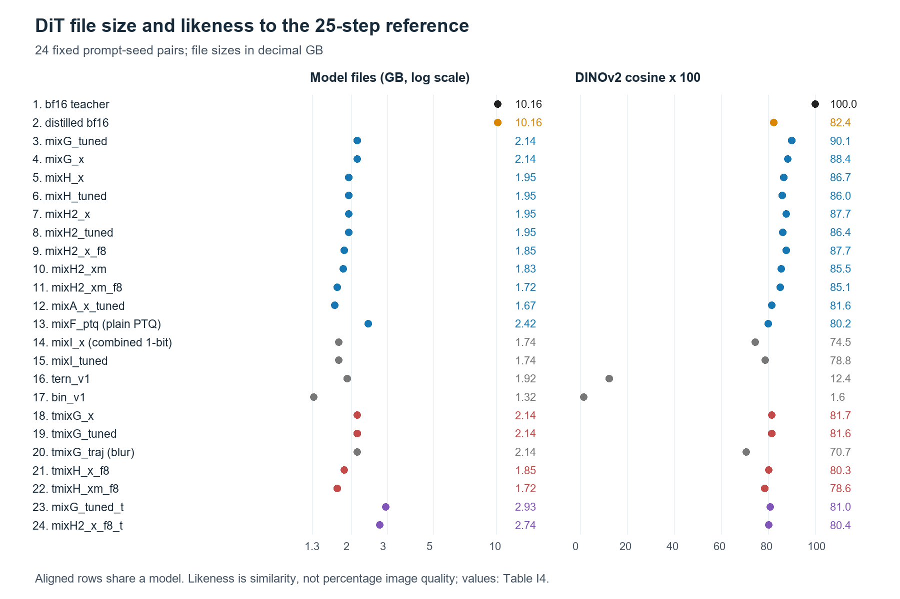

**Figure 32.** Every DiT version against the 25-step bf16 reference on a log file-size axis. Aligned rows show each model's file size (left) and likeness (right); the external Table I4 gives exact values. DINOv2 cosine x 100 measures similarity, not percentage image quality. No HPS quality percentages are used. *Source:* `RELEASE_CANDIDATES/charts/dit_likeness.csv`, drawn by `scripts/review_reporting.py`.


**Figure 33.** Local HPSv3-based mean differences from the 25-step teacher, with model file sizes in labels and exploratory 95% paired t intervals (24 prompt-seed pairs, df = 23; no multiplicity adjustment). All scored failures are shown. Scores have no calibrated ratio interpretation; intervals omit scorer parity and training uncertainty and do not establish equivalence. *Source:* `eval/hps3_*.json` via `scripts/review_reporting.py`; numeric means and differences in Table I4.

**Table I4. The values of the DiT charts (Figures 32 and 33).**

| # / model | family | file (GB) | DINOv2 cosine x 100 | local HPS mean | local HPS minus 25-step reference | eval tag |
|---|---|---|---|---|---|---|
| 1. bf16 teacher | bf16 teacher (25 steps) | 10.16 | 100.00 | 12.38 | +0.00 | teacher_bf16 |
| 2. distilled bf16 | distilled bf16 teacher (4 steps) | 10.16 | 82.38 | 11.93 | -0.46 | turbo4_1024 |
| 3. mixG_tuned | non-distilled, quantized | 2.14 | 90.07 | 12.14 | -0.24 | mixG_tuned |
| 4. mixG_x | non-distilled, quantized | 2.14 | 88.39 | 12.09 | -0.30 | mixG_x |
| 5. mixH_x | non-distilled, quantized | 1.95 | 86.71 | 11.88 | -0.50 | mixH_x |
| 6. mixH_tuned | non-distilled, quantized | 1.95 | 85.97 | 11.70 | -0.69 | mixH_tuned |
| 7. mixH2_x | non-distilled, quantized | 1.95 | 87.70 | 11.92 | -0.47 | mixH2_x |
| 8. mixH2_tuned | non-distilled, quantized | 1.95 | 86.36 | 11.90 | -0.49 | mixH2_tuned |
| 9. mixH2_x_f8 | non-distilled, quantized | 1.85 | 87.67 | 11.99 | -0.40 | mixH2_x_f8 |
| 10. mixH2_xm | non-distilled, quantized | 1.83 | 85.55 | 11.49 | -0.90 | mixH2_xm |
| 11. mixH2_xm_f8 | non-distilled, quantized | 1.72 | 85.13 | 11.44 | -0.94 | mixH2_xm_f8 |
| 12. mixA_x_tuned | non-distilled, quantized | 1.67 | 81.61 | 11.61 | -0.77 | mixA_x_tuned |
| 13. mixF_ptq (plain PTQ) | non-distilled, quantized | 2.42 | 80.15 | 10.86 | -1.53 | mixF_ptq |
| 14. mixI_x (combined 1-bit) | failed / not acceptable | 1.74 | 74.47 | 9.66 | -2.73 | mixI_x |
| 15. mixI_tuned | failed / not acceptable | 1.74 | 78.85 | 10.65 | -1.73 | mixI_tuned |
| 16. tern_v1 | failed / not acceptable | 1.92 | 12.45 | -8.96 | -21.35 | tern_v1 |
| 17. bin_v1 | failed / not acceptable | 1.32 | 1.65 | not scored | not scored | bin_v1 |
| 18. tmixG_x | distilled, quantized | 2.14 | 81.69 | 11.09 | -1.29 | tmixG_x_1024 |
| 19. tmixG_tuned | distilled, quantized | 2.14 | 81.60 | 10.65 | -1.73 | tmixG_tuned_1024 |
| 20. tmixG_traj (blur) | failed / not acceptable | 2.14 | 70.73 | 4.71 | -7.67 | tmixG_traj_1024 |
| 21. tmixH_x_f8 | distilled, quantized | 1.85 | 80.35 | 10.13 | -2.25 | tmixH_x_f8_1024 |
| 22. tmixH_xm_f8 | distilled, quantized | 1.72 | 78.56 | 9.81 | -2.57 | tmixH_xm_f8_1024 |
| 23. mixG_tuned_t | distilled, turbo factors folded (no retraining) | 2.93 | 80.98 | 12.05 | -0.33 | turboF_mixG_tuned |
| 24. mixH2_x_f8_t | distilled, turbo factors folded (no retraining) | 2.74 | 80.38 | 11.57 | -0.81 | turboF_mixH2_x_f8 |

*Source:* `RELEASE_CANDIDATES/charts/dit_likeness.csv`, with local preference means and paired differences recomputed from the stored per-prompt HPS JSON by `scripts/review_reporting.py`. DINOv2 values are retained from the previous measured CSV, not remeasured in this revision. The percentages previously shown here were score ratios, not quality percentages, and have been removed. bin_v1 was not scored.

**Table I5. The values of the encoder chart (Figure 29).**

| encoder | file (GB) | conditioning token cosine (x 100) | image DINOv2 against the bf16-encoder images (x 100) | HPSv3 with tmixG_x | eval tag |
|---|---|---|---|---|---|
| bf16 encoder (reference) | 19.31 | 100.00 | 100.00 | 11.09 | tmixG_x_1024 |
| Comfy int8 convrot | 9.75 | 99.96 | 99.24 | 10.95 | enc_int8_convrot |
| Comfy W4A8 GPTQ | 7.34 | 99.44 | 98.15 | 10.99 | enc_w4a8_gptq |
| Comfy GPTQ pruned (recommended) | 4.93 | 99.44 | 98.00 | 11.02 | enc_gptq_pruned |
| own int4 + int8 embedding | 4.60 | 93.94 | 92.83 | 11.09 | enc_i4e8 |
| own int4 | 5.61 | 93.94 | 93.20 | 11.03 | enc_i4 |
| own mlp-int3 | 5.01 | 84.32 | 88.80 | 10.64 | enc_m3 |
| own attn-int3 | 4.54 | 90.18 | 92.37 | 11.02 | enc_a3 |
| own lin-attn-int3 | 4.40 | 62.85 | 80.76 | 9.77 | enc_l3 |
| own all-int3 | 4.75 | 42.46 | 44.54 | 4.86 | enc_i3 |

*Source:* `RELEASE_CANDIDATES/charts/encoder_likeness.csv`; the token cosines are those of Table 37 (as percentages), the DINOv2 values those of Tables 30 and 31 and, for the pruned file, of `logs/metrics_enc_gptq_pruned.log`, the HPSv3 those of Tables 30, 31 and 39.

**Table I6. The values of the VAE chart (Figure 31).**

| decoder | file (GB) | DINOv2 against the full-VAE decode (x 100) | SSIM against the full-VAE decode (x 100) |
|---|---|---|---|
| FLUX.2 VAE (full) | 0.336 | 100.00 | 100.00 |
| small decoder + original encoder (official) | 0.25 | 99.58 | 94.79 |
| small decoder only (built) | 0.112 | 99.58 | 94.79 |
| reference: two runs of the SAME full-VAE pipeline | 0.336 | 99.82 | 97.38 |

*Source:* `RELEASE_CANDIDATES/charts/vae_likeness.csv`; the small-decoder rows are the 24-latent comparison of Table 41, the last row the pruned against the unpruned GPTQ run (identical latents, full VAE twice; Section 9.9).


**Table I7. Exact configurations behind the measured and proposed packages.**

| DiT | encoder | decoder | resolution / sampling | comparison reference | evaluation of this exact combination | total model files (GB) |
|---|---|---|---|---|---|---|
| tmixG_x | bf16 | full | 1024 / 4 steps, CFG 1, Euler | turbo4, bf16 encoder/full VAE | A 4.06; 18/24 accepted; local HPS 11.09 | 21.78 |
| mixG_tuned_t | bf16 | full | 1024 / 4 steps, CFG 1, Euler | turbo4, bf16 encoder/full VAE | A 4.27; 23/24 accepted; local HPS 12.05 | 22.58 |
| tmixG_x | pruned GPTQ | small built | 1024 / 4 steps, CFG 1, Euler | same latents decoded by full VAE | local HPS 11.06, image metrics, informal web test; no package judge pass | 7.18 |
| mixG_tuned_t | pruned GPTQ | small built | proposed: 1024 / 4 steps, CFG 1, Euler | planned: turbo4 with original components | unmeasured exact combination; no package judge pass | 7.97 |
| mixG_tuned | pruned GPTQ | full | 768 / 25 steps, CFG 2.5, er_sde | bf16 25-step teacher | A 4.12, 20/24 accepted; local HPS 12.16 | 7.40 |
| mixH2_x_f8 | pruned GPTQ | full | 768 / 25 steps, CFG 2.5, er_sde | bf16 25-step teacher | A 4.06, 19/24 accepted; local HPS 12.04 | 7.11 |
| mixG_tuned | pruned GPTQ | small built | proposed: 768 / 25 steps, CFG 2.5, er_sde | planned: bf16 25-step teacher | no judge result for this compact combination | 7.18 |
| mixH2_x_f8 | pruned GPTQ | small built | proposed: 768 / 25 steps, CFG 2.5, er_sde | planned: bf16 25-step teacher | no judge result for this compact combination | 6.89 |

*Source:* Component bytes of Table 42; original judge reports and HPS JSON identified in Tables 23, 41, 43 and 44. All sampling uses the simple scheduler. These are file totals, not peak RAM/VRAM. A score for a source DiT is not a score for a different encoder/decoder combination.

**Table I8. Recomputed exploratory paired local-HPS comparisons.**

| candidate minus reference | mean | paired SE | 95% paired t interval |
|---|---|---|---|
| mixH2_x_f8 minus mixH2_x | +0.072 | 0.055 | [-0.042, +0.186] |
| mixH2_xm_f8 minus mixH2_x_f8 | -0.546 | 0.172 | [-0.902, -0.191] |
| mixH2_x minus mixH_x | +0.037 | 0.148 | [-0.270, +0.343] |
| tmixG_x_1024 minus turbo4_1024 | -0.833 | 0.162 | [-1.169, -0.498] |
| turboF_mixG_tuned minus turbo4_1024 | +0.128 | 0.151 | [-0.185, +0.440] |
| nd_mixG_tuned_gptq minus mixG_tuned | +0.024 | 0.089 | [-0.160, +0.208] |
| nd_mixH2_x_f8_gptq minus mixH2_x_f8 | +0.046 | 0.096 | [-0.152, +0.244] |

*Source:* `paper/_build/review_pairs.json`, recomputed by `scripts/review_reporting.py` from stored per-prompt scores. N = 24 paired prompt-seed observations, df = 23; no multiplicity adjustment. These are not equivalence tests and omit training and scorer-implementation uncertainty.

**Table I9. Common-preprocessing edge-energy measurements on saved primary-resolution images.**

| configuration (bf16 encoder / full VAE) | native pixels | mean Laplacian RMS | edge-energy change vs reference | contrast change vs reference | reference |
|---|---|---|---|---|---|
| teacher_bf16 | 768 | 0.10300 | +0.0% | +0.0% | teacher_bf16 |
| turbo4_1024 | 1024 | 0.06183 | -40.0% | -6.9% | teacher_bf16 |
| tmixG_x_1024 | 1024 | 0.04864 | -21.3% | -7.9% | turbo4_1024 |
| tmixG_tuned_1024 | 1024 | 0.05570 | -9.9% | -9.2% | turbo4_1024 |
| tmixH_x_f8_1024 | 1024 | 0.04332 | -29.9% | -8.8% | turbo4_1024 |
| turboF_mixG_tuned | 1024 | 0.06164 | -0.3% | +7.9% | turbo4_1024 |

*Source:* `paper/_build/review_detail_stats.json`, measured from 144 saved PNGs by `scripts/review_reporting.py`: Pillow LANCZOS resize to 768 x 768; RGB in [0,1]; Rec.709 luma; population luma SD for contrast; RMS of the four-neighbour Laplacian over interior pixels. Means cover 24 images per configuration. Different native resolutions are stated explicitly. Edge energy responds to edges, contrast, texture and noise; it is not a percentage of retained meaningful detail.

**Honest limits** (README). The quality numbers come from 24 prompts with one seed each; HPSv3 each score contrast requires its own uncertainty estimate; judge spread is informal, and the judge is a Claude model instance, not a human panel; the judge rows of the distilled models and of the encoder swaps come from separate instances. tmixG_x has 18 of 24 images at A of 4 or more, below the 20 of 24 post hoc bar of the non-distilled models: borderline. mixH2_x_f8 with the pruned encoder is one image short of that bar (19 of 24). Text rendering is the first thing to degrade (small text); large titles survive. The turbo LoRA is merged in bf16 by round-to-nearest, which keeps only part of its intended delta (Section 8.2). LoRAs cannot be applied on top of the low-bit DiTs at run time (the loader refuses). The licences of the turbo LoRA and of the FLUX.2 small decoder are Apache-2.0; the licences of MOSS-Image-SFT and Qwen3.5-9B have to be checked before redistribution.

**Not yet done** (README, updated). The web-interface run of the small pick exists only as the owner's verbal report (no log); a logged run with the proposed quality package and the 25-step models does not. A judge pass for mixG_tuned_t and the 25-step models with the pruned encoder and the small decoder in the package (the judged images used the bf16 encoder or the full VAE as stated above), for the pruned encoder with the distilled DiT, and for the small decoder; a blind artifact count on the pruned file's own images and on mixG_tuned_t.
